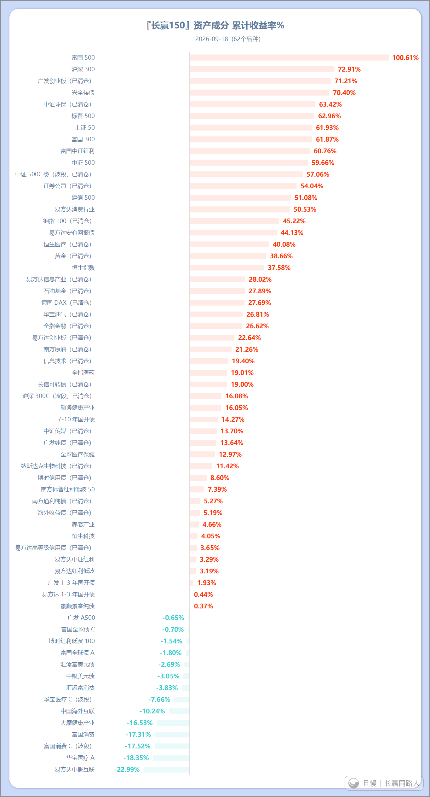

A股最值得投资指数名单11年后更新
说几句A股的指数。

首先做几个定性。

第一，即使是A股这样在全世界范围内都非常有特色的市场，宽基也能挣钱，超长期（5年以上）看也是向上的。

一个很好的例子就是我们的长赢计划。所有的宽基都能取得很不错的成绩。即使2021年没有高位卖掉太多，即使大部分时间都处在“痛苦”中。但现在看，至少都能取得几十甚至上百点的回报。

也就是说，并不需要完美的操作，A股宽基也能取得盈利。

各位，千万不要看不起十年几十个点上百点的收益。如果你知道这个市场上绝大多数人到底是一个什么样的收益情况，我坚信你绝对不会看不起这样的收益。宽基是靠谱的，即使在A股。

第二，与VOO或者QQQ甚至哪怕VXUS或者VT的最大不同，除了长期收益低很多以外，其特点在于下跌与盘整的时间特别长。

过去几十年，美股乃至全球宽基除了2000年纳斯达克那次需要十几年才能涨回，绝大多数时间各指数哪怕是大崩盘，3-5年时间也能新高了。但是我们的宽基，动不动5-10年无法涨回。比如中证500，十一年依然没有回到2015年的高位。中证1000就更不必说。也就意味着，大多数股票根本永远也回不去了。同理，最近这波科技股，也有很大一批股票永远永远无法涨回高位，这是必然的。

所以，这就导致了投资者持仓体验很差，非常痛苦。哪怕是低位买入依然痛苦。因为即使你低位买，只要高位没卖，很可能很久无法取得好的收益。只有低位买入，高位卖出，才能有好的体验。问题是，低位买入已经很难，高位卖出就是神一样的交易。试问，有几个人能长期做到？

所以A股是绝大多数人的修罗场。不仅是账户，还是心灵。

第三，值得交易的品种。

11年前我在雪球写过A股值得买的六个品种。分别是：

上证50、中证500、创业板、医药、消费、信息。

这十年来，每个品种都有过高光时刻，每个品种也沉沦过。

2026年，如果让我更新这个名单，那么将是这样：

大仓位：

红利、A500、创业板。

小仓位：

医药、消费、信息。

两版的不同，是加入了红利，随之相应降低行业比重。同时，上证50与中证500合并为A500，整个名单更加简洁。

但是无论如何，各位一定要记住：

这是一个全球看都非常有特色的市场。其特色根深蒂固，几乎看不到改变的希望。而我们投资其它市场的渠道又非常狭窄，甚至日渐收缩。鉴于这样的现实，投资A股几乎是必须要做的。

而投资这里最重要两个点：

第一，千万别买高。

第二，高了一定要跑。哪怕不全跑，也要跑一部分。就像3月超级大机构一样的跑。因为很多投资者真的是疯的。他们真的会周期性的把热门板块拉到100倍。

基本就是这样。