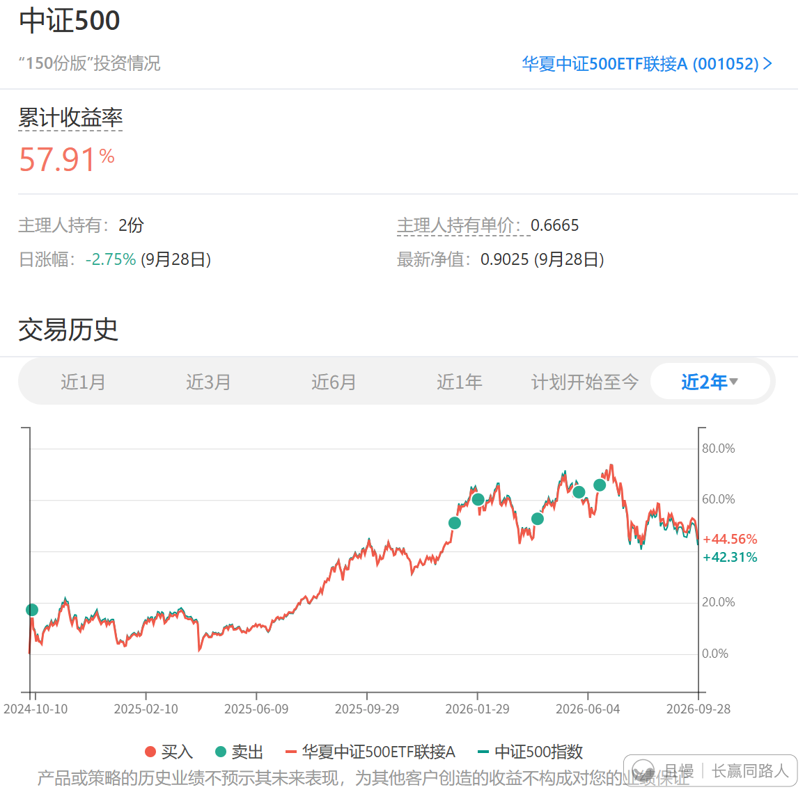
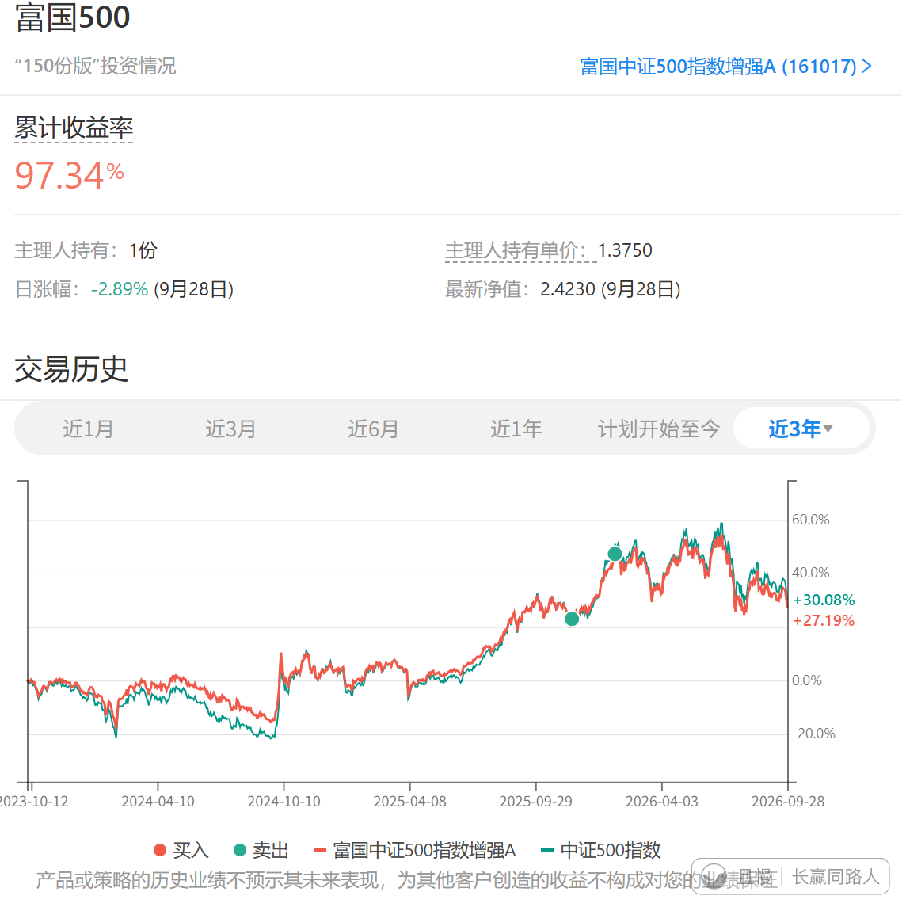
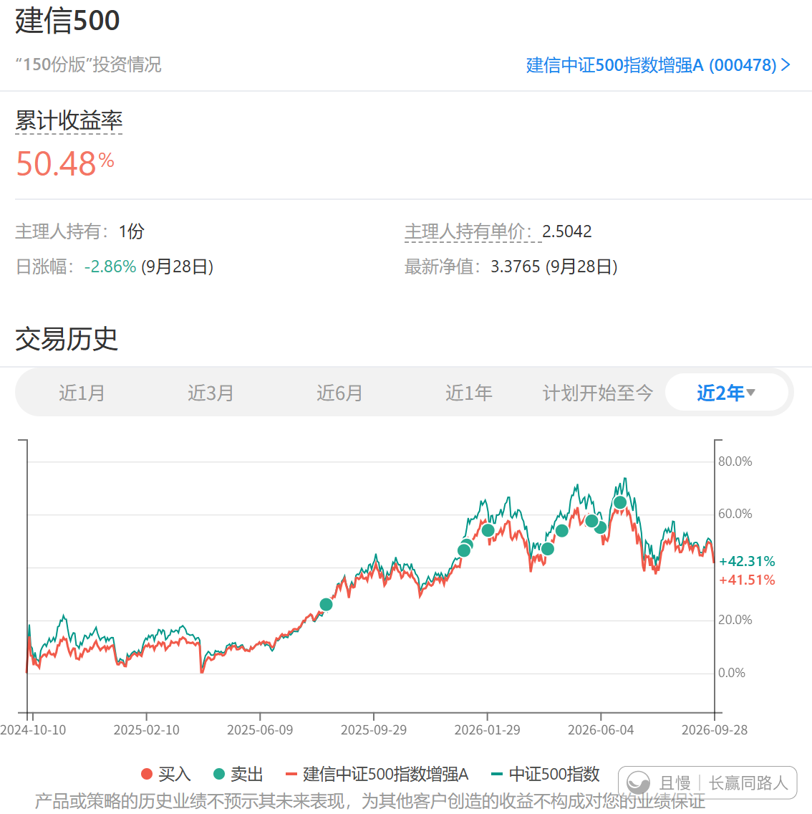

7月底一次，9月底一次，两次补入A500的主要原因，是高位卖掉的中证500实在是太多了。整个150就剩4份中证500了，最多的时候，持仓20多份。

无论玩哪个市场，宽基一定不能太少。这是保底的仓位，一定要有一部分。

卖掉那么多，只买回两份，还早呢，慢慢买吧。

这一波在上面减持、清仓了很多品种，仓位腾出来了，真的非常舒服。未来如果下跌，会比前几年更游刃有余。

只能说感谢上帝的救生艇了。

