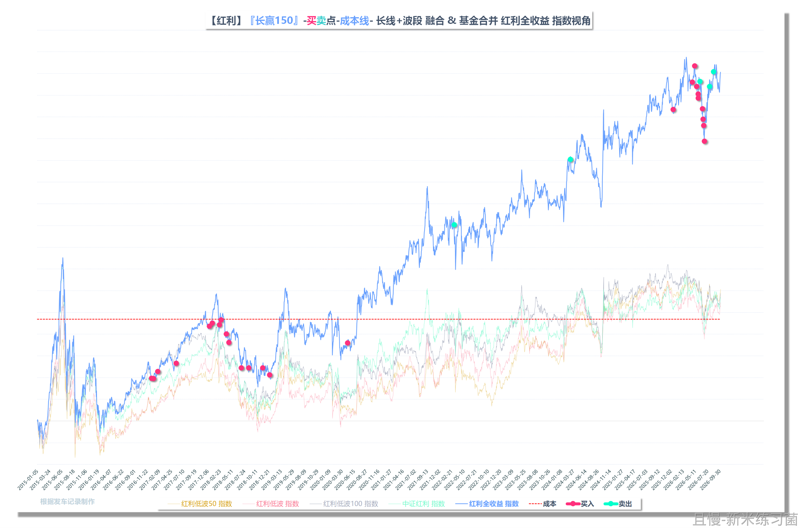
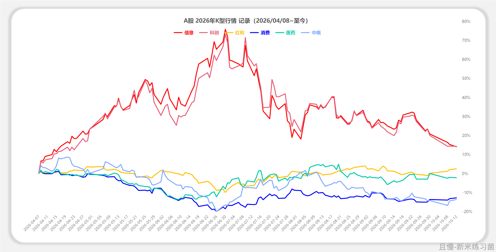
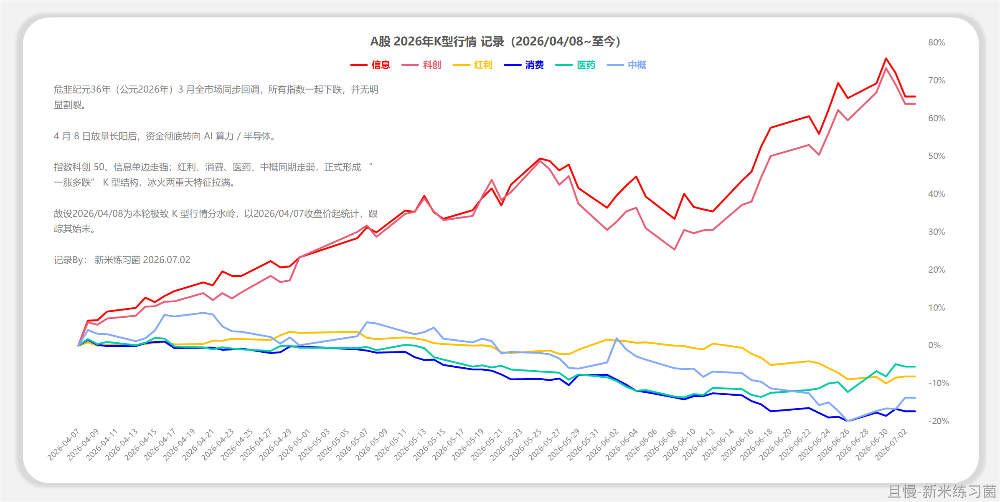
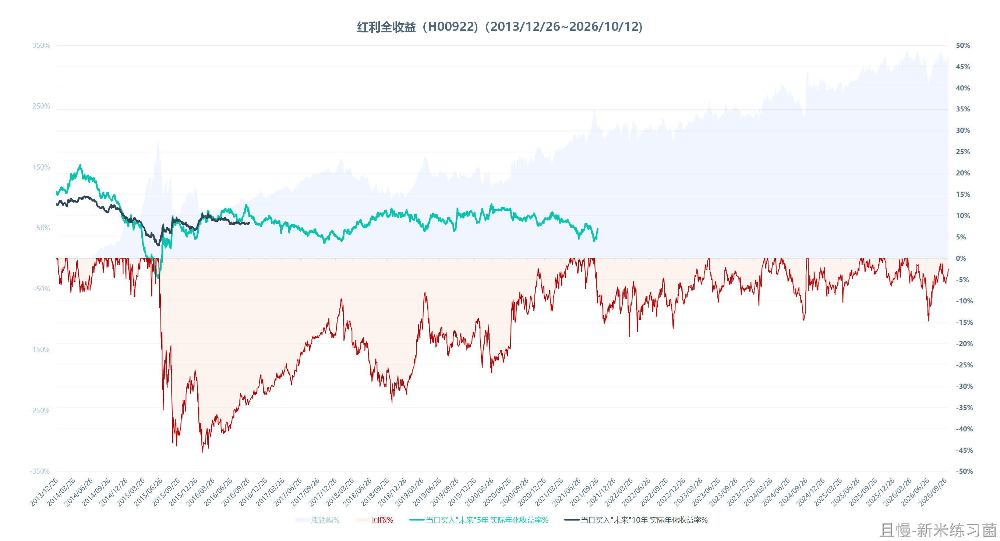
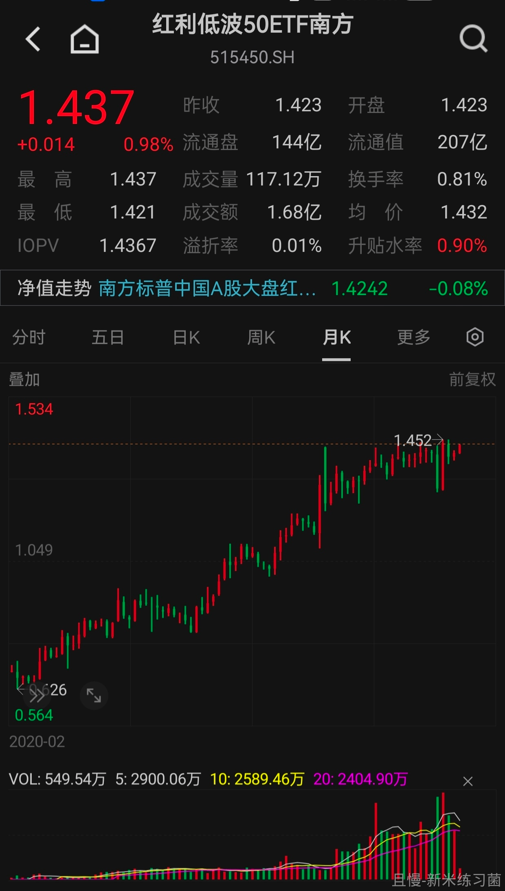

上半年红利表现相对于科技甚至大盘来说都很不好。但我持续的与各位分享：长期来看，红利股票和基金是最适合投资A股的普通人的。

在它们表现最不好的6月，我顶住巨大压力持续买入四支红利基金。那个月，红利在暴跌，科技在暴涨。

现在，时过境迁。有红利基金又要历史新高了。科技套住了几千亿元股民的资金。

我再说一次，我觉得红利适合普通人，不是因为组成红利基金的股票有多么伟大。

而是因为它们在这个充斥着炒作、概念、骗子的市场上，能够真金白银的给你分钱。就凭这一点，它们已经是长期最优解了。

给你发钱的未必是好股票，但它大概率不是最坏的。

只想从你身上拿钱的不一定是坏股票，但请多一分警惕。

红魔披头士
2095天
我原本以为像中概这样估值低、跌幅大、愿意回购注销的会是最优解，但现实总会给我一记又一记的耳光。

Lingo
一年前的这个时候是中概上涨的最高点，那个时候之前深度套牢的我整体基本解套了，波段也卖了点，结果还是格局了一把(本质还是贪婪了，不想刚解套就大幅减仓，毕竟熬了好几年了)，留住了绝大部分仓位。一年后再看，重新回到深度套牢的状态。还是没法轻易乐观啊，几乎所有涨起来没多卖点的，终归还是被教育了。

红魔披头士

Lingo
中概是我操作过的最难的品种，没有之一。
持有五年，高位没接过盘，低位大量买，严格遵守时间空间规律，网格交易也被运用的淋漓尽致，然而还是没什么卵用，目前还是浮亏。不过我还是会继续坚守，因为我对长期的发展还是抱有幻想。

红魔披头士
有些品种想做到低买高卖并不难，因为从估值上已经能判断风险了，像500/1000/创业/科创这样的宽基，又或者信息/传媒这样的行业。
但是有些品种，像我持有的中概医疗这些，最近几年的体验来看，简直比登天还难，你认为合理的价格往往也会有极其夸张的大涨大落。

新米练习菌
1609天
E大早上好
更新一下红利们的情况

新米练习菌
再更新一下“科技大年”——K线行情
【图1】现在，今天。（不知道什么时候会“咬”上）
【图2】年中，最“K”的时候

新米练习菌
.

