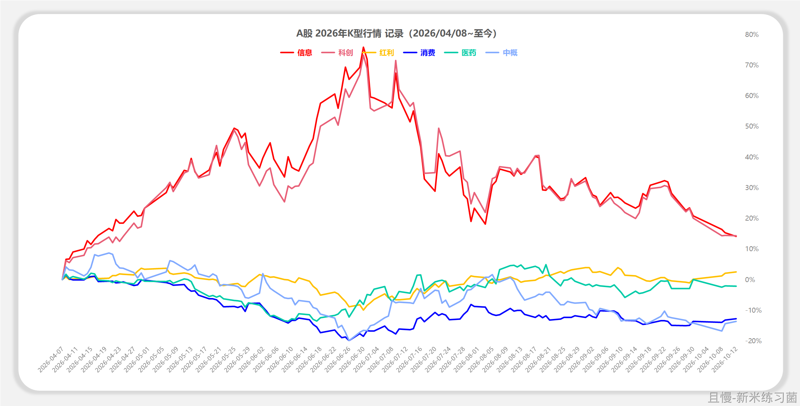
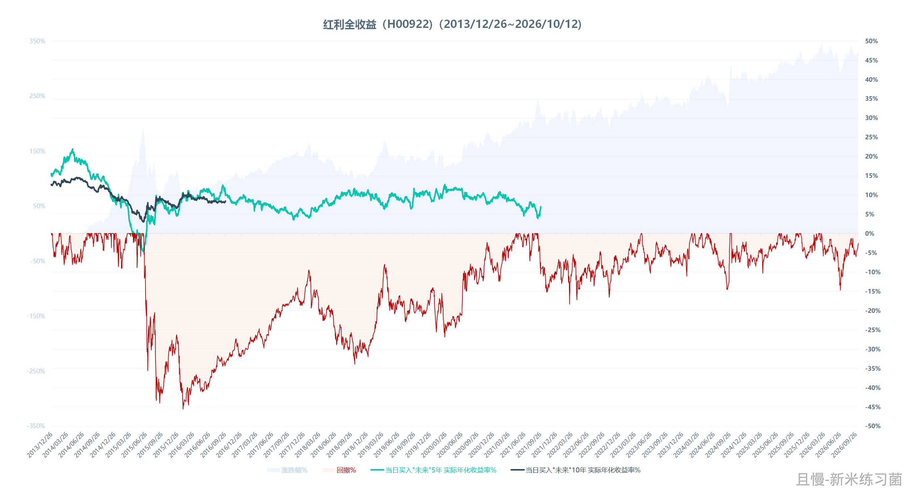
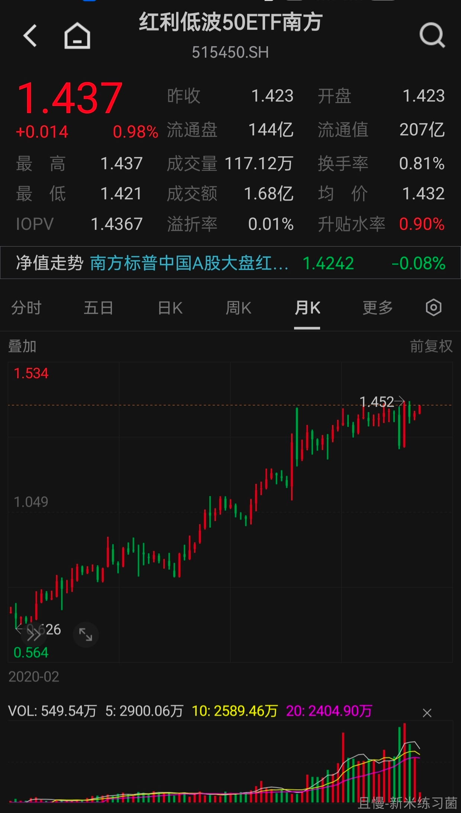
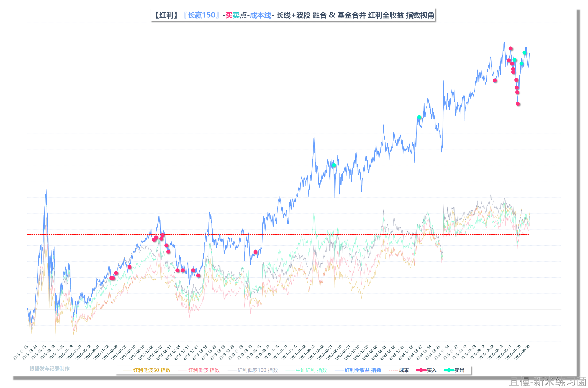
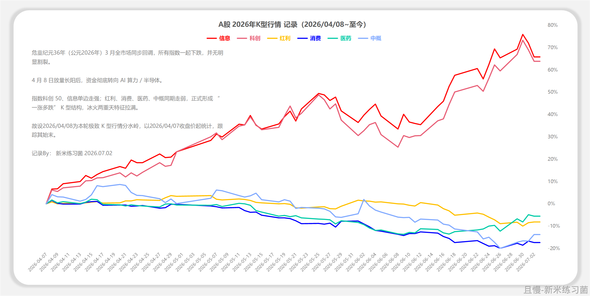
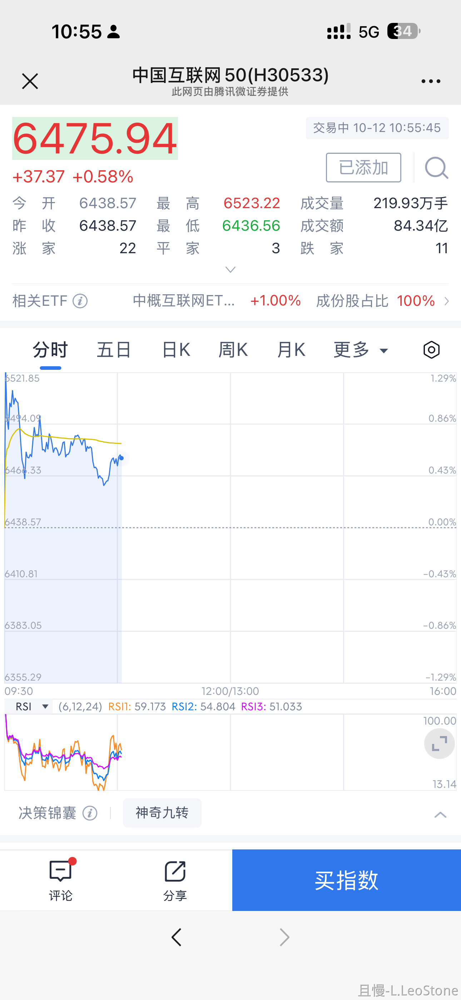

上半年红利表现相对于科技甚至大盘来说都很不好。但我持续的与各位分享：长期来看，红利股票和基金是最适合投资A股的普通人的。

在它们表现最不好的6月，我顶住巨大压力持续买入四支红利基金。那个月，红利在暴跌，科技在暴涨。

现在，时过境迁。有红利基金又要历史新高了。科技套住了几千亿元股民的资金。

我再说一次，我觉得红利适合普通人，不是因为组成红利基金的股票有多么伟大。

而是因为它们在这个充斥着炒作、概念、骗子的市场上，能够真金白银的给你分钱。就凭这一点，它们已经是长期最优解了。

给你发钱的未必是好股票，但它大概率不是最坏的。

只想从你身上拿钱的不一定是坏股票，但请多一分警惕。

红魔披头士
2095天
我原本以为像中概这样估值低、跌幅大、愿意回购注销的会是最优解，但现实总会给我一记又一记的耳光。

Lingo
一年前的这个时候是中概上涨的最高点，那个时候之前深度套牢的我整体基本解套了，波段也卖了点，结果还是格局了一把(本质还是贪婪了，不想刚解套就大幅减仓，毕竟熬了好几年了)，留住了绝大部分仓位。一年后再看，重新回到深度套牢的状态。还是没法轻易乐观啊，几乎所有涨起来没多卖点的，终归还是被教育了。

红魔披头士

Lingo
中概是我操作过的最难的品种，没有之一。
持有五年，高位没接过盘，低位大量买，严格遵守时间空间规律，网格交易也被运用的淋漓尽致，然而还是没什么卵用，目前还是浮亏。不过我还是会继续坚守，因为我对长期的发展还是抱有幻想。

红魔披头士
有些品种想做到低买高卖并不难，因为从估值上已经能判断风险了，像500/1000/创业/科创这样的宽基，又或者信息/传媒这样的行业。
但是有些品种，像我持有的中概医疗这些，最近几年的体验来看，简直比登天还难，你认为合理的价格往往也会有极其夸张的大涨大落。

新米练习菌
1609天
E大早上好
更新一下红利们的情况

新米练习菌
再更新一下“科技大年”——K线行情
【图1】现在，今天。（不知道什么时候会“咬”上）
【图2】年中，最“K”的时候

新米练习菌
.

<!-- qieman-comments:start -->

---

# 上半年红利表现相 · 评论区（2026-10-12）

> 评论区归档：2026-11-06 抓取于且慢社区，原帖共 237 条互动，精选 91 条（作者发言、作者回复及其他投资相关评论）。

## 闲适（辽宁省） · 0 赞

前几个月坚定相信e大。加了这么多红利真是正确

## 同路人_VoFdHL（广东省） · 0 赞

慢慢熬，靠着网格混日子😎

## 红魔披头士（山西省） · 114 赞

我原本以为像中概这样估值低、跌幅大、愿意回购注销的会是最优解，但现实总会给我一记又一记的耳光。

> **红魔披头士（山西省）** · 48 赞：有些品种想做到低买高卖并不难，因为从估值上已经能判断风险了，像500/1000/创业/科创这样的宽基，又或者信息/传媒这样的行业。

但是有些品种，像我持有的中概医疗这些，最近几年的体验来看，简直比登天还难，你认为合理的价格往往也会有极其夸张的大涨大落。

> **晓风残月Witnesses（广西壮族自治区）** · 4 赞：中概一蹶不振好久了，下一个风口是什么时候

> **Lingo（山东省）** · 89 赞：一年前的这个时候是中概上涨的最高点，那个时候之前深度套牢的我整体基本解套了，波段也卖了点，结果还是格局了一把(本质还是贪婪了，不想刚解套就大幅减仓，毕竟熬了好几年了)，留住了绝大部分仓位。一年后再看，重新回到深度套牢的状态。还是没法轻易乐观啊，几乎所有涨起来没多卖点的，终归还是被教育了。

> **胡萝卜星（上海市）**（回复 Lingo） · 1 赞：但是没人可以预测未来，我也和你差不多的情况。我当时没买是因为买中概是看好 ai 应用，ai 硬件涨疯了，ai 应用却跌惨了，实在想不通…

> **三戒（广东省）** · 3 赞：港股市场基本废了，已经慢慢A股化了重融资轻回报股东，并且我们买的恒生科技指数成份股这个月开始有大变化，己经不是以前的东西来了，我都已经考虑卖出全部港股类资产，全部买入红利类ETF长线投资低频交易复利增值，少添烦忧，多享受人生！

> **啊啊阿毛（辽宁省）**（回复 红魔披头士） · 1 赞：传媒一直在做波段，低买高卖效果不错。中概在坚持不懈的波段中，赚钱，没舍得卖，后又不断回落，趁着还有一点利润就清仓了。而前段时间，以为比较低了，又买了一点，😂，这点回本后，不想再碰了

> **80计划（陕西省）** · 1 赞：好奇，你们的中概是亏损几个点？我上车的晚了点

> **cc1（江苏省）** · 5 赞：我在想，我们是不是最后一批还在坚持中概的兄弟，会不会我们放弃的时候它突然起来了，这情况我自己在不同行业etf上体验过几把了😭

> **红魔披头士（山西省）**（回复 Lingo） · 63 赞：中概是我操作过的最难的品种，没有之一。

持有五年，高位没接过盘，低位大量买，严格遵守时间空间规律，网格交易也被运用的淋漓尽致，然而还是没什么卵用，目前还是浮亏。不过我还是会继续坚守，因为我对长期的发展还是抱有幻想。

> **红魔披头士（山西省）**（回复 啊啊阿毛） · 7 赞：传媒虽然是初代莫再提品种，但是远不如中概医疗这些惨烈，期间也经历过数次大起大落，至少每次网格都吃的饱饱的，长线也全身而退了。
传媒和信息虽然都跌至过谷底，但是一旦上了高峰确实会有开张吃三年的效果。

> **纳风儿正红（北京市）** · 4 赞：地狱级别难度的市场，最核心的还是回报不够，估值低并不必然估值修复，中概这几个赚了FCF又有什么用，像阿里还不是宁愿把钱扔出去投外卖也不分红，所以我觉得，地狱级别的市场，就看DDM，其他不要信

> **DemonsL4（四川省）** · 6 赞：中概/恒科结结实实的做了波过山车，自己几十个点的盈利全部回吐了。🤡

> **九月梅（湖北省）**（回复 Lingo） · 5 赞：跟你一模一样的情况，当时解套了，想着不能刚解套就卖吧，以为也许刚刚启动，格局打开。结果…唉

> **中国童童（辽宁省）**（回复 红魔披头士） · 5 赞：中概医疗消费真是让人怀疑人生。等把钱还我，并给我带来平均5个点的年化，我就不玩儿了。以后老老实实的红利和A500。

> **钻石不锈（北京市）**（回复 红魔披头士） · 10 赞：我觉得还是持仓成本不够低。我自己基本是不到持仓成本不卖，只低位补。中概还是持仓成本相对高，导致去年涨起来时卖得不多。恒科就从容很多，持仓成本不算高，不断低买，高位时就舍得卖，然后持仓成本越来越低，跌下来也不怕。

## 躺在沙滩睡大觉（北京市） · 0 赞

确实如此 ，现实一点来讲，红利可以给我们看得见摸得着的收益，当然别买贵了。。。

## 托斯卡纳酒桶（陕西省） · 1 赞

老大，我想问下消费拉开时间，未来ETF计划还有买入的打算吗。🫡

## 向天一笑（河南省） · 11 赞

可惜空间太短了，没吃饱，期待下次发车的机会。期待月月分红的种类，用作补充现金流的生活小确幸。

> **学习ETF投资（江苏省）** · 4 赞：每个季度分红就能接受。

> **王永飞（北京市）**（回复 学习ETF投资） · 4 赞：季度分红也可以，有几个月度分红的红利管理费在0.6%，季度分红的能到0.2%

## 知行合E（河北省） · 0 赞

我们真金白银投入股市的钱是用来干什么的？不是来做慈善的，是来分钱的

## 感恩遇见E大（安徽省） · 23 赞

深有体会，当时身边同事经常讨论科技股赚了多少多少！问我买的什么，我说大部分都是医药、消费、红利，他当时就说我买的这些最近几年不会好的，我笑笑不说话。当时管住手没买科技是对的！

> **先到300万（陕西省）** · 7 赞：但是人家确实赚了不少啊，科技都翻倍了

## 星辰I（山东省） · 0 赞

哎  大部分已经深套科技出不来了😭😭

## Duringg（广东省） · 0 赞

那么其实是不是单独把红利前排的个股买了就好了，毕竟etf是个大集合，很多滥竽充数的在里面

## Dennie（新加坡） · 0 赞

当时看到老大说自己的红利八位数了 我就不慌了 坚定投

## 新米练习菌（上海市） · 72 赞

E大早上好
更新一下红利们的情况

> **新米练习菌（上海市）** · 49 赞：再更新一下“科技大年”——K线行情
【图1】现在，今天。（不知道什么时候会“咬”上）
【图2】年中，最“K”的时候

> **三戒（广东省）**（回复 新米练习菌） · 0 赞：感觉只有红利和医药才会有机会咬上

## Jamie胡椒（广东省） · 0 赞

啥时候能买创业板？比较期待。

## 小K的窝窝（重庆市） · 0 赞

深有体会，有机会还买红利😊

## 长盈陪伴（广东省） · 0 赞

之前很多舆论嘲笑老登股，瞧不起这些只靠分红吸引投资者，没有想象力的行业和公司，经过这么多轮牛熊，可以说只有分红才是投资者真正能获得的利润，不立足于分红再投资，只把希望寄托在股票站在风口上，靠估值提升来获利的只有无所不知的先知，作为一个小卡拉米，我以后的投资只看分红

## 山头斜照（北京市） · 1 赞

红利已经是我的第一大持仓

## 虚拟身影（北京市） · 0 赞

今年红利类基金还可能搞分红再投吗？

## 兔rabbit（山西省） · 0 赞

一直在坚定的跟车，对E大从不犹疑。拿着红利还是挺舒服的。希望市场给机会让E大还能带着买些红利

## 雪小梨（湖北省） · 0 赞

之前那一轮来晚了，红利没来得及上车。现在虽然策略上先卖后买有点卡住了但是对我而言是圆满了。趁着这个机会库库上车，也没有先卖后买的难度😁

## peacedong（河北省） · 1 赞

前段时间突然发现有次余额不够漏买了一份，一直等回撤，结果涨上去了

## 亿贯（北京市） · 0 赞

红利特别适合回撤买入，仓位不够的可以试试

## qiosan（四川省） · 0 赞

红利那么多款，E大会从那几个维度选择产品呢？

## 撒起拖板儿hai（广东省） · 0 赞

虽然但是 我需要插个题外话（能说话的机会稍纵即逝） 益达之前教的850均线真的太好用了 感谢益达😇😇😇

## 丰行（山东省） · 0 赞

跟着E大稳稳的幸福很关键，科技，赚的时候嗨，多数人跑不了是个问题。

## 锦鲤小迷妹（广东省） · 0 赞

感恩遇见，攒钱买红利。目前红利仓位不够

## 小阳春（湖南省） · 1 赞

现在周边有不少朋友推荐说无脑场内买入纳指 ETF 和标普 ETF，我也动心了。

## solen（广东省） · 0 赞

当越来越多人意识到红利的好，会不会也发生像科技那样抱团的场景，期待那一天的到来～

## Lingo（山东省） · 12 赞

我从 10 年几前开始进入市场的时候，就是抱定了一个不断买入、长期持有的想法，我内心深处一直觉着，股市会长期上涨，只要拿的时间足够长，不折腾就能挣钱。结果我大错特错，一直到现在来看，也许只有买红利才能契合我一直以来的想法。奈何之前折腾的都不是红利这种长期看上涨的，一路以来犯了各种各样的错误，但凡买的不够便宜的，哪怕超长期持有，也未必会有收益，甚至一直亏损，永远也涨不回来了。甚至所谓买的便宜的，抱定一个长期持有，那也真的要比预期中的要长很多，才可能见到收益。难度太大了，还是红利好，希望以后还能出现好的买入的机会。

> **前院（浙江省）** · 5 赞：理念是一样的，坚信股市是长期上涨的。这两年一直也在思考的问题是有没有可能长期上涨的基础在哪里，有没有可能我们看的书都是说的正常的市场。时间过得好快，已到中年，人生几十年，我们会不会是牺牲的一代。历史的进程中，愿不愿做历史的炮灰还是必须做。这些年的体验真是活久见，个体在历史长河中太渺小了

> **Aaron6（河南省）** · 1 赞：新股民都会有这种想法😂，只要不退市必创新高，只是时间问题，所以选股只选国资控的，这一波牛被死套，等待时间验证…

> **纤云（河南省）** · 3 赞：理念是对的，但用在这个市场上就错了，当时如能买美股基金，或许就对上了。

## 陈维岳（山东省） · 0 赞

我自己多买了很多红利 嘿嘿

## 嗖嗖漫步（福建省） · 0 赞

上一个帖子说，红利技术方面不支持追涨，有没有哪位课代表说一下，e大以前说的用那些技术指标来判断的？

## E路同行-且行且珍惜（广东省） · 0 赞

中概再跌20%，是不是可以整点

## 皮皮波（上海市） · 0 赞

大A市场，红利是普通人的最优解

## 柳树在路上（广东省） · 1 赞

喜欢每个月都分红的基金～

## 乌拉不吃鱼（山西省） · 0 赞

感谢这波红利给的机会让我上车，自己的实践仓也补上了一部分，库库买

## WillinMao（湖北省） · 0 赞

分散配置，你能有情绪，埋人的科技也要有，它埋人咋了，不能挣钱吗

## Joy_mm2020（四川省） · 0 赞

科技疯狂的时候，同事都在讨论对应的股票，劝我买点，说他们老板说了年底要涨到多少多少，用“零花钱”买点赚点零花钱，我笑笑不语

## PUI飘飘（上海市） · 0 赞

支持，希望红利可以补到占A股比例的50%以上

## 瓶子啊（广东省） · 0 赞

会有机会的，一波下跌再买点

## L.LeoStone（安徽省） · 0 赞

中概互联现在位置不高，能不能买？

> **牛玲和狗尿苔（浙江省）** · 0 赞：没有强大的心理承受能力，不要买一分中概(✋ˇ-ˇ)

## 勇懿毅YYY（上海市） · 1 赞

在科技股猛涨的时候能拿住红利的也凤毛麟角，希望红利也能继续加大波段操作力度

## 久利众争（广西壮族自治区） · 0 赞

个人感觉中概最大的问题是最强那一个没收入指数，这家公司要说风口能力碾压指数里现有这几个内卷王。

## 战火小阿蛮（北京市） · 0 赞

攒钱攒钱！红利下回猛猛买。现在不着急，坐等EE指令。

## 同路人_Jane（浙江省） · 0 赞

在这个炒作的市场，能真金白银分钱的，确实长期最优解了！
爱红利！

## 破茧成蝶的毛毛虫（天津市） · 0 赞

因为你认识了红利
喜欢这种默默分钱的基金

## HJKL（广东省） · 0 赞

等红利继续买入，还留了四份资金

## 三戒（广东省） · 0 赞

红利类资产都要有做大波段高抛低吸才能有比较好的年化收益率，因为狗狗队也是这样做的😂😂😂

## 从容理财（北京市） · 2 赞

这世上任何事情，没有“永远”。只有阶段，只有周期。

## 扶木之桑（福建省） · 0 赞

感恩！红利在我看来类似美股了，不用太操心稳稳放着也是红的票，给人心情非常好～

## 田老师（湖南省） · 4 赞

e大，恒科还能逢低买入吗，目前成分股已经变了

## 北京小小夏（北京市） · 0 赞

E大说的对，这个市场也就分红的红利还可以

## 李素芬（河南省） · 0 赞

严重同意老大对红利指数的观点

## 且慢叫我输昵称（上海市） · 0 赞

红利一致，告诉我们有收钱的权利，另外几个一直在告诉我们要供养

## 葡萄矿泉水（广东省） · 0 赞

科技股跟我已无关，老老实实跟车，心安

## 万利（广东省） · 0 赞

老大，传媒你发车，我钱没到位，没能跟车，第二天钱到赶紧买了场内ETF，两天6个点，感恩有你

## 同路人_eu7uIJ（上海市） · 0 赞

E大，请问自由现金流ETF算是红利的一种么？这个能长期持有按照红利对待么？前期大幅度回调了15%，现在适合买入吗？

## 学无止境-1（广东省） · 0 赞

你说的非常在理，谢谢E大。多买点红利。🥰🥰

## 落絮若雪（江苏省） · 0 赞

手上现金比较多，可以买些什么债吗？银行太低了

## 李哈哈哈（广东省） · 1 赞

在这里，我学会了：分仓持有相关性低品种，低买高卖，加仓看时间、空间，等待是常态等。理论学到了，实践也要做到。

## 黑暗骑士robot（北京市） · 0 赞

长期来看，红利股票和基金是最适合投资A股的普通人的。--感谢e大

## 闷声发财（辽宁省） · 0 赞

手里的红利离理想仓位差得还有点远，不知道接下来还会不会有机会

## Licht（北京市） · 0 赞

持续上涨，回调可控的标的太少了。十分认可，已经买了不少，但感觉还不够多，有机会再多买，这个是真拿的住。

## 北风其凉（山东省） · 6 赞

请教e大是否可以聊聊恒科扩容的事，是否影响恒科整个估值体系，有没有更换标的的必要？

## 李素芬（河南省） · 0 赞

可转债基金历史收益也不错

## ETF左右（浙江省） · 0 赞

应该还会有机会继续买入吧😉

## Noah000001（广东省） · 8 赞

E大是否可以讲讲消费，之前说过消费是比较值得买的指数之一，消费指数的点位也跌破了之前讲的最大支撑，但150的消费仓位却很少，有点不解，希望E大或社区里的大神给解解惑

## 耐心等待的点点酱（浙江省） · 4 赞

前两年e说消费12000点买，未来是有机会赚大钱的，现在还作数吗😳

## 南风知我毅（北京市） · 19 赞

E大，能聊一下现在我们已经买了的美债吗

<!-- qieman-comments:end -->
