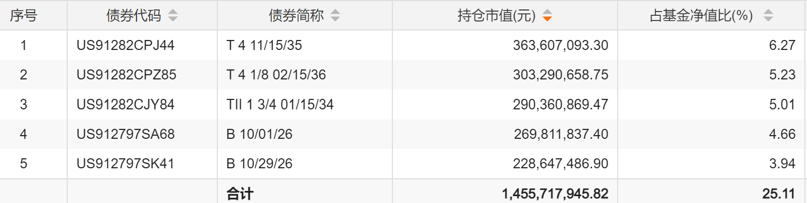
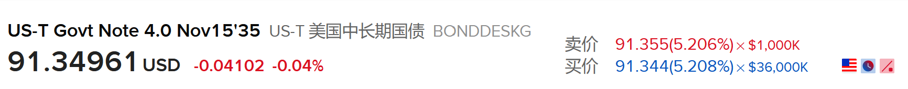

如何根据美元债券基金的持仓列表观察它持有了什么。

先看这张富国美元债的前五大持仓。

  
  
先说整体，只看前五大持仓，我个人非常喜欢。我有个朋友的美债配置思路跟这支基金差不多。

第一个和第二个是一类债券。  
  
“T”  
  
这里的T是Treasury Note。是美国中期国债。它是固定票息，到期偿还本金。  
  
T后面的4，代表票面利率是4%。注意，这里是票面利率。不代表富国美债持有的收益率也是4%。  
  
举例来说，你昨天申购的资金，它现在去市场上买，买到的到期收益率就是5%以上。  
  
我查了一下，图一的第一支美债，昨天买入，到期收益率是5.2%（图二）。

因为它的价格比发行时候低。这个不明白的朋友以后再补课吧。

4后面的11/15/35。是这支债券的到期日期。也就是2035年11月15日到期。是一支久期9年的中期债券。同理，第二支02/15/36，是一支2036年到期，久期10年的中期债券。  
  
对了，第二支的4 1/8，实际上是4.125%的意思。

第三个TII。  
  
这个TII是非常有意思的一个品种。叫做美国通胀保值国债（Treasury Inflation-Indexed），也就是 TIPS，本金随美国通胀指数调整。也有人叫它美国通胀贴补债券（有音译+意译的意思）  
  
这种债券非常有意思，跟各位以前理解的普通债券是不同的：普通国债的本金是固定的，而TIPS的本金会根据美国通货膨胀水平不断调整。  
  
首先看字面。  
  
TII，是通胀保值国债。1 3/4，这支债券票面利率1.75%。到期日2034年1月15日。  
  
它的特点到底是什么？  
  
是它未来归还的本金不确定。会根据美国通胀水平不断调整。  
  
举例来说，买入时本金10000元。第一年美国通胀4%，你的本金就变成了——10400。到期还本的时候，大漂亮政府会还给你的本金就多了400。第二年通胀是5%，那么第二年的累计通胀就变成了1.092。你的本金就变成了：10920。  
  
除此之外，还有1.75%的利息。  
  
这种债券是一种对通胀的保护。哪怕通胀到了20%，你的本金就会增加20%。某些时候这是非常非常好的一个品种。也是大卫斯文森推荐配置的一个品种。

第四和第五，B，是短期美国国库券（Treasury Bill）。  
  
第四支到期日是2026年10月1日。因为这是半年报数据，所以已经到期了。大概率是持有到期拿回本息。  
  
所以我们来综合看一下，只说前五支持仓债券：  
  
涵盖了：短期国库券，通胀保值债券，中期国债。平均久期在5-7年。  
  
这里面兼顾了安全（短期），收益（中期），通胀保护（TIPS）。没有企业债（也许前五大之外有，至少前五大没有）。很合我的心意。  
  
  
  
基本上就是这样。写完了没有审，有错的话我之后会改。但不会有大错，基本就是这样。与各位分享。

<!-- qieman-comments:start -->

---

# 如何根据美元债券基金的持仓列表观察它持有了什么 · 评论区（2026-10-14）

> 评论区归档：2026-11-13 抓取于且慢社区，原帖共 331 条互动，精选 65 条（作者发言、作者回复及其他投资相关评论）。

## 洗心革面学投资（河南省） · 16 赞

E大真的是倾囊相授了！
还记得债券计算器的用法，也是一步步的教呢。

> **函宝（湖南省）** · 1 赞：您好，请问债券计算器的用法是在微博里讲的吗？啥日期，我去翻翻补补课😍

> **向天一笑（河南省）** · 0 赞：哪里有债券计算方法啊？手里有一笔钱，想买点国债放着

> **洗心革面学投资（河南省）**（回复 函宝） · 14 赞：复习用：微博，二级市场捡垃圾冠军，20241230《年底了，除了发红包，也送对债券有兴趣的朋友一个小礼物。》

## Darren_（上海市） · 9 赞

E大，我自己也买了这个基金，本来希望连同标普纳指一起做再平衡。但其实收益并不好，这里面汇率有很大因素，以标普纳指的单边上涨，也没有按计划再平衡。想请教E大，是觉得这时候已经不需要考虑这个因素了吗？还是配置的考虑超过汇率风险？谢谢

> **ETF拯救世界（作者）** · 108 赞：汇率有涨就有跌。我个人不相信rmb会一直涨上去。rmb兑usd一直是一个区间波动。

> **holykun（北京市）**（回复 ETF拯救世界） · 1 赞：前几天央行专门提到中国的外汇市场管理思路，提到实行有管理的浮动汇率制度，保持人民币汇率在合理区间双向浮动。美元加息也是不可持续的，目前的利率已经这么高了，再加是不是有点吓人？

> **老农（广西壮族自治区）**（回复 holykun） · 2 赞：利率高，债券价格就低
人民币升值，同样的人民币可以买到更多的美债

债券价格涨起来利率变低
人民币贬值，卖出美债，同样的美元可以换回更多的人民币

我也不知道我说的是否对，仅供参考

## 薛凯（山西省） · 0 赞

及时，最近正感慨美元债怎么一直跌

## 五马街（浙江省） · 0 赞

假设不考虑仓位上限且手头有钱的情况下 当前位置应该买入摊低成本吗

## 顾西城（江苏省） · 1 赞

是的呢，这个持仓是很健康的，目前我们浮亏是因为HL的波动导致的，后续HL恢复，那就是红红的啦。

## 乐观点（湖北省） · 0 赞

可以讲讲美股嘛大大，我现在有离岸资金，想入

## 夜雨声烦（江苏省） · 0 赞

美债基金这支一直都是境内中期债券的不二选择

## Alex2025（加拿大） · 0 赞

我有个问题，基于组合的平衡，债券可以吸收股票下降的波动，而且短期债比长期债，对于久期相对反应好点，主要还是债券利息。但现在就是怕人民币升值过快（大概率不会），美金贬值开启（现在不会，但未来难说）。我认为这边风险主要是汇率，而不是久期

## 红魔披头士（山西省） · 12 赞

第三支债券是不是可以理解为类似于跟踪CPI的指数基金，只是额外给了利息。还有，他结算利息是按初始本金核算呢还是按通胀后的本金核算？

> **ETF拯救世界（作者）** · 90 赞：通胀后本金。利息是半年付一次。

> **金小标（吉林省）**（回复 ETF拯救世界） · 0 赞：国内有没有类似的债，感觉好适合求稳的我

## hiBingo（广东省） · 8 赞

问下E大，美元债为啥近半年可以跌四五个点，是人民币升值吗？

> **ETF拯救世界（作者）** · 94 赞：人民币升值+美债下跌。你看中期美债收益率已经到5.2%了。一两个月前才4.3%。这一两个月下跌比较快。

> **Jean（陕西省）**（回复 ETF拯救世界） · 0 赞：这就是我们最近频繁买入操作的逻辑啊

> **耘Boicary耔（青海省）**（回复 ETF拯救世界） · 2 赞：未来就是人民币贬值，美债利率下跌，持有美债就类似戴维斯双击，是这样吗？

> **8慢慢8（湖南省）**（回复 ETF拯救世界） · 0 赞：请问发车的中银美元债人民币A浮亏4%+也是这个原因吗？

> **耘Boicary耔（青海省）**（回复 同路人_ieg1b6） · 0 赞：现状是人民币贵了，未来贬值的概率就大，持有美债再换回人民币不就赚了吗？

> **超级玛丽鸡丝（四川省）**（回复 ETF拯救世界） · 2 赞：关于老大提到的通胀保值国债，我把演算过程列出来，这样子估计大家看的更明白1.092是什么意思
第一年:通胀4%,第1年本金=10000*(1+4%)=10400
第1年利息=10400*1.75%=182
第二年:通胀5%,第2年本金=10400*(1+5%)=10920
第2年利息=10920*1.75%=191.1
依次类推
再补充一个知识点。
通胀连接债券通常分为2类：第1类是本金通胀挂钩债券。意思是本金与已实现通胀相联系，而票息按本金的固定百分比进行计算。第2类是票息通胀挂钩债券：只有票息随通胀变动而变动，而本金赎回价值保持不变。

## 阿斯巴甜路（上海市） · 0 赞

美债的收益率有保障，问题是美元会不会走上长期贬值的路线，目前看这个概率还是有的

## 新米练习菌（上海市） · 89 赞

E大早上好，
学习了，非常清楚。
嗯，关于（图2）US-T Govt Note 4.0 Nov15'35
我的理解是：美国中期国债，票面利率 4%，2035-11-15 到期
面值默认：100 美元
现在买价：91.344美元
到期收益率 ：5.208%
本来100美元的，只要91美元就能买到，除了本来4%的票息，还有一笔差价，折算进去，到期就有5.2%。
好比：一张100块的定期存单，纸面写着每年利息 4 块，到期兑100块。但现在别人急用钱，91 块卖给我这张存单，每年依旧有4 块利息，等2035年到期拿 100块，综合回报高于 4%，有 5.2%。

> **洗心革面学投资（河南省）**（回复 孤帆） · 1 赞：曾经（微博时期）有幸看到过她整理的知识树，包含了观察体系，交易体系，情感博主，干货专区……每一个都有详细的分支再分支，当时就挺震惊的，也只是仔细看了看，没有保存。
现在已经看不到了，想抄作业也抄不了了。
看这个调取速度，应该是线上备份（以前是飞书云文档，现在应该搬家到ima了），每个知识分支都有相应连接，可以点进去，存的有截图，原始网址，原文档，还有自己的理解和整理资料。
比如今天的US债分支，复习抓取很快，可见平时下了多少功夫呀。

## 杜杜爱投资阿姨（山东省） · 1 赞

学到了一点债券知识，谢谢

## 未来顶峰相见（浙江省） · 1 赞

请教一下e大 20年3月的时候美债利率达到接近零利率，为什么这个美债的基金涨幅并没有多大

## Pharisees（中国） · 0 赞

倒数第二笔买的有点早啊，加息还没完就买了

## loveandlife（上海市） · 1 赞

e大上午好，对您说的为什么优势产业最后大家都不赚钱这件事，刚好在用ai做研究。想跟您分享一下我的思考，1、需求好，反而是危险信号，需求爆发本身会摧毁需求带来的利润。机制是一条因果链：需求好 → 利润高 → 利润高召唤资本 → 资本变成产能 → 供给超过需求 → 价格崩 → 全行业亏损。这个链条里找不到任何一个环节能自己停下来，除非供给端有东西刹车。2、想要大家都赚钱，可能取决于这个行业赚了钱之后，扩产冲动能不能被约束住？如果扩产约束不住，自然又是一场互相残杀。3、现实里资本是异质的：跨界者有主业现金流补贴，地方政府有就业指标，上市公司账上有已募未花的定增款，银行有续贷压力，每笔钱对亏损的忍耐线完全不同，大家都想熬死对方自己赚取胜利的果实，有点像个体的理性造成集体的悲剧。

## Fawn（上海市） · 0 赞

原来这么多不同的债券工具啊，大开眼界

## 愚人码头（上海市） · 1 赞

您说的很详细，感谢。我在想，如果这三至五年，人民币对美元持续升值，那是否就抵销了美元债的收益了？

## Han_Z（陕西省） · 0 赞

场内的那支美元债怎么样呢

## 跟随老大（陕西省） · 0 赞

昨天刚查了这个基金的持仓，看不懂，今天老大就讲解了

## IceRiver（山东省） · 1 赞

E大 请教一下红利的一个问题。 当前红利的PE、PB这些估值点分位较高，但是股息率还不错，这个数据对比有点反常吧？
这个反差是近年提高分红比例 和 企业盈利下降造成的？

> **PayneWei（浙江省）** · 0 赞：我最近回测过红利类指数，发现最简单的策略最适合红利：买入持有！

> **与时间做朋友（福建省）** · 0 赞：我记得之前我也查过ai，大概有2点原因，一是在降息周期里面，银行利率已经非常低了，所以红利股的股息率在目前来看是比较高的；二是国九条发布后，鼓励企业分红，有一定的正向预期影响。

## 李哈哈哈（广东省） · 0 赞

债券感觉还是挺复杂的。尤其是什么时候配置，什么时候卖。

## PayneWei（浙江省） · 0 赞

债券对我来说太难了，可不可以简化成中债买 161119，美债买 富国这只？

## 万水千山走遍（北京市） · 0 赞

正在看美债呢，老大就发了，美债最近估计都在高位震荡了

## 学习ETF投资（江苏省） · 0 赞

已准备好子弹把美元债缺少的份额补齐！今天动手

## 春眠不觉晓（山东省） · 1 赞

需要叠加考虑汇率变化，人民币升值贬值啥的，咱也不懂。跟着E大操作吧，
如果在大漂亮国，我觉得可以考虑重仓，四五个点的无风险收益，还是不错的吧

## 陌上归人（广东省） · 0 赞

这两年美元债资产的负收益和人民币升值关系较大，看到e大买入继续跟车了

## 正正正（广东省） · 1 赞

什么时候在聊聊医疗医药。好久了一直趴着，想亏着卖掉算了

> **晚上吃烧烤不（重庆市）** · 0 赞：医疗医药中概，这三金刚

## 叨瑞咪发（河南省） · 0 赞

债券逻辑对我来说还是有点难理解，但看得出来是好东西，先跟随E大再慢慢消化

## XN（海南省） · 2 赞

益达可以分享下吗，对于QDII部分，计划无法配置到该有的仓位的话，个人可以在什么位置逐步自行配置一些。

## 龙葵（北京市） · 0 赞

谢谢，教我看懂美债简称的含义，又一扇门♥️

## 晚上吃烧烤不（重庆市） · 1 赞

我很好奇A股这市场，怎么就可以做到每天大部分股票都跌的

## 学而不倦（雅加达） · 0 赞

一直没有懂债券相关的知识

## 风走了八千里（上海市） · 0 赞

没有国外账户，但很感谢E大让我了解美债小知识。看金融书籍看不懂，E大的我愿意看也通俗易懂👍

## Yang..（广东省） · 0 赞

老大，关于美股外围市场的知识以后可以多说一些么？美股市场如果有机会出手的时候能够提一嘴么？即使国内可能买不到太多

## 向阳（北京市） · 0 赞

人民币如果持续升值，比如美元兑人民币汇率再降10%（6.0-6.2），超过美债到期收益？本基金的实际收益可能为负？

> **向阳（北京市）** · 0 赞：问题：这只债券基金有锁汇操作吗？有什么方法可以查阅这只基金是否进行了锁汇对冲？

## 自由之路未来可期（广东省） · 0 赞

老大 纳指100适合定投吗

## 斐波那契（浙江省） · 0 赞

为了对抗人民币汇率，我对这个进行定投

## 刘洋洋（湖北省） · 0 赞

再跌的话，可以再买点美债

## 小安a_a（河南省） · 0 赞

感谢 想问问咱们买以后会受汇率影响吗

## 怜花惜月（广东省） · 0 赞

汇率这么升，是否可以换些美元？

## hrpETF（河南省） · 0 赞

对债券知识了解的少，补课🧐

## 同路人_bZ6yxe（浙江省） · 0 赞

债基，很多管理费加运行费合计是1%，假如债券利息是4%，相当于基金拿走收益的25%。个人算下来只有3%了。还有买债基的必要吗。

## 鹅蛋鹅蛋鹅（江苏省） · 0 赞

这几天正研究美债呢，正发愁持仓怎么判断，老大这就上课了，要多看几遍，谢谢老大

## 二.0（陕西省） · 0 赞

刚看完的漫步华尔街里面有说到这个通胀保值国债。还以为我们买不到呢。

## 嘟嘟小迷糊（河北省） · 0 赞

看懂了怎么“看”基金持仓，了解它各个字母的含义，多学习

<!-- qieman-comments:end -->
