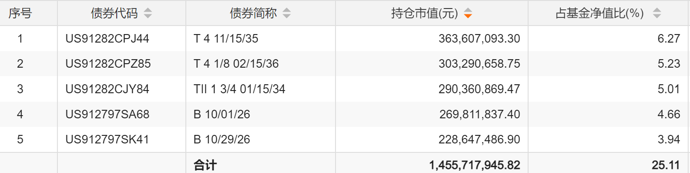
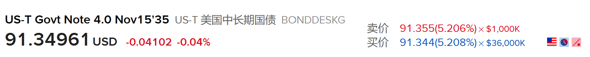

如何根据美元债券基金的持仓列表观察它持有了什么。

先看这张富国美元债的前五大持仓。

  
  
先说整体，只看前五大持仓，我个人非常喜欢。我有个朋友的美债配置思路跟这支基金差不多。

第一个和第二个是一类债券。  
  
“T”  
  
这里的T是Treasury Note。是美国中期国债。它是固定票息，到期偿还本金。  
  
T后面的4，代表票面利率是4%。注意，这里是票面利率。不代表富国美债持有的收益率也是4%。  
  
举例来说，你昨天申购的资金，它现在去市场上买，买到的到期收益率就是5%以上。  
  
我查了一下，图一的第一支美债，昨天买入，到期收益率是5.2%（图二）。

因为它的价格比发行时候低。这个不明白的朋友以后再补课吧。

4后面的11/15/35。是这支债券的到期日期。也就是2035年11月15日到期。是一支久期9年的中期债券。同理，第二支02/15/36，是一支2036年到期，久期10年的中期债券。  
  
对了，第二支的4 1/8，实际上是4.125%的意思。

第三个TII。  
  
这个TII是非常有意思的一个品种。叫做美国通胀保值国债（Treasury Inflation-Indexed），也就是 TIPS，本金随美国通胀指数调整。也有人叫它美国通胀贴补债券（有音译+意译的意思）  
  
这种债券非常有意思，跟各位以前理解的普通债券是不同的：普通国债的本金是固定的，而TIPS的本金会根据美国通货膨胀水平不断调整。  
  
首先看字面。  
  
TII，是通胀保值国债。1 3/4，这支债券票面利率1.75%。到期日2034年1月15日。  
  
它的特点到底是什么？  
  
是它未来归还的本金不确定。会根据美国通胀水平不断调整。  
  
举例来说，买入时本金10000元。第一年美国通胀4%，你的本金就变成了——10400。到期还本的时候，大漂亮政府会还给你的本金就多了400。第二年通胀是5%，那么第二年的累计通胀就变成了1.092。你的本金就变成了：10920。  
  
除此之外，还有1.75%的利息。  
  
这种债券是一种对通胀的保护。哪怕通胀到了20%，你的本金就会增加20%。某些时候这是非常非常好的一个品种。也是大卫斯文森推荐配置的一个品种。

第四和第五，B，是短期美国国库券（Treasury Bill）。  
  
第四支到期日是2026年10月1日。因为这是半年报数据，所以已经到期了。大概率是持有到期拿回本息。  
  
所以我们来综合看一下，只说前五支持仓债券：  
  
涵盖了：短期国库券，通胀保值债券，中期国债。平均久期在5-7年。  
  
这里面兼顾了安全（短期），收益（中期），通胀保护（TIPS）。没有企业债（也许前五大之外有，至少前五大没有）。很合我的心意。  
  
  
  
基本上就是这样。写完了没有审，有错的话我之后会改。但不会有大错，基本就是这样。与各位分享。
