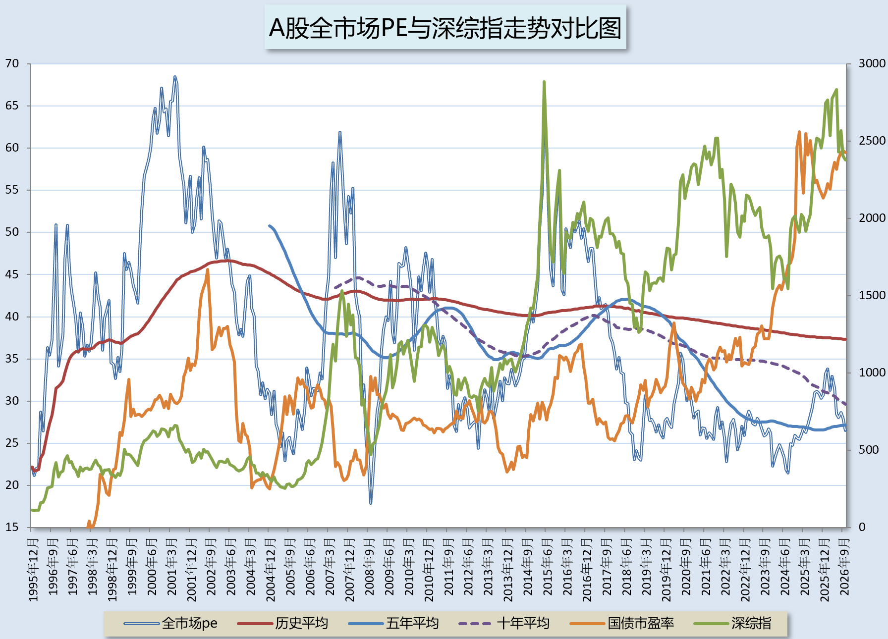
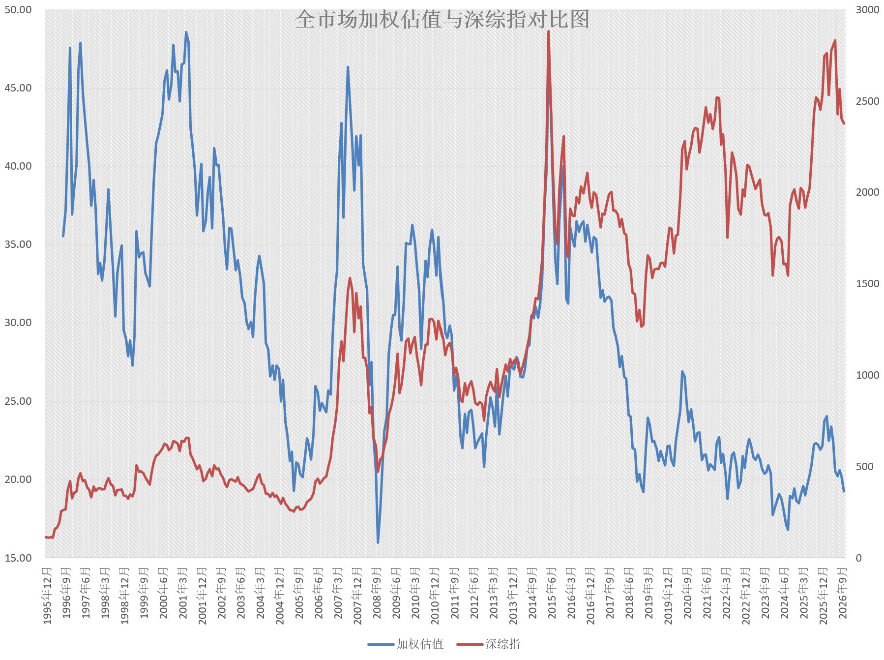
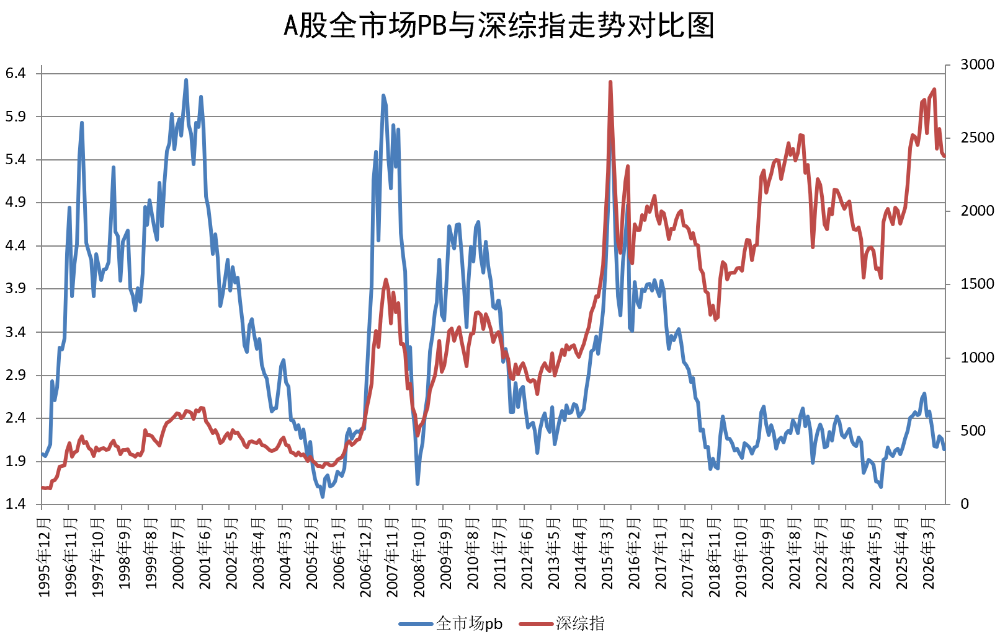
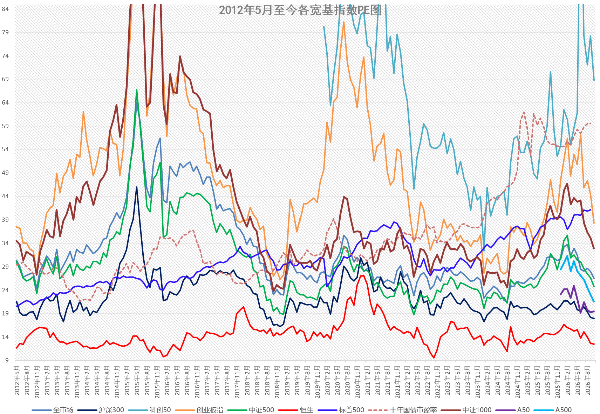
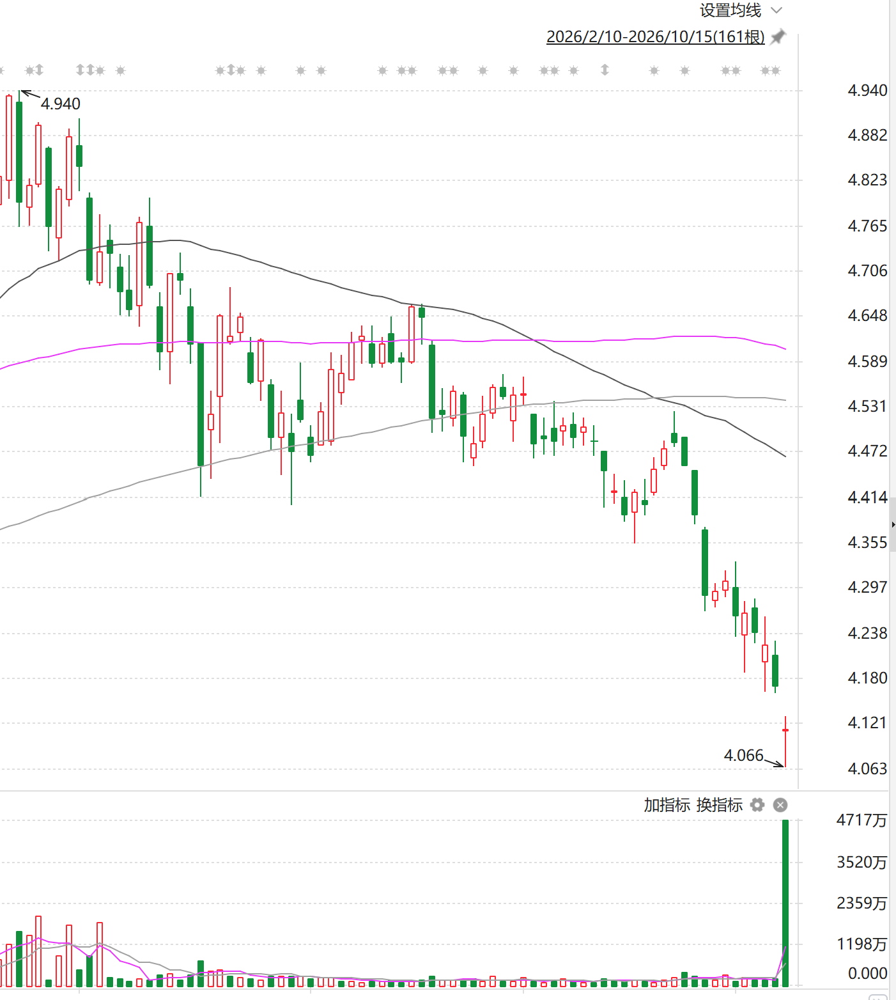

先说结论。

如果明天不大幅反弹，我会加仓。如果小幅反弹我加二级债基。如果继续下跌或者平盘我加宽基。

理由：

上面三张图，分别是全市场等权、外部数据加权PE，以及全市场PB。

今日收盘后，全市场等权估值从2025年4月以来，首次同时跌破五年、十年平均。

更不要说：

沪深300估值已经即将跌入十年最便宜的5%区间。

于是，今天，有人动手就不奇怪了。

易方达沪深300，成交额从昨天的8亿，到了今天的194亿，全都是下午收盘前一小时买入。你觉得谁才有这个实力？

我之前说过，GJD一定有一套类似于我这套估值系统的东西，对A股进行评价。因为从2010年代起，它们的每一次入场出场，都与估值的底部顶部区域极度契合。这种契合，如果你一直关注我，就会完全明白是如何一次次发生的。

当然，目前算得上便宜的，也只有沪深300。与以往所有品种都几乎处在低位的情况还有所不同。比如全市场也只是历史的40%多分位，也刚刚跌破五年平均百分位。

但是，我请各位注意，在这个位置，如果你还想继续卖出宽基，请一定谨慎。真正好的卖点，是上半年我们不停卖出中证500的那个阶段（那里甚至比3月份神秘资金清仓救市买入的指数基金的位置还要好）。现在，我不认为再卖宽基是理智的。不是说肯定不会跌了，只从估值看，也不是绝对底部。但在这里继续卖，我认为不合理。

虽然300算是便宜，500、A500也不贵，但是科创板依然是60多倍估值。反而全指信息倒是因为业绩太好，导致估值已经回到了2024年8月，但是整个板块PB依然在历史80分位以上。

也就是说，如果科技股业绩继续好，那么现在的估值就合理。如果最终发现依然是周期，那么从PB看，回归起来就遥遥无期。

另外，我真诚的请各位炒个股和热门行业的普通投资者朋友，认真思考自己的选择。年初大热的所谓商业航空我并没有跟踪，但跟中证军工应该大差不差。而中证军工从年初到现在已经跌了接近40%，估值依然高达60多。是因为它的业绩不仅没上升，反而成分股的业绩都在下滑。

在A股，个股和行业的把握真的很难。要买，就是红利+宽基。行业小仓位玩玩，不要下重注。

前几天买入的美元债，昨天小幅反弹，今天盘前继续反弹。持仓亏损应该回到2%以内。

有朋友担心USD，也担心大漂亮国债。

我这么说吧。

你在这个地球上任何一个国家（除了那种你很难去去了也无法自由行动的国家），都可以顺利的用USD换取当地的货币。在不少比较乱的国家你用其它任何货币都无法换到当地货币。甚至有些国家你可以直接花USD。如果你连这种货币都要担心，那么应该也没有什么货币你可以安心持有了。

至于它的国债，我不能说它没有风险。但如果它无法被偿还，那么这个世界上大多数甚至绝大多数的国债都已经是废纸了。

接下来无非就是通胀导致的利率上行风险。昨天我分析了，我们的持仓品种，很机智的配置了TIPS，会有一定的对冲。

总而言之，不必太担心。当然5%仓位，不会再加。

基本就是这样，不说太多了。说太多您看着烦，也消化不了。

请各位不必担心。拿150来说，我们的持仓40多个点都是现金+纯债+一级债+美债。还有十几个点是昨天还在新高的红利。整个组合的抗风险能力真的值得相信。当然，您要说全现金才安全。这个是没错。但是，现金就真的安全吗？

且不说通胀什么的，就说难道您不会在反弹后FOMO，一把重新追高最终悲惨落幕？

总而言之，我不会再考虑太多各位的情绪。该买什么就买什么。您觉得可以参考就跟车，觉得害怕就停。非常简单。
