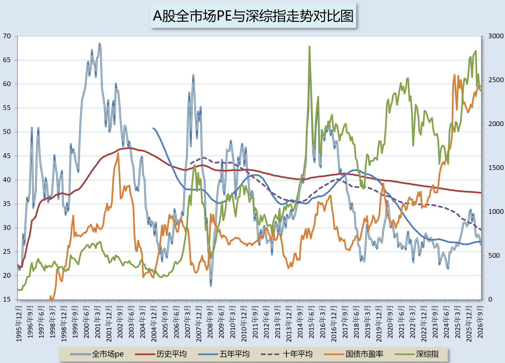
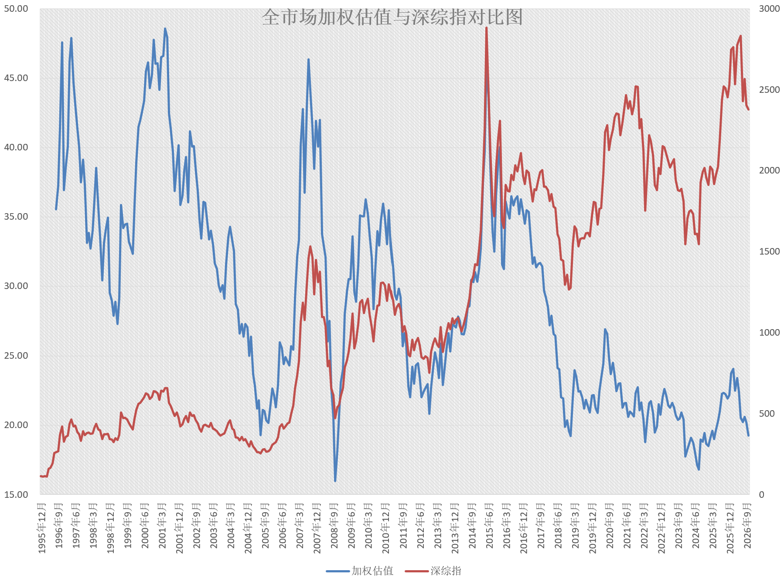
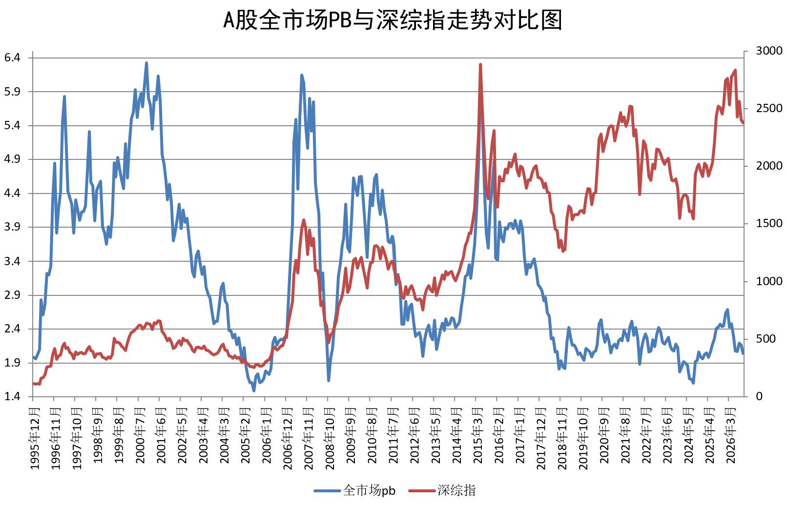
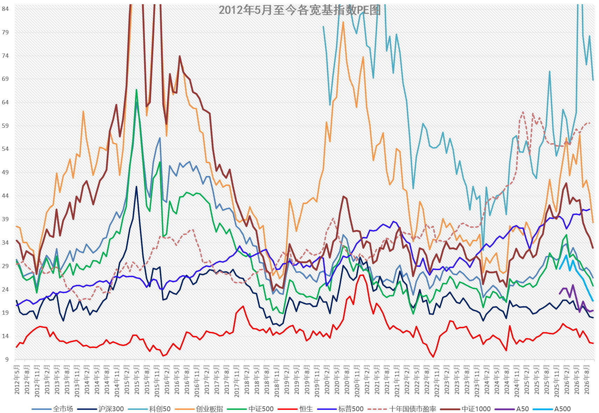
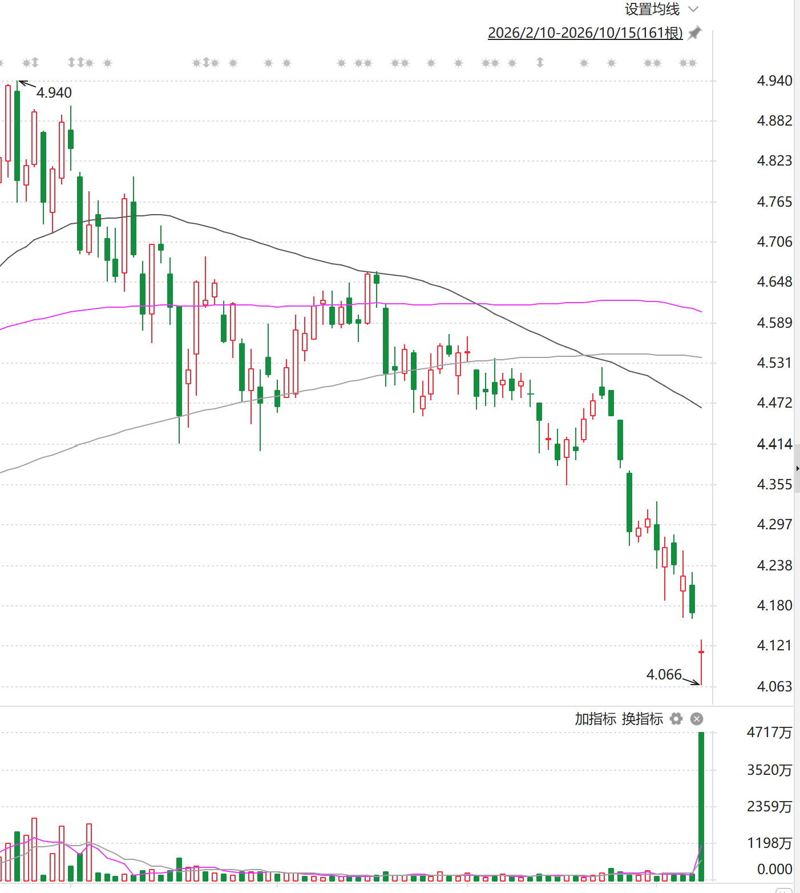
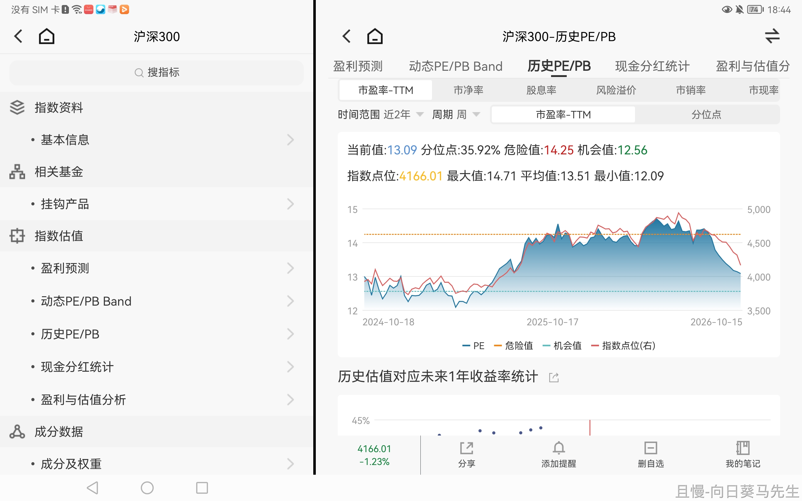
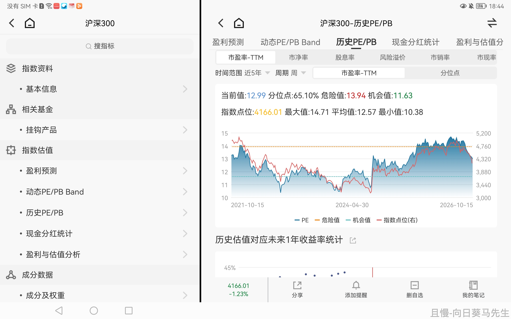
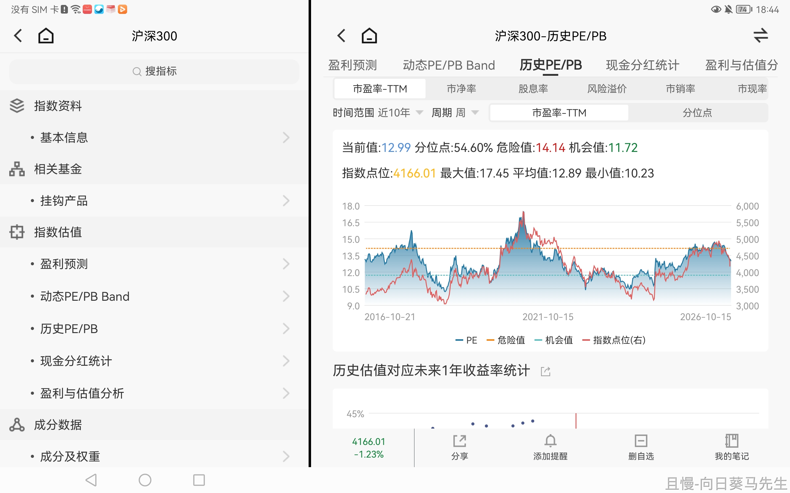
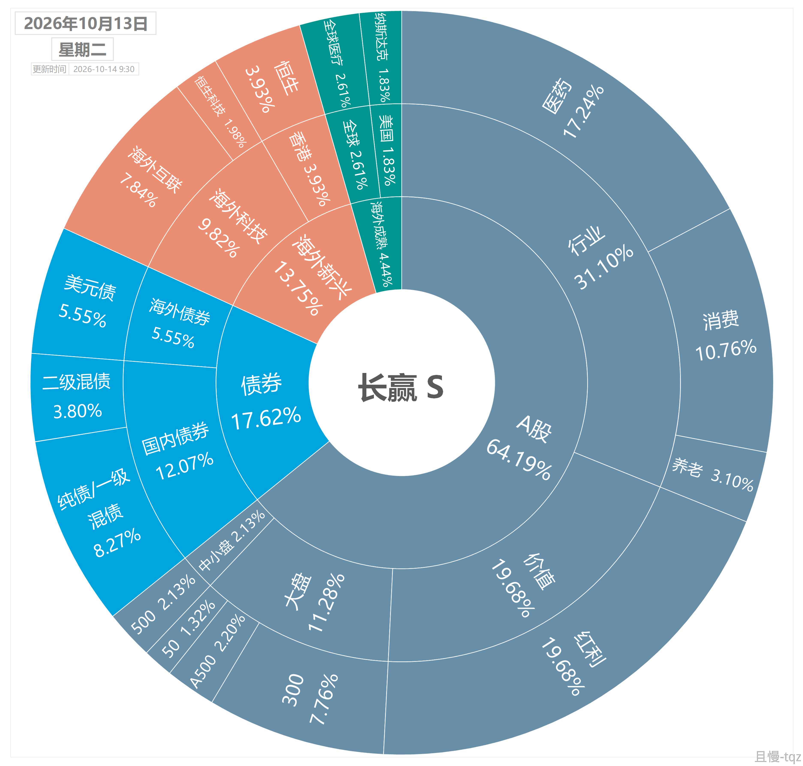
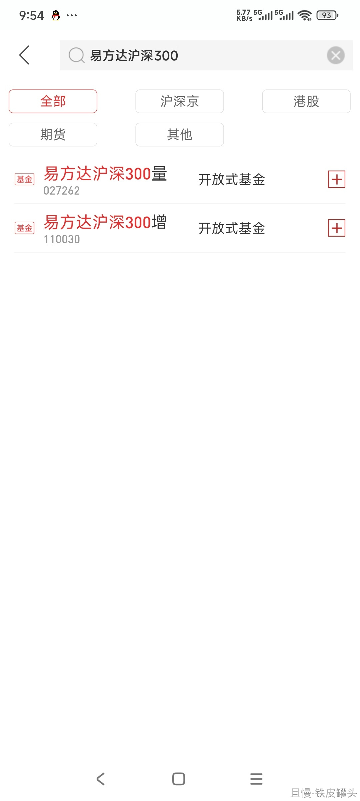

先说结论。

如果明天不大幅反弹，我会加仓。如果小幅反弹我加二级债基。如果继续下跌或者平盘我加宽基。

理由：

上面三张图，分别是全市场等权、外部数据加权PE，以及全市场PB。

今日收盘后，全市场等权估值从2025年4月以来，首次同时跌破五年、十年平均。

更不要说：

沪深300估值已经即将跌入十年最便宜的5%区间。

于是，今天，有人动手就不奇怪了。

易方达沪深300，成交额从昨天的8亿，到了今天的194亿，全都是下午收盘前一小时买入。你觉得谁才有这个实力？

我之前说过，GJD一定有一套类似于我这套估值系统的东西，对A股进行评价。因为从2010年代起，它们的每一次入场出场，都与估值的底部顶部区域极度契合。这种契合，如果你一直关注我，就会完全明白是如何一次次发生的。

当然，目前算得上便宜的，也只有沪深300。与以往所有品种都几乎处在低位的情况还有所不同。比如全市场也只是历史的40%多分位，也刚刚跌破五年平均百分位。

但是，我请各位注意，在这个位置，如果你还想继续卖出宽基，请一定谨慎。真正好的卖点，是上半年我们不停卖出中证500的那个阶段（那里甚至比3月份神秘资金清仓救市买入的指数基金的位置还要好）。现在，我不认为再卖宽基是理智的。不是说肯定不会跌了，只从估值看，也不是绝对底部。但在这里继续卖，我认为不合理。

虽然300算是便宜，500、A500也不贵，但是科创板依然是60多倍估值。反而全指信息倒是因为业绩太好，导致估值已经回到了2024年8月，但是整个板块PB依然在历史80分位以上。

也就是说，如果科技股业绩继续好，那么现在的估值就合理。如果最终发现依然是周期，那么从PB看，回归起来就遥遥无期。

另外，我真诚的请各位炒个股和热门行业的普通投资者朋友，认真思考自己的选择。年初大热的所谓商业航空我并没有跟踪，但跟中证军工应该大差不差。而中证军工从年初到现在已经跌了接近40%，估值依然高达60多。是因为它的业绩不仅没上升，反而成分股的业绩都在下滑。

在A股，个股和行业的把握真的很难。要买，就是红利+宽基。行业小仓位玩玩，不要下重注。

前几天买入的美元债，昨天小幅反弹，今天盘前继续反弹。持仓亏损应该回到2%以内。

有朋友担心USD，也担心大漂亮国债。

我这么说吧。

你在这个地球上任何一个国家（除了那种你很难去去了也无法自由行动的国家），都可以顺利的用USD换取当地的货币。在不少比较乱的国家你用其它任何货币都无法换到当地货币。甚至有些国家你可以直接花USD。如果你连这种货币都要担心，那么应该也没有什么货币你可以安心持有了。

至于它的国债，我不能说它没有风险。但如果它无法被偿还，那么这个世界上大多数甚至绝大多数的国债都已经是废纸了。

接下来无非就是通胀导致的利率上行风险。昨天我分析了，我们的持仓品种，很机智的配置了TIPS，会有一定的对冲。

总而言之，不必太担心。当然5%仓位，不会再加。

基本就是这样，不说太多了。说太多您看着烦，也消化不了。

请各位不必担心。拿150来说，我们的持仓40多个点都是现金+纯债+一级债+美债。还有十几个点是昨天还在新高的红利。整个组合的抗风险能力真的值得相信。当然，您要说全现金才安全。这个是没错。但是，现金就真的安全吗？

且不说通胀什么的，就说难道您不会在反弹后FOMO，一把重新追高最终悲惨落幕？

总而言之，我不会再考虑太多各位的情绪。该买什么就买什么。您觉得可以参考就跟车，觉得害怕就停。非常简单。

<!-- qieman-comments:start -->

---

# 先说结论 · 评论区（2026-10-15）

> 评论区归档：2026-11-13 抓取于且慢社区，原帖共 654 条互动，精选 175 条（作者发言、作者回复及其他投资相关评论）。

## 肥仔_（山东省） · 53 赞

E大，我想听你聊聊中概😭，如果有可能的话

> **ETF拯救世界（作者）** · 361 赞：中概恒科什么的，我目前的思路就是波段。便宜，但大环境压制。做波段。

> **风来了（福建省）**（回复 ETF拯救世界） · 0 赞：恒科，被套了11个点，现在要怎么搞？

> **LuccaRun（北京市）**（回复 ETF拯救世界） · 2 赞：哎网格做一个套一个，这个中概恒科真不知道咋整了

> **向日葵马先生（宁夏回族自治区）**（回复 ETF拯救世界） · 3 赞：老师，我买的恒科现在亏将近十个点，不知道如何是好了？

> **自由的风（陕西省）**（回复 ETF拯救世界） · 1 赞：听到这个回复就更踏实了，一直等老大说关于它的消息。我也一直在做网格

> **天空月亮（湖北省）**（回复 ETF拯救世界） · 3 赞：我觉得大A绝大部分品种都只能波段，很难长拿，否则就是坐过山车

> **大晗（广东省）**（回复 向日葵马先生） · 0 赞：当然就是拿着，做做网格啊，总不能割吧

> **闪亮的小欣（辽宁省）** · 9 赞：应该做波段，但我之前仓位高了，所以低位买入不允许，我就高位卖出一些，低了再买回来😂

> **再见南山（河北省）**（回复 向日葵马先生） · 0 赞：做波段啊   十个点很简单的

> **想一个能被人注意到的名字（安徽省）**（回复 向日葵马先生） · 9 赞：我告诉你，我恒科+中概目前是30%，你可觉得好点了？老大的应该也在20%多，10%你怕什么 ？

> **铭金（西藏自治区）**（回复 ETF拯救世界） · 0 赞：我今天加了恒科和医药

> **左右（广东省）**（回复 风来了） · 0 赞：跌到位了就加仓啊，网格交易写的很清楚加仓的点位

> **Criscan（湖北省）**（回复 ETF拯救世界） · 0 赞：我哭了，自己开网格做恒科的波段，截止今天亏十八个点🥹，非但没有赚些本金回来，还加重了仓位😭

> **虹彤（广西壮族自治区）** · 3 赞：中概真的很便宜啊 ，但不知为啥，和医疗医药一样，就是起不来。要是指数下跌，泻得还更快🤣

> **纤云（河南省）**（回复 Criscan） · 0 赞：这是因为前一段恒科是单边下跌，连像样点的反弹也没有，所以仓位加重了。单边下跌市不适合网格，做网格前要先确定网格区间，跌穿就停止网格。

> **再来一杯战至终章（广东省）** · 1 赞：中概和医药医疗都苟着，我就不相信大家不用AI或者不生病

> **Marco.LF.Poon（北京市）**（回复 想一个能被人注意到的名字） · 3 赞：如果10%浮亏也会焦虑的话。你可能要重新考虑一下投资方向了。要么定投标普500，要不只玩红利板块。就算是标普500，一个新冠也给它打了7折。

> **山竹（浙江省）**（回复 再来一杯战至终章） · 0 赞：国家医保没钱，集采导致药企利润腰斩，医疗医药只能死等

> **名字太难起了（浙江省）**（回复 向日葵马先生） · 0 赞：亏10个点焦虑，说明恒科占你仓位比重太大了，调一下吧

> **Criscan（湖北省）**（回复 纤云） · 0 赞：好的谢谢，这次含泪学到了，还要提前确定网格区间应对这种单边下跌的

> **无内耗更健康（四川省）**（回复 我是青年君） · 0 赞：网格一直有在做波段啊，在华宝

## 草原狼汛（广东省） · 10 赞

E大，传媒不考虑入手吗，似乎很便宜了

> **ETF拯救世界（作者）** · 221 赞：计划里应该不会再买了。我也很不建议各位自己乱买传媒。这个品种水太深。

> **有风的治愈岛（安徽省）**（回复 ETF拯救世界） · 0 赞：网格波段还是可以做吧老大

> **474啊啊啊（四川省）**（回复 ETF拯救世界） · 0 赞：正在考虑缩减网格品种，看见您这句，果断弃掉它

> **名字太难起了（浙江省）**（回复 ETF拯救世界） · 0 赞：那传媒的网格还能继续吗？时隔一年多触发买入了第一格

> **雨露（浙江省）** · 0 赞：传媒做做网格太好啦((つ≧▽≦)つ

> **剑煮酒无味（中国）** · 0 赞：你们的中证传媒这几年难道没有一直跌吗？

## E..（广东省） · 3 赞

感谢e大，深刻体会到行业etf确实更难把握，比如中概😅，宽基确实让人更放心😎

## 小番茄的储蓄罐（辽宁省） · 0 赞

我同学刚从美国回来，就业形势很好，都在消费

## 同路人929（广东省） · 18 赞

沪深300其实跌下来没多少，怎么就这么便宜了呢

> **ETF拯救世界（作者）** · 183 赞：因为它这一波上去就没贵过。

> **飞洪Simon（河南省）** · 2 赞：企业利润比十年前增长了

> **收破烂和挖地瓜（北京市）** · 1 赞：300里上证便宜深证贵

> **xinshengf（浙江省）** · 0 赞：同样没看懂，天天基金的估值百分位还是在高位。

> **山竹（浙江省）** · 0 赞：我个人理解，虽然估值便宜，便宜不等于立马上涨不等于不会继续跌。过去常年3000点，3400点的魔咒记忆犹新

> **山竹（浙江省）**（回复 xinshengf） · 0 赞：是的啊，基金软件这个估值都是历史高位，不知道为啥

> **同路人929（广东省）**（回复 山竹） · 0 赞：上证现在3000的话相当于以前跌到2600，绝对的低位

> **出乎意料（广东省）**（回复 悠悠然然） · 1 赞：我也一直很好奇。但E大肯定是有自己特殊计算估值的算法，结合之前他在雪球或微博中一些跟估值相关发言的蛛丝马迹，大概率就是计算与衡量标准不一致导致的，很多软件上的结果是等权/全市场口径，各家计算的模型不一致会有些差别。
我看上面E大给的第4张估值图，就跟且慢APP首页的“市场温度计”的结果就有高度重合的迹像，泸深300此时温度计显示的值就只有7.82，其实我理解像我这种小白，是不是平日里参考且慢的市场温度计也足够用于指数投资了，E大的评估体系那得有专业的人士才能弄得懂。
否则你我都能自己算，那这个市场不会有7亏2平1盈利的结果了，大部分人可能买卖的逻辑就是跟个风而已

## 向天一笑（河南省） · 5 赞

老大，三个宽基各种大概可以给到多少的比例？
还有，就是如果您哪天心情好，能不能些微讲讲医药？倒不是担心什么，就是想了解一下这个行业的周期，从您这儿蹭一点关于行业周期的知识。或者您给推荐个材料，帮助了解行业周期的，让我们自主阅读也行

## 斐波那契（浙江省） · 0 赞

E大估值系统是指路明灯，航海灯塔

## 紫杉小九（上海市） · 0 赞

那我的个人养老金岂不是可以跟着gjd买一点300😂 只是说300是不是还是需要适时做点波段，不要一直放着？我的个人养老金里的红利就是买完就放着不动的

## 战火小阿蛮（北京市） · 2 赞

大仓位全都按着手没接盘等老大信号，小仓位来回波降低成本。anyway，现在既不是卖也不是买的好时机，不敢瞎买，大手笔没老大带队根本不敢动，这点自知之明我是有的。

## 托斯卡纳酒桶（陕西省） · 0 赞

老大，那国证食品类的消费，后续有计划安排吗

## lucky_ETF（北京市） · 0 赞

网格今天已经自动黑车了500和300，期待明天跟着老大加长线。

乱七八糟买了不少行业，😭😭😭😭等待救生艇，以后真的不能买太多

## 雾之风凉（江苏省） · 2 赞

希望E大能够自己把波段带进来 搞起人工量化

> **闲适（辽宁省）** · 2 赞：个人理解。前些天买到中概其实就是在做波段了

## 向日葵马先生（宁夏回族自治区） · 2 赞

老师好，沪深300的估值你是怎么算的？能给我们教一下吗？我在WINDAPP上看的估值是这样的，我不知道差异在哪里？
看不懂估值就也不敢买，烦请老师指点

> **洗心革面学投资（河南省）** · 0 赞：讨论估值计算方法一律处死🤪

> **如其所是（美国加利福尼亚费利蒙）** · 0 赞：沪深300等权PB目前十年分位4.6%，处于最便宜区间，市场上大多是加权视角，而且看PE比较多，看加权PE可能还在很贵的区间，E大说的可能更接近等权PB

## 同路人_3vOoeJ（广东省） · 0 赞

E大最近3年我一直在给孩子的账户买纳指，有50w左右的仓位，我孩子目前还在小学阶段这笔钱10年之内是不会动的，我还要不要继续呢，请指教

## 飞洪Simon（河南省） · 0 赞

老大说下午可能会反弹，场内1成仓买点宽基玩玩，一是验证下老大的猜测，另一个就是图个乐，1成仓错了也亏不了啥。（纯个人行为,DYOR）😝

## 黄梅知（江苏省） · 3 赞

这几天一直听E大再说配置齐了美元债，问下美元债买的是哪个？最近发车都是兴业收益增强债券A呀

> **同路人_Ga5ajZ（广东省）** · 1 赞：对，我也想问来着，s计划最近买的都没有美元债啊

> **WAA（上海市）** · 2 赞：为啥是听说，你没收到买入消息？为啥不翻翻老大发车文章

> **新叶（广东省）**（回复 同路人_Ga5ajZ） · 0 赞：前两天发车了一份富国全球债

> **学习ETF投资（江苏省）**（回复 同路人_Ga5ajZ） · 0 赞：看老大的计划持仓，有美债的

> **黄梅知（江苏省）**（回复 WAA） · 1 赞：我是长赢指数投资计划—S定投，近一个月是没有买入美元债的发车的

> **WAA（上海市）**（回复 黄梅知） · 0 赞：150发车的美元债 而且不会主动再买入 我是150发车时 主动加了一份s黑车

> **同路人_Ga5ajZ（广东省）**（回复 学习ETF投资） · 0 赞：嗯嗯，我是看到E大说这几天配齐了美元债，我以为错过了啥哈哈哈

> **鱼之乐（浙江省）**（回复 黄梅知） · 0 赞：S投很早就说配置足够了

## 捡辣鸡二十三名（陕西省） · 0 赞

请问E大A500大概再跌多少会进入加仓区域呢？

## 同路人_yQYEfs（北京市） · 0 赞

老大，可以分享一下沪深300、中证500等指数最新的支撑位和压力位吗

## MAXX（北京市） · 0 赞

军工传媒这种还能自己做网格玩吗

## 雪松家的幸福积累（四川省） · 2 赞

二舅，不知道能否翻个牌子来讲一下消费C，为何近期没做波段了呢？

## movin（北京市） · 0 赞

今天我感觉是阶段性底部了，今天肯定不少人割肉清仓了(带着懊悔。。。

## 我的猪脚姜呢（广东省） · 0 赞

想听听E大对境外美元配置的建议和看法（如果可以）

## 三戒（广东省） · 1 赞

港股感觉已被全世界抛弃似的😂外资不玩，北水自己都照顾不来，唯有让这个二奶仔先自生自灭🥶

## 同路人_yB814a（山东省） · 0 赞

跟着E大，心里踏实多了，自己小仓位做波段挣个零花钱，大仓位跟长赢，不得不说，没有E大我是不敢入市的，感谢相遇E大🙏

## 萤火虫之光（湖南省） · 0 赞

红利+宽基才是我们小卡拉米的主菜，记住了老大

## 同路人_Ga5ajZ（广东省） · 1 赞

前几天买入的美元债， s计划有配置吗？

> **tqz（江苏省）** · 0 赞：没买，可能的原因是S配置已超标5%，150没有超标。

> **学习ETF投资（江苏省）** · 0 赞：S计划不是也有美债吗

## 小雏菊修补匠（江苏省） · 0 赞

坐等发车，丐丐和医药不知道啥时可以起来，

## 碳烤猪排（江苏省） · 5 赞

wind的沪深300估值和E大估出来的差别好大，不知道具体是什么原因，有人知道吗

> **耘Boicary耔（青海省）** · 0 赞：我也有这个疑问。但我我参考wind的估值，在高点清了宽基，现在回头看一点毛病没有。

> **安安静静（广东省）** · 0 赞：老大有自己的估值体系，没办法细说，我们软件看个趋势，大概就行，方向别跑错就行😀

> **如其所是（美国加利福尼亚费利蒙）** · 0 赞：沪深300等权PB目前十年分位4.6%，处于最便宜区间，市场上大多是加权视角，而且看PE比较多，看加权PE可能还在很贵的区间，E大说的可能更接近等权PB

## 长宁1999（上海市） · 1 赞

行业小仓位玩玩，不要下重注。
非常认同，现在就是重仓行业导致很难，希望后面给机会减减仓。

## 秋雨春风（北京市） · 0 赞

明天是股指期货交割日，今天大跌正常，明天可能不跌了。本来以为今天下午会买宽基……

## 学习ETF投资（江苏省） · 0 赞

紧跟E大，昨天把缺的美债份额也补齐了，看您说的这两天涨了，成本稍微高点点，长期来看无所谓！静待时间的馈赠！

## Peaker（广东省） · 4 赞

E大，感谢分享，想听听您关于医疗的看法，这个行业的逻辑有变化吗，坚持了非常久了

## 枫叶红了（江苏省） · 6 赞

E大，冒昧问一句，方不方便继续说说医药的看法，按照您的说法，针对这种行业指数，如果这一轮结束，是不是未来不会再投很多医药医疗类指数了🤝

## 好娃娃（内蒙古自治区） · 0 赞

这两天原打算把2021年自己买的沪深300全清仓，今年沪深300亏不少。
谢谢E大，我先不卖了。没余钱，跌先不补了。等回归涨涨盈利卖出。
我不会算估值，谢谢E大，谢谢E大的这篇文章。内容直白清晰，不彷徨了。

## Rich豆（四川省） · 6 赞

想在A股赚钱我真的觉得就是耐心…耐心等低位，耐心等价值回归。。我虽然入市8年年化才5个点，去年高的时候到过6个多点，已经很满意了，经历了两轮牛市了，这次明显比上次从容很多，上半年现金就留了50多万了。4000多点清了创业板和通信。等着e大加仓信号。

## Rich豆（四川省） · 1 赞

今天一个去年200万进来买科技的朋友，亏了80万已经清仓了。我听着感觉好震惊，怎么敢这么追高的，他就是听到说牛市来了就进来了……

## 是宁宁吖（四川省） · 0 赞

值得拜读三遍！想到上半年科技疯狂的时候(｡_｡)📖

## 鑫余（湖北省） · 0 赞

E大，为撒今天大跌不加仓，要等到明天买了

## 开心啦（上海市） · 0 赞

感觉e大对跌的行情，更加兴奋。毕竟高位没买啥，还卖出去了一些。

## 孤独的风（河南省） · 3 赞

恒科的波段什么时候能够做起来

## 一颗咖啡豆（湖北省） · 4 赞

我现在就是等手上的医药、医疗、中概涨起来之后盈利卖掉。以后安心持有红利。

## 鸢渊（浙江省） · 0 赞

很高兴又看到了E大对全市场的一些分析。当然，这其实也不全是“”好”，毕竟意味着跌幅巨大。但是，资产配置就是便宜时候多买点。尽量做雪中送炭的人。有些时候锦上添花也可以。

## 汪汪（北京市） · 0 赞

手里有粮，不慌！积极加仓

## 十万毫升的眼泪（广东省） · 0 赞

今天考虑了很久，继续买了点债，和一点点中盖。宽鸡等待老大发车，准备好开干🤫

## 暖日和风（山东省） · 0 赞

现在300和500科技含量很高，和以前不一样了

> **同路人_iv4Jk9（浙江省）** · 0 赞：😂姐妹你这是抢答错了，哪里来的什么高科技，只不过压榨存款利息，接近免费资金堆出来的外贸出口优势。

> **暖日和风（山东省）**（回复 同路人_iv4Jk9） · 1 赞：不是说高科技，是说300和500成份股里面很多是现在暴跌的科创，既然说科创还要跌，那300和500不是也要继续跌。

> **同路人_iv4Jk9（浙江省）**（回复 暖日和风） · 0 赞：🙈🙈🙈它们不杀科创，杀起医药指数来了🙈🙈🙈

## saiiiii（湖南省） · 0 赞

老大，我看您的300的估值已经到了最低区域的5%以内，但是我看且慢的估值，300还在54%，能否大致介绍一下差异？

## 收工的农夫（上海市） · 2 赞

明天如果大幅反弹，就不发车
不大幅反弹，跟车加仓
小幅反弹，跟车加仓二级债基
继续下跌或者平盘，跟车加仓宽基

## 很哇塞的鱼池（安徽省） · 0 赞

请问沪深300估值进入近10年的5%分位怎么和好几个平台的估值都不一样？

## 二级市场捡勒色小跟班（上海市） · 0 赞

今天抢跑加了点沪深300🥰

## 杨兆硕（上海市） · 0 赞

黄金什么时候可以配置？想听 E 大意见，现在合适吗？

## 同路人_JDcq8Q（上海市） · 0 赞

我差点把24年买的沪深300卖了，幸好没卖

## E起富起来（四川省） · 0 赞

看到了明天不管咋样都有买😃
E大的估值体系👍

## Liamn（江苏省） · 0 赞

没啥想法。预留了足够多的仓位。认为还会跌。

## 秋夕（江西省） · 2 赞

请教E大，沪深300估值这么低，我的持仓没有沪深300的话，目前适合补齐份数吗？150里您沪深300买得太低了我不可能补到您的价位。

## 花香菇大人（山东省） · 0 赞

同时段已经买了持有5年的沪深300和纯债，发现，沪深300收益率已进都没有跑过纯债了😂

## 北风其凉（山东省） · 1 赞

有一次验证e估值体系的正确，目前跟车比以前舒适了非常非常多

## 偶尔有空的软糖（安徽省） · 0 赞

希望明天能有宽基的🚗，红利跟着老大开了点黑🚗

## 春日饮花酒（四川省） · 2 赞

e大，我一直有在跟车，但是我还是买了科创50，明明知道科创已经很高很高了，但我还是抄底了，抄在了半山腰。感觉很痛苦，不是亏钱的痛苦，而是没有知行合一的痛苦。也许只有自己真正经历过才能明白，人教人教不会，事教人一次就会。

## 小灰灰伴大象（江苏省） · 0 赞

今天黑了一车宽基，明天有机会继续跟车

## anxy（陕西省） · 0 赞

持有的科技股跌的很惨，要清仓止损吗E大

## 橙夏（山东省） · 0 赞

最近也在纠结是否止盈300，看了E大分析，原来已经在低位了，那就继续持有～

## 尔冬尘（北京市） · 1 赞

E大，消费、白酒目前可入嘛？

## 我是小蚂蚁（江苏省） · 0 赞

今天黑车开了300，A500小仓位😍

## Guangyin（天津市） · 0 赞

收到，宽基最能能代表我们国家的整个产业进步和GJ的意图。

## 保本小赚（广东省） · 1 赞

在A股，个股和行业的把握真的很难。要买，就是红利+宽基。行业小仓位玩玩，不要下重注。

## Guangyin（天津市） · 0 赞

E大，医疗这个行业在a，也不能下重注了么？
ps我意思的重注就是10%±

## 闷声发财（辽宁省） · 0 赞

下半年看到e大分析红利就听话一步步开始配置资金了，虽然只配了一点点，但是账户是真的好看多了

## 浩子1943（浙江省） · 0 赞

E 大，宽基准备配置多少占比？

## 同路人_7P01Z1（上海市） · 0 赞

😳看来学了半天还是不懂啊，怎么沪深300就到了最便宜的5%了，我好像是2016年开始定投的，今年卖了很多，感觉还没跌多少啊。还得好好学

## 幸运草1985（上海市） · 0 赞

医药医疗，你们都没回本吧

## Ziwei（北京市） · 0 赞

我想请教一下沪深300估值处于最便宜5%区间，是如何判断的呢，看pe吗？

## 平安顺遂（河南省） · 0 赞

老大 明天要是买宽基了，是300还是500呢

## 简单（河南省） · 0 赞

宽基考不考虑配置中证1000

## A-慢就是快（江苏省） · 1 赞

会再吃医药波段不？华宝医药C真是只好鸡

## ZQqqqq（上海市） · 0 赞

沪深300的估值和同花顺不一致啊 ，同花顺显示现在是10年59.36分位

## 不知道叫啥（广东省） · 0 赞

E大，红利激进点频繁点吧，后跟的仓位太少了，等着你呢

## 横店查理（中国） · 0 赞

假设两个小白两个海龟一对在咱村学各种技术分析各种操作一对直接标普500   大概率平局吧

## 红利宽基不败（广西壮族自治区） · 4 赞

哈哈哈，经过这一轮医药医疗消费中概的折磨，以后宽基红利就是我的投资方向😃

## 好人一平安（河南省） · 0 赞

中概和恒科有开的黑车，什么时候能涨呢

## yiyiya（浙江省） · 0 赞

e大，为什么同样看pe，我看到的沪深300估值适中，在50多分位。和您差距甚大，是哪里出问题了

> **再来一杯战至终章（广东省）** · 0 赞：pe 的算法有很多种，各家平台和e大的都不一样，所以会有不同

## 益起达（江苏省） · 0 赞

今天益达的高产的惊喜 完完全全对冲了市场的下跌的乌云

## 再来一杯战至终章（广东省） · 0 赞

这几年给这个特殊市场教训的不要不要的，以后认定红利+宽基，过上心静如水的生活

## 再来一杯战至终章（广东省） · 6 赞

其实e大一直想带着大家配置美股基金，奈何海外额度一直不足，无法下手。建议e大也做个美股基金的发车提醒，让有渠道的人先配置上呀

## 杨全胜（上海市） · 0 赞

涨跌都舒服，就喜欢这么优秀
不大幅反弹→加仓（加权益）
小幅反弹→加二级债基
继续下跌或平盘→加宽基

## 杨剑锋（广东省） · 0 赞

一些成长类的策略指数益达会考虑吗？比如说通过peg加权的中证东方红优势成长指数，会考虑利润增速，peg加权也是一种高抛低吸机制。
与红利走势是负相关的。是否组合有质量或成长类的因子有一些帮助呢？

## 同路人Mjj发财（河南省） · 0 赞

E大好！我的150仓位少30份，咋弥补呢？跟车时又不能多买？缺的啥品种也看不出来？🙏🙏🙏

## 名字太难起了（浙江省） · 0 赞

E大，我怎么看沪深300的市盈率还在历史40%以上的分位

## Noah000001（广东省） · 0 赞

E大讲讲消费，组合中仓位很少，是足够了吗，还是技术上还不能买？

## 同路人_CJHUJf（广东省） · 0 赞

为啥每日估值里面沪深300还在50%区间，并且还在黄色区域？

## 对了大（河南省） · 0 赞

科技股确实有业绩啊，是实实在在的业绩，并不是泡沫，现在的这种情况，大盘想在向上，除了科技股，还能有谁呢？

## 月见团子（河南省） · 0 赞

e大能否抽空讲一讲目前大盘是下降趋势了么

## Elaine.（湖北省） · 0 赞

请教一下老大，那传媒以后是只做网格，不做长线了嘛？

> **周周有惊喜（广东省）** · 0 赞：感觉网格也不要做了，自己看法，网格已删

## 扶摇九万里（山东省） · 0 赞

红利加宽基，可能最适合普通人了

## 云上（湖北省） · 0 赞

恒科我也是做网格，但是我发现他不适合做网格。  动辄长时间的单边下跌和单边上涨。🤣

## 同路人Mjj发财（河南省） · 0 赞

今天反弹，那就踏踏实实的等着😎

## 等下线（上海市） · 0 赞

老大，你的估值图与且慢的是否相似，我们自己不会做，不能实时看到你的，能否直接参考切慢的估值图

## 福缘_9（内蒙古自治区） · 0 赞

只是希望市场给机会，这次老大能心无旁骛地把仓位能加满。😊

## 闪亮的小欣（辽宁省） · 0 赞

老大，我想问一下，华宝的网格您还更新吗？我的投顾已购里显示过期了，节前联系华宝上海客服想续期，目前还没续上呢。

> **WAA（上海市）** · 0 赞：网格还是更新的 你要在华宝上海开户的

> **WAA（上海市）**（回复 闪亮的小欣） · 0 赞：哦 我刚才看了一下我的华宝app的网格 原来现在有一条备注 赠送720天 大概你的超过这个时间了 看来我也要去截屏保存 就怕我的也会过期

## 路途中（湖北省） · 0 赞

什么时候低位了，买点科创50

## 咖啡泡西洋参（浙江省） · 0 赞

E大E大，中概/恒科是不是还得稳一波再下手？

## 余生请多指教（陕西省） · 1 赞

慢慢的等待，着急的人真投不了长赢。

## 小猫悠悠（浙江省） · 0 赞

发了债，跌了应该发宽基车呀。

## 兔rabbit（山西省） · 2 赞

现在跌了，以为会加宽基，但是老大加了债基，撤单了，原因是现金不是太多了，留着加股基用。老大今天没加股基，自然有他的道理，继续等待老大发车宽基和红利

## 日富一日小月（北京市） · 3 赞

E大近期买的兴业收益增强债券A，在二级债里面属于 TMT 暴露偏高的一档，是否意味着E大对TMT抱着一种不想主动参与但最好也别被落下的心态。根据2026年该基金产品的二季报，前十大重仓股中TMT（主要是电子）持仓占净值的11.6%，考虑到该产品权益占比20%，也就是权益配置中的58%买了TMT。

## 西班牙的中国韭菜（西班牙） · 0 赞

我阅读能力不太好，有几点我没看懂，求大神指点：
1. “神秘资金清仓救市买入”，清仓不是卖出吗？为啥叫清仓救市买入？ 
2."我不认为再卖宽基是理智的。不是说肯定不会跌了，只从估值看，也不是绝对底部。"这意思是说宽基已经跌到相对底部了吗？跌到底部怎么会有人愿意卖呢？不都是跌到底部买入吗？

## 紫色水晶葡萄（河北省） · 0 赞

老大，华宝医疗C有机会还做波段不？

## 铁皮罐头（四川省） · 0 赞

求大佬指点，怎么在自己的软件上找到e大的易方达沪深300这张图呢，我搜出来怎么是开放式基金

## 二级市场捡垃圾能手（上海市） · 2 赞

E大，医药和医疗可以再给大家打打气么，周五下午杀尾盘，也不担心行业问题，就是一直拿着这么久，一次次给点希望，又一次次破灭

## yizhituski（山东省） · 0 赞

E大有加仓美股的机会还请不吝指出，国内QDII限额，我可以出去买QQQ🙂

## 老M（山东省） · 1 赞

大哥，能不能多做点差价，比如医疗和恒科？他们波动很大，是降成本好机会啊

## 水流不停（广东省） · 0 赞

老大，科创多少点位入比较合适

## 勇懿毅YYY（上海市） · 0 赞

红利是不是又到了倒T的时候了

## 江湖年少（广东省） · 0 赞

我们计划里面所有的品种，目前分红方式都是红利再投吗

## LooL（上海市） · 0 赞

回头看想问问当时说的次日操作为什么是加二级债基而不是宽基呢，因为看起来更符合“继续下跌或平盘加宽基”的情况？

## 嘟嘟小迷糊（河北省） · 0 赞

好的，很安心，持仓的都是踏实的品种，没有跟风追热点。

## 嘟嘟小迷糊（河北省） · 0 赞

恒科和中概我也有不少，比E大持仓多一些，巧了，也在做波段，有了E大的分析，更踏实了

## 哈喽小晚晚（山东省） · 0 赞

上半年我们不停卖出中证500的那个阶段（那里甚至比3月份神秘资金清仓救市买入的指数基金的位置还要好）。这里是不是写错了，应该是清仓是救市卖出的指数基金

<!-- qieman-comments:end -->
