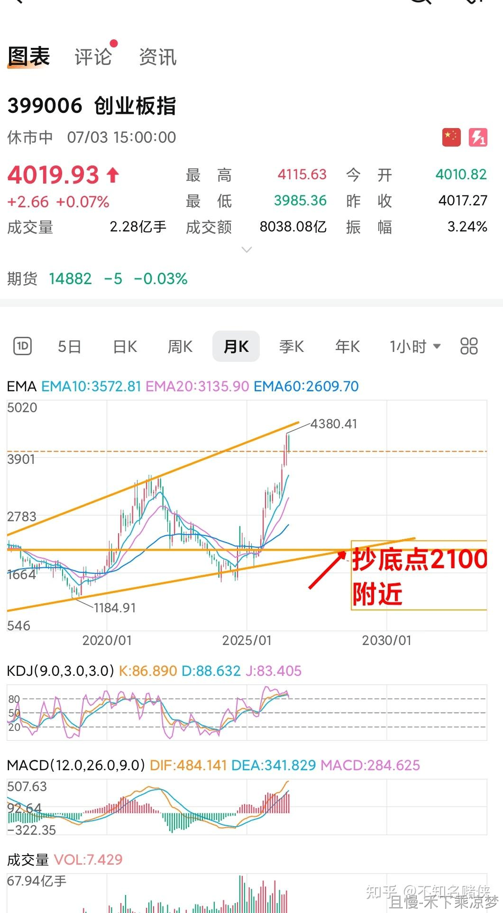

5000个杯子初步计划这样发放。

首先会划定一个范围。就是从今天之前的上一次发车算起，最近三次发车至少跟车了一次的朋友。这个大家应该能理解，就是早就不跟车的朋友优先度一定应该是低于一直持续的朋友。

其中最大的一部分份额，会给最早跟车的朋友。按照开始跟车的起始时间算，顺序排列。这个也应该不难理解。老朋友本来就应该享受到优先待遇，对吧。

然后是两个部分。范围内剩下的朋友，会按照最多跟车金额，以及最低收益率两项，分别顺序排列一部分。这个也应该能理解吧。越多金额代表对计划的信任度越高。收益率低的话代表我的歉意……

然后既不是最长久的朋友，也不是钱最多的朋友，又不是收益率最低的普通朋友，也不用担心。还有很大一块是靠运气来抽奖的。这部分会有公证处来公证，保证公平公正。

其实这像不像人生，要成功：

要么靠人际关系。要么靠有钱。要么靠生活困难别人救济。要么靠运气。但所有的前提是自己的坚持……哈哈开个玩笑……

这套方案是我想出来的。我觉得相对来说是很公平又兼具温度。不过您如果中奖，也不会告诉您是因为哪部分得奖的……这次的概率相对来说还是挺大的，毕竟送5000个，至少比之前的概率大很多。也祝大家能拿到我和且慢的一点心意。

如果没拿到，也不用难过。以后再送，就会把这次中奖的先排除。以后的概率会越来越大的。

<!-- qieman-comments:start -->

---

# 5000个杯子初步计划这样发放 · 评论区（2026-10-16）

> 评论区归档：2026-11-13 抓取于且慢社区，原帖共 4146 条互动，精选 26 条（作者发言、作者回复及其他投资相关评论）。

## jiearsenal（广东省） · 1 赞

我跟车很久了 但是我都不买债券类 那岂不是没得抽了😳

## 水蓝儿不哭（湖南省） · 0 赞

怎么参与呢，是自动从长赢里跟投的人抽吗？还是先要报名呢

## 袁伟-Wayne（江苏省） · 0 赞

我早就是自动跟车啦
最近一年多无暇关注金融产品 l
长赢是一直持有 自动跟车的

## 三戒（广东省） · 0 赞

一个既长情又用实际行动来证明对长赢的信任和坚持的投资者值得这份礼物嘉许👍👍👍

## 龟蜗（山东省） · 0 赞

我好像只符合第一条，最近发车三次以上，除了红利因为在别的地方有大头儿了，所以少跟了一点儿，其他都是紧跟😊

## 红魔披头士（山西省） · 0 赞

我自己仓位远高于计划，所以是选择性跟车。

最近三次都没跟，因为我不喜欢买债券。而且由于我仓位过重，我更喜欢补仓而不是跟车，E大套出了我再出手。

## ETF拯救世界（作者） · 456 赞

其实也不是不能再多送，而是工作量什么的可能吃不消。以后争取多次多量。

> **执着（湖南省）** · 4 赞：我少发言，有自动跟车后就自动跟车，资金量不大，但一直紧跟，也在努力学习，充实自己的养老金，也充实自己的生活，感恩遇见E大！之后又遇到其它优秀的队友！预感这次能拿到E大的良苦用心杯，拥有一杯（辈）子的幸福快乐生活！

## 村尾小红（中国） · 0 赞

最近三次发车是不是都是债券😳

## 晃晃晃晃晃晃（广东省） · 1 赞

第一个条件有点裂开了，最近发车都是债券，我并不想买债券所以都没跟🥹

## 愚人码头（上海市） · 1 赞

这是养老金的模式吗？哈哈。

## FangSY（浙江省） · 0 赞

碍于还贷生存 我可用于投资的资金少 按照金额大小个人觉得也不咋合适 理论上长赢资金占活钱占比大小才决定了信任程度吧 乱说的哈 讨论一下

## 花傲天yu（江西省） · 0 赞

创业板再跌30多个点跌成这样中证医疗是不是又要到5300点🥶

## 齐骏马（山东省） · 0 赞

今天又反弹下去了，又要上车喽

## 竺音（湖南省） · 0 赞

为了更好的看持仓量情况，最近把S停了，只跟150😂😂跟了5年多，基本是无脑跟，就是部分收益率达到自己预期后提前卖掉了🤫🤫一直按照E大的策略来配置资产，所以往往是下跌严重的时候更能坚守，涨的多的时候赚不了计划那么多，以后要努力做到📈也能拿住😂

## 略懂先生（重庆市） · 0 赞

最近一直在买债，请问由于跟车晚没买到的兴全转债和易方达安心回报债，什么时候补齐合适呢，这种品种做不到比E大成本低吧。

## 桂小忠（上海市） · 0 赞

完啦，我跟车跟到一半结婚买房了，然后让我媳妇继续跟车了，我现在账户只剩一份亏损的品种没卖出，感觉已经不符合抽取条件了😢

## 路生生（陕西省） · 0 赞

为啥这样砸医疗医药呀  为啥呀

## 晚上吃烧烤不（重庆市） · 0 赞

E大能说下今天医疗医药怎么了吗？从开盘涨到收盘暴跌

## 金建勇（浙江省） · 0 赞

E大，医疗下午被砸是什么原因。能否聊一下，谢谢

## 夜曲夜曲N（广东省） · 0 赞

E大，我想说不是我不想跟车。是我自己的资金方面遇到困难。资产配置没有做好，只能先暂停。等渡过这个时期，我会继续跟的，一切都会好起来的。

## 禾下乘凉梦（山东省） · 0 赞

E总，2100符合趋势交易，但那个时候的情绪感觉还会往下砸，砸到1900。

## 笑谈中（河北省） · 1 赞

努力赚钱，努力攒钱，加仓加仓💪

## 我是传奇（湖北省） · 0 赞

E大，补仓提醒显示功能取消了没有，有些基金仓位分数不够，以前到了合适买入的时候会有补仓位提醒并显示，现在好久没见到这个信号了，是取消了吗？

## DragonShawn（四川省） · 0 赞

我大部分仓位在场内，靠什么呢？好像也没什么运气。。。

## Mr.Y（广东省） · 0 赞

今天我买入长赢的3335天了，我希望可以坚持到9999的那一天！还有谁！

<!-- qieman-comments:end -->
