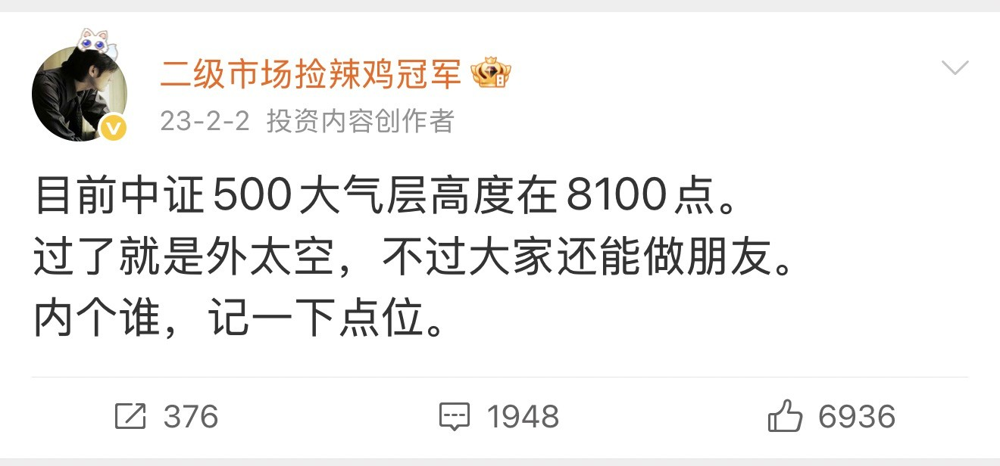

2023年2月，我估算的中证500外太空点位是8100点。

当时是6200点，后来最低跌到了4200点。

2026年1月，中证500在2015年以后首次突破8100点。由于时间已经过了3年多，点位每年会有些许上浮，所以我又等了一等。

再涨几百点后，我开始按照3年多前的预判果断减仓。

知行合一。

现在，中证500从最高9100点，跌回了6800点。

今天，我再给一个钻石坑点位。如果能到，我会在那个附近把宽基仓位配置完毕。

以今天的指数看，中证500在4800点左右，又是一个完美配置位置。不是说必然到，而是说到了的话，不要犹豫。

注意，这个点位大概每年会增加200点，因为通胀及利润增长。

不知道几年后才有机会见到？

