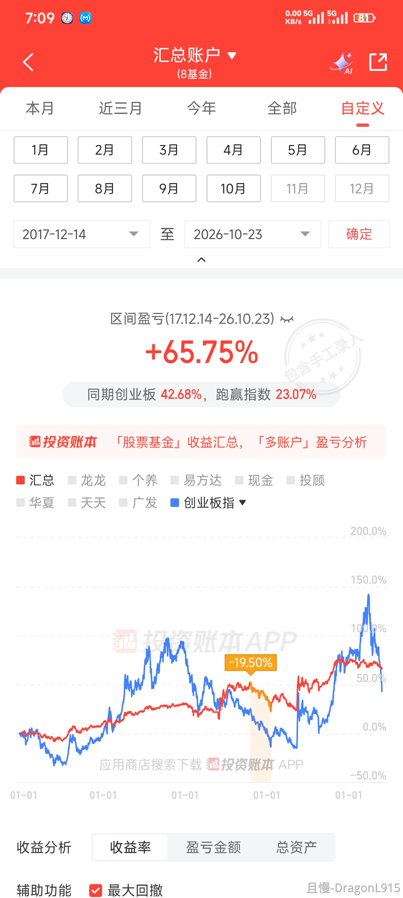
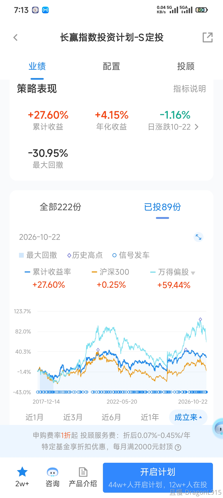

与大家分享前三季度所有操作的整体逻辑：

首先是大量卖出宽基指数中证500。最主要的逻辑是太贵了。所以这一次卖出不是小卖，而是大卖。整个S计划卖到只剩一份，150计划每个500品种也只剩1-3份，绝大多数全部卖出。最主要就是因为贵。（目标基本达成）

其次，清仓证券、金融、环保、传媒。也是因为贵（除了金融）。具体卖出点位，会参考技术层面。现在看后两者基本卖在几乎最高点。（目标达成）

第三，用卖出的资金，买入纯债（1-3年国开债），一级债。是为了在大概率会到来的下跌中尽量有对冲。（目标基本达成）

第四，逢低继续买入红利基金。尤其是6月完成了四个红利品种的买入。最频繁的时候一周就买了几次。目前红利品种占S计划将近20%，150将近15%。最近股市调整，但红利基金已经或接近历史新高。（目标基本达成）

第五，卖出一点恒生买入一点中概做波段。可惜中概一路下跌，没有机会做。（目标未达成）

第六，做医药、消费波段降低成本。基本成功。还未买回。（目标基本达成）

第七，市场下跌后，开始少量买入二级债基。二级债基比纯债和一级债基波动稍大。随着市场下跌，开始缓慢布局。（目标持续达成中）

第八，市场下跌后，开始买回宽基。买了两份A500。距离目标仓位以及高位减持的部分依然太少，继续找机会买。（目标持续达成中）

第九，随着美元汇率及美债下跌，买入中期美债基金，降低组合持仓品种相关度。（目标完成）

今年整体思路就是：

高位大量卖出权益类基金，买入债券。

随着市场下跌，开始进行波段操作。

市场跌幅较大后，开始买入波动大一些的二级债基。市场跌幅继续加大，开始买回高位减持的宽基。

整体操作逻辑就是这样。基本来说完成了既定目标。后续也会按照这个思路去执行。争取在尽量降低波动的同时，完成目标品种的目标仓位配置。

与各位分享。

<!-- qieman-comments:start -->

---

# 与大家分享前三季度所有操作的整体逻辑： · 评论区（2026-10-20）

> 评论区归档：2026-11-06 抓取于且慢社区，原帖共 381 条互动，精选 70 条（作者发言、作者回复及其他投资相关评论）。

## 闲适（辽宁省） · 1 赞

高位大量卖出权益类基金，买入债券。
随着市场下跌，开始进行波段操作。
市场跌幅较大后，开始买入波动大一些的二级债基。市场跌幅继续加大，开始买回高位减持的宽基。
感觉个人操作也可以以这个思路作为调整，上涨和下跌思路正好相反。平盘主要思路就是波段和动态平衡。

## 捡辣鸡二十三名（陕西省） · 1 赞

E大觉得现阶段哪些品种适合做波段？中概一路向下，环保和传媒水有很深，现在在做的是医药和医疗，消费能做吗？

> **捡辣鸡二十三名（陕西省）** · 0 赞：医药医疗是我自己在做的波段操作

> **洗心革面学投资（河南省）** · 1 赞：波段还是得做啊，先把策略搭起来，等着鱼来。
不是所有操作都能成功，成不成还得看市场。

> **捡辣鸡二十三名（陕西省）**（回复 游叶） · 1 赞：就是在华宝做的波段，中概做波段做麻了😅

> **且行且珍薪（广东省）** · 3 赞：中概以一己之力让E大未达成目标。。。

> **西门追雪（广西壮族自治区）** · 0 赞：自己小小仓位买点试试咯，趋势向下消费需求又不行

> **lazypanda（北京市）**（回复 游叶） · 0 赞：红利新高，也没法做波段了吧？

> **yoyo983（广东省）**（回复 捡辣鸡二十三名） · 0 赞：真的做麻了😅我自己做的波段，从21年7月份开始到现在共买入40次，卖出24次，持仓盈亏-9点多~🙈

## E起富起来（四川省） · 77 赞

现在的下跌让我想起了之前的“要站在光里，不要光站在这里”，恍如隔世的感觉
贵不贵，便宜不便宜还得多多看向E大呢😍

> **ETF拯救世界（作者）** · 363 赞：更不要光着站在那里。

## LuccaRun（北京市） · 2 赞

消费和中概真的难，市场连个波段机会也不给

## 同路人_PWhYD5（浙江省） · 0 赞

很好很好，我A仓位基本也是这样，高位卖了很多，跌下来买回一些。其他存银行保守型理财了。

## 同路人_57o5cv（上海市） · 0 赞

某些思路和e大不谋而合，从今年初开始布局红利股票，现在市场下跌，红利股涨势惊人

## 应无所住（四川省） · 0 赞

权重部分卖出了一半，先声明是黑车，依据是自己搭的指标，没卖在最高层。后面看情况接回来，红利部分纳入了一些稳定好的个股。既然注定要分离，还是得自己动手搞一搞😭

## chowlay（贵州省） · 0 赞

自己做了消费、医疗、中概的波段，但就是没啥波动😃

## 情趣抑制剂（江苏省） · 7 赞

豆包回答通缩时配置什么资产：债券，现金，黄金，红利

## 眉梢女壮士巴扎嘿（上海市） · 6 赞

请问老大，二级混债和纯债/一级混债在债券类仓位设计的配比，如何考虑？感谢老大🥰

## 大陈合一（浙江省） · 2 赞

反正无脑自动跟车，轻轻松松，自己炒股这边浮亏60%，哈哈，等回本了全部清掉，还是把资金交给E大吧，我当甩手掌柜，E大的操作我信得过，涨跌我都OK。省却烦心事，好好养身体😘

## 万霖钱丰（四川省） · 1 赞

想问问老大中概咋整。这个品种做波段都做的很脑壳痛🥺🥺🥺   中概这才好了多久又这个死样子了

## lzq（浙江省） · 0 赞

今年初新开了计划，150和S各一个，并且加大了每份的金额，提醒补的全补了，基本都是医药消费中概。目前还在修复中😅 ，对于这种新开的情况，也只能慢慢等待均值回归吧？

## 檐下雨（福建省） · 2 赞

环保这个高点判断真的很难，做波段有感

## 汉水浮萍（陕西省） · 0 赞

踏踏实实跟车，跟着E大做资产配置，为降低波动增加了稳稳的幸福，为下一轮熊市储存子弹。

## 麦仓（广东省） · 0 赞

之前除了长赢，还跟了别的投顾，分别是固守+、海内外债券为主的、还有网格交易为主的，今年来长贏的配置体系越来越全面了，不用到处去找车了，逐渐把其他投顾的资金挪过来。另外，自己以前不懂仓位控制，跟随且慢的补仓提醒，一口气补了很多份医药医疗，最近也在逢高逐渐卖出几份，逐渐跟随E大建立均衡配置体系。感谢E大！

## 小牛牛奶当水喝（上海市） · 0 赞

医药我以为会有更多波段的👻

## 二级市场捡垃圾能手（上海市） · 4 赞

感恩。
另外E大可以再给医药和医疗打打气么？来来回回已经做了两轮过山车了，每次快回本就戛然而止。其实也理解最终会回来，过程是真难熬

## 1234ti（安徽省） · 0 赞

第四点没明白，红利已经或历史新高，为什么还要买入

> **WAA（上海市）** · 1 赞：做波段啊 上次卖出了 等待下跌买入啊

> **1234ti（安徽省）**（回复 WAA） · 0 赞：没看出来是做波段的意思呢

> **WAA（上海市）**（回复 1234ti） · 0 赞：新高就不会跌吗 跌了买入 我们都在等呢

> **zRon（上海市）** · 1 赞：红利是6月坑底的时候买的，最近新高了，不是最近还在买。

## 同路人_eu7uIJ（上海市） · 0 赞

请问如果要加大投入，或者改变份额金额，怎么操作？直接改份额的金额么？那之前没买到的需要手动买入么？

## 北风其凉（山东省） · 1 赞

证券的卖出我也不理解，希望e大可以解惑一下😃

## 同路人Mjj（河南省） · 0 赞

紧跟E大，踏踏实实跟车。持仓，又学很多知识和理念😎😎👍

## shadow-dy（北京市） · 0 赞

刚好，上周的兴业债跟车计划部分失败了，看到持续达成中，下次再发车就可以在跟着一起追车了

## 棉花糖mm（上海市） · 0 赞

强大的逻辑和执行力啊。我的500不多，早就卖完了（赚了可观的品种），该清仓的品类也清了，红利、债券这些都跟上了。哦耶

## 如山-（浙江省） · 1 赞

请问 E 大，继续做证券的网格问题大吗？

## 水竹（山西省） · 0 赞

我跟车晚没有配到宽基，这次500如果掉下来，一定要跟着E大把宽基都配够

## 学习ETF投资（江苏省） · 2 赞

E大请教一下:证券估值不贵，为啥清仓了？能给解惑一下吗？谢谢！

## 谁是懒惰虫（广东省） · 2 赞

e大，请问我们四个红利是打算等比例配置么？

## 肥肥小金猪（江苏省） · 0 赞

2018年10月中证500最低3948点，2024年2月，最低点4281点，按每年底部抬升200点，这区间是5.3年，那么应该太升1060点，最低点应该是5000点，结果最低到了4281，自行参考吧

## 薇_w9r（江苏省） · 1 赞

E大，中概说说吧，这么多年了，有没有加仓摊平成本的计划呢，这个浮亏确实蛮久了

## 顾盼生辉（天津市） · 1 赞

请问E大，港股通ETF，513530，这个红利基金股息率很高，您会考虑在计划中买吗？这个红利有没有什么问题？

## PayneWei（浙江省） · 2 赞

老大，说说港股中概吧，前面已经说过A股的6个指数

## 同路人_wHZPFM（上海市） · 0 赞

因为相信E 大的投资理念和能力，就自动跟车了长盈150和S定投，然后惊喜地发现这里还有一个群可以跟着E大学习投资，开心😃

## 吴小姐（湖南省） · 0 赞

未来只想买创业板ETF跟红利ETF

## 缝中（广东省） · 1 赞

E大说到配置宽基500，能否相对集中一个A500？

> **知己知彼（甘肃省）** · 0 赞：前一段时间提过一嘴说要合适的时候接回创业板！

## 爱喝饮料的小熊（浙江省） · 1 赞

逻辑清晰明了啊，尤其最后总结中，纯债→二级债→宽基的渐次关系，一下就通透了，学到了

## 同路人_0DDmyN（贵州省） · 0 赞

老大 自己操作科创，赚的时候没出，现在都变负了😰

## 不怕熊的winnie（上海市） · 0 赞

老大早上好！兴业债那个尖尖角上的买点，绝了！怎么做到的？（啊知道了是瞎蒙的啦~）

## 鹅蛋鹅蛋鹅（江苏省） · 1 赞

自己的功课
纯债：只做债，跟股市无关
一级债：80%债 + 可配20%转债
二级债：80%债 + 可配20%转债 + 股票
国开债：是一个底层债券品种，纯债 / 一级 / 二级债基都可以买它当持仓

> **颜颜投资理财（四川省）** · 0 赞：二级债有好的标的吗？ 我目前买入的都是纯债

## Monday彪（北京市） · 1 赞

老大，消费现在如果要自己配置一些，有什么思路吗

## 同路人_KZ1k2I（北京市） · 2 赞

A股真是地狱难度，不会择时就是过山车或者一直回本

## 晴天yyh（湖南省） · 0 赞

红利什么时候才能再买哦，六月买少了

## 骨头卿（上海市） · 5 赞

老大，刚看了下目前的资产。

创业跌了快40%的情况下，我的资产和年初相比居然还略有增加。

越来越感受到资产配置的魅力。

感谢你在这一年里带着我们高位卖，然后买债基，买全球债，买红利；

如果不是跟着你，我现在一定是光着站在下跌的光里!

## -嘿嘻（江苏省） · 3 赞

等着中概和医药/疗的波段和崛起，终有一天会起来的，就像传媒、恒生一样哈哈哈哈哈哈哈

## 荔枝酒（江苏省） · 4 赞

中概这是要奔着新低去呀……

> **陈小明（江苏省）** · 1 赞：中概要新低，还要跌30%呢。

## 山今（浙江省） · 0 赞

红利什么点位能买可以明示吗

## 菜头田（浙江省） · 4 赞

E大能说说美元汇率吗，离6.3很近了...

## 同路人_pJ6fHq（辽宁省） · 2 赞

老大，道心要碎了，怎么我们自己就没有美股的行情，天天割散户呢😭

## 同路人_UtnfWP（福建省） · 9 赞

怎么不说说你最懂的指数，恒生呢

## 花傲天yu（江西省） · 4 赞

今年真是买什么都亏，中概，恒生科技到底怎么了跌成这样？

## 路生生（中国） · 10 赞

老大 中概以及文体娱乐都做了巨量过山车 他们从高点到现在跌的一点都不比科技少

医疗医药来来回回也坐了很多次过山车

就像评论区其他人问的 前段时间研究的动量因子对于我们账户起到什么帮助没

## 御玺沉（江苏省） · 1 赞

今天恒科入一网啦，但是我朋友受不了偏偏今天割了一半恒科中概，心情有点小复杂

## 学习ETF投资（北京市） · 0 赞

创业板是不是也快要开始配置了？说了压力测试点位是2100，开始配置的点位在多少呢？2500？2600？

## TrueBoy（广东省） · 1 赞

E大，看完你22号的收盘曲线图，估值的高低我能大概理解，但是这技术面完全看不懂啊，看【期货市场技术分析】这本书会有帮助吗？只是想对技术形态有个初步的了解，再结合估值基本面分析。

## DragonL915（上海市） · 0 赞

场外增量资金跑赢同期S定投和偏股混合，最大回撤小于同期S定投和偏股混合，我出师了🥳

<!-- qieman-comments:end -->
