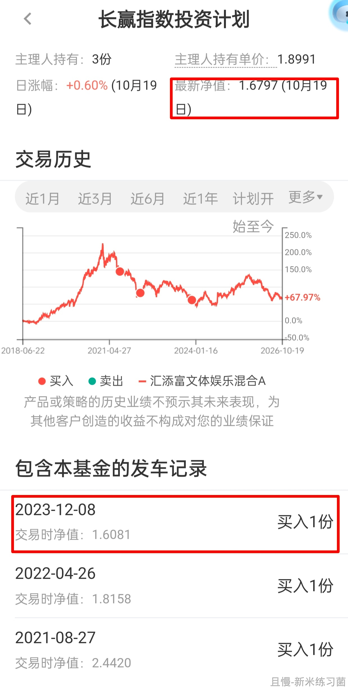

今天要跟大家沟通一件比较重要的事情。

我们的投资计划，并不完全是想如何交易就如何交易。因为我们是最正规的投顾计划，所以，它就要受到一些监管与合规约束。

监管合规约束中，有一项叫做集中度要求。集中度要求中有一项，是规定单一投顾计划持有某一支基金的份额，占比不得超过该基金份额的20%（主动基金）或30%（被动基金）。

现在比较麻烦的，是我们的S计划，持仓汇添富文体娱乐混合A（004424）已经过线了。

我们买的时候并没有过线。这几年也都没有过。只是随着它的规模越来越小，我们被动的过线了。

所以，今天S计划会卖出一份。计划中可以卖出的朋友，这一份从上个交易日的净值看，是盈利的。

另外我给一个建议。

因为这一份并非我主观想卖，所以今天S计划跟车卖出的朋友，我个人认为，可以自助在计划外买回一份。

请放心。今天这个品种无论是S计划的卖出的赎回费，还是卖出朋友自助在计划外三天内买回的申购费（只限且慢平台），全部会返还。也就是说，今天的操作绝不会让您掏一分钱的摩擦费用。

今天这个品种跟车朋友的赎回费、三天内买回的申购费（只限且慢平台），全部返还。

自助申购的流程在附图里，各位可以参考。请千万不要在长赢计划中买回，那样就没有意义了。

发生这样的事情让我很不舒服。经过多方努力，还是没能解决。但其实最不舒服的，是去年此时没有高位卖出——上帝的救生艇来了，我却没有上。各位可能不知道，当时它离我设置的卖出触发价，只差不到2%。这一点，是让我最无法接受的。

具体的，我会单独再与大家沟通。今天就不说太多。

总而言之，一句话：

今天的卖出，不是我主观想卖，而是配合监管合规要求。跟车卖出的朋友不妨自助在计划外三天内买回，所有手续费返还，0摩擦成本。

至于这一份未来什么时候卖出，到时候我会想办法给出我的建议。

发生这样的事情，特别遗憾，给大家添麻烦了。

<!-- qieman-comments:start -->

---

# 今天要跟大家沟通一件比较重要的事情 · 评论区（2026-10-20）

> 评论区归档：2026-11-13 抓取于且慢社区，原帖共 737 条互动，精选 104 条（作者发言、作者回复及其他投资相关评论）。

## LindaLeo（北京市） · 0 赞

那今天可以不跟车，不卖出吧

## vlife（湖南省） · 1 赞

E大不必自责和有压力。这种情况属于不可抗力，您已经做得足够好了。

## KA吴（中国） · 0 赞

没事的，不要给自己太大压力。您已经帮我们安排的明明白白了，跟着操作即可

## E大的粉丝（陕西省） · 0 赞

没事儿，您要是为这种事情有压力，我会觉得更有压力，感觉拖累了您轻松愉快的人生

## ashley223（辽宁省） · 0 赞

老大 知道啦🥰在支付bao买入记着点 在市场再次疯狂的时候卖出 嘿嘿😁踏踏实实的～

## 第三心音（广东省） · 0 赞

那在计划外买回来是买原来一份的金额还是今天卖出到手的金额？

## sora24（广东省） · 0 赞

计划外买入是三天后不管什么价格都买吗？

## 红魔披头士（山西省） · 0 赞

如果品种浮亏，又超了监管要求的上限，岂不是得割肉卖出了？比如大摩健康。 
感觉这样的规则很不合理啊，规模高可以限制不买，为啥还得逼着卖呢。

## 新米练习菌（上海市） · 5 赞

E大早上好，
文体娱乐，最近的一笔是1.6081买入的，昨日净值1.6797，约4.5%的盈利空间，就当换个仓，问题不大的

## 巧红（辽宁省） · 1 赞

好的，谢谢老大提醒，少于您的份数是不是不用卖出呢？

## E..（广东省） · 2 赞

我想问一下，原来是没有3份的，这次可以自主再买入一份吗？

## Karma（浙江省） · 0 赞

最后一张图账户是选择长赢S吗

## 大王wj1076（湖北省） · 0 赞

我已经在9月底提前卖出了

## 劳资蜀道山（四川省） · 2 赞

如果是个人主动撤销卖出呢？这样可以吗

> **ETF拯救世界（作者）** · 94 赞：建议别撤。你撤了集中度下不来，那就还得卖。如果你自动跟车了，直接计划外再买就行了。0摩擦成本。只是辛苦你要操作一下。

## 财心安（福建省） · 1 赞

买入还是按之前的设置的每一份固定金额吗？

> **ETF拯救世界（作者）** · 51 赞：可以是赎回的金额。

## oyf53号飞船驾驶员（北京市） · 7 赞

s里只有一两份的不做任何操作吧？

> **ETF拯救世界（作者）** · 65 赞：不用。满3份才卖最后一份。

## 美丽人生（辽宁省） · 0 赞

今天、明天和后天的任何一天，都是可以自己手动买入了吗？

## E路同行-且行且珍惜（广东省） · 0 赞

我持仓价格低，卖了还是赚的

## 小新是也（广东省） · 17 赞

是不是我今天不跟车就行了？

> **连睡觉都穿着铠甲（广东省）** · 0 赞：不跟车，如果超限了，E大还得再卖出一份，再不跟车就只能再卖，直到合规或者清仓

> **厉害了（陕西省）** · 0 赞：不行，你不跟车就是计划内还持有，还有不合规风险。要把你的持仓从计划内转到计划外

> **ETF拯救世界（作者）** · 151 赞：符合跟车条件的会自动跟车。如果持有3份以上的也建议跟车。各位都不卖，集中度下不来麻烦就没法解决。

> **Chris123456（北京市）** · 12 赞：不行，卖出的人太少，投顾还是不满足集中度要求，老大就还得想办法

> **且邀月听风（河南省）**（回复 百年不合） · 1 赞：哈哈，说着玩的，在高点把自己乱调设置多出来的一大堆中概恒科仓位降了后，后来的车没管过了，自动跟。

## 小小虾米（北京市） · 0 赞

投资是概率的游戏，在另一个时空轨迹下，可能多涨了2%，顺利卖出了。
得之我幸，失之我命，一份的得失并不会太影响整个计划。
想买的自行买回即可，买卖还都没有手续费，在别的地方这种事可不多见🌹

## 公孙（山东省） · 0 赞

好的老大，不要有心理压力，这不是给我们机会学习怎么自己动手吗？😊

## 蛋挞Prince（中国） · 0 赞

比E大份额少的还会自动卖出吗？是不是不用再操作

## 悠宝早日退休（北京市） · 0 赞

对于我们这种只持有一份的人，应该不会被通知自动卖出吧，那么可以趁着这个机会买一份不?

## 小丸子糯（广东省） · 0 赞

老大太贴心了！自助申购的流程说明很清楚，几分钟就可以自己买好了♥️♥️♥️

## dryduck（山东省） · 0 赞

本来就少买一份的这次还有必要卖出吗？

## 终是未曾拥有（江西省） · 0 赞

理解，这并不是你主观想卖出，不是你的问题

## 蜗牛小跟班（山东省） · 0 赞

那我手动取消卖出呢？自己操作跟益达无关🙂

## 亚木木（河北省） · 0 赞

我正好只有两份，是不是可以不卖出嘞

## 兔宝兔贝（天津市） · 0 赞

规则这样设置本身有点不合理，它应该限制买入的时刻即可。没事儿，每次遇到事儿在E大这都有妥善解决的办法。

## 星星Star要一直闪亮（北京市） · 0 赞

看到大家有人在问不跟车执行计划可不可以，我是手动跟车，所以也在想，我不跟车会不会监管的问题还是没解决，这一车必须在S计划中卖出？🤔

## Tinysun（北京市） · 0 赞

没事，以后再有此类问题告诉我们，我们自己买就是了，不差这点申购费

## Ningx（北京市） · 0 赞

刚准备好钱，正准备先按图进行买入，但不知道买多少，于是去看了一下持有的计划，发现主理人持有3份，我只有1份，是不是我可能不会被卖出？
决定等下午发车看看，卖出了我就按照卖出份额买入，谢谢老大详细的知道，给您添麻烦了！

> **且小慢** · 1 赞：同路人您好～如果您只是持有一份，本次不需要卖出哈

> **Ningx（北京市）**（回复 且小慢） · 1 赞：好的谢谢，我刚刚看了我的三个计划，分别持有3份2份1份，那我买回3份里被卖出的那一份就行，谢谢！

## 纯纯么么哒（北京市） · 0 赞

有个问题：比如某人没有在且慢投资计划底下买入，他是参考了这里，实际操作是在别的平台比如zfb tc买的这个基金 那这笔会算在20% 30%这个比例里嘛？

## 媛媛0708（河南省） · 0 赞

已跟流程买入，坐等下午发车赎回

## Jwang（北京市） · 0 赞

合规要求，没办法的事。这波上涨落袋了很多，没啥遗憾的，又不可能都卖，都卖的话万一还涨不完犊子了。踏踏实实的，多大点事。

## 虚己（北京市） · 0 赞

感谢E大！查了一下，004424目前持仓亏损11.6%还跟车卖出吗？谢谢！！！

## 放过瘸子那条好腿（山东省） · 0 赞

后跟车的比计划少一份，应该不会卖出吧

## 同路人_kIDzIT（上海市） · 0 赞

我的份数只有2份，是不是就不用赎回了？

## Hi-甜甜my小宝贝（湖北省） · 0 赞

E大您好！请教只有2份的是否现在可以自助买入1份啊？

## 血橙大姐（湖南省） · 0 赞

其他两个长赢150份里面没有这只基金，操作买回来了在自助交易账户里面。

## 虚己（北京市） · 1 赞

太感谢E大了！🙏🙏🙏。看明白了，卖出最后一份，再买入同样一份，但不能在长赢里面操作。

## liming（北京市） · 0 赞

E大，目前红利配置的品种分散，和份额有关么？

## 且慢叫我输昵称（上海市） · 0 赞

所以，感觉到计划要买入的时候考虑的因素太多了。

## 爱学习的cc（北京市） · 0 赞

看了一眼，老大有3份，我只有2.5份，是不是只会卖出0.5份？

## 金涟漪（广东省） · 0 赞

今天买入的可以免手续费吗

> **且小慢** · 0 赞：同路人您好～今天买入这个品种的手续费后续会返还哈

## CH.L（广东省） · 1 赞

老大，我要是2份，这两天也自己补一份，要是不收申购费，那不是等于占便宜了，也是老大给争取来的收益呀。

## 青春的终结者（浙江省） · 2 赞

E大，如果有些朋友未必看信息的，但是自动跟车的朋友。这样不就没有自己手动买入了嘛。是不是直接调仓从这只调到另一只类似的可选消费比较好一点呐。只是突然想到这一点就随便说一声。

## 学习ETF投资（江苏省） · 1 赞

这太暖心啦，还返回赎回和申购费，E大为基友们考虑的太多太多！感动啊，有这样的投顾三生有幸啊！

## 同路人_doa4Eb（四川省） · 0 赞

低位的时候，现在大力买，还有那么多现金，每次波段的仓位感觉都不足

## lyq0378（河南省） · 0 赞

一定要在计划内跟车，还想买的在计划外自助买入。

## 长赢的熊（四川省） · 1 赞

按照今天发车卖出的预估到账金额买入就对了吗？

## 资管人（福建省） · 2 赞

持有 3 份，已卖出 1 份，并在计划外已买入 1 份。

## 李哈哈哈（广东省） · 1 赞

合法合规很重要，这个不是为了限制我们，是为了控制系统性风险。同时也提醒我们以后配置要更多考虑分散度的问题。

## 美好的妞妞（福建省） · 1 赞

老大辛苦了，为了我们操碎了心，🥰，必须跟车卖出，不然不合规老大还得为这事操心

## 老骥66（四川省） · 0 赞

我只有两份，比E大少一份，我还是又额外买入一份

## 我想致富（江西省） · 0 赞

【盈米且慢】您持有的长赢计划-S定投（默认账户）发车了，因持有收益率低于主理人，自动跟车失败。详情请查看且慢app并尝试手动跟车。

## 长伽马（四川省） · 2 赞

没有问题，可以计划外买回，但是计划外买回这份，还是希望未来老大能通知大家卖出

## Ningx（北京市） · 0 赞

卖出的一份已经按照金额买回来啦，谢谢E大，劳您费心了！多加了几块钱，不返摩擦费用也没事的，平台和E大费心又破费，真是不好意思

## JF（上海市） · 0 赞

自动跟车因为低于E大的收益率失败了，这种要手动跟车卖出吗

> **翠翠婆婆（北京市）** · 0 赞：同问，我也是这个情况，也是要卖出再自行买回吗？

## 万能科学家（广东省） · 0 赞

如果我本来缺少这一份，但是没有达到补仓提醒的标准，但是当前价格仍是低于老大的买入价格的，这就意味着我今天可以申购一份，就当是补仓了😃

## 胖胖鱼（广东省） · 0 赞

我现在有四份，手动跟车卖出2份，那所以买不买都OK是不是这样理解？

> **南森（山东省）** · 0 赞：不是，卖出，然后计划外卖去，计划本来也只有三分

> **胖胖鱼（广东省）**（回复 南森） · 0 赞：应该是计划外再买入一份是不是？

## 清凉伞上微微雨（上海市） · 0 赞

理解并支持。另外今天公布成立了主动ETF基金，这不就是我们正在干的事吗？

## 稳稳的静待花开（山东省） · 0 赞

我只有2份，没有卖出，像我这样的还需要自助自己额外买么？

## 同路人_15shDa（安徽省） · 0 赞

不太明白，今天卖出今天又买回来的话有啥区别呢

## 大陈合一（浙江省） · 0 赞

好像我只有两份，自动跟车时没给我卖出，应该不用手动吧？

## Ges（河南省） · 0 赞

跟车这么多年，收到卖出提醒时，一看就感觉到了异常。还是合规重要，感谢E大的解释。

## 宁静致远花自开（广东省） · 0 赞

老大太为我们着想了，以至于给您增添很多无形的压力，该怎么操作就怎么操作，不必多虑，我们全力支持。一直跟车就是对您绝对的信任。

## 慢慢来嘛（福建省） · 0 赞

不麻烦，已经跟车卖出并在计划外买回来了。🤝🤝🤝

## 平安顺遂（河南省） · 0 赞

想问一下E大，今天还发车买入吗？再买宽基是买500还是300

## DemonsL4（四川省） · 0 赞

找了一圈，这一只基目前规模预估8亿、长赢持仓就1.6亿了？

## 老新（湖北省） · 0 赞

计划外买入要怎么操作？在且慢

## 盛西西（湖南省） · 0 赞

E大提到，卖出的是最后买的那份，但是且慢自动跟车卖出的是平均份额，所以之前类似的情况都会需要手动撤回，然后再手动输入相对应的份额

## SENLee（广东省） · 0 赞

也就是手动在自助开车的，可以不用卖出对吧？

## Juno芒果果果儿（新疆维吾尔自治区） · 0 赞

已自动跟车，已重新自己买入😉

## 伟大航路（四川省） · 0 赞

已自动跟车，已另外自己买入。感谢E大

## 文具盒（广东省） · 0 赞

今天买一份比卖出一份的份额还要多一点点

## luoluo（贵州省） · 0 赞

己卖出又买入。谢谢E大！

## 麦多多---（湖南省） · 0 赞

已经跟车，重新计划外买入。

## kouw（湖南省） · 0 赞

不知道我的理解是否正确，（收益率低于主理人）自动跟车失败后手动跟车，然后计划外重新买入一份

## a新乡（浙江省） · 1 赞

E大您好，提个建议：今天卖出又重新买入的那份，以后卖出的时候能不能设置成自动卖出？因为担心没有看到卖出提醒而耽误了，谢谢您及且慢的工作人员🌹

## 辣鸡没捡够（上海市） · 0 赞

E大，计划中的持仓只有两份，可以自己买一份凑成三份嘛？

## OCTAVIA（北京市） · 0 赞

从这个角度，看发车信息后另外自己单独买稀释计划持仓占比，反而是有利于合规的？是这样吗？

## 山长水阔Z（江西省） · 0 赞

我只有一份，怎么也自动跟车卖出了呀？，是要自己手动撤销卖出吗？现在才看到E大的详细说明😂

## CathyH（四川省） · 0 赞

跟得晚没有买，希望后面给机会多配置一点宽基指数

## MW（山东省） · 0 赞

刚刚突然想到，以后如果有其他基金也是受这个限制的话，能不能麻烦E大大家说一下，自己决定要不要在外面单独买入

## 云枫（广东省） · 0 赞

今天已买入，放入S组合里面。😃

## 堇贤（广东省） · 0 赞

我就担心到时候卖出的时候，这一份自己买的就给忘了

## 同路人_AZjIdn（广东省） · 2 赞

今天把赎回的钱重新计划外买了，赎回和申购的手续费什么时候返还啊

## 思思呀（广东省） · 1 赞

前两天忘记买回了，今天再买还返申购费么？

## 云枫（广东省） · 0 赞

老大，今天已经收到返回的申购费，谢谢。

<!-- qieman-comments:end -->
