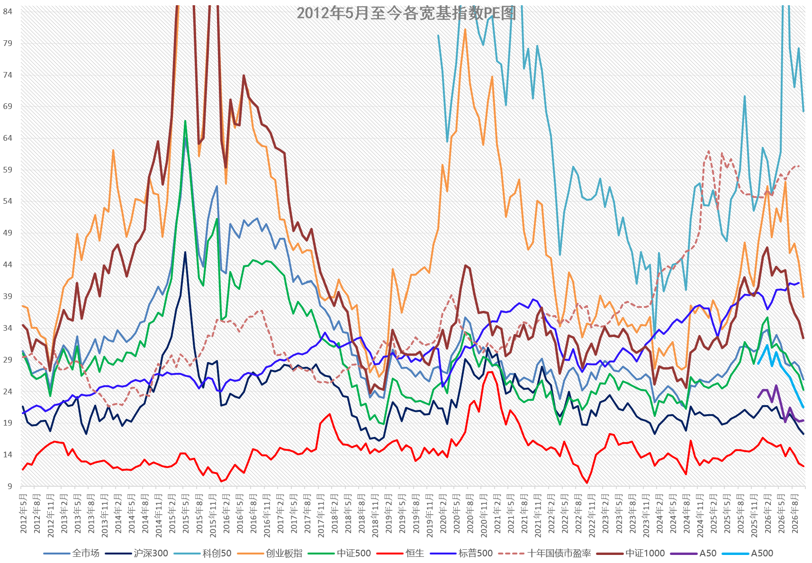

这是今天收盘后的估值图，各位可以自己看。

目前很多品种估值看已经比较具有吸引力。然而与前几次不同的是，目前指数估值与指数技术形态并未共振。

之前几次都是估值到位+技术形态到位。

目前主要是沪深300。估值已经很低，但技术看想要到技术底还有十几二十个点的空间。

先按照交易计划加仓吧。看看未来市场如何解决这个问题的。其它指数也有这个问题但并没有那么突出。

科技股连估值都差得远。所有宽基都已经不贵了。包括4个月下跌40%+的创业板，但我还没有想买它。

