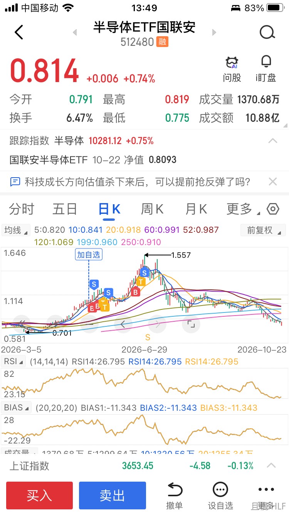

不知道各位是否还记得，我之前在微博说，90%甚至95%的上市公司都是辣鸡。

前几天我看了两篇美股研究。发现是自己冒昧了。

原来，辣鸡是96%。

2018年，有一篇《Do Stocks Outperform Treasury Bills?》的研究指出，美股历史上所有针对短期国债跑出的超额收益，都是来自于4%的股票。96%股票做出的贡献，约等于短期国债。

今年，又有人发布了一篇《One Hundred Years in the U.S. Stock Markets》的研究。指出只有3.72%的公司创造了超额收益。59.13%的公司创造了负收益。37.15%产生正收益但用来抵消负收益了。

而全球64000支股票来看，超额收益来自于2.4%的公司。

朋友们。如果我们相信科学，就不要炒股票了。我是说普通人。

踏踏实实买红利和宽基吧。

不知道各位今年有没有买股票的。现在情况怎么样。

<!-- qieman-comments:start -->

---

# 不知道各位是否还记得，我之前在微博说，90%甚至95%的上市公司都是辣鸡 · 评论区（2026-10-23）

> 评论区归档：2026-11-13 抓取于且慢社区，原帖共 305 条互动，精选 73 条（作者发言、作者回复及其他投资相关评论）。

## 泓潫PatrickTing（浙江省） · 2 赞

让我们在红利和宽基里翻云覆雨~

## 豆汁儿好喝（北京市） · 39 赞

E大，像沪深300这种宽基都在科技股泡沫估值的时候纳入进去了，宽基还适合买吗

> **同路人_PWhYD5（浙江省）** · 1 赞：纳入进去后就卖出一部分呀，现在又跌下来了不是刚好来个差价嘛😊

> **ETF拯救世界（作者）** · 210 赞：实际上全球的市值型指数都是这么干的。我们的特色在于公司花期太短，周期性明显，所以比较恶心。但整体来说，还是靠谱的。A500能好一点。

## 见空（广东省） · 0 赞

现在只希望红利再爱我一次🤡

## 投资-小白（贵州省） · 0 赞

这2.4%的公司能选出来吧，比如茅台、格力……或者直接买红利里的股票。

## 同路人_0gurkp（江苏省） · 0 赞

我要跌麻了😭E大黄金这是为嘛呀

## 同路人_PWhYD5（浙江省） · 0 赞

早就不碰个股了，ETF玩的飞起，踏踏实实的。ETF做做差价也很爽呀，何必去碰股票

## 同路人_yuc9PP（山东省） · 1 赞

老大   能不能详细说说中概一直跌的因素？

## 吴小姐（湖南省） · 1 赞

亏麻了，还是老实回来买宽基

## yyyL（广东省） · 0 赞

哪里的宽基，哪里的红利😬😬

## 荔枝酒（江苏省） · 0 赞

今年买了一支科创50中的股票，亏掉了去年的盈利。

## 雪琴（广西壮族自治区） · 0 赞

八年前我入手了一只白酒个股，到现在亏损了60%，被深度套牢，又不舍得割肉离场😢

## Cichenfuchen（江西省） · 0 赞

好的 记录一下  宽基A500和红利

> **投资不能投机（江苏省）** · 0 赞：前面有一篇 A股值得投的六个指数更新
红利 > A500 > 创业板
医药、消费、信息

## 好多yu榆（浙江省） · 0 赞

老大，想了解下你对券商保险的安排，

## Zhuili（重庆市） · 0 赞

太难了，还是整红利吧。上次科技股大涨，红利跌的时候买了一些，现在还是舒服些的

## 动物园李老师（吉林省） · 0 赞

问题来了，如何做资产配置？有没有想再更新说说

> **海上追风（江苏省）** · 0 赞：资产配置非常非常简单，你照抄国外机构几个有名的组合就行，哪怕是最简单的永动组合也好，最起码长期来说不会亏。

## 遥而不远（湖北省） · 0 赞

E大，我124买的五粮液，遭遇财务造假，亏损40%多；13.1买的爱尔眼科，9元补仓一次，目前亏损30%，本来买股票是为了打新股想中签，结果新股没中上，股票亏的一塌糊涂，好在没敢碰科技股是对的。以后有种不想再炒股票的想法呢，只想跟着E大做指数基金了。

> **dryduck（山东省）** · 0 赞：其实你这两个股都还行，还不属于那96%的，五粮液拿着分红20年本就分回来了，市值和后续的分红都是白给，拿着吧😅

## ETF拯救我的世界（湖北省） · 0 赞

宽基听起来就很好，很均衡，很全面，就像有菜有肉有面的捞面条一样🤪

## 骨头卿（上海市） · 0 赞

E大，我也有买股票，但是都是老登，感觉在今年起到了和科技股对冲的作用

## luwikes（北京市） · 0 赞

我其实有想过买入京东、小米、腾讯、泡泡玛特、特斯拉的，然后想了想就放弃了哈哈哈哈哈，省钱了
基金越买越放心，股票真的是太折磨人的心态了，算了不搞了
基金真香😍

## 浪衣（广东省） · 0 赞

打算以后场内就只搞中证2000+中证红利😃

## 应无所住（四川省） · 0 赞

还行，今年买的股票无论长短线都赚钱了，上午T了一支反弹的降降成本😂

## 喜欢捡辣鸡的羊毛衫（四川省） · 1 赞

买宽基指数，算普通人最好的选择了

## 小雏菊修补匠（江苏省） · 1 赞

今年买了长江电力，云铝，神火，云铝还在套着，拿着吃股息，长江电力最近都在卖出囤积现金仓位，等着老大指令，开干，今年套的多的是中概，医药，安心等待网格

## V泡泡V（四川省） · 0 赞

求解惑，我想问问，既然考虑创业板，为什么不考虑双创50呢？是因为目前双创太贵了不考虑，以后便宜了会考虑，还是一直都不考虑呢？

## 同路人_WId6hu（湖南省） · 0 赞

想问下那种买入高息股票等分红的有可操作性吗

## movin（北京市） · 0 赞

A500最近跌幅明显小于中证500

> **Guangyin（天津市）** · 0 赞：A500和中证500就不是一个东西😃

## 同路人_j6I5lO（广东省） · 0 赞

红利买了4个月，分了我年化4%的利息，话说是不是要利息再投？

## HLF（广东省） · 0 赞

没买股票，趋势跟踪了行业ET F

## SHOWZHOU（四川省） · 0 赞

不喜欢折腾就红利，宽基，而且都得择时效果才好

## SS2026.1.15（陕西省） · 0 赞

中概咋整啊  -34%了 看这个太难受了

## 同路人_JD2ecw（上海市） · 0 赞

可是宽基也是由股票构成的呀

## nonerule8（福建省） · 0 赞

我买的是红利股，交易很牛逼，但还是亏钱了。哈哈哈哈

## 春眠不觉晓（山东省） · 0 赞

收到
我看好
A500ETF招商、红利低波50ETF，这两货，
在低估值的时候可以买入，持有几年，大概率是能赚钱的

## zyh（中国） · 0 赞

24年十一后清仓最后一支A股的股票后再没有买过，踏踏实实跟车最舒服

## 山水迢迢（浙江省） · 0 赞

买了长电，为数不多正收益的股票，其他的都很垃圾，在陆陆续续的卖出

## 大大大久保田（江苏省） · 0 赞

A股 狂热的顶部阶段基本清仓了 只是后面又拿了半仓干进去了 上上周清仓了 今年股票账户收益率4% 我妈的账户我做绝对收益思路 小账户清仓后反而有30%收益（没去抢反弹）

## 汉水浮萍（陕西省） · 1 赞

清一色指数基金和ETF，主打听劝🫶

## 超级玛丽鸡丝（四川省） · 0 赞

消费，医药这些传统长牛行业拿着都烧心，更不要说个股了

## M1（浙江省） · 0 赞

红利股还行，这次大跌之前还是正的

## Brian（北京市） · 0 赞

吃买了个科技股 吃了一点就跑了

## Sunny向光而生（山东省） · 0 赞

大佬们有没有长期持有银行股，吃分红滴？发现银行股最近很稳定呢🥳

## 同路人_OYoIm6（江苏省） · 0 赞

从真正跟车后，我也会开黑车，但只在你操作的etf范围内蹦跶，因为之前遇过股票的黑天鹅，所以对"不死的etf"特别有感触，学乖了

## 旺旺旺财（北京市） · 0 赞

红利大蓝筹这波下跌救了我，今年目前还盈利7%

## 爱拼财会win（天津市） · 1 赞

前几年买了一只旅游股三年了喋喋不休，结果今年调查携程反垄断时它连涨两个板，果断出手后买了长电，庆幸自己今年管住手没碰科技啊，要不凭我的智商那真是完蛋的完啊。

## sharc（辽宁省） · 0 赞

报告老大，今年四月中旬入股市，到六月底挣了十万，当然，也开始飘了。
七月开始到现在，亏了十六万，本金亏了六万，清醒一些。
准备趁反弹割肉离场了。

## 大晗（广东省） · 1 赞

我今年开始买了点红利股票，应该不是垃圾😬

## 孤帆（湖南省） · 0 赞

E大，下午好。感谢您一直操心着为大家赚钱的事儿。我今年自己买了电力和煤炭的央企股票跟行业基金，6月份指数调整成份股时买了有色金属的央企股。电力板块目前盈利10%左右，煤炭板块和有色板块坐了两次电梯了，目前整体亏损分别是5%和2%左右。好在浮亏不多，央企有分红，没有业绩亏损会退市的担忧，拿着比较有底气，跌多了敢补仓。谢谢您的记挂。

## 同路人_blomCM（新疆维吾尔自治区） · 2 赞

今年科技最疯狂的时期狂补红利，银行，长电等老登的仓，这个月陆续波段都出了，完全没有碰科技，躲过一劫。

## Niceone（云南省） · 1 赞

牢记牢记～踏踏实实买红利和宽基

## 凉茶927（北京市） · 0 赞

关注你之前买过股票，有几个到现在还没解套。😅
关注你之后就变成网格小黑车选手了，当然，大头还是跟车中😘
很神奇，耳濡目染久了，今年面对科技股的大起大落一直很淡定，没有碰。🐷

## 競超超（广东省） · 0 赞

手上的两只股票焦头烂额的，大蓝筹也得难受啊，幸好不多🙁

## 胖菜（广东省） · 2 赞

今年没有买股票，以后也不会再买。
手上个股只剩1支了，还是2019年买的，它给我第一次尝到了股票的甜头，开心坏了。然后它涨我追高，它跌我补仓降成本，腰斩再腰斩，装死了。好在它每年都有不错的分红，就让它一直在那儿了。时不时看看它，跟清心丹似的。

## ashley223（辽宁省） · 1 赞

老大，股票可不敢买啊！在遇到老大之前买过几个为了打新股，自从老大说有破发的以后，不敢打新了。现在， 手头的卖的七七八八啦，还好之前都及时卖掉了呢，如果当时没卖就掺透了。有一个是亏本卖出的，换手了同行业的龙头，还好那个还在分红。 等一波牛市想清仓。留着的2个股票是每年稳定分红的，但是买的价格并不便宜所以打算大牛市出掉。跟着老大踏踏实实跟车，比什么都强🍀自己乱投估计早就亏的裤衩都不剩了😭老大就是我的财神爷🥰

## 红利宽基不败（广西壮族自治区） · 0 赞

1月高位清仓了有色6月清仓了科技，保住了利润，但买的央企股一路下跌一路补仓，现在还亏着几个点，等回本就跑路。人贵有自知之明，我买股票都是跟大V买的，赚钱都是运气。最主要持有股票大幅下跌时根本睡不好，好怕退市，现在手上大量现金等下跌买宽基和红利，保住本金比啥都重要😊

## 橙夏（山东省） · 0 赞

茅台，其他目前都是跟车或宽基

## 铁中铁（山东省） · 0 赞

买的中国平安，还没加多少仓位呢，不好玩。公司户买的，吃分红不交税。

## Lingo（山东省） · 0 赞

在我今年割肉清仓万科 A 的时候（留了 100 股，钉在耻辱柱上，时刻提醒自己这次巨幅亏损），我给自己定了一个家规，再也不碰股票。

## 秦小玄子（北京市） · 0 赞

股票硬扛中，反正没钱补小仓位，躺平算球😤

## 昌黎（陕西省） · 2 赞

大家跟着长赢转了几个点了，虽然我没赚到，但是我每天都在学习

## 知己知彼（甘肃省） · 0 赞

小资金玩玩股票可以的，别贪，找个机会进去赚三五八个甚至一，两个点也行，设置浮动止损一旦下跌掉头就跑，今年抽空用10W本金玩目前收益+11%！

## 红方印（广东省） · 0 赞

早早清掉股票了，老老实实买ETF，闲钱投资，安安稳稳😘拿着，高了就卖

## 寧_（辽宁省） · 0 赞

有，跑的不及时，利润大幅回撤

## 阮秀珍（北京市） · 0 赞

虽然没敢买股票，但开黑车玩的科技基也惨了，没上救生艇

## 焰九霄（山西省） · 0 赞

有值得推荐的 qdii 吗

## Hi铭（广东省） · 0 赞

买过一只科技，20买入，60卖出，没想到最高去到190🤣

## 孤僻的啊（上海市） · 1 赞

中国男性平均身高是169.7 然后某个1米8的跳出来说 纯属放屁 我就1米8
评论区晒个股收益的想证明啥 个例和统计数据都分不清楚 还非要晒图出来 且不说样本量和时间周期都没有可比性 要真是炒了20年 年年50%的收益 就算是幸存者偏差也算是个牛人 晒个今年以来的截图 还要拼命显摆=_=

## 法兰西多士（中国） · 0 赞

好奇E大自己的持仓也不买股票吗？

<!-- qieman-comments:end -->
