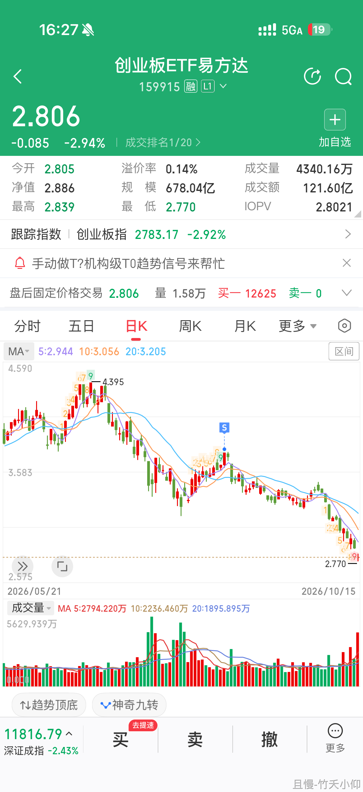
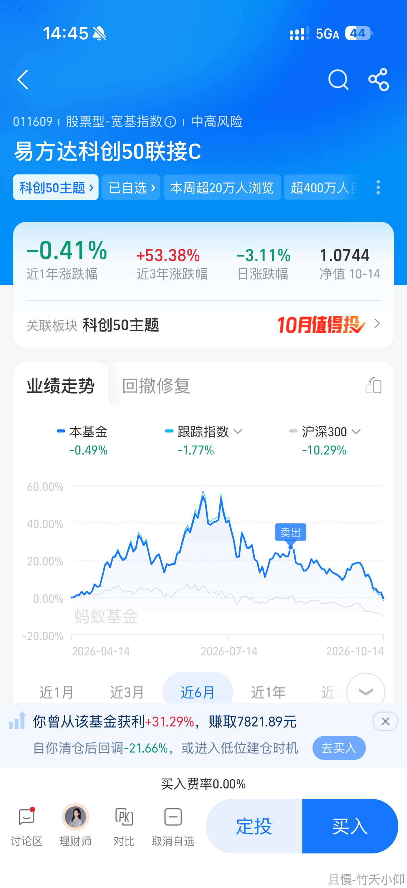
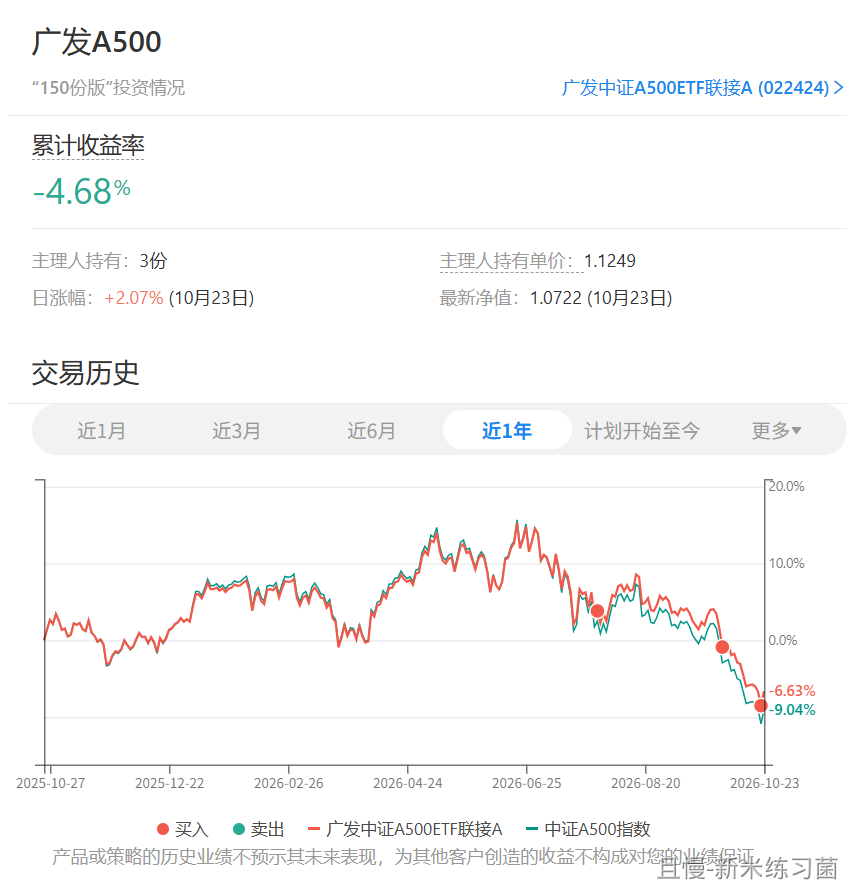

昨天想等更低，或者害怕不敢跟车的朋友，估计现在有点难受。

我昨天说了。高卖也许并不难，真正难的是高卖之后你还能低买回来。这需要精准的两次操作，难度并不是1+1这么简单。

我会在建仓的时候控制好节奏，也会参考技术指标。如果您只是害怕或者贪婪，其实有点浪费我选买点的精力。

我不敢说自己的买卖点一定是最高最低。但它们一定包含了很多东西。你可以在技术面或者基本面不认同我。如果仅仅是情绪，我认为很难战胜我的理性。

A500的浮亏已经回到了4%多一点。未来如果真的大幅反弹，我不排除会有波段卖出的操作。当然要比较大的涨幅了。

前几天我说过，一路下跌是很少见的。再大的熊市也有反弹。你卖出他接盘。你赔一点，他赔一点，每个人都赔一个阶段，比较和谐。

千万不要暴跌的时候卖出，看到反弹又杀回来。朋友，多少钱也不够你这么折腾的。

<!-- qieman-comments:start -->

---

# 昨天想等更低，或者害怕不敢跟车的朋友，估计现在有点难受 · 评论区（2026-10-23）

> 评论区归档：2026-11-06 抓取于且慢社区，原帖共 412 条互动，精选 98 条（作者发言、作者回复及其他投资相关评论）。

## Segger（浙江省） · 0 赞

想请问各位大佬，恒科现在建议补仓吗？

> **网格小助理（上海市）** · 0 赞：网格，已经到位了，不补了

> **If-OnlyJ（福建省）**（回复 Segger） · 0 赞：华宝。你开户了，他就会给你网格条件单

## 牧大人（江苏省） · 0 赞

我昨天+了点恒科，虽然不多

## WillinMao（湖北省） · 1 赞

难受啥，还得跌呢，大趋势就这样

## 同路人_VoFdHL（广东省） · 28 赞

😎无脑跟车+无脑网格，剩下时间自己吃喝玩乐，剩下的压力交给老大😎

> **大浆糊（四川省）** · 4 赞：E大的网格在哪跟啊？我跟车7年了，一直找不到场内网格

## 小卡拉米橙子（湖北省） · 0 赞

跟车买了，因为预告上午也黑车买了红利低波，谢谢老大

> **If-OnlyJ（福建省）** · 0 赞：我咋就没想到红利这茬

## 丁丁90（辽宁省） · 12 赞

我小黑车网格今早响了，手动调整了了下份数，下午才发现，我手动卖出了。。。。

## 你的好友正在学习（广东省） · 0 赞

我认为关键点在于你用于买基金的钱是需要至少五年不用的，这样就不会存在暴跌卖出了。

## 同路人_yxVzxP（湖北省） · 0 赞

根据观测结果，暴跌之后反弹的概率很大🤔

## E起踏踏实实捡垃圾（四川省） · 0 赞

做网格还是舒服的，来回收割。

## 驴喊羊（山东省） · 0 赞

“ 你可以在技术面或者基本面不认同我。如果仅仅是情绪，我认为很难战胜我的理性。”
不知道为什么，听着就很舒服。感觉就像站在巨人肩膀

## 悠悠淘金者6182（四川省） · 0 赞

盘中下跌时没钱再“捞”一点，有点遗憾😝

## 兔rabbit（山西省） · 0 赞

都是自动跟车，买完涨呀跌呀的都随意。看样子老大取消今天发车红利了，没关系，继续等车，就像我平时等公交一样，来了我就坐上去，没来就耐心继续等😬

## pp.（河南省） · 0 赞

不是害怕也不是想等更低，卡里钱不够定投没跟上🙊😭

## Andrew_Li668（江苏省） · 0 赞

E大，500现在开网格位置合适吗？

## 百年不合（湖南省） · 0 赞

恒科限购了这么久今天开门 有点意思🤔

## 90后嘟嘟妈妈（上海市） · 0 赞

管住手，发车了就跟车买吧，500本身之前的仓位就不多，做好了生活费和投资的分割后，投资的波动对我现在情绪影响不大，跌多了就不看了，涨了就开心一下。

## its8（广东省） · 1 赞

“千万不要暴跌的时候卖出，看到反弹又杀回来”🙏

## 以人为镜_可以知得失（广东省） · 0 赞

确实啊，我传媒波段昨天设置好了，自动触发，但是恒科忘记了没有设置，然后就贪婪了，想等等，结果传媒今天就美滋滋的看着一路升高，但是恒科纠结买还是不买，所以两个品种不同的操作反映出了不同的结果

## E起富起来（中国） · 0 赞

按既定的计划执行挺好的，不用担心买高了或卖低了。今天的A500黑车网格，还有既往的很多时候都给了自己惊喜，目标市值也是，没那么多让自己瞎操心的事，可真不错呢

## Zhuili（重庆市） · 0 赞

从22年过来的，已经学会装死了，绝对不恐慌卖出，大不了我装死。跟车倒是不手软，主打一个听话。但是我自己的卖点我还没把握好，总是因为贪婪而错过。😳

## 同路人_blomCM（新疆维吾尔自治区） · 0 赞

恒科网格定好的昨天自己已经操作了。

## 小小虾米（北京市） · 1 赞

昨天小黑车网格成交了不少，今天创业板直接来了一个T，不要太开心，太喜欢这里大幅波动了。
跟车很踏实，好久没有这么多交易了

## 静行致远（湖南省） · 0 赞

老大还是老大，我自己操作的A500到现在是浮亏6%，看后续有没有希望折腾下波段把成本降低

## 一只快要牛逼哄哄的小栗子（江苏省） · 0 赞

嚯 我可是，穷穷的也跟上的，一遍喊穷一遍麻溜地赎回钱

## 骨头卿（上海市） · 0 赞

真的是。我现在的习惯是自动跟车之外，场内再买入一笔；

昨天下午比较忙，收盘之后才看到E大发车了，所以我今天一开盘就在场内买了；

我之前吃过好几次亏，想等再跌跌或者再涨涨操作，然后发现老大的买点和卖点每次都那么精准，结合了估值 技术 情绪等各种综合考虑，我自己根本连零头都还没学到，真的非常佩服，后视镜看点位都很漂亮

## 小K的窝窝（重庆市） · 0 赞

今天操作失误了，医药的条件单昨天响了，但没入网，因为没到价格，昨天收盘后又重建，结果，我没有仔细检查，因为收盘价比触发价低，买入变成上穿，今早看到价格一路跌，我想肯定成交，结果等我忙完一看，没有，不应该啊，再检查才发现问题，后面就是没机会了，还是自己的问题，唉😇

## 山头斜照（北京市） · 1 赞

我想如果这一波涨起来也只是一个反弹，交换一下筹码后会再继续下跌，后面还有更大的机会买入。只是这个反弹可能会比较大

## 竹夭小仰（上海市） · 0 赞

之前听话在救生艇开来的时候及时上船了😂心态平和很多，最近又开始慢慢接回来一些宽基

## 小熊1019（湖北省） · 0 赞

老大和汪汪队的买入步调，有时候神奇的一致。记得之前有次300就是😊

## 可爱的洪水与猛兽（北京市） · 2 赞

昨天买了今天卖了，利用好波段。GJD年初卖的资金还可以买两三个月。大家别太当真。

## 李素芬（河南省） · 2 赞

非常赞同老大的观点，15到18年的熊市有两波大反弹，21到24年熊市有3次大反弹，通常反弹都在大暴跌之后产生的，我猜昨天买入不只有考虑估值，可能开走技术指标层面的因素，像均线乖离率指标之类的。

## ETF拯救学徒（广东省） · 0 赞

昨天忘记了，今天才买入。🤣

## 夏天的海獭（上海市） · 1 赞

以前经常怕还没涨完不舍得都卖出，又怕低了买少了，后面通过恒生科技、中概啊甚至沪深300发现大A总会有机会在低位买回来的

## 迷途小学童（广东省） · 0 赞

自从认识E大，下跌从不慌张😝

## 幸运遇见E（广东省） · 2 赞

各位e友牢记：千万不要暴跌的时候卖出，看到反弹又杀回来。朋友，多少钱也不够你这么折腾的。

## 木鱼CW（湖北省） · 0 赞

牛短熊长，对A500这样的宽基还有足够的空间

## 乌拉不吃鱼（山西省） · 0 赞

昨天不是说了创业板么，是不是创业板快接回来了？

> **等待等等等（北京市）** · 0 赞：那得看下跌速度吧，继续跌这么几天，应该快

## 有风的治愈岛（安徽省） · 0 赞

我的A500网格也开着，昨天又入了一网

## 等待等等等（北京市） · 0 赞

🥳🥳安心跟车，然后自己还加仓了一点etf指数

## 红魔披头士（山西省） · 18 赞

昨天中概补了6笔，A500原本想跟个一两笔，稍一犹豫错过时间了，不过没什么好后悔的，之所以犹豫就是觉得现阶段还不够好。

> **田老师（湖南省）** · 2 赞：恒科加没，中概目前加到预设仓位的几成了？

> **If-OnlyJ（福建省）**（回复 田老师） · 0 赞：恒科中概可以看成一个吧

> **红魔披头士（山西省）**（回复 田老师） · 6 赞：有，我习惯把中概恒科算作一个品种。目前仓位占比20%左右，我没有仓位上限，只要时间空间拉开就买。

> **Hoikei.W（广东省）**（回复 If-OnlyJ） · 10 赞：我中概负30%人都麻了。

> **If-OnlyJ（福建省）**（回复 Hoikei.W） · 0 赞：我也是，网格一路买下来。熬着吧，看明年能不能出一网

> **YoYo201607（湖北省）**（回复 红魔披头士） · 0 赞：你的医药呢，还是没动？

> **同路人_S843Tl（天津市）**（回复 红魔披头士） · 0 赞：中概，腾讯和阿里占比太大和恒科还不太一样，但中概差不多了，不大能破前低，终究指数还是底部不断抬高的。

> **可爱的洪水与猛兽（北京市）**（回复 Hoikei.W） · 0 赞：我按照9/24最低点的价位买的恒生互联网，目前依然负5个点，距离历史最低还有将近10个点的跌幅。目前价位肯定越跌越买，就是控制好节奏。如果最终跌到历史最低还跌的话那就不买了，也不看了，等待慢慢起来😃

> **田老师（湖南省）**（回复 红魔披头士） · 2 赞：20已经不低了，为啥没有仓位上限的，如果标的很多，很吃资金量

> **红魔披头士（山西省）**（回复 田老师） · 2 赞：中概仓位我是30%降到20%了，仓位下降是波段卖出以及下跌造成的。
我自己本身是长期满仓的，而且超过150%，每个人情况都不太一样，适合自己就行。对现阶段的我来说，买入的标准只有一个，那就是便宜。

> **红魔披头士（山西省）**（回复 同路人_S843Tl） · 0 赞：对我来说，不买主要是因为我仓位高。如果仓位低，主动买套也无所谓。

> **红魔披头士（山西省）**（回复 YoYo201607） · 1 赞：医药波段卖过几笔，比方说大摩健康。但是整体没太大变化，还是50%以上的仓位

## 待富婆（浙江省） · 1 赞

科技疯狂的时候，益达被骂被嘲的也多。嫌科技少，嫌卖得早。但是纸面狂欢退去，有几个人赚到科技的钱。。。我自己都只卖了50%，那会收益率是120%。剩下的已经，不剩啥了🤣还是看谁能活下来，谁能保住本哈哈哈

## 开心的富婆就是我啦（广西壮族自治区） · 0 赞

反馈一个问题，这几次都是益达更新网格了，华宝的客服都是3点以后才通知更新。无语了，这样怎么跟？

> **WAA（上海市）** · 0 赞：网格是华宝的 老大不会提醒 你要主动去看

> **有风的治愈岛（安徽省）** · 0 赞：不是手动跟的，是提前设置好自动触发买入卖出的

> **WAA（上海市）**（回复 土奇） · 0 赞：这个网格是华宝证券的网格

## 云上（湖北省） · 0 赞

哈哈 突然想到恒科这一年真的就是一路下跌，几乎没什么像样的反弹，就有一次吧。

## 易游（云南省） · 0 赞

昨天跟车了，今天场内自己的网格单也响了，不凑巧买在了最近的最低点，早上怕这波情绪来，买入会是一个漫长的过程；就把买入数量减半了😂

## 彤瞳（重庆市） · 0 赞

昨天账户余额不足没跟上，今天一早手动跟车了，结果反弹了几个点，都是教训啊

## 春眠不觉晓（山东省） · 0 赞

买个股，可能会买错
买宽基，比如A500，目前这个位置，大概率错不了太多

## 小熊vivi（江苏省） · 0 赞

红利和宽基，自动跟车之外还会手动加一份

## 芒果你个pineapple（四川省） · 0 赞

我好惨，网格要自己设置条件单。我居然把中概买卖设置反了，大家引以为戒😳😳😳

## 战栗的乐谱（山东省） · 0 赞

上次加的消费还亏着呢，也不是每次都买完了就反弹

## WAA（上海市） · 0 赞

十一月正好有几笔定存到期 正好可以加大买入红利

## 辣鸡没捡够（上海市） · 0 赞

上次波段传媒因为账户余额不足失败了，昨天大跌终于又给了机会！

## 七月.（河南省） · 0 赞

在做好压力测试的前提下，按照既定的策略执行，机会还是不少

## 我还没有杯子并且一个都没有（甘肃省） · 0 赞

踏踏实实跟车，甚至还同步开了A500的网格😊

## 樱桃球（浙江省） · 0 赞

跟紧E大的波段不会错，再也不追高了

## 圣地亚哥ly（山东省） · 0 赞

千万不要在暴跌的时候卖出。那很可能就是阶段最低。

## SS2026.1.15（陕西省） · 0 赞

我觉得别的都没啥  中概咋整啊  是不是要买点儿  -36%了  😱😱😱

## 爱拼才会赢hb（湖北省） · 0 赞

e大近期加了3次a500q，除了估值便宜，想听听E大对a500的其他看法？
a500跟300之间比例如何分配？

## 爱拼才会赢hb（中国） · 2 赞

e大近期加了3次a500q，除了估值便宜，想听听E大对a500的其他看法？
a500跟300之间比例如何分配？

## 秋月夜白（北京市） · 0 赞

昨天买的今天条件单自动卖出了，开心🥰🥰🥰小黑车

## 吴小姐（湖南省） · 3 赞

以后只跟车宽基，行业基不要了

## A-慢就是快（江苏省） · 0 赞

看恒科不限额了，会不会有可能再来吸溜波段。波段真是个好东西🥰

> **山竹（浙江省）** · 0 赞：恒科距离上次至暗时刻，还有大幅下跌空间呢

> **WAA（上海市）** · 0 赞：正好看到你的提醒 谢谢 我可以去加仓一点 幸好之前限额 否则黑车开在半山腰 😄

## 一碗牛肉面（云南省） · 0 赞

感恩E大，跟着开黑车小网格，也很快乐。

## 新米练习菌（上海市） · 100 赞

E大晚上好，我出差回来了，上来学习和整理资料，写一下留言：

非常喜欢这个节奏，时间&空间，看着指数下降，仓位渐渐升起，手里有相关的筹码，觉得很踏实。

个人理解，这次建仓的A500有点像是"先锋部队"，中证500大量减仓后，宽基仓位下降不少，介于300、500中间态的A500可攻可守、可咸可甜。个人粗浅地认为：它不像沪深300那样单纯按市值选股，而是先照顾到每个行业、再排序，像CN版标普500，比300更均衡、更接近整个A股经济结构。而且技术图形看，A500是个很规整的指数，很漂亮，没有特别"不对劲"过。

现在感觉，涨了，"先锋部队"就会有钱赚的；跌了，后续大军按节奏入场。

印象中，有点像当年2016年，先锋部队，本来就是要做好牺牲的准备的，刺探军情，身先士卒，生死没人能保证，为了大部队的全面胜利，有时候先锋部队的牺牲也是值得的，但有时候先锋部队不但没死，还弄来了战利品，抢了不少粮食和补给，赚取小波段收益，为长线持仓提供安全垫。

> **林hklin（山东省）**（回复 同路人_Bn80Yq） · 5 赞：这波大概率会考验3450，极限一点3300也会到的，在A股不怕买不到😂

## D仔计划（广东省） · 0 赞

有反弹，看大伙都开心，真好

## SuperColin（重庆市） · 0 赞

有个问题，我就是目前中证红利还差3份补齐，之前说要将中证红利转换掉，我现在还有补的必要吗

> **E米云（北京市）** · 0 赞：新买入的应该可以补吧

## 菜头田（浙江省） · 0 赞

自动跟车，没管过了😊。场内网格积极自我救赎...

## 山竹（浙江省） · 0 赞

这几年都没跟网格了。往年跟过一段时间，短期变成了长期持有，现在只想好好150拿着

## 投资不能投机（江苏省） · 1 赞

小本本：一路下跌是很少见的，再大的熊市也有反弹。
千万不要暴跌的时候卖出，看到反弹又杀回来。
嗯

## Andrew_Li668（江苏省） · 0 赞

500网格，现在价格开始可以吗？

## 夜曲夜曲N（广东省） · 0 赞

E大，没跟车是因为我资金配置不当。是我的问题。抱歉让你误解了😭

## HXS（浙江省） · 0 赞

中概还能补呀！还是A500比较靠谱些！

## 大石头（浙江省） · 8 赞

我就是想问下医疗医药消费和互联网跌了这么多，要什么时候能回本？

## 小w（湖北省） · 5 赞

老大，我想问一下你对中证养老的看法，这个行业和表现怎么看怎么不对劲呀

## 凉夏Free（河南省） · 0 赞

高卖的时候想着新高不卖，然后跌下来了，想着再涨上去，于是错过了一个小峰，好在后面及时出手

<!-- qieman-comments:end -->
