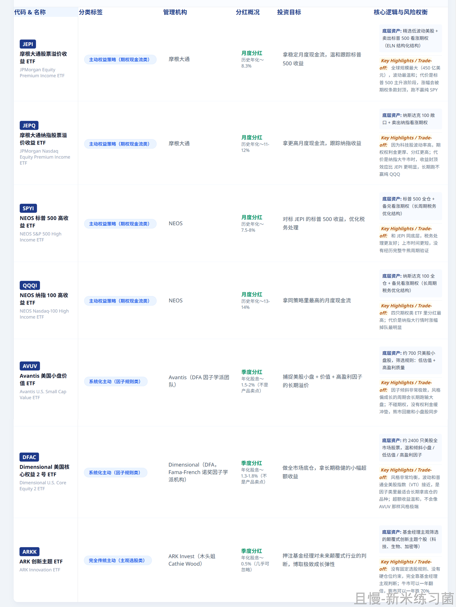
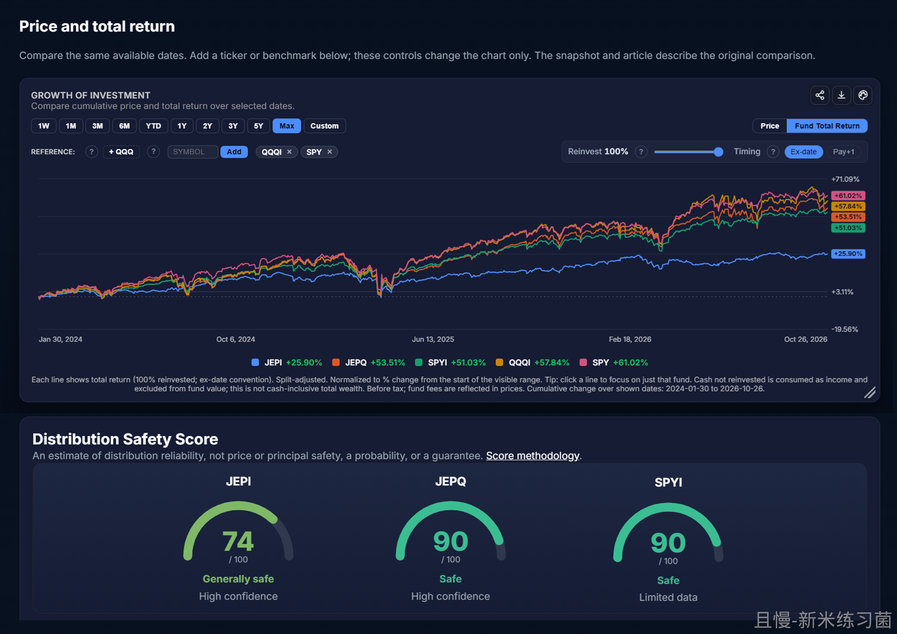
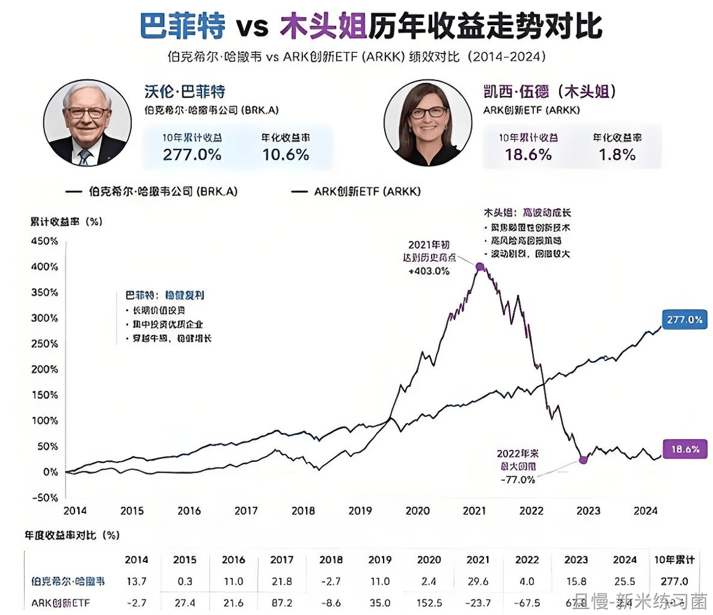

最近在发主动式ETF。当然，各位没有看到之前基金公司发产品的时候，铺天盖地的分析文章了。

那是因为现在不让自媒体做广告了。🙂

我从来没有发布过一篇分析任何单支基金的文章。今天依然是笼统说一下我对主动基金的认知。

我一直说，在投资领域，各位真的要致敬美股。因为美股100多年，又不断有金融创新。我们的很多产品都是跟着美股走。我们这边有什么需要研究的，把美股拿来看看就是很好的借鉴。

（当然，各位也能发现，由于极其有特色，某些市场和美股还是有着天壤之别的。借鉴意义少了很多）

主动式ETF当然也是美股先玩的。我只说几点。

第一，完全由基金经理操盘选股的ETF，我非常不建议买。不是说不会涨。甚至某个时期，一定有某些这种ETF跑得非常好。但长期看，你很难选到真正长期出色的品种。不是说不会有，而是你很难事先把它们选出来。

具体的，你可以去找一找ARK，也就是木头姐的ETF情况。好就天堂，差就地狱。

第二，这不是说主动式基金没得玩。相反，大有可为。

尤其是在某些特色市场。如果基金公司能推出真正好玩的品种，那不一定不可以买。

以下例子，都绝对不是让你去买。这里面有一些也不值得买。而是做一个介绍，希望朋友们心里有个数而已。

比如很多朋友知道的JEPI、JEPQ、SPYI、QQQI。这些基金把相关指数与期权策略结合起来，持有者可以拿到不错的分红，同时也能一定程度上跟踪指数。

各位想想，如果一个产品，每年将近10%的分红，同时能大致跟上沪深300、中证500……你买不买？

还有一种是基于某种策略，在策略基础上，比如估值、盈利能力、动量等策略的基础上，进行主动判断的微调。AVUV、DFAC等等。

也就是说，主动基金其实分三种。

完全传统主动、系统化主动、主动权益策略。

未来，我个人认为，真正有得玩的，是后两种。至于依赖基金经理，说实话，我不知道怎么在1000个基金经理中，选出下一个十年二十年会表现好、不离职的200人。

再说一次，本文所举的所有美股主动ETF例子，都不是让你去买。再说一次！只是学术探讨！

<!-- qieman-comments:start -->

---

# 最近在发主动式ETF。当然，各位没有看到之前基金公司发产品的时候，铺天盖地的分析文章了 · 评论区（2026-10-23）

> 评论区归档：2026-11-06 抓取于且慢社区，原帖共 230 条互动，精选 43 条（作者发言、作者回复及其他投资相关评论）。

## 向天一笑（河南省） · 0 赞

我们啥时候能有SCHD这种qdii产品

## 纪如是（广东省） · 0 赞

Au860了，是不是快到买入区间了👀

## 一条有梦想的闲鱼（上海市） · 1 赞

假如说这里，美欧走我国的通胀周期见顶的话，主动的里面有三个红利比较推荐跟踪一下，业绩基准就是红利低波，3-6个月跑不赢直接剔除。理论上来说，三只红利主动基金都要跑赢的。以上是个人假想，不可作为投资参考依据。🤣

## 望山山是你（河北省） · 0 赞

哇～终于等到E大讲主动ETF了！好详细👍会记下的！

## 爷再也不吃糖了（天津市） · 0 赞

a股的基金经理真的算了  原来还愿意致敬一下张坤  后来他被逼的卖消费买科技我就是知道在a股主动基金就是死路了

## Tina过的小日子（四川省） · 0 赞

我们算不算：系统化主动LOF

## 同路人Mr.Az（上海市） · 0 赞

既然公基95%都跑不赢宽基，凭啥相信主动etf就能跑赢宽基了，只不过流动性和持仓相对改善了吧。。。其他问题还是没解决，我这么理解对吗

## 福德巷白芍（中国） · 37 赞

四年前买了一支，作为普通金融消费者，经历了基金公司内斗、基金经理权限被锁、被撤换等一些列鬼马操作，一直亏损，损失最大至50%。前两个月，得益于后换经理违约调仓至科技，终于回本，微亏出局，不幸中的大幸。此后，规矩就是，绝对不买了这类主动性基金。他们真的好无合同意识。

> **Alance（新疆维吾尔自治区）** · 0 赞：最近银行不错我甚至看到银行etf 一半上涨一半下跌非常的抽象

## qiemanmomo（广东省） · 0 赞

Etf 还主动，就像在打枪游戏里加消消乐

## 熊迪迪（上海市） · 0 赞

主动ETF，在有完善的规则之前，在某市场是绝对不会碰的🤣

## MSNOVA（四川省） · 0 赞

谢谢E大详解，确实我自己没本事选到、拿住超越市场的主动ETF

## 小喵驾到（广东省） · 0 赞

二三是不是有点像红利etf

## lucky_ETF（北京市） · 0 赞

从前段时间大量基金经理追科技，完全主动的肯定不敢买，如果有分红+基本追踪宽基的那很心动啊，但是没有时间检验，不知道会不会乱操作导致不是开始计划的这样，先跟车+观察记录

## 同路人_Jane（浙江省） · 0 赞

我不知道怎么在1000个基金经理中，选出下一个十年二十年会表现好、不离职的200人。
我更不知道了！有不错的分红，又能跟上指数。这个不错😊但不会买

## 小小虾米（北京市） · 0 赞

由具体的人按自己的思路做决定的主动式ETF，不值得买，你不知道这个人以后会干什么，会不会离职，会不会有人不让他干，逼着他干他不想干的事。六月份老登股基金就有几个典型的案例

## 同路人_iv4Jk9（中国） · 0 赞

美帝的红利国内有啥是可以买的除了标普500这东西买不到

## 同路人_S60Uwn（福建省） · 0 赞

年少无知买了某etf五年了还没回本，虽然目前来看价格回归了，但是还是太拉了

## 略懂先生（重庆市） · 0 赞

期权策略里的分红是不是就是贴水，一直想滚IC，但是一手太贵，感觉买了腾挪空间小，要是有基金好像就不错。

## ETF蓑笠翁（江苏省） · 0 赞

被动ETF已经够玩了，对于主动的毫无兴趣

## 萬事勝意A（江苏省） · 0 赞

不懂就问，混合债里面有股票部分，应该也是基金经理自己挑选股票，是不是也有主动基金的这个顾虑呢

## 心简如素（河南省） · 0 赞

请问各位，S定投能调整跟车的金额吗？还是再新开一个计划？

## 仰止（辽宁省） · 2 赞

E大：上午好♥️
选出负责有能力且长期不会离职的基金经理太难太难太难，普通的小卡拉米做不到。希望市场中ETF越来越丰富，ETF拯救世界，感谢有您！🥰

## 上帝的直升机（福建省） · 0 赞

学无止境，最近在学习股指期货，期权，原来都有看跌功能，进行套期保值。学到了。

## E帆风顺（广东省） · 0 赞

基金经理是个大问题，君不见消费基换了经理高位接盘科技

## Joky（浙江省） · 1 赞

基金经理也是打工人，不可控的因素太多了，上半年科技大涨很多基金经理都偏离了就是个例子。

> **如是我闻-（湖南省）** · 0 赞：易方达蓝筹科技最高点调仓换科技，现在新低了

## 肖张（浙江省） · 2 赞

e大，创业板最多会配到多少仓位

> **luckyzz（北京市）**（回复 Stephanie_头大大头） · 0 赞：朋友，请问是在哪篇提到的仓位？我翻了最近一周的，没有看到相关内容，虚心请教你，谢谢你

## 大喵Endo（上海市） · 1 赞

想请教下E大，像A500这样的宽基指数，是不是未来会在计划中逐步替代300、500，还是他们之间是相互补充的，毕竟持仓会有重叠度。

## 随缘随缘（上海市） · 0 赞

主动基金最怕的是明明老登已经跌的差不多了，我也愿意继续下跌。但基金经理把老登割了，去追科技了。

## 春眠不觉晓（山东省） · 1 赞

今天A500下跌，我在股票账户里，偷着开黑车加仓了🥰🥰🥰，相信E大，相信估值偏低的A500ETF，相信红利ETF，相信我自己

## 同路人_C8sXAt（北京市） · 2 赞

组合里的两个健康基金和一个消费基金是不是都是传统主动啊？

> **同路人_C8sXAt（北京市）** · 1 赞：弄错了 是三个消费类基金

## 胡蝶蝶（福建省） · 0 赞

老大，中概和恒科提醒补充，比例差到了27%和30%了，是不是可以下手了

## 凉茶927（北京市） · 0 赞

这几天营业好积极，是不是怕我们面对最近的下跌会恐惧不安，所以一直陪着我们？😂😂😂哈哈哈哈～

二十年不敢期待，未来十年能不能不要离开我们？😍

## HelloHi（广东省） · 1 赞

跟着E大，又涨见识了，第一次听说系统化主动美股ETF，既能吃到跟踪指数涨幅，又有分行，这合计收益嘎嘎香。。。话说，E大什么时候多开放下评论呀，很多都想E大解惑、心理按摩😂

## ceciliaaa（巴西） · 1 赞

上个牛市的坑除了易方达蓝筹，所有的深坑我都填平赚钱了，易方达蓝筹我真是有心无力，苦苦挣扎。哦对了，还有银华富裕，已经割了。睿远成长我都赚钱走掉了。太坑了

## 风随帆动（浙江省） · 0 赞

就信你，反正也学不会。提议适当的提高一下风险偏好。量化时代没有波段就是过山车。😇

## DragonL915（上海市） · 0 赞

卖出备兑看涨期权，学习了

## 月亮很可爱（湖北省） · 0 赞

这些年易方达蓝筹一直没有解套，真是太垃圾了

## Chira（江苏省） · 0 赞

e大的策略是否也是一种主动ETF

## 新米练习菌（上海市） · 4 赞

这篇的留言上周没有写，因为还没来得及接触和学习，太专业了，不敢妄议，今天查了一些相关资料，看一会儿，尝试一些留言和笔记：
我的体会是：被动或是主动，重要的是都取决于Data-Driven，金融投资，是心理学，因为是人类的行为，但依旧是数学。
完全靠明星基金经理选股的传统主动 ETF，长期很难选对，而且多了一个最不可控的「人」的因素，；
真正值得关注的是「规则化、策略化」，就算归类于主动型产品，依旧就是「靠数据」，而不是「靠人」，驱动它们的是：清晰的数据与模型，与之对应的策略，没有押注“一个人”的能力与状态。
尤其了解文中提到的DFAC，系统化主动的代表。
（📊【图1】是查询了上述7个美股ETF整理的表格笔记。）
我觉得老大的长赢就打造了（和正在配置成）这样的「规则化、策略化」的 “系统化主动基金”模式，比如A股配置——大部分红利+ 宽基 + 小部分值得的行业，一边量化了配置，一边有节奏精选买卖点，且更适合我们CN的情况、可复制、可持续，买得到。

<!-- qieman-comments:end -->
