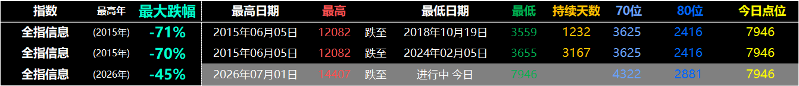
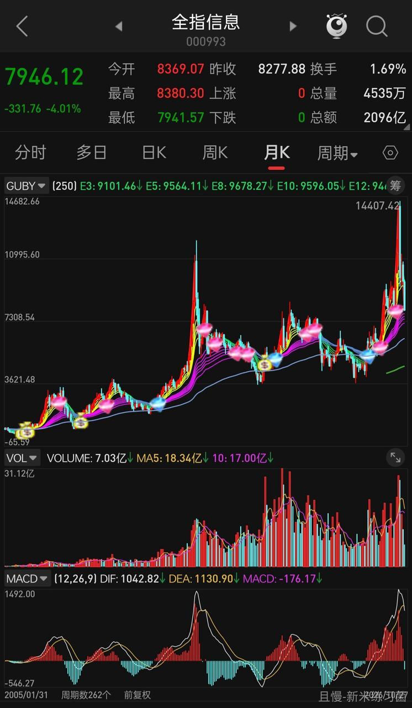
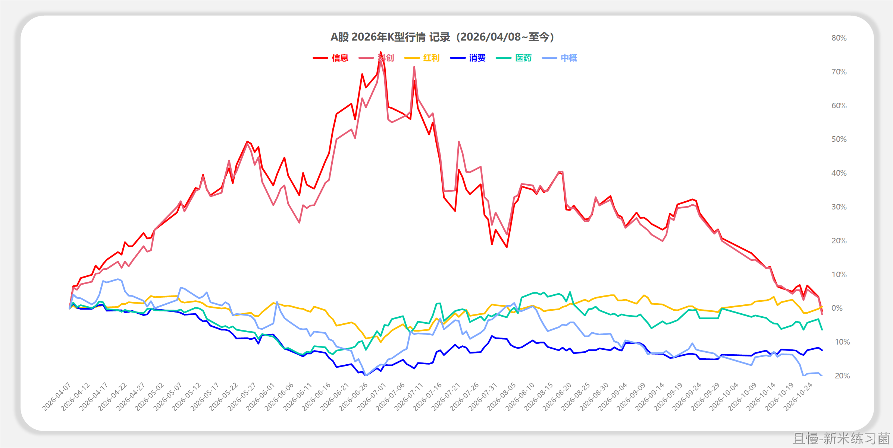
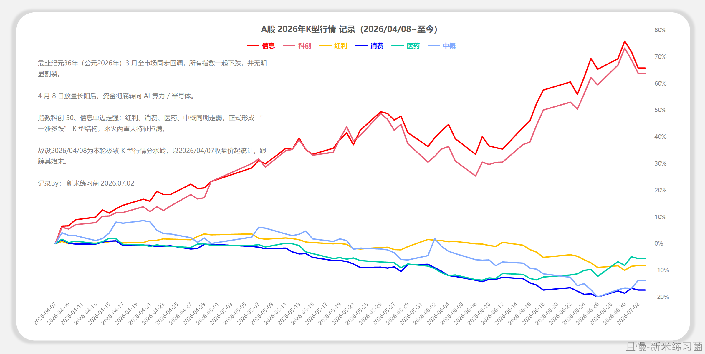
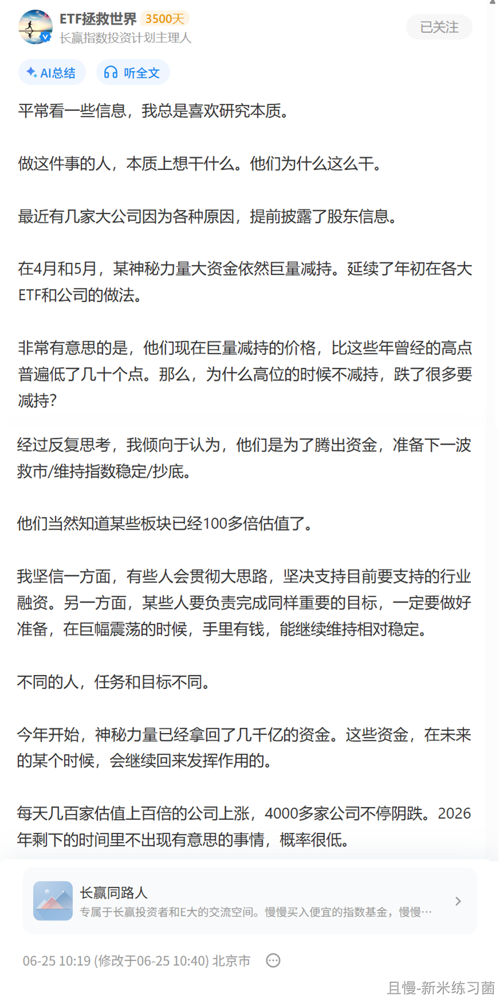
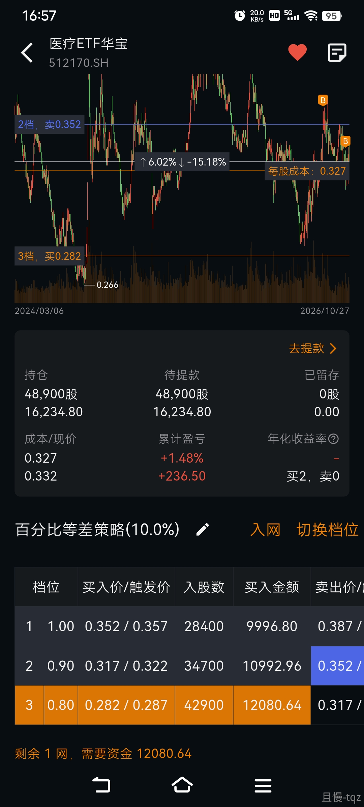
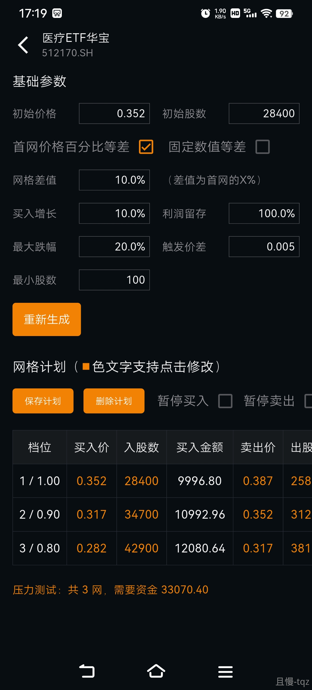
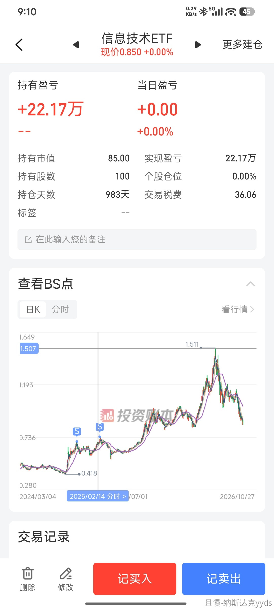

全指信息已经回撤接近45%，距离腰斩一步之遥。

回想2023年，我们的中证医疗也是在腰斩以后接近下跌60%的地方开始买入，结果三年依然没赚钱。

看信息最近十年的历史。

2015年高点后，三年后在2018年钻石坑见底，下跌了70%。

然而即使你精准的在下跌65%几乎最低的地方买入，依然在6年后，也就是2024年，不赚钱。

当然，后面的故事就是翻了200%的喜剧。然而，喜剧之后，又是很快成为悲剧。

这就是A股投资之难。

你在下跌50%、60%的地方买入，依然几年不赚钱。更别提高位买入了。

<!-- qieman-comments:start -->

---

# 全指信息已经回撤接近45%，距离腰斩一步之遥 · 评论区（2026-10-27）

> 评论区归档：2026-11-13 抓取于且慢社区，原帖共 349 条互动，精选 82 条（作者发言、作者回复及其他投资相关评论）。

## 不鸟万洋（上海市） · 0 赞

竟然是6年不赚钱，看样子还得耐心地等待中概。

## 来去匆匆（上海市） · 0 赞

红利仓位占比是否可以提高一些呢

## 先到300万（陕西省） · 0 赞

那咱们的组合可以多买几份海外，纳斯达克，标普500，包括您之前买的DAX，还是得去鱼多的地方钓鱼

> **周周有惊喜（广东省）** · 0 赞：纳指，标普应该是额度限制，买的少

## INNER_PEACE（山东省） · 1 赞

中间没有波段真的体验感不好

## 同路人_小卡拉米（广东省） · 4 赞

我们能做的就是控制仓位，低位买入，至于什么时候赚钱，能不能赚钱，能赚多少，就不是我们能控制的了😂😂

## 向天一笑（河南省） · 63 赞

真的很难，经历过一轮完整的牛熊，更有切实的体会。在美股，买的贵是原罪，可是在A股，买的便宜也未必就有结果。道心不坚定，在日复一日的动荡、横盘、下跌中，根本做不到初心如故。

## 暗香（安徽省） · 1 赞

照这么说，医疗的春天也快了吧🙂

## Duringg（广东省） · 3 赞

医疗再等三年？给我机会多投点？

## 丁丁90（辽宁省） · 0 赞

A股能赚钱，但是体验真的太差了

## 晴空万李（福建省） · 0 赞

没事，医疗又快到波段买日的位置啦~

## 胖猪的妈妈（山东省） · 0 赞

说得是医药吧，是快到了的意思吗？

## Kelen（湖南省） · 1 赞

仓位决定心态 仓位决定心态 这是本轮真金白银买出来的最深刻的教训😂

## 与星辰大海相拥（陕西省） · 2 赞

医疗会有200%的喜剧吗

## 新米练习菌（上海市） · 133 赞

全指信息，2015年跌到2018年，-70%一次；
2020年如果没走，那么，跌到2024年，又-70%一次；
《十年》
现在2026年创了新高，那么高，跌了-45%，还是不低，怕是“下个十年”“下个-70%”的开始…
——所以——
“投资这里（A股）最重要两个点：

第一，千万别买高。

第二，高了一定要跑。哪怕不全跑，也要跑一部分。”
——from文章【20260924】（11:30）A股最值得投资指数名单11年后更新

> **新米练习菌（上海市）** · 105 赞：再更新一下今年“特产”——《K型行情》
这两天跌跌（上周四，这周二），“咬”上了，像恐龙化石头盖骨。
想起6月时的这篇【图3】
——
"今年开始，神秘力量已经拿回了几千亿的资金。这些资金，在未来的某个时候，会继续回来发挥作用的。
每天几百家估值上百倍的公司上涨，4000多家公司不停阴跌。2026年剩下的时间里不出现有意思的事情，概率很低。" 
——
还有2个月，不知道这个“现象”算不算已出现的有意思事情之一。

## 义之士（安徽省） · 1 赞

A股市场是炼狱级别的难度

## 大鹏（四川省） · 0 赞

这么说a股真的需要择时，但是择时又是最难的地方

> **海上追风（江苏省）** · 0 赞：对我们散户来说不需要择时，只要最简单的资产配置，到时再平衡下就行，哪怕是最简单的永动组合，收益跟择时比也差不了多少，。

## 永春（四川省） · 0 赞

明白了，医疗还要再等几年

## 水竹（山西省） · 0 赞

医疗小黑车网格赚了好多呢🌹🌹🌹

## 村长刘（新疆维吾尔自治区） · 0 赞

在A股赚钱比港股容易  A股明显有情绪 港股那是真的理智 可能机构投资者占比大的市场都比较成熟理性吧  从19年买恒生如果不卖不动基本没赚钱

## 热美式和冰美式（四川省） · 0 赞

便宜的筹码要能守得住才行，难熬的日子还得想办法做些波段，但是说不定哪天惊喜就到了

## 如影随E（广东省） · 0 赞

耐心在这里好像没啥用…不确定自己会不会是因为中概，而有了坚决控制品种仓位以及赚了就跑的思想钢印

## 阿征（山西省） · 0 赞

跌了很多我反而可以大胆放心的买了，高的别人都吹捧的我反而不敢买，虽然小仓位也赚了点钱，但就是不踏实。

## 浅若清风（宁夏回族自治区） · 25 赞

充分说明了行业只能少量卫星，宽基才是硬道理

## 漫步于投资（日本东京） · 0 赞

这就是A股投资之难。

你在下跌50%、60%的地方买入，依然几年不赚钱。更别提高位买入了。

## 不系之舟_（浙江省） · 1 赞

太难了，这一波之后我察觉大部分钱还是得买入宽基，行业基只占一小部分就行🤔

## 雪铃（陕西省） · 0 赞

行业 etf 比宽基还要难很多，这一轮轮的已经有了深刻体会

## 小小菜园子（保加利亚索非亚） · 0 赞

发现自己有这么一个心态，既有一点点不太舒服，但又很期待未来。
我2021年高位入市的，高位接盘之后的煎熬，从中去逐渐认识到被动的指数基金、资产配置的方式去投资是适合自己的。

也这个原因在机缘巧合下遇到了认识了E大，虽然2021年的一些仓位，特别是恒生科技还没有回来，但是我还是很期待未来会发生什么的，这时候是不会把筹码交出去，因为所有的钱在账户里，不管他如何下跌都不会影响我现在的生活。

## 游击队员（湖南省） · 0 赞

以低于发车价10~20个点买入就好，买不到也不亏钱

## 资产加零（四川省） · 3 赞

横有多长 竖就有多高 在这里除了低位买入 剩下的就是耐心等待 好像没有别的办法 这是我跟了E大这么多年学到的 这么多年 我也真的发现 这个市场真的需要更多的耐心 十分十分多才够 我佩服E大这么多年的坚持 我也羡慕E大在这里获得过的结果 我也想要结果 所以我就跟E大一起耐心等待

> **大石头（浙江省）** · 1 赞：最起码到现在为止医疗医药消费肯定不适用

## 张仲蔚（陕西省） · 2 赞

这是不是就是老大以前说要在策略中加入动量因子的原因？还有种办法就是在底部不断用网格吃波段，算是中式特色的卖call卖put，稍微拿回点时间价值。

## 李哈哈哈（广东省） · 0 赞

这样是不是也导致很多人不愿意去接纳那些腰斩再腰斩品种的原因呢？甚至市场大多数人觉得玩上涨趋势的品种更靠谱，哪怕外太空。所以是市场造出玩法，还是玩法造出市场呢？

## 同路人_清风乱翻（云南省） · 0 赞

相较于买入和持有，卖出的窗口就是那么短暂！过去十多年，我还对一句话不是太服气，今年服气了：“会卖的才是师傅”。

## 逐阳（上海市） · 5 赞

长线+波段结合，才能拿的住。
恒科和中概，现在又快回到2022年的买入价附近了。
但恒科，恒科高点做了3次波段，累计还盈利不少。
网格在低位开了恒科，后面补了中概，目前为止，恒科+中概的累计还是微赚。
如果不是有网格，或许拿不住长线，但没长线，一路上扬，网格很快就卖的只剩利润仓位了，也是互补了。

## nekoxx（辽宁省） · 0 赞

买点纳斯达克，标普500吧，A股太凶险了，害怕极了。

## 酱油少女（浙江省） · 6 赞

不断做网格，医疗成本已降到3以下🤪赚钱了

> **常先生（河南省）**（回复 酱油少女） · 0 赞：可以分享一下你的医疗参数和网格占仓位比例吗？谢谢

> **酱油少女（浙江省）**（回复 常先生） · 1 赞：我瞎弄的，低于均线买入，涨10%就卖了。来回几波

> **tqz（江苏省）**（回复 常先生） · 1 赞：我分享一下我的医疗网格参数。
1、初始价格，我当时设置在850线附近。其实只要不贵就行，没特别要求。如果突破了，我应该会上移价格。不贵就一直做。
2、幅度是10%，每网加码10%
3、留利润取本金
4、每网资金量要小于计划总资金量*幅度。比如我计划持仓10万，网格幅度10%，我一网就小一万。不因网格买卖导致持仓变化过大。毕竟网格为辅，主要持仓要等牛市赚大钱。

## wpm（北京市） · 7 赞

E大又出来给大家心理按摩了，我很开心有世上还有E大这样的人，慈悲心肠，雷霆手段，感恩遇到，今生有幸！咱们医疗和消费也会像全指信息一样的，别着急，日本都能涨，咱们大A更是听话😌

## 霍庆丰（湖北省） · 13 赞

科创50真没必要一直吐槽，无论什么风格赚钱就是王道，再说策略牛逼体系好，一看持仓盈亏？ 各有各的玩法，做好自己就成，反复吐槽，让人感觉

> **爱民谣不爱摇滚（广东省）** · 1 赞：这个基金不是行情刚启动就卖了吗？没吃到很多利润啊，咋一直说这个

> **投资不能投机（江苏省）** · 1 赞：这哪是吐槽啊，这是救命的提醒啊。115倍估值帖子发的时候的时候，黑车逃顶，完美

## 周滔（上海市） · 0 赞

财富是认知的补偿。希望能站在二大坚实的肩膀上，赚取超额利润。哪怕不成攻也没关系。

## cml（重庆市） · 0 赞

A股真得耐心、使劲的等待

## AAa包子姐（重庆市） · 2 赞

现在情绪稳定都多亏跟着老大买，经历过这些年，浮亏都淡定了

## 8慢慢8（湖南省） · 5 赞

所以至今没搞明白，在跌幅不大时，开始中概网格

## 铁中铁（山东省） · 0 赞

美股又大红了，只能看别人狂欢了

## 星梦ya（浙江省） · 1 赞

今年的养老金账户跟着买了红利和A500，耐心等下一波机会😃

> **二级市场捡垃圾能手（上海市）** · 1 赞：个人养老金买了红利，前一段时间还做了波段， 真香啊

## 花傲天yu（江西省） · 6 赞

评论里清一色吐槽医疗中概消费的，是不是快要到底了。。。。

> **荔枝酒（江苏省）** · 4 赞：医药比中概有信心哇，中概真是烂了。。。

## 橙夏（山东省） · 0 赞

行业ETF的确有些难，熬的比较久，涨起来也就短时间，稍微格局下就又回去了😅

## 小白菜很菜（江苏省） · 0 赞

医药医疗消费我买的稍微晚一些，去年十月左右买的，拿了差不多一年了，开了网格，安心拿着。

> **山竹（浙江省）** · 0 赞：网格有一部分是不是也被套着了？

> **不怕熊的winnie（上海市）**（回复 山竹） · 0 赞：网格咋可能被套嘛，网格的中概系已经翻倍了

## 易水寒fly（河南省） · 7 赞

E大，想咨询下，医疗医药机构持仓已经那么低了，到底是谁还在一直卖呢？导致昨天那么大的跌幅🙏

## kuanke（广东省） · 3 赞

跟投了两轮牛熊，收益拉胯，只能说A股投资太难了，太难了，对散户太不友好！

## 纳斯达克yyds（上海市） · 1 赞

其实不是很快，是一年多后又翻倍了，目前还比卖出时高一点🤣

## 冬蜜瓜（河南省） · 0 赞

跟着老大上的红债做后盾，丐疗就一直按网格的节奏开黑车。

## 萌新是我（北京市） · 0 赞

A股好像真的要学逃顶，不存在抄不到的底😅

## Patrick从4000点启航（山东省） · 2 赞

老大别忘了医疗啊，感觉又可以做波段了😍😍。前面跟着做的几次太爽了，心理压力显著下降。

## 红鱼（广东省） · 7 赞

捡垃圾不难，但守着垃圾几年看着别的变得越来越纯的黄金那就难了，更难的是不知道应该在这垃圾变成多高纯度黄金的时候卖。

## 翠翠008（广东省） · 2 赞

在A股要敢于卖出，敢于落袋，否则怎么来就怎么回，而且是几倍奉还

## 对了大（河南省） · 0 赞

保持耐心，消费起来的时候就是医疗的春天来了😃

## zhouxuanli（贵州省） · 4 赞

我自己场内买的医疗做波段已经红了

> **WAA（上海市）** · 1 赞：我场外的医疗c做波段 也红了 😄

## 阿狼（广东省） · 3 赞

下跌时间长，过程煎熬，把所有人的信心熬没了，就开始了。然后放一个大烟花结束。这个过程，需要对规律的深刻认知和理性的坚守。然而能走到最后的，依然没有几人.太难了。

## 禹翟（新加坡） · 1 赞

甚至在回撤50%的时候买，最低回撤70%的时候也已经是亏损40%了😅

## Lisa2025（山西省） · 0 赞

经过这一轮上涨📈和下跌📉，更加体会到E大的组合的牛。坚持跟投下去😃

## Joovei（北京市） · 1 赞

请教E大：那是不是说明A股的左侧不能买太多，要留更多的部分，等待右侧上涨？我记得您之前微博说过，大部分都买在左侧，右侧起主升浪的时候，会加一车。您现在还维持之前的策略吗，还是有了新的调整？谢谢🤝

> **保本小赚（广东省）** · 0 赞：难的是怎么精准判断左侧还是右侧，一般是抄底失败和意外追高😃

## 同路人_E3Hcvx（陕西省） · 2 赞

唉，也不知道中概什么时候能起来

## 小鹿遁出森林（陕西省） · 1 赞

狠狠记一笔医药致敬的惨痛教训，然后继续笑着生活，等出坑～

## 罗昂纳多（广东省） · 0 赞

虽然回撤幅度不大，但还是很伤身。。😂😂

## CreamYang（广东省） · 0 赞

人民币升值，美债怎么办？

## 同路人-鑫鑫向荣（山西省） · 3 赞

冷知识：
如果一只投资标的从高点跌了99%，

而你非常有耐心，终于忍到，它下跌90%的地方，开始抄底，

恭喜你，你买入后的浮亏将会是90%，
这是你抄底后，亏了“另一个90%”。
你体验如何？

如果你痛不欲生，几近绝望，
对未来没有信心，挥泪斩仓。
祝贺你，不到两年，迎接你的将是10倍涨幅。

这不是恐怖故事，也不是传奇故事，
是真实案例。

新东方美股面临双减+疫情，一年时间脚踝斩，
下跌99%。

而从最灰暗的底部8.5美元，不到两年时间，
涨了10倍。

E多每每说到，普通人最适合的就是红利＋指数

也多次提醒友友们可以试试自己买股票，基金，试试其他策略。

试完之后，你会觉得长赢有多香！

## 诗诗的幸福（陕西省） · 0 赞

中钙，医疗，消费就是这样的，一样，不知道啥时候才能走出来

> **大石头（浙江省）** · 0 赞：大大之前说过医疗28年再看

<!-- qieman-comments:end -->
