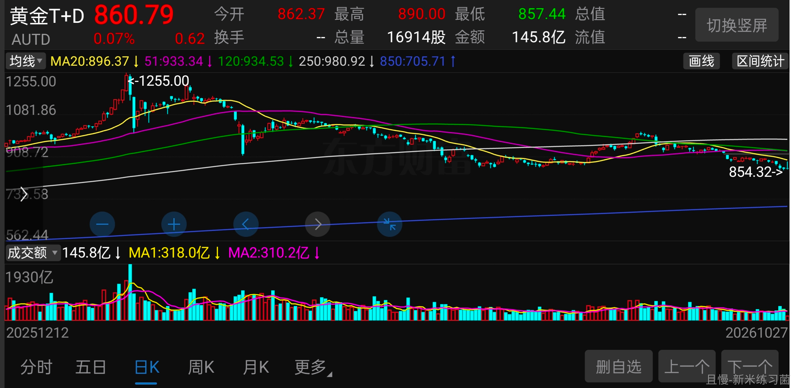
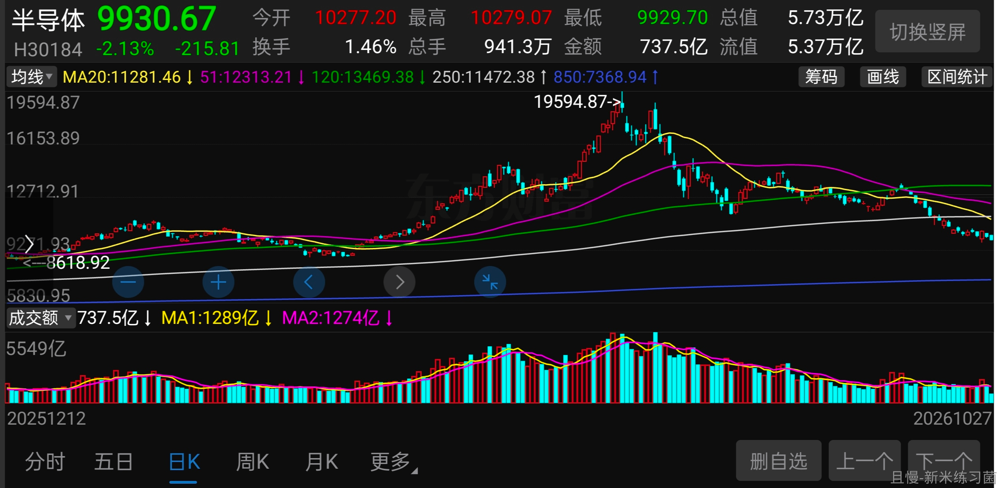
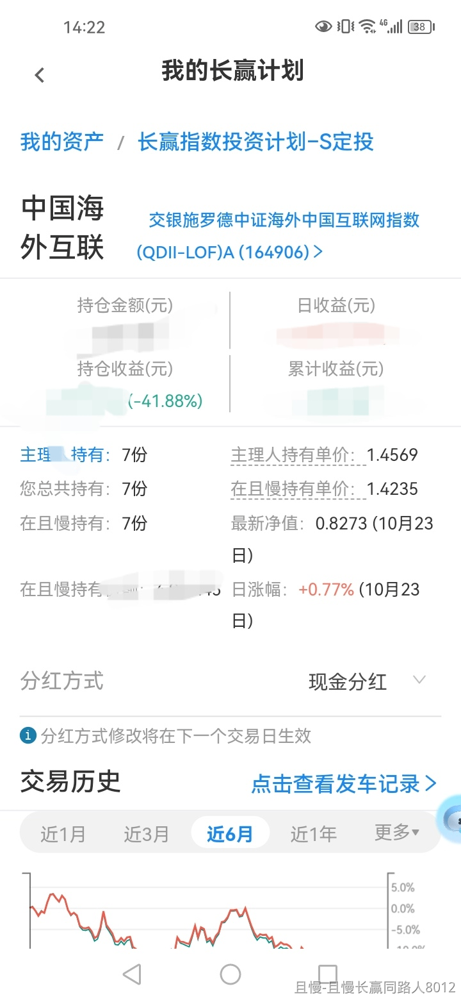
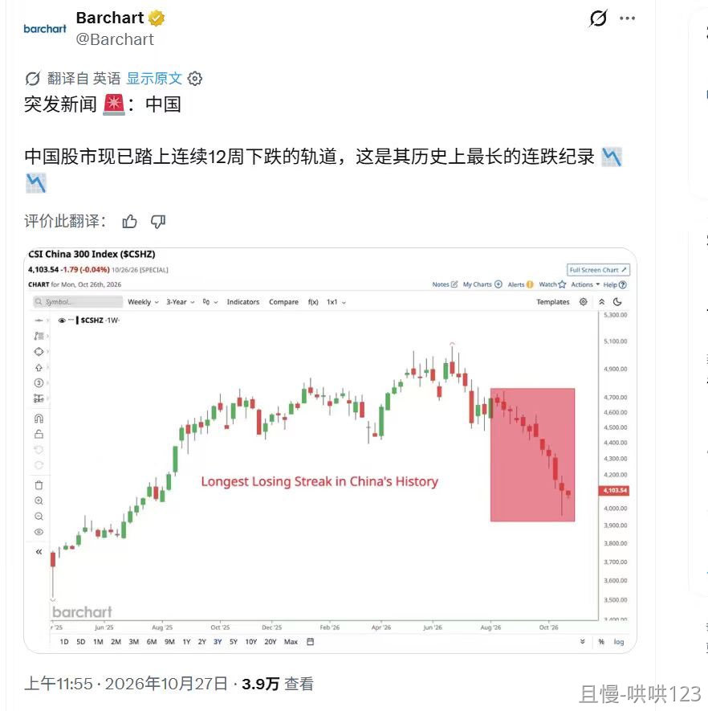

刚才在xhs看到一个人年初买了黄金，5、6月买了科技股。

麻了。

明明都是暴涨的品种。结果赔了个一塌糊涂。

财富不会消失，只会转移。每一次行情都是如此。

咱们做金融投资的时候，首先要想的是，怎么不让自己的钱转移到别人那里。然后才是怎么才能把别人的钱转移到自己这里。

<!-- qieman-comments:start -->

---

# 刚才在xhs看到一个人年初买了黄金，5、6月买了科技股 · 评论区（2026-10-27）

> 评论区归档：2026-11-13 抓取于且慢社区，原帖共 296 条互动，精选 64 条（作者发言、作者回复及其他投资相关评论）。

## nimo.（浙江省） · 43 赞

跟几年前买中概和医疗也差不多

> **一凡（北京市）** · 20 赞：我觉得不一样，中概亏 30%  基本上是大底了，而科技 50% 的回撤后，还是不便宜，还没到我们的击球点呢。

> **巨大的芒果（北京市）** · 3 赞：差很多 中概医疗都没给过卖出机会  双创给了足够的机会了

> **慢慢来比较快1587（河南省）**（回复 一凡） · 0 赞：请问科技会到哪里啊？🙏

## 小w（湖北省） · 0 赞

想听听养老基金的看法😃😃😃

## 左右（广东省） · 0 赞

这不就是我同学吗，他就是这样操作的，1100左右的时候买了黄金，然后割了，6月份买了半导体

> **海上追风（江苏省）** · 0 赞：追高追低都可以，关键是看你有没有策略，当然绝大部分人是没有策略的，全凭感觉买卖。

## 尢拾柒啊（河北省） · 0 赞

我刚又看了自己9块卖出去的500，感谢有你！

## 如是我闻-（湖南省） · 0 赞

老老实实跟车，不信就自己买，我自己买的科创，创业板，已经-30%了

## 新米练习菌（上海市） · 142 赞

E大中午好，
黄金回撤-30%，年初
科技回撤-50%，5/6月
其实不得不说，倒也是精准…属于《山顶资本》。

## 同路人_ZOTmVV（北京市） · 0 赞

年初朋友白银暴跌前夕，听xhs的话重金买的银砖。我说姐姐你这辈子没买过风险超过固收的理财产品，这一干干了个大的，整体资产的35%左右吧，都买了银砖

## 80分投资者（河南省） · 0 赞

市场总不缺机会，尤其是a股。开黑车尚有可能翻车，更别说追高了，一次追高十年不好翻身。

## 黑暗骑士robot（北京市） · 3 赞

期待黄金继续跌，跌到咱们的买点

## 同路人_Bn80Yq（广东省） · 72 赞

我大A从来都不缺买入的机会，卖出的机会却少的可怜，所以买入要谨慎，卖出要及时

> **同路人_Bn80Yq（广东省）** · 6 赞：这轮又结束了，再想大规模的卖出，只能等5年后了

> **dryduck（山东省）**（回复 同路人_Bn80Yq） · 48 赞：今天看到一个视频说大A要学习的是逃顶，没必要学抄底，整天都有底🤣，美股要学的是抄底。

## 被ETF拯救的may（辽宁省） · 0 赞

嗯，我就是那个年初开始定投黄金的🤐

## 宁雯昕（上海市） · 0 赞

年初买了黄金实物金条
5-6月自己的基金定投做了止盈卖出

## 周滔（上海市） · 2 赞

能做的只是尽量不追高，黄金在4000买了点，4400走一半。现在准备接回来那一半。科技深跌后买了mini仓，现在套10%出头。没啥大问题

## 大超超（北京市） · 0 赞

我也是😇已升天 不过科技股有止盈操作
黄金就扔那放着了

## 文二（广东省） · 2 赞

兵荒马乱的大A有世外桃源的长赢计划，幸运着我在计划里😘

## 小小虾米（北京市） · 0 赞

讨论的人多的品种，都不是买入的好时机，等到热度过去或者热度没有来的时候布局

## 丁丁90（辽宁省） · 0 赞

坚持资产配置，加再平衡。让系统决定

## 同路人_58KM7T（河南省） · 17 赞

交银中证海外互联网指数基金目前亏37个点，现在能否补仓了，大家给些意见

> **洗心革面学投资（河南省）** · 1 赞：建议拿一部分钱做波段

> **Hoikei.W（广东省）**（回复 洗心革面学投资） · 1 赞：一直跌，咋个做波段？

> **哄哄123（重庆市）** · 1 赞：说真的，只要是港股市场，都不要去碰了

## 轻舟已过万重山.（山东省） · 9 赞

E大能说说中概吗？看起来不贵

## 萤火虫之光（湖南省） · 3 赞

跟车这几年来，最大的感慨就是大A永远不缺买入的机会，缺的是现金，管理好自己的仓位，拿闲钱来投资是铁律。

## 泛泛之辈（湖北省） · 0 赞

年底发奖金了加仓，现在没钱了

## ETF计划执行者（贵州省） · 11 赞

行业都不容易，这几年被医药、新能源、中概坑了不少😓

> **百花争艳（广东省）** · 6 赞：说的有理，熊市布局宽基才是硬道理

## 大头（湖北省） · 1 赞

E大  今年是不是A股史上最难得一年？ 波动猛烈 轮流割

## 云上（湖北省） · 0 赞

想抄底黄金做个短线=。= 现在被套10%

## qiemanmomo（广东省） · 1 赞

怎么一直有人说中概的，后面已经拿恒生科技补了

## 徐徐图之（北京市） · 0 赞

我也买了黄金，但是买的少😂标记了自己的愚蠢

## 小布童鞋（上海市） · 5 赞

被A股折磨了十几年，我彻底受不了了，已经把绝大部分持仓转移到了场内的纳指ETF。这笔钱是我准备的养老钱，投资周期是二十年起步。现在纳指溢价很高，做这个决定很艰难，但我想，滚雪球总得找个雪多的地方才有机会滚大，即使买入后就下跌，或者不幸碰上泡沫崩盘，我也认了。从十一之后开始行动，到今天基本挪完，真的是心累。A股这个生态，太难了。不过还是要谢谢E大，这些年确实学到很多。

> **nonerule8（福建省）** · 1 赞：这么决绝。我也觉得大A赚钱太辛苦，也太难了🤣也在想，等美股回调，也配置些场内的美股基金。但现在实在是下不去手。我再等等，慢慢配置一点。大A没赚钱我是不跑的🤣🤣🤣

> **小布童鞋（上海市）**（回复 nonerule8） · 0 赞：长赢跟车五年多整体上是赚钱的，截止今天还是赚的，只是利润回撤了很多！我只赎回了赢利的部分，剩下的相信E大会帮助大家赢利的。别的地方买的不管盈利亏损是全部赎回，一分没留。🤧

> **SHOWZHOU（四川省）** · 0 赞：既然是养老还是分散点比较好啊

## 且慢长赢同路人8012（重庆市） · 16 赞

交银施罗德中证海外中国互联网指(164906)
当前持有7份

## 谁是懒惰虫（广东省） · 0 赞

有被骂到，小仓位玩了一下，两眼发直哈哈哈哈

> **Guangyin（天津市）** · 0 赞：都一样，很小仓位试错我觉得是没问题的，不但没问题反而应该这么做。

## 哄哄123（重庆市） · 0 赞

沪深300指数连续下跌11周了😭😭😭

## MNMG（浙江省） · 1 赞

老大，我买在了年初黄金的最高点！还好只有小几千，算是体验了亏钱的过程。😃

## 笨鸟先飞走（江苏省） · 0 赞

黄金跌嘛了，科技跌嘛了，除了红利，别的都跌麻了

## 同路人_dvTjKT（广东省） · 13 赞

中概不是亏了也亏了很多吗？😓😓😓

## 舒服就行_踏踏实实的（北京市） · 3 赞

中概没办法，我觉得应该看组合，不用组合的眼光看收益是没办法做好投资的。配比合理就好。

## 小K的窝窝（重庆市） · 2 赞

现在努力折腾中概，医疗，医药，养老

## 周滔（上海市） · 1 赞

红利这样子搞下去，会不会变成第二个科技

## 90后嘟嘟妈妈（上海市） · 1 赞

我？好在还好，就几千块😂，放着吧，黄金跌了10几个点，2000块，科技跌了44个点了，也不多，就几千，这下老实了，好在几千块管住了自己的手，这个钱不是我能挣的，还是老实跟车😂

## 巷里猫（福建省） · 3 赞

黄金是国际的，也不是A股啊，大家别骂了

## Fawn（上海市） · 0 赞

有的时候不知道哪里是低位，干脆定投看起来不高估的etf算了

## 闲适（辽宁省） · 1 赞

中概只是亏损。但不是山顶站岗啊

## 堇贤（北京市） · 3 赞

恒科和医药真是跌得扎心啊，以为大底了还能再跌，希望它们可以尽快支楞起来😭

## 同路人_Aue2eD（北京市） · 0 赞

换个角度看看 黄金美股基本都已经是纯利润在奔跑🙈

## 禾下乘凉梦（山东省） · 2 赞

E大，在港股上市的公司，以后还会有流动性吗。目前港股不能说是一潭死水也可以说是没几个喘气的了，以后还有配置港股的必要吗。🤔

## Freedomisland（浙江省） · 2 赞

黄金去年我买了点，还好今年3月份高点附近跑了，科技股看不懂不买

> **zero.（广东省）** · 0 赞：ni zhen de shi hao yang de。现在被科技杀的，都求自己没进过这个市场

## 聆聽風聲（北京市） · 0 赞

3点说科创50那条更。。。只比过去5年84%的时间贵可还行🤣

## 毛豆（广东省） · 0 赞

当黄金被很多不做黄金的人知道涨了非常多之后，就表示离大跌不远了。不敢进入

## 益起达（江苏省） · 0 赞

某些基金经理调仓止损？？

## ftmnz（北京市） · 0 赞

这不是我嘛。。还不如她。。年初买的白银😅6月买的科技

## wpm（北京市） · 1 赞

感谢E大，我们是整体盈利安全的一部分人，我感觉买入的机会又来了，很开心🥳

<!-- qieman-comments:end -->
