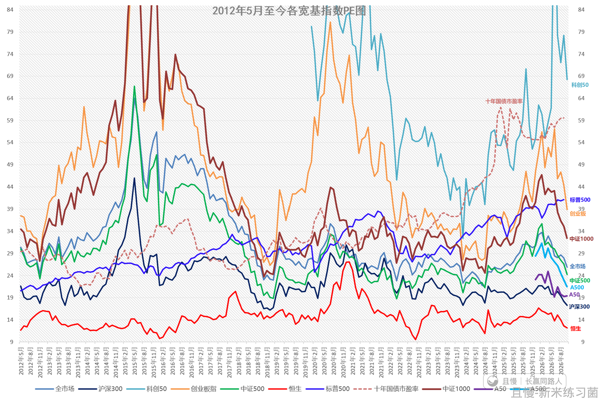
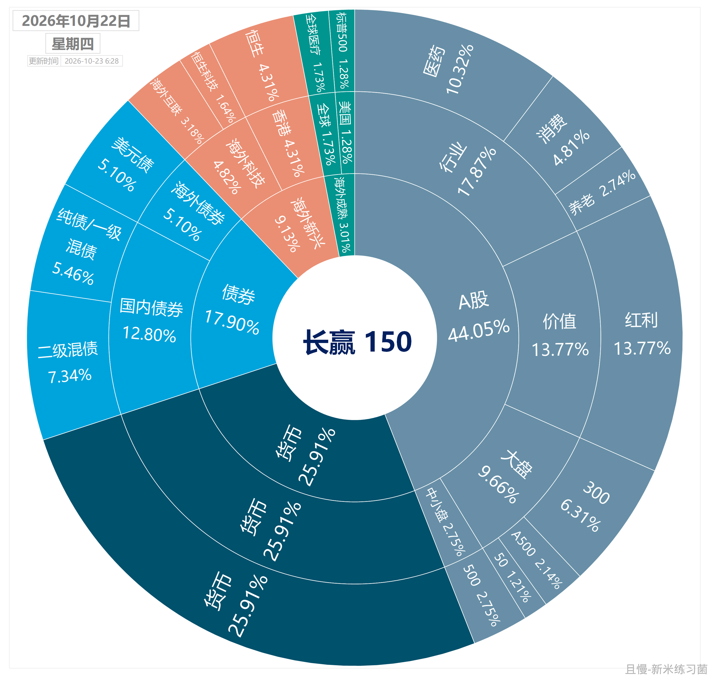
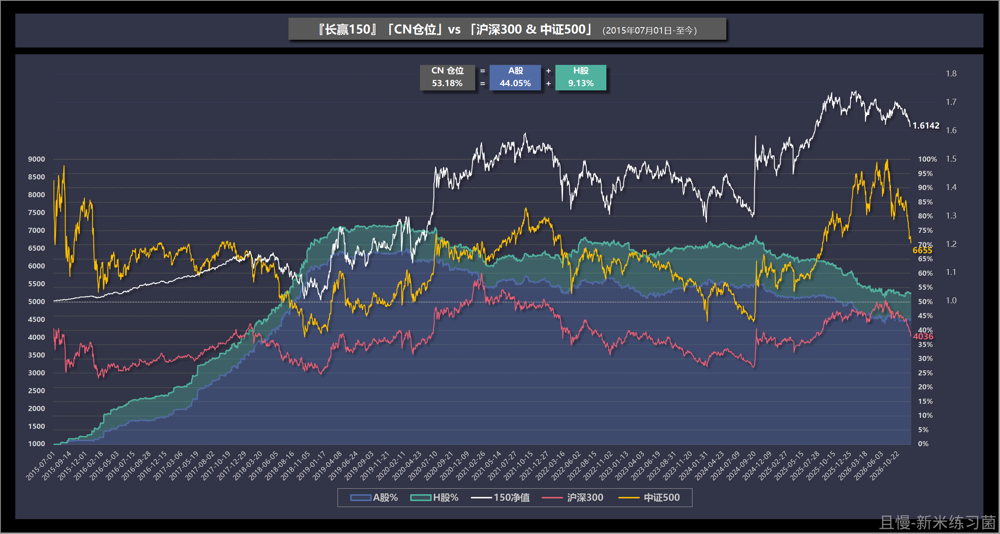

只要市场不大幅反弹，那么下个月开始，我们的宽基买回操作将继续提速。

各位可以根据自己的情况，丰俭由人。

我自己是要加快买回速度的。不管你这那的。

今天收盘，全市场估值已经回到五年30%、十年20%以内了。

<!-- qieman-comments:start -->

---

# 只要市场不大幅反弹，那么下个月开始，我们的宽基买回操作将继续提速 · 评论区（2026-10-27）

> 评论区归档：2026-11-13 抓取于且慢社区，原帖共 543 条互动，精选 63 条（作者发言、作者回复及其他投资相关评论）。

## cookies_xxx（广东省） · 0 赞

可以买创业板的日子越来越近了

## ETF拯救世界（作者） · 389 赞

别人欲哭无泪的时候，你就可以加快进场捡筹码的速度了。

> **山竹（浙江省）**（回复 长赢E家人） · 59 赞：为啥我看着医疗医药笑不出来😂

> **长赢E家人（辽宁省）**（回复 山竹） · 2 赞：只要不是欲哭无泪就好，你仓位大吗？按照份额买不会出大问题的，长赢也不是买了就卖、相信到卖的时候你会大笑不止😃😃

> **同路人_15shDa（安徽省）**（回复 山竹） · 19 赞：医疗6年过去了，人生有多少个六年

> **海上追风（江苏省）**（回复 同路人_15shDa） · 1 赞：你讲到重点了，所以才要资产配置，你提到这个问题，说明你已经悟了。

> **洗心革面学投资（河南省）**（回复 山竹） · 4 赞：笑不出来也不能说有什么问题，只是你没有思考过，辛辛苦苦上班，看领导眼色，被同事甩锅才赚那点工资，那凭什么在股市随便点一下买入，就能赚钱？没有任何事情是轻松的。

> **zyy（江苏省）**（回复 海上追风） · 4 赞：所以大家站的角度和立场不一样而已。他跟我一样是在且慢跟的e大。e大也说了欢迎不是人身攻击对事不对人的意见。他也只是代表了他角度的观点所以没有对错。如果你也是在且慢里开始跟医疗消费中概我想你也有不一样的观点~

> **Forgeter（吉林省）**（回复 山竹） · 0 赞：我是准备接着买，浮亏在百分之以内，怕啥，接着做波段，接着降低成本

> **wpm（北京市）** · 2 赞：太好了😀！听到别人谈医疗，别老看现在，我算上致敬，长赢占比不多，没超过20%，咱们账户累计盈利，安全垫够厚，还拿了优质筹码。恒生医疗怎么样了，赚了多少

> **少买股票多买宽基（山东省）**（回复 同路人_15shDa） · 1 赞：医疗才7份，不用慌啊，我自己都黑车到20份了。

> **海上追风（江苏省）**（回复 Zhangyg） · 7 赞：其实投资盈利真的非常简单，只需要在指数低点，比如前几年的恒生指数，我就是在低位买入，持有了几年，那几年恒生指数真的跌得很惨，涨起来后我就抛掉了。还有中证500，创业板等等，我基本都是低位买入，然后耐心持有，不涨不抛。现在我的目标又是创业板，等它再跌点我就开始布局，后面越跌越买，买完了就持仓不动了，等几年它涨了再抛。所以，你可以看出我买卖一次都是几年的周期。

> **Zhangyg（北京市）**（回复 海上追风） · 6 赞：恒生科技呢？医药？证券？

> **海上追风（江苏省）**（回复 Zhangyg） · 3 赞：宽基指数，宽基指数，我们散户一定要以宽基为主，等你水平足够了，再逐步增加行业指数仓位，这就是资产配置，我们散户最终的策略。

> **海上追风（江苏省）**（回复 Zhangyg） · 1 赞：其实，重点买宽基指数，次要才是行业指数，这个根本不需要我跟你说，难道你会不明白？你无非就是非要来反驳我而已，这个就真没意思了。

> **Mary（福建省）**（回复 山竹） · 0 赞：光看亏损的确实心里不舒服，但没买在高处已经很好了，至于什么时候涨真没法预测。所以才要策略，仓位配置。

## zhouxuanli（贵州省） · 0 赞

今天等不及买了点三百etf,很不幸没有买在低点。

## zhouhaha（浙江省） · 0 赞

期待买创业板的那天😃😃😃

## 新米练习菌（上海市） · 62 赞

我贴一下上周四10/22收盘后的数据（今天比那日还低，应该可以参考用用吧）
（估值图是老大的，也是那日收盘后发的，借用一下哦）
现在仓位不高，现金也很充裕。

> **Guangyin（天津市）** · 3 赞：没错，沪深300的估值从8月份又下降了好多，都接近12了😃

## 红魔披头士（山西省） · 2 赞

我本身就是长期满仓，给机会的话就再酌情加点，但也买不了多少，还有两个月左右，今年可能要以浮亏收场了。

## 捡辣鸡二十三名（陕西省） · 0 赞

现在算黄金底吗？很多估值被情绪杀到很低了

## Andrew_Li668（江苏省） · 0 赞

500现在位置开始网格合适吗？

## 同路人_Um2OJp（河南省） · 2 赞

这波沪深300没卖算遗憾吗

> **zhouxuanli（贵州省）** · 4 赞：我自己的仓位跟着国家队清仓了，很为自己骄傲，150的仓位好像很少，就跟着老大的计划了。

> **周周有惊喜（广东省）**（回复 zhouxuanli） · 0 赞：问下国家队怎么跟的，从哪里看他们卖出

> **zhouxuanli（贵州省）**（回复 周周有惊喜） · 1 赞：国家队卖出的时候网上到处都是新闻，你没注意看吗？

## 小楼听雨（广东省） · 0 赞

理解，提早布局，短期大幅上涨的话，可以卖出一部分，增厚利润垫。

## 夏小天（山东省） · 1 赞

E大，宽基大约会买多少份，提前准备一下资金😊

## Biubibabo（北京市） · 0 赞

乐疯了，快点吧，求别反弹

## 众所周知zh（广东省） · 0 赞

清仓红利买宽基，应该只能这样啦

## 逐阳（上海市） · 0 赞

一直没啥宽基，现在终于有机会了。

## 简单点（四川省） · 1 赞

其实有点担心出现中概的情况，一路跌，买的太早，跌一半，就到3200左右。

> **zhouxuanli（贵州省）** · 0 赞：中概和宽基不是一个层面，中概属于行业etf,行业可能长期不行，宽基低位买入基本是稳赚的。

> **zhouxuanli（贵州省）**（回复 If-OnlyJ） · 0 赞：那就买红利吧，就算不择时，买了不要动，拿个几年，肯定比存银行强。

## 永思（四川省） · 1 赞

逐步加仓，买入肯定是好机会

## 坚定跟车（北京市） · 0 赞

又能加仓啦~安心跟车E大~辛苦辛苦~

## 追风少年2021（河南省） · 0 赞

自动脑补了老大“不管你这那”的语气，笑出了声～，果然不追高是铁律，短短几个月的跌幅也是满恐怖的，没经历过2015，不知道当时股灾的情形是否更甚…

## 同路人_oOszrO（天津市） · 0 赞

问一下我看软件科创50估值是100左右，E大的估值是70多，E大的估值怎么计算？

## 平常心L（广西壮族自治区） · 0 赞

老大.，您说红利放量.，是不是新募集的主动基金干的

## 春深几许（浙江省） · 0 赞

宽基大概会再买多少份，要去准备钱钱了

## stephano（山东省） · 0 赞

可以调高每分金额么？跟e大之间差了好多持仓，不知道怎么追上😓

## 阿特拉斯111222（上海市） · 0 赞

宽基包含哪些呢？有人知道吗

> **百花争艳（广东省）** · 0 赞：沪深300，中证500，中证800，标普500等包含很多个行业的

## 勇懿毅YYY（上海市） · 0 赞

宽基、红利，统统到碗里来

## 应无所住（四川省） · 0 赞

我定的计划是3850附近买回300，至于A500会跟长赢走

## 老何（广东省） · 0 赞

好，我就是没什么宽基，一直没跟上，就A500跟了一点

## 周滔（上海市） · 1 赞

只买A500了，我有大把中证红利和红利低波，300啥的再配的意义不大

## FF568（广东省） · 8 赞

中概，恒科，医药，医疗，消费
亏麻了😭

## 山人隹（黑龙江省） · 0 赞

怕一被指导，下周就要反弹了。

## 季公子（湖南省） · 4 赞

E大能预告一下要买的品种和仓位吗，好提前准备钱😘

> **投资不能投机（江苏省）** · 1 赞：根据情况看，指定是继续买A500啦，继续跌的话有可能建仓创业板

## 春眠不觉晓（山东省） · 0 赞

我红利有不少，
我跟车比较晚，
宽基没有多少，有一点A500，
沪深300啥的宽基，需要补充了

## 兔rabbit（山西省） · 0 赞

期盼已久，继续耐心等待各种宽基到碗里来🌹

## 雪木公子（北京市） · 0 赞

一直控制加仓的小手，就等号令，这次除了跟车，自己也试试配置一些喜欢的品种。

## 碧蚁红炉（广东省） · 0 赞

E大，红利最近波动剧烈，这个月会做波段不？

## 长江边上_（江苏省） · 0 赞

那个红利etf增加是不是gjd干的；看来gjd又开始慢慢进场了

## Luckygirl88（云南省） · 0 赞

太好了，我跟车晚，没买什么宽基，红利之前跟车买了一些，这次把宽基配好

## 稳稳的静待花开（山东省） · 0 赞

丰俭由人的买入是哪只啊，我是小白也

## kimiyt（北京市） · 1 赞

E大，咱们买点港股创新药ETF怎么样

## 姜大伟（天津市） · 0 赞

我也一直偷偷的加仓还在赔本的基金，哪个创新低了我就偷偷加点

## 抽刀断水（广东省） · 0 赞

宽基会包括创业板么？老大？创业板是不是还是比较贵？

## 瓶子啊（泰国） · 0 赞

场内网格自己成交，都没去管他，只等下跌

<!-- qieman-comments:end -->
