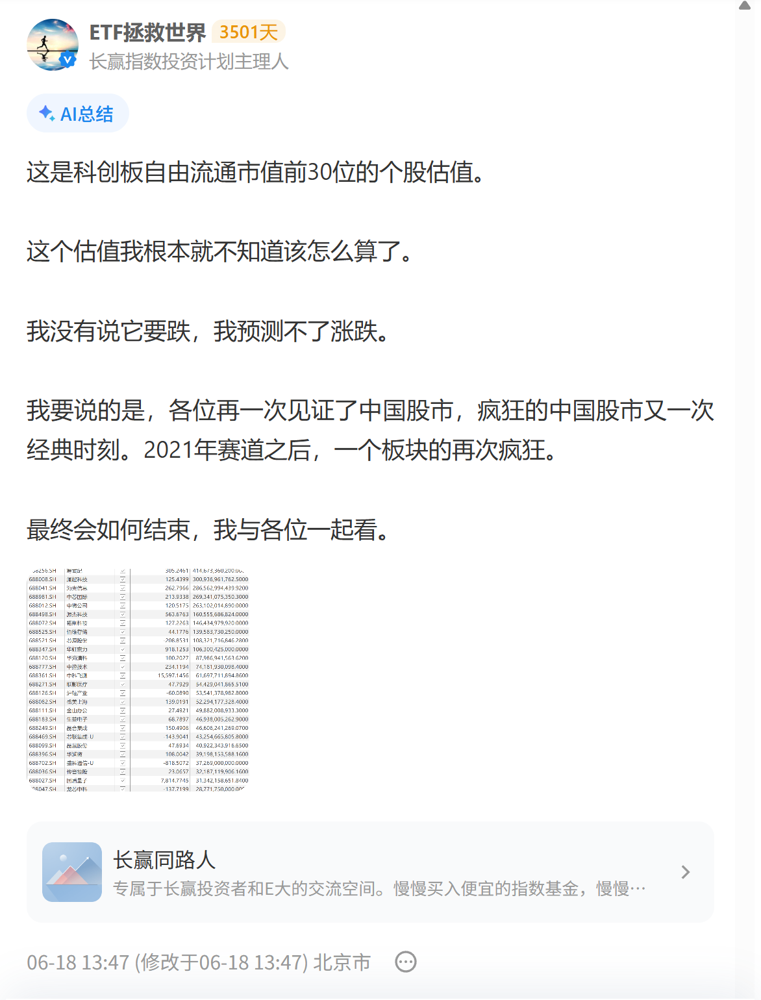
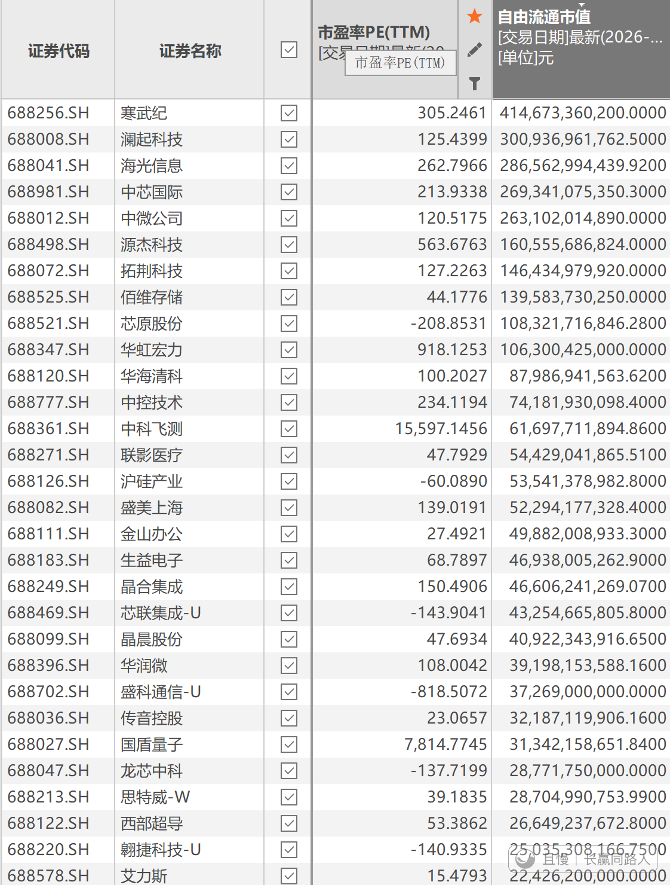

今天科创50再创调整以来新低。

回看6.18这一篇，终究是没让我失望。

那一天距离115倍的超级大顶，还有12天。

<!-- qieman-comments:start -->

---

# 今天科创50再创调整以来新低 · 评论区（2026-10-29）

> 评论区归档：2026-11-13 抓取于且慢社区，原帖共 1 条互动，精选 1 条（作者发言、作者回复及其他投资相关评论）。

## ETF拯救世界（作者） · 205 赞

A股股民确实疯狂。在最后的12天，科创50又涨了35%。

<!-- qieman-comments:end -->
