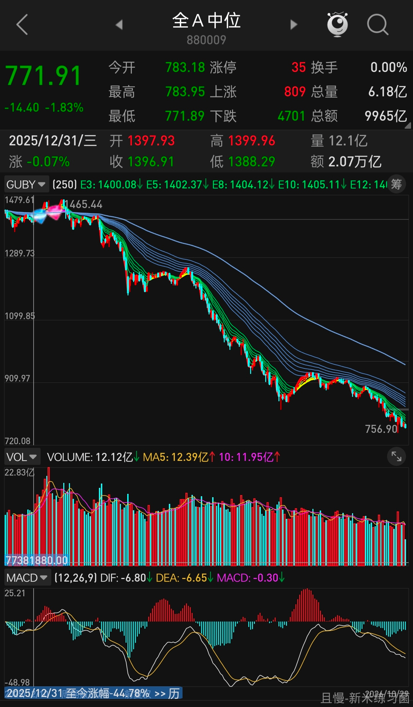
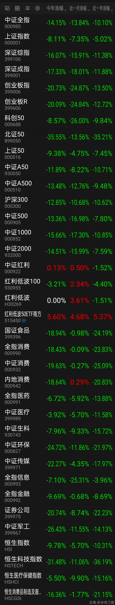
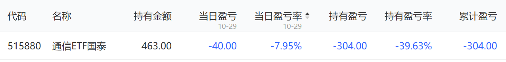

我知道各位长赢的账户最近也是有回撤的。

但我真希望各位在长赢以外自己买股票、买基金。这样各位再回头看长赢，就会发现这个世界是多么温柔了。

我真心真意，第101次建议各位在参考长赢投资的时候，也自己去做投资。这样有可能发现自己是投资奇才。

<!-- qieman-comments:start -->

---

# 我知道各位长赢的账户最近也是有回撤的 · 评论区（2026-10-29）

> 评论区归档：2026-11-13 抓取于且慢社区，原帖共 670 条互动，精选 124 条（作者发言、作者回复及其他投资相关评论）。

## ocd的地盘（广东省） · 3 赞

长赢是我还在投资的信心，自己买早就不玩了

## 可乐且慢（浙江省） · 0 赞

哪个账户没有回撤？回撤不是很正常吗？希望大家平常心一些 关掉账户出去走走 已经跟车了就别操心了 反正有e大看着呢🙈

## Lrright（北京市） · 0 赞

e大，我都想把全仓位加到长赢了。自己买股基太操心了😭

## Fengsui（河南省） · 0 赞

总得试一试。已经从红利场外反转和科技场内趋势开始。

## 老农（广西壮族自治区） · 0 赞

主仓在长赢，小小小仓自己乱买

## 兰花草（北京市） · 0 赞

是有回撤，确实感受到长赢的温柔😄
自己的账户没有节奏，亏的比长赢多，实操下来，我接下来的计划留足够的生活资金，然后其他的就是更加坚定跟长赢，E大已经在我跟您计划的这几年帮我规避了太多的损失。我坐车非常踏实！谢谢有您，E大有一颗如计划一样温柔的心🌹

## 丁丁90（辽宁省） · 1 赞

我确实自己也在长赢外买股票，不过是美股🙂

## 云枫（广东省） · 1 赞

看到第101次的时候，我笑了。其实一直有对比，我买了主动基金，那回撤大不是一点。

## 捡辣鸡二十三名（陕西省） · 2 赞

自己开的黑车都被埋了😂
经过这几年的毒打，得出的结论是：
1.A股的底在地表之下还有18层，一不小心抄底就抄成重仓；
2.黑车的目标是回本，跟车才是稳稳的幸福。

## 李哈哈哈（广东省） · 0 赞

各有各的优缺点，长赢就好在不烧心😂

## NN爱E大一辈子（辽宁省） · 0 赞

虽然我的长赢利润也马上跌没了 但我知道外面更惨🤣🤣🤣惨多了

## 随澄想（重庆市） · 0 赞

🤐我就是在外面买过股票的，在长赢我很稳得住，还不用自己每时每刻注意，简直是天堂

## 不再犹豫17（上海市） · 0 赞

自己的也是参考E大的网格去做的😇😇😇

## 月牙泉（广东省） · 0 赞

我就待在长赢里“长赢”😃

## 叶子就是我（浙江省） · 0 赞

自己买的股票，只有一个盈利了跑走的，其他都套牢了

## 点犀（上海市） · 0 赞

海外市场正在测试多种策略并行，国内就交给长赢了😉

## 老陈同学（广东省） · 0 赞

长羸就是中概类惨，其他的稳

## 淡淡的小蜜蜂（湖南省） · 0 赞

我就非常后悔自己在外面操作了，现在还有一堆没有解套，烦死了。
昨天你说自己是话痨，但是我想说的是，你知道吗？是你让我知道，话痨也有春天！哈哈哈

## 喜欢捡辣鸡的羊毛衫（四川省） · 0 赞

自己除了买了一些债+红利 ，然后就是跟车了。

## 坚定跟车（北京市） · 0 赞

长赢是我的底气~谢谢E大的专业和用心~

## 橙意满满（北京市） · 0 赞

长赢教会我耐心，静待机会出现。反观有些投顾即使在顶峰也会不停地买入，然后在亏损的时候大量卖出，保证持仓的收益好看。

## 清风如徐淡淡怡人_e4FkmZ（上海市） · 0 赞

其实我有点不明白 让股民都赚钱 提高消费 共同富裕 难道不好吗？呜呜

## lucky_ETF（北京市） · 0 赞

自己的账户，今年快-10%了，真的还是得大仓位老老实实跟车，小仓位可以胡搞八搞

## PayneWei（浙江省） · 0 赞

嗯，自己有单独做投资，恶果是便宜的行业指数占比过高。结果自己承担得起，不是要抱怨，只是说学到经验，以后主力仓位买A500＋红利才是正道，甚至极端地认为A股只买这俩也未尝不可。

## 柳树在路上（广东省） · 5 赞

长赢像是我读小学时经常找她抄作业的女生，我虽然照着抄，但是却不全抄，总想加点自己的创意进去，但大体上还是不改变我抄这件事。

## 小牛牛奶当水喝（上海市） · 0 赞

年轻的时候自己玩，现在皈依ETF👻

## 新米练习菌（上海市） · 27 赞

E大中午好，
A股中位，今年📉-44.7%
从12/31的1397到今天10/29的772（图1），可见个股之惨烈。
各指数今年如（图2），生还的（红着的）只有红利了。好像今年定义是…“牛市”？
长赢150，今年目前-3.24%
——
101次。
羽翼下保护得太好，忘记了外面是炼狱。
跟着老大时，自己是个人才，
不跟的时候，我就是个炮灰。

## 新手跟投hyy（四川省） · 0 赞

E大，最近回撤正常的，不用担心。我其他地方有，还是且慢的还有正收益，其他吐完了还要亏本哦。不用太在意别人说啥，懂的就会跟或者合适他的就会跟，觉得不合他的他会走。多给我们说点投资知识比较好。

## 爱赚钱（广东省） · 0 赞

买了，有个正常医疗、医药、恒科的账户，亏的一塌糊涂

## 边滚雪边生活（江西省） · 0 赞

大大之前提到的期权网格卖Put和备兑卖Call，我已经把知识体系打通了，接下来要用少量资金开始实施了，谢谢大大的新思路，让我在投资路上又探索了新领域！

## 应无所住（四川省） · 0 赞

在试了，不过是红利个股方面，体验还行吧

## SENLee（广东省） · 3 赞

除非你真的能做到知行合一，否则老老实实买长赢！

> **同路人_mynCiH（重庆市）** · 0 赞：普通人的知，也很难达到长赢标准吧

## 怡然Tree（广东省） · 0 赞

这几天红利等股票涨，是不是不给机会买了，E大啊，趴了几个月就是没到扣动板机的时刻，唉！

## 汉水浮萍（陕西省） · 0 赞

今年太难了，更年期+生意亏损+基金帐户回撤。

## 铁中铁（山东省） · 0 赞

开黑车买的中国平安还行，稳稳当当吃分红。（实在是没别的买了，打新底仓都没得选）

## 彤欣（湖北省） · 0 赞

在老大这儿即使账户有回撤，但心里踏实。

## 哈尔（浙江省） · 0 赞

长赢，不是一时的盈，踏踏实实地。

## nonerule8（福建省） · 0 赞

一边跟长赢，一边被动学习🤣有点启发，就小仓位开开黑车。能不能赚钱不知道，风险这根弦E大是给我种下了，不怎么亏🤣🤣

## 暗香（安徽省） · 1 赞

有在买，但仅限红利股，其他不碰

## Yujie（四川省） · 0 赞

我刚看到有个博主说险资割了老登冲科技，结果被挂在山顶上了，有点不可思议啊，险资风险意识应该很强吧？

## 小宇小宇（四川省） · 0 赞

哈哈哈，我自己买的都不敢看，只有看到长赢的时候才有所安慰，还好大头在这边。

## 莹莹（广东省） · 1 赞

惨败中，还好还有长赢...

## 静行致远（湖南省） · 0 赞

虽然自己开黑车比长赢亏损多，不过好在分散投资之后总体亏得也不多，也就比长赢的多亏一倍😂不过想到E大曾说不会永远带领我们前进，该交学费还是得交，如果认知不到位，等老大离开了，曾经赚的都会在未来亏回去，人是只能赚到认知内的钱的。就是某市场确实太难做了，如果我初次入市是买美股，哪怕当初是高点入的，持有至今也翻了136%，某市场垃圾是真的垃圾，可惜我没有国外户头，只能挑点便宜的垃圾继续坚持

## 大空头（天津市） · 0 赞

请问医疗的前景如何？还可以持有吗？

## 长枪依在（广东省） · 0 赞

奉劝各位半吊子水平都没有的，不要乱买，我除了长赢就只做网格🤪

## 赵升海（北京市） · 1 赞

长赢赚的都在外面花掉了，长赢真好

## 同路人-鑫鑫向荣（山西省） · 2 赞

自己买股票、买基金。
再回头看长赢，就会发现这个世界是多么温柔了。

我一直是这样。

感谢E大给了我投资世界里的唯一温柔🫶

## Focx（广东省） · 0 赞

可不敢，除了长赢我只有标标和娜娜

## E米粉（天津市） · 0 赞

跟投长赢最靠谱！最踏实！感谢E大！

## 山竹（浙江省） · 0 赞

一直相信E大策略，只怪自己当年医药医疗致敬仓位加猛了！

> **YoYo201607（湖北省）** · 0 赞：还好上波上涨清了一部分致敬😅

## Feeling（广东省） · 0 赞

不是跟着长赢，凭我的实力，能在这个市场亏完

## 欣然在（上海市） · 0 赞

长赢赚的，黑车又吐回去啦

## JXF（浙江省） · 0 赞

老师，恒科怎么看？一直跌

## 同路人_7ZyboC超越梦想（广西壮族自治区） · 0 赞

我试过了，浮亏15一20%，很难赚到钱，还是跟着老大好

## 永东（北京市） · 0 赞

跟随长赢，长期投资，要求不高，保住本金就行。

## 英子姐姐（陕西省） · 0 赞

试过了，但是发现太菜了，不过跟着长赢投资自己的投资心态还是有很大进步的

## Sunnybao（上海市） · 0 赞

是投资废材+1，老实呆着长赢，要稳稳拿时间复利

## 一等星（山西省） · 0 赞

试了试了，白酒没卖，亏本了，腾讯没卖，盈利从接近100%到现在20%，6月底买科创50，赔了3%割肉走人，我现在只想按住自己的手，别在乱操作了，扎心啦

## 同路人_roxUJX（河北省） · 1 赞

老实讲，长赢有的，股票有的，一直学习也是有的。加油自己。加油大家。

## 同路人-鑫鑫向荣（山西省） · 0 赞

冷知识：
如果一只投资标的从高点跌了99%，
而你非常有耐心，终于忍到，它下跌90%的地方，开始抄底，
恭喜你，你买入后的浮亏将会是90%，
这是你抄底后，亏了“另一个90%”。
你体验如何？
如果你痛不欲生，几近绝望，
对未来没有信心，挥泪斩仓。
祝贺你，不到两年，迎接你的将是10倍涨幅。
这不是恐怖故事，也不是传奇故事，
是真实案例。
新东方美股面临双减+疫情，一年时间脚踝斩，
下跌99%。
而从最灰暗的底部8.5美元，不到两年时间，
涨了10倍。
E多每每说到，普通人最适合的就是红利＋指数
也多次提醒友友们可以试试自己买股票，基金，试试其他策略。

试完之后，你会觉得长赢有多香！

## V泡泡V（四川省） · 1 赞

想听听整个创业板买入的批次、时机。

## 拯救自由（广东省） · 1 赞

长赢以外买的还是长赢的持有品类，哈哈😃

## 想要随时退休（重庆市） · 0 赞

我真买了，巨亏，但坚持做网格，相信慢慢会回来的

## 夏笙（山东省） · 0 赞

事实证明我还是老老实实在长赢吧

## 红方印（广东省） · 0 赞

弄来弄去还是长赢稳赚，不操心

## 老大小跟班（山东省） · 0 赞

之前自己乱买的现在还在还债，现在有老大简直不要太幸福🥰

## YiyiE（江苏省） · 2 赞

长赢虽然跟的资金不多，但是老大的话一直谨记在心，今年躲过科技股。

## 乌拉不吃鱼（山西省） · 1 赞

我是场外自己学着配置了一些，不为别的，就为了把E大的知识学个一二，万一哪天他真的不干了，我还能用这些知识找到个靠谱的下家这能说吗？对，说了这么多，就是怕E大不干了

## 樱桃球（浙江省） · 0 赞

试过了，把跟E大一起买的全球医疗在持续定投的，割了买cpo，呵呵🤭好家伙，全球医疗+12%，cpo-50%了🙃庆幸买得不多

## 靠捡垃圾生存（山西省） · 0 赞

我都没有买其他的，就在网格上，乱开车，都废了😃

## 沈茉莉（湖北省） · 0 赞

感谢长赢的投资分享，让我有了些许心得，也慢慢开始自己做了一些尝试🫡🫡🫡🫡
不过我还不能独立😊离不开大家长的指导

## 众所周知zh（广东省） · 5 赞

被医药消费中概毒打，难受啊

> **荔枝酒（江苏省）** · 2 赞：医药还好，消费也还好，中概能一直跌，一直往下跌，我也是服了，今天已经跌回四年前九月了。

## 西门追雪（广西壮族自治区） · 0 赞

长赢是个宝藏，感恩益达😊

## 枫叶红了（江苏省） · 0 赞

E大，目前是不有点感觉，资金又在一股脑买入银行，到最后会不会像科技那样，一地鸡毛

## 我奶常扇奥特曼（浙江省） · 0 赞

e哥，我加仓了证券etf自己做投资，我感觉她已经很低估了 但是一直不涨，我的成本是1.018，狗队要慢牛，一直在压，感觉要当底牌用，现在这个价位估计跌也跌不到哪里去了，哥你觉得呢，可以指点指点嘛

## 富足莅临（辽宁省） · 2 赞

E大你的投资策略、体系绝对是无人能比的，今生有幸遇见您就是我最大的福气。长赢之外投资股票、银行都是跌跌不休！您有一天投票，如果我不记错🈶8个人认为您对他可有可无，这8人也是我佩服之人，佩服他们如此出色还能在这里跟投👍👍👍我只有这里是赚钱的，其他都亏😓

## 同路人_V5EzSa（湖北省） · 0 赞

我买了很多年了，很惨，才来投长赢。

## Niceone（云南省） · 1 赞

已经试过，结论就是紧紧跟好长赢

## 不高兴（浙江省） · 0 赞

回撤不怕的，这不是还能省申购费吗，等后面再起来，双赢

## 跟着e大捡捡捡（四川省） · 0 赞

我哪都不试，就在长赢，我只抱老大的大腿。🤭

## 天空月亮（湖北省） · 0 赞

单看今年的收益，长盈不占优势，估计是中概拖了后腿，我自己买的其他组合大幅跑赢，而且我在这轮大跌前也都减仓了，避免了大幅回撤，但这也说明长盈还是很稳的，适合安心跟车不用操心何时减仓

## 幸运遇见E（广东省） · 1 赞

e大，问个问题，中概又新低，这个有没有再讲解一下

## Kkk会发财（广东省） · 0 赞

哈哈哈哈哈哈哈最近长赢盈利好优秀

## Licht（北京市） · 0 赞

股票仓主要是银行和长江电力这种收息股，除了茅台浮亏其实年化还不错。。最近增量资金已经往股票账户加了，长赢主要还是稳，但也不太好有超额收益，还会继续跟车，无论如何谢谢老大带我度过新手期。

## ETF逐梦人生（河北省） · 0 赞

试过了，跟长赢的车更踏实了！

## 余有米有矿（广东省） · 0 赞

自己也建了一个组合，波动比长赢略大，正在实践如何降低波动

## 谷爆（广东省） · 0 赞

试过了，收益时好时坏，少投一般还好，不敢多投。但在长赢就能放心多买。

## DragonShawn（四川省） · 0 赞

从刚开始想的超于巴菲特，到年化10%也挺不错，到总比存银行强吧，直到现在发现。还是长盈最香！！！

## 檐下雨（福建省） · 0 赞

几个账户现在只有长赢是红的

## 绿豆糕（四川省） · 0 赞

我觉得老大这个话很中肯，越早拿小钱去试水，越能知道自己是不是那块料。如果玩脱了，就死心别碰，老实学习和跟车；如果跨越了周期后证明自己真有实力，那就恭喜踏上通天大道。

## 谷爆（广东省） · 1 赞

如果能投资美股，某些市场应该一早就关门了。

> **Alance（新疆维吾尔自治区）** · 0 赞：你猜美股为啥个人投资者这么少，是因为美国人不会开户，美国散户不愿意赚钱么。不要天天设想未曾走过的道路有多么好。用后视镜看什么市场都简单就算是大a从1990年到现在低点不断的在抬高是30年的慢牛。你感觉美股好因为你开始投资的时代正是美股从2000年泡沫里爬起来的时代。

## 新小白（天津市） · 0 赞

在投资，所以非常理解长赢，也非常知足。

## 赫兹（北京市） · 1 赞

我粗浅地模仿了温度带的策略，并机械地执行了自己定的策略。用估值百分位的方法投资了5年的宽基，有500、300、50、创业板、恒生，已基本清仓的几个年化有7%-16%。但我同时买了医药和消费，也正因为未求甚解导致医药在长期0度的情况下我分批把给它配的子弹打光了，然后它又狂跌了好久🙂。付出了代价后才想起来还有价值中枢下移这么一回事

> **同路人_andy（江苏省）** · 1 赞：中枢下移 是 估值里多么痛的领悟，我也在付出代价后感受到了无常

## 还行吧（河北省） · 0 赞

自己投资真是一塌糊涂了 都不敢看账户，还是长赢香，还是E大香喷喷啊🤪

## 取名好烦（浙江省） · 0 赞

试过了才知道长赢香。
ps，希望e大后面能有机会开致敬车的时候能告知一下

## 二.0（陕西省） · 0 赞

最高点听劝卖了科创50。

但是。看了一年4倍的主动🐔，心动了。在额度内买了一些。当时还庆幸额度放开前买了。还买了5G通信，上个礼拜已经割肉了。巨亏1/3离场，留了一点尾吧，给自己当做警示。

当时应该把心思放在继续卖什么上，而不是看了这些，一年涨4倍的，还想自己进场做波段。现在本来浮盈能挣好几万的也没跑掉。
又一次明白了自己是站在韭菜那边儿还是割韭菜那边儿的。

## scillayi（广西壮族自治区） · 0 赞

从现在开始，沪深300算20-25点。那就是直接回到24.9.24前3150的位置了。轮回又重新开始了。

## 黄邦艳（广东省） · 1 赞

以前一直是自己买的，后来跟了这个定投，我也会分开，一些自己想买的，定投一轮下来，跟投的收益比较高，因为坚持下来的，我不是每次都跟，每次看到比主理人还低的价格我才跟，所以主理人还没喊清仓我就走了，我觉得有两万多利润，我要拿去买股票，然后本来买基金赚了9万，去股票市场亏了10万，把基金定投的这一轮的利润全部亏没了，我自己定投的医疗上一轮下来到现在还亏，所以有纪律的定投比自己乱投还是收益更好，更容易坚持，之前最低点有时候真的坚持不住，没有定投，但是最终坚持过来，收益可观，就是我跑的太快了，我投了很多组合，这次有开始新一轮的定投，选了这个，因为对比下来，这个组合收益最高。

## A-钟小生（广东省） · 2 赞

试过了，纳指标普稳得一逼。不要和A股较劲，早日放弃他。🙄

> **Alance（新疆维吾尔自治区）** · 0 赞：那是因为美股吃人的时候你还没接触这个市场，2000年互联网泡沫到2015年标普才回本，最巅峰的时候标普下跌超过80%

> **A-钟小生（广东省）**（回复 Alance） · 0 赞：a股每次吃人的时候大家都在场，你看谁骄傲了吗😝

## 春眠不觉晓（中国） · 0 赞

我也有自己的股票账户
分享给大家，投资只做我选出的四大金刚：
茅台、纳斯达克ETF、A500ETF招商、红利ETF华泰柏瑞
别的一律不碰
这四大金刚定投为主，偶尔做做T
效果也是不错的😊

## ceciliaaa（上海市） · 0 赞

我来了，这是我清仓了所有的科技以后买的底仓，为了观察市场情况

## 浪味仙啊（浙江省） · 0 赞

我从六月底卖光科技以后，空仓几个月，上个月买了白酒都还能套我

## 山竹（浙江省） · 0 赞

估计又有人拿整体年化收益率新低说事了……

## 排山倒海（江苏省） · 0 赞

学废了，还是老实跟车保险。

## yoyo983（广东省） · 0 赞

股票账户惨不忍睹，靠你的波段理念维持无亏，但也相当于亏几年的利息啊~
大部分资金还是老实跟车吧！

## 道口刘老三（黑龙江省） · 0 赞

信任很重要，我的黑车也基本是跟着E大的思路走，利润不多，但安心啊～

## 小蜘蛛（福建省） · 1 赞

自己开车的品种基本上都是对应E大两个计划里场内代码，买入价格心中也有数。饶是这种情况，有盈利的，也有浮亏的，所以结论是投资不易，要趁早，跟对人，攒本金！

## 仰止（辽宁省） · 0 赞

E大：晚上好♥️
老大：只有长赢投资能让我踏踏实实的、涨跌都开心！🥰

## 萨达哈鲁（浙江省） · 1 赞

哈哈哈，最近自己买的仓位也跌了，但是模仿着益达的交易做法，少亏了很多，也买到了一些教训😂

## 小米儿（广东省） · 1 赞

不用试，经历过 22 年的追高，然后一直到 24 的回撤。我就知道了 E 大策略的含金量，回撤很低

## 大圓仔（浙江省） · 0 赞

在长赢挣的 都被股票套牢了😃

## Dr.Hong（四川省） · 0 赞

试过了，这里回撤最小，自己试的没眼看😪

## 不怕熊的winnie（上海市） · 2 赞

老大。我也试过了。我自己搞的从2020年到现在，也是赚钱的。但是没有长盈赚的多，更没有长盈稳，因为我重仓了港股、中概、医疗。但我也是赚钱的呢！搞不懂那些天天哀嚎中概医疗的怎么回事，照理说总不至于满仓这些吧，我这么重的仓位我也是总体赚钱的！另外我的网格账户，也有自己开的小黑车，虽然赚的不多但是开心极了！

## 柠檬百香果（上海市） · 0 赞

自己做，全面转向红利一年多了，发现真的简单省心

## 小盆宇（浙江省） · 0 赞

试过了，跟长盈同周期，目前年化5.86%，我投的还都是偏红利的个股，但猜到了地产股，中间的波动大起大落，太让人难受了😵

## allinthewine（广东省） · 0 赞

试过了，华宝那浮亏40呢😂

## 超毛战士小太阳（辽宁省） · 0 赞

我自己的账户在慢慢缩小持仓，经过一两轮的试验有了一些自己的体会，网格操作基本掌握，就是仓位控制的不太好，所以准备减少资金的投入，不然总想买点啥……

<!-- qieman-comments:end -->
