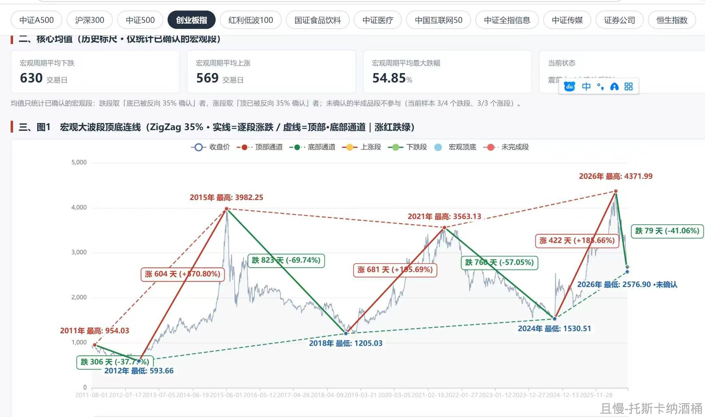
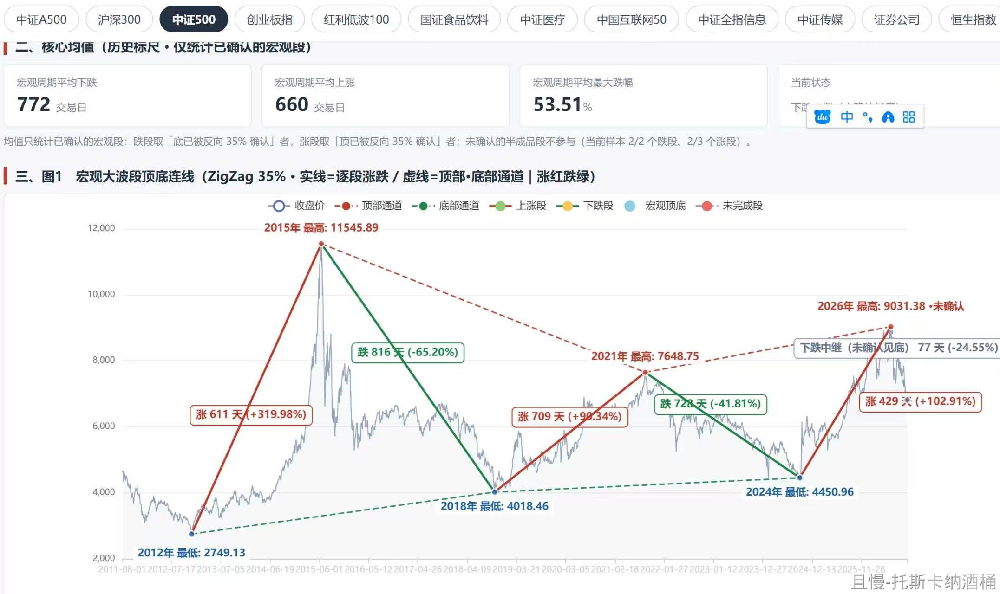
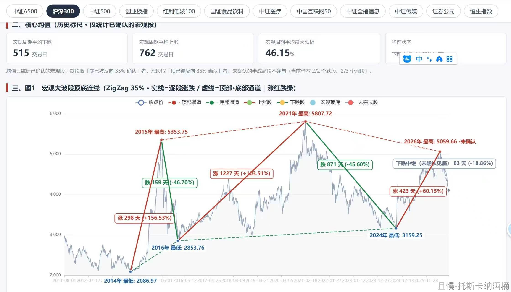
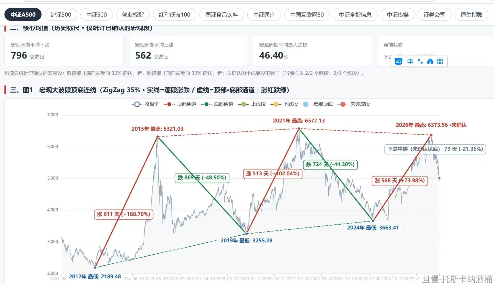

我请各位从逻辑上思考一件事。

巴菲特几十年前就说过，股票本质其实就是债券。

好，我们从这个逻辑来捋一遍。

首先，债券里面，收益率最低的一种是国债。这是因为一个国家的信用，通常来说，要比单独的企业好。

企业债的收益率会比国债高。垃圾债的收益率会比高等级债券高。为什么呢，因为当你信用不好的时候，投资者担心你还不上钱的时候，你只有愿意掏更多的利息，才能借到钱。

好，我们继续推演。

如果股票本质也是债券，那么它的收益率就应该比债券高。非常简单，股票的波动更大。要提供更高的风险溢价，才会有人愿意来买它。

好，接下来是更有意思的问题。

A股已经开门30多年了。上市公司越来越多，成交量越来越大，股民基民数量也越来越大……这说明什么？

非常简单，说明这个市场整体来看，是能挣钱的。如果真的大多数、绝大多数投资者都赔钱，那么这个市场恐怕早关门了。

但是，请注意，我说的是投资者，而不是——散户。

什么人在这个市场赚钱了呢。

非常简单，举两个例子。

第一。有一笔资金，他们的动向我监控了十几年。他们分别在2012年买入，在2015年卖出。在2024年买入，在2026年卖出。他们完整的把握了两个大的波段，拿走了几百亿甚至更多。

这笔资金是谁。

第二。我们的长赢计划，持续跟车的朋友，有85%是赚钱的。只在这一个平台，我们这些朋友的获利就超过几十亿。就是在这样的行情下。我们也在300和500远远没有新高的时候，持续新高。还有一些朋友做了场内网格波段，我毛估估95%以上都是赚钱的。我们这里基本都是所谓的散户。但是，我们这些散户用的不是散户经典的投资方法，而是类似于机构的投资方式去投资。

另外，你再打开沪深300ETF的走势，你会发现，它整体上来说，长期来看，实际上是向上的。它之所以还没有打破之前的高点，是因为之前太疯了。如果去掉过于疯狂的那两三个高点，长期看，它是上涨的。当然，收益率比美股差多了。那有更加深刻的原因，我们不讨论。

我的意思是，某些市场确实很有特色。散户也确实80%都赔钱。但是，再有特色，它也是个市场。它还能越来越大，就说明除了把钱圈走的各方势力，二级市场投资者，是一定有一部分人赚钱的。这部分人数可能很少，但控制的资金恐怕很大。只是散户赔的钱，越来越多的集中到这些赚钱的人和机构手中了而已。

绝大多数资金都不赚钱的市场，一定早就关门了。所以，我们来做投资，最重要的问题就是，如何像那些赚钱的人或者机构一样做事情？

否则，无非是金钱供养者罢了。

每一轮牛市，都是把资产从一部分人那里，换到另一部分人那里的过程。对于前者来说，熊市固然可怕，而牛市才是真正的屠宰场。不要做这类人。

<!-- qieman-comments:start -->

---

# 我请各位从逻辑上思考一件事 · 评论区（2026-10-29）

> 评论区归档：2026-11-13 抓取于且慢社区，原帖共 200 条互动，精选 29 条（作者发言、作者回复及其他投资相关评论）。

## 不知道叫啥（广东省） · 2 赞

😃 鸡哥快发车，等着你带着后入场的配置好。

## Licht（北京市） · 0 赞

本质都是买未来自由现金流折现，其实波段在原教旨价投里也是投机的一种，核心还是赚企业成长的钱，否则就是负和博弈，当然，一般这种博弈只要掌握耐心，选择不死标的以及买在低位总能胜出。

## 叶叶生哥（新加坡） · 8 赞

说的太好了，散户多，才赚钱。
但是在A股，好像赚市场增值的钱很难（大股东套现，分红不回股市），所以只能赚情绪的钱。就是从别人兜里掏到自己兜里。

## 一条有梦想的闲鱼（上海市） · 11 赞

场内etf挺好玩的，可以在底部区间规划好资金抄底🤣

> **西班牙的中国韭菜（西班牙）** · 0 赞：我之前也这么想的，但是老是判断不好底，经常抄底抄在半山腰

> **一条有梦想的闲鱼（上海市）**（回复 西班牙的中国韭菜） · 0 赞：我自己有一套指标工具箱的，可以协助我判断顶底，当然遇见20-24年年这种大的通缩周期，确实不好找底的。🤣

## 同路人_PWhYD5（浙江省） · 0 赞

其实看下沪深300的年K就了然了，差不多五年一轮回，下沿线买入就行了。收益率要求不高的话甚至可以永远不卖。

## 任煜（河南省） · 1 赞

就喜欢听您讲话，真真切切，真真诚诚，真金白银

## 山海万里（河南省） · 0 赞

化债需要有人付出代价+财富重新分配

## 新米练习菌（上海市） · 77 赞

【留言1】『股票的本质是债券』	【补充阅读】相关系列文章
【20161020】【雪球】国债市盈率和A股全市场市盈率的情况
https://xueqiu.com/4776750571/76361646
【20161226】【雪球】股票也是债券的一种；打新；满仓问题
https://xueqiu.com/4776750571/79384526
【20161226】【雪球】怎么理解股票也是债券的一种？
(附：《通货膨胀如何欺诈股票投资者》巴菲特1977年5月发表于财富杂志）
https://xueqiu.com/4776750571/79385789
【20171114】【雪球】别忘了，股票也是债券
https://xueqiu.com/4776750571/95585829
【20180608】【雪球】A股收益率已经快速逼近十年国债
https://xueqiu.com/4776750571/108539956
【20240205】【微博】今天最后一张图：股债收益率
https://weibo.com/7519797263/NFbGY1OG9
（未完待续）

> **新米练习菌（上海市）** · 64 赞：【留言2】『股票的本质是债券』	【补充阅读】相关系列文章②
【20240304】【微博评论】本质上，股票是债券。
https://weibo.com/7519797263/O3r535gxz
【20240413】【微博】股票本质上是债券
https://weibo.com/7519797263/O9u60ek0E
【20241211】【微博】股票本质上就是债券。而红利更是体现得淋漓尽致。
https://weibo.com/7519797263/P4l5HoFvw
【20250513】【微博】大家有没有思考过，金融投资，或者说股票投资，真正赚钱的本质是什么。
https://weibo.com/7519797263/PrBF8defi
【20250520】【微博】分红到底是不是左手转右手？
https://weibo.com/7519797263/PsGubrQEN
【20250926】【微博】 到了我这把年纪啊，越来越喜欢领股息了。股票的本质是债券
https://weibo.com/7519797263/Q6k873IXd

> **Bryan没有T（江苏省）** · 4 赞：米，没法私信，借楼请教一个问题：
网格中的证券ETF暂停所有新增买入，底仓也将在1.30卖出，这是什么原因？
感谢～

> **ETF拯救哈基咪（广东省）** · 2 赞：散户是「金融消费者」，以「投资者」之名，行「金融消费者」之实。٩(•̤̀ᵕ•̤́๑)ᵒᵏᵎᵎᵎᵎ

源源不断地拿出积蓄参与二级市场交易，贡献了庞大的成交额，承担了天量交易费用和风险，为部分机构和大股东等「投资者」们创造了可观的获利机会。

--

五道口的一份实证研究，2014-2015 年市场泡沫迅速膨胀后破裂的时期里：

财富总量居前 0.5% 的投资者通过主动交易总体盈利 2500 亿元，而后 85% 亏损 2500 亿元

--

来源：

未央网《散户亏钱的重要原因：股市泡沫》

https://www.weiyangx.com/365764.html

以及

https://www.pbcsf.tsinghua.edu.cn/info/1154/2403.htm

https://www.pbcsf.tsinghua.edu.cn/__local/6/6E/3A/A8D55C27831E494FE9E954615F9_0E853BCB_2A1DE1.pdf

## 豆汁儿好喝（北京市） · 2 赞

老大，咱们的医药医疗还会再补仓吗？会触及到资管之类要求的上限吗

## 游击队员（湖南省） · 0 赞

中概的极限跌幅多少？40%从现在开始。请教E总。

## 血橙大姐（湖南省） · 1 赞

多加入网格到长赢中，我们就不用冒险开黑车了

## 汉水浮萍（陕西省） · 0 赞

亲身经历一轮牛熊，要不是跟车我就退出了。把一部分仓位给了稳稳的幸福 ，降低点波动。年纪大了该好好生活了

## 萌萌哒康熙爷变身萌萌哒紫色瓶子（北京市） · 0 赞

E大，请教个问题，为什么恒科网格不留利润了呢？

## Mary（福建省） · 0 赞

越来越意识到，投资大部分时间就是等，等到建仓加仓仓卖出那个机会。

## 追梦亮（云南省） · 0 赞

现在才知道，我们配的红利是多么的香啊🥰

## 托斯卡纳酒桶（陕西省） · 36 赞

几个宽基的顶底周期图。可能有瑕疵或者错误，还在改进中。

## 花傲天yu（江西省） · 0 赞

300.A500都要下跌20左右，那大盘不又要到3000点保卫战😂

## 同路人Mjj发财（河南省） · 0 赞

遗憾的是我还是不会网格，我看了那三篇文章还是不会😂

## 田老师（湖南省） · 0 赞

今年看着e大的尊尊教诲，科技一次也没追，只是行业基金（恒科消费白酒）的仓位和加仓节奏没控制好

## 糖霜史莱姆（上海市） · 0 赞

我想问问，保险资金不应该是长线资金吗，怎么三季报险资都通通暴雷了，险资也去炒AI炒科技被套了？怎么会这样。

## 诗诗的幸福（陕西省） · 0 赞

学到了股票的本质也是一种债券

## 大石头（浙江省） · 1 赞

我就想问下后面跟车的粉丝，买了很多医疗中概消费 接下来怎么搞啊？经济继续下行，消费中概和医疗受其影响很大很大

## 瓜瓜（陕西省） · 0 赞

我一直觉得债券比基金风险高，除了国债其他都很危险😂

## Hui色足迹（浙江省） · 0 赞

某市场这么操蛋，为什么不干脆远离？不是还有很多其他地区市场的etf可以搞吗？

<!-- qieman-comments:end -->
