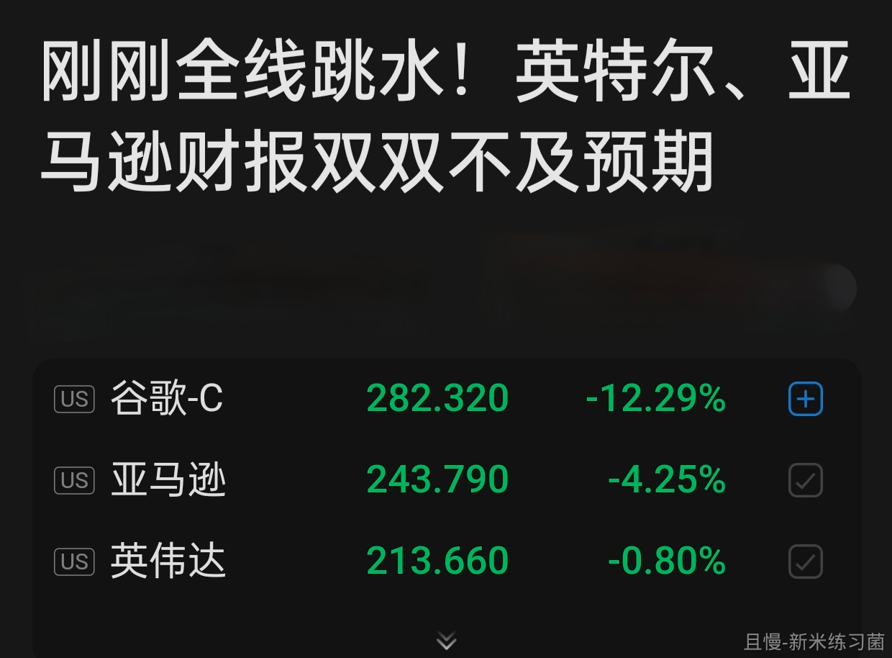
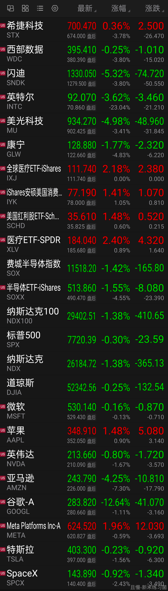
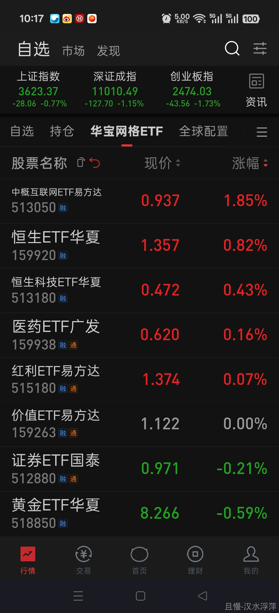

今天科技股是不是又要摆烂了。

<!-- qieman-comments:start -->

---

# 今天科技股是不是又要摆烂了 · 评论区（2026-10-30）

> 评论区归档：2026-11-13 抓取于且慢社区，原帖共 250 条互动，精选 41 条（作者发言、作者回复及其他投资相关评论）。

## Gia_Alan（江苏省） · 0 赞

昨晚美股部分科技股暴雷，今天韩股先跌为敬，劝大A不要不识抬举[旺柴]

## 草原狼汛（广东省） · 2 赞

我们是不是要准备捡科创，创业，宽基的垃圾啦？让暴风雨来得更猛烈些？

## 碧蚁红炉（广东省） · 0 赞

老大，红利要做波段再卖一份不？

## 很爱睡的绵羊（广东省） · 0 赞

希望暴风雨来的更猛烈些。E大，全球医疗最近新高，是不是可以暂停定投了？

## UUI慢慢变富（河南省） · 0 赞

A股的尿性就像A这个字母，名副其实，两头走极端

## 骨头卿（上海市） · 0 赞

摆烂的话，可能又要和红利对冲，哪个低就进哪个

## Doris77（浙江省） · 0 赞

在最需要反弹的时候碰到了外面崩

## 剁肉丁（福建省） · 0 赞

观察，买科技的阿峰现在怎么样了

## 新米练习菌（上海市） · 6 赞

E大早上好~
是因为“那边”科技跳水了吗…

## 我有很多仙晶啊（北京市） · 0 赞

带我们吃个波段吧，行不行嘛

## 晓月可可（安徽省） · 0 赞

大家都想着抄底，那么抄底太一致了。

## 周周有惊喜（广东省） · 4 赞

消费，医药涨一涨，让我降一下仓位😂

## 无为而治（北京市） · 0 赞

大概率 看看红利是否还会苦苦支撑

## nonerule8（福建省） · 0 赞

科技这波下跌是不是不准备反弹了🤣

## zhouxuanli（贵州省） · 8 赞

昨天没忍住在场内买了点创业板etf，今天该怎么办？还想着今天国家队会拉，趁机出了呢。

> **不怕熊的winnie（上海市）**（回复 Gia_Alan） · 1 赞：那有什么不敢的，科创50、信息技术的黑车从7月份开始我都开了5-6轮了，每轮都是小蚊子腿就是了。

## 长赢E家人（辽宁省） · 1 赞

我们啥时候捡…科技辣鸡值不值得我们捡啊😘😘

## 小范同学（北京市） · 0 赞

摆一摆更健康，美股盘后还有接着跌的

## E..（广东省） · 20 赞

中概恒科算科技吗？

> **同路人_JD2ecw（上海市）** · 1 赞：其实我也想问，有人说是伪科技实消费？

> **ETF拯救世界（作者）** · 198 赞：不算。它们算垃圾股。

> **今天也想暴富（重庆市）** · 30 赞：涨的时候算消费，跌的时候算科技

> **西门追雪（广西壮族自治区）** · 1 赞：中概也算金融消费股吧

> **梅西GOAT（山东省）**（回复 ETF拯救世界） · 0 赞：😂😂😂是因为科技涨的时候他们不跟，科技跌的时候他们也跌吗

> **战火小阿蛮（北京市）**（回复 ETF拯救世界） · 0 赞：谢谢老大，我一直区别不了恒科中概和科技股的概念，现在想来科技应该是科创50、半导体之类的吧？昨天查资料发现50里面好些都是半导体的公司。

## 雪铃（陕西省） · 0 赞

哈哈，希望它继续摆烂，好方便咱后续的建仓

## 百花争艳（广东省） · 1 赞

等待老大的科技枪响，这次多整点科技

## 糖霜史莱姆（上海市） · 0 赞

跌的太猛太快了。为什么险资三季报都暴雷了，险资不应该追涨科技股吧。

## 同路人_DsrkAC（重庆市） · 5 赞

对不起e大，科技股我之前追高了，确实没忍住，现在腰斩了，从盈利200万到现在亏损300多万，😭😭😭

> **秦喜君（辽宁省）** · 0 赞：之前有的人说，买科技股盈利多，垫子厚，下跌就卖出，顶多少挣点，但不会亏损。兄弟，你这咋亏这么多，对科技太相信了？

## 陈S（广东省） · 0 赞

今天宽基是不是要布一点先头部队？

## movin（北京市） · 2 赞

创业板我感觉估值不高了啊，几个龙头才20PE，相当可以了

## 同路人_l5JmXa（新疆维吾尔自治区） · 3 赞

中概现在应该怎么处理，逢低买入还是躺平

## 汉水浮萍（陕西省） · 0 赞

恒科中概再坚持坚持，会出坑的💪

## 汉唐（江苏省） · 1 赞

中概恒科被字节打的抬不起头，得把字节纳进来

## 呼吸的鱼（河北省） · 1 赞

前一段时间恒科做了条件单，目前还在跌，就默默地放着吧，既然做了条件单，那就做好了下跌的准备，不看它就行，等着触发了就卖。

## 千里天山（北京市） · 0 赞

这种真的不适合做网格，现金流全填进去了

## 同路人-1刘S（广东省） · 1 赞

中概应该还有一段时间跌。🙂

## qiosan（四川省） · 0 赞

看样子是的，量化交易会不会改造了原有的下跌走势，让下跌更扭曲变形

## ETF拯救我的世界（河南省） · 0 赞

空了谈谈中概互联吧 boss

## 进击的阿越（福建省） · 0 赞

E大我很想知道我跟投到现在为啥还亏呐？是不是我哪里没操作对？一直很信赖E大，E大早期文章我在有知有行都很认真读，我投资也不冒进，还在学习中，我自己想着是不是之前没注意中概互联超配太多导致拖累账户？ E大有空看到了，回复我呗。我感觉我犯了大错误，但是还没找到根源

<!-- qieman-comments:end -->
