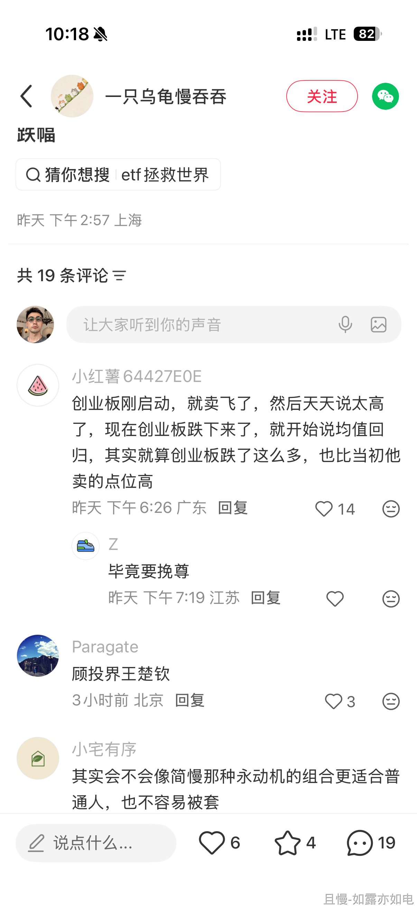
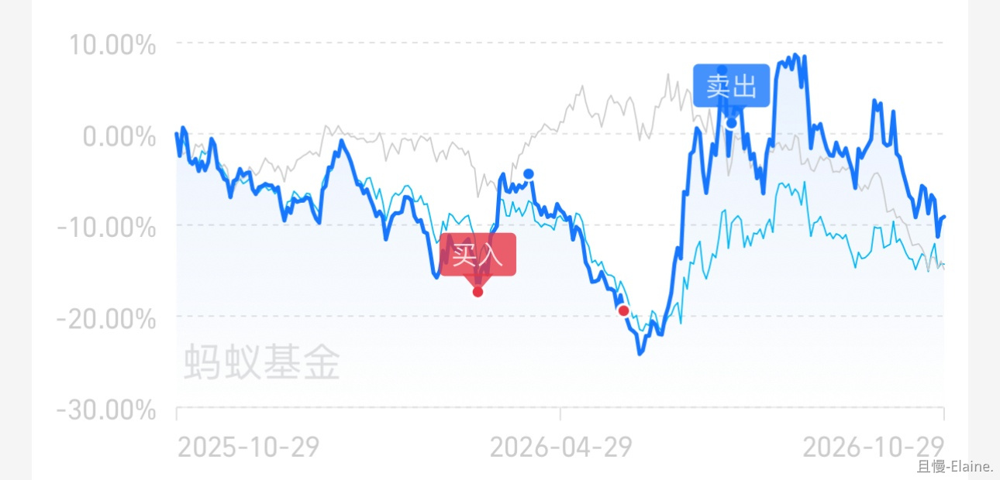
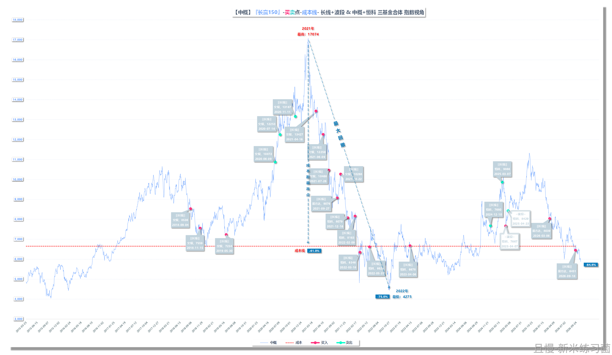
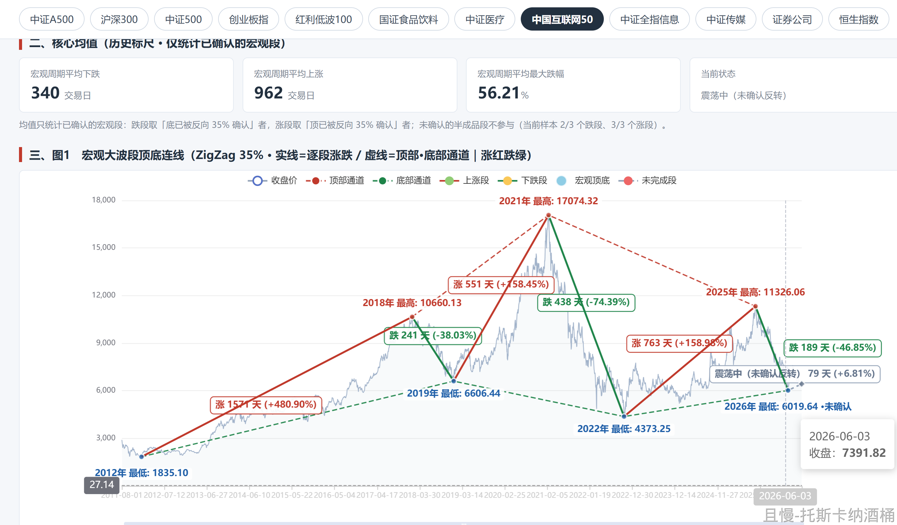
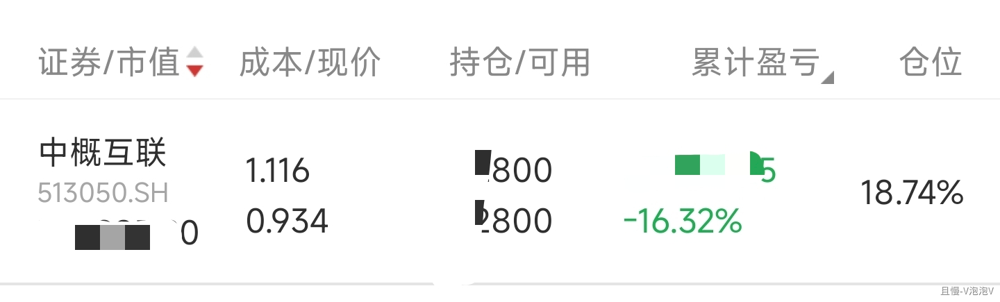
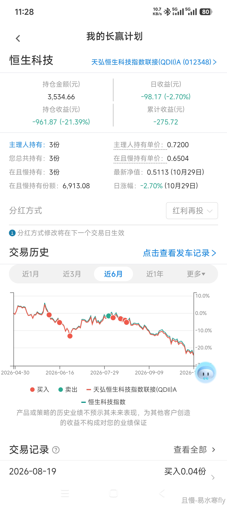
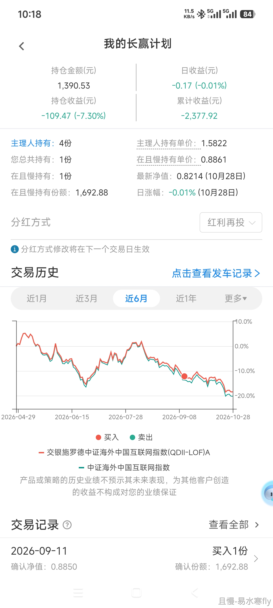

总是有人不停的说中概恒科。

好。就请你一次说清楚。

你到底买了多少中概和恒科。

目前150仓位4.68%。S仓位9.18%。

另外。你想让我说什么。

我说了多少次了，我会继续在中概和恒科上面做波段，尽量把成本降下来。

中概的估值历史最低了。从最高点下跌65%。

一个品种比历史最高低65%，即将进入7080，你浮亏4%、20%、13%。

未来业绩？走势？你问问这些公司他们自己知道不知道明天会不会又有什么里面外面上面下面突然来一棒子打头上。你再问问他们知道不知道未来产业会怎么发展。

走势？你去找个股神问吧。

你到底想让我不停的说什么。请发言。

我已经不停的说了，今年也在持续的做。还说什么。

<!-- qieman-comments:start -->

---

# 总是有人不停的说中概恒科 · 评论区（2026-10-30）

> 评论区归档：2026-11-13 抓取于且慢社区，原帖共 535 条互动，精选 231 条（作者发言、作者回复及其他投资相关评论）。

## 同路人_VoFdHL（广东省） · 0 赞

对啊，并没有压力，不知道朋友们是多重的仓位，整天提起🤣

## 微博且慢都被E大回复一次的幸运儿（广东省） · 3 赞

自己默默加仓中，拉开时间空间

## 纳风儿正红（北京市） · 5 赞

很多人没有仓位的概念，中概、医药、医疗应该就是买多了

> **同路人_HYWJRA（河北省）** · 1 赞：确实是，有网格的仓位，还是抄底的仓位，还有150，s的仓位，放一起，确实不少。就是用时间换空间了

## 我要瘦十五斤（吉林省） · 52 赞

中概跌的太长了，大家都emo了吧🤣🤣🤣

> **阿李财富自由奋斗中（重庆市）** · 12 赞：经历过上一轮，所以这次我还好。仓位＝心态

## 小薪亿亿_（广东省） · 2 赞

被那群人气笑了。他们是黑车开多了，仓位重

## 橘香（河南省） · 1 赞

咦，我看到恒科跌我可太高兴了，我越跌越买都买到了0.578的位置了，再跌我再买，我可太高兴了！

## JonX（江西省） · 7 赞

刚觉要等到流动性转好港股才有出头日，最好是美国降息中国加息的时候，才是恒科起舞的时刻

> **musk（上海市）** · 0 赞：港股一直流动性很差，全球最低估值市场，不过中概里面是国内最好的互联网企业了，早晚会起来

## Boxer（陕西省） · 94 赞

是不是因为华宝的条件单买的，目前我的持仓浮亏30%、20%，我估计他们说的是这个，先说我自己，我不慌，因为前些年比这儿可差远了

> **nonerule8（福建省）** · 10 赞：哈哈。我黑车中概恒科-13%左右。最近一直看结构性的机会补仓。节奏控制的挺好🤣这两年屯了现金，还挺能忍的🤑

> **青溪（安徽省）** · 2 赞：看到这条我打开自己的华宝，好消息是没有老大说的这个，坏消息是有个医疗，绿到我立马叉掉🤪

> **名字太难起了（浙江省）** · 5 赞：我网格也开始买回恒科了，这么低了。买了不信回不来

> **且邀月听风（河南省）** · 1 赞：华宝条件单就恒科恒生恒生医疗赚的多，市场极度恐慌，老大致敬的那段时间补满了格子💯

> **Dragon2080（海南省）** · 3 赞：我也是浮亏最大就是这几个品种，其次是医药消费养老，拖了整体仓位的后腿。不过我从来没上来抱怨过。估计牢骚的人可能用的不是闲钱所以时间等不起，还可能跟车时间和控制仓位不理想，获利的仓位少套牢的仓位重导致的。所以对行业周期和市场环境要心怀敬畏，网格做T躺平都见仁见智愿赌服输。

> **GLORIA2095（海南省）** · 4 赞：我也是浮亏最大的就这几个，弱弱的问一下老大和各位和高手前辈，自己另外补仓可以吗？没有别的意思，别生气骂我哈🤐就问这一次，下次一定不会再问了

> **Godric_qm（辽宁省）** · 3 赞：说的不是网格，网格里的恒科反而是盈利的

> **富贵儿的天才小猫（北京市）**（回复 GLORIA2095） · 2 赞：自己最好学一学技术，支撑位压力位，可以把剩下的要补的钱分成三四份，在重要的支撑位补些试试，带上止损。

## Duringg（广东省） · 0 赞

不要急，估计是后面跟车的（我也算“后面”），看到目前亏损的“这么多”，其他都赚钱了，它一枝独秀，所以急了呗
不是我啊，我悄悄在场内做网格的

## 向天一笑（河南省） · 2 赞

主要是可能有些人黑车开多了，压力有点大，想让老大给他们做个心里按摩😂😂😂

## 橘香（河南省） · 0 赞

已持仓到0.578，再跌再买能够更低

## 从容理财（北京市） · 0 赞

能力再强也禁不住市场不给面子，再说仓位没多少，无碍大局，踏踏实实的，多大点事儿啊！按说留下来能一起走到现在的，应该不需要任何心理按摩了吧？不然，只能说明你根本就不适合投资。

## 晓风残月Witnesses（广西壮族自治区） · 67 赞

竟然开放评论了！大家中盖的体感不好，是因为大家的占比和老大你的占比是不一样的。好多人跟投的时间不一样，反而是中概医疗消费跟着你加仓比较多。而你之前买的红利等等一直没有提示补仓，然后就没有达到你所买的份数。我跟车都比较早了，我的红利都没有老大你的分数这么多。其他的占比肯定就比你组合里的显示的要高。

> **晓风残月Witnesses（广西壮族自治区）** · 1 赞：我之前跟做网格交易，没有算好自己的底线。然后在华宝被套了一些中概。是我自己的问题，已经打算慢慢的做波段，把它成本降下去。

> **晓风残月Witnesses（广西壮族自治区）** · 5 赞：中概在亏，但是我的恒科是盈利的。是很神奇，买的点位不一样吧。

> **Dragon2080（海南省）** · 17 赞：我浮亏最大的也是这几个品种，其次是医药消费养老，有的时候已经买得很低了，但是没想到时间周期过于漫长，这个可能是行业周期以及外围环境的巨变导致的。我从来没有上来抱怨过，只是感觉对市场心怀敬畏吧，没有完美策略，任何交易都需要牺牲一些东西

> **平常心最珍贵（广东省）** · 0 赞：我也是，几年前的红利，中证500没买到，没享受到快乐，净挨中概消费医疗的打了

## flysunny（山东省） · 0 赞

但凡理解长赢的，都不会反复这么说，老大别往心里去哈

## 小投怡情（河南省） · 13 赞

大部分人让说说中概恒科不是让你说咱们的150和s定投，是让你说说现在能不能抄底的意思，不要错误理解

## Hal（北京市） · 1 赞

一直问就是不舒服，自己黑车，仓位重了？

## 闷声发财（辽宁省） · 0 赞

一年前拿着中概我还想喊可怜，现在我只想说又不是拿着科技有什么好叫唤的😂

## 以人为镜_可以知得失（广东省） · 2 赞

可能是因为华宝的波段吧，不是因为且慢，因为且慢都很久没发车了

## 胡蝶蝶（福建省） · 1 赞

换个思路是之前没买足份额的中概恒科可以补单了😍

## 老农（广西壮族自治区） · 0 赞

我自己有黑车，而且仓位较重。但是，完全由我自己负责，目前就是淡定耐心等。

## 同路人_Aqvh6X（北京市） · 1 赞

持仓浮亏20% 30%，应该是条件单补的仓，之前历史盈利没吃到，体感有差异

## 骨头卿（上海市） · 1 赞

我觉得应该是仓位过重了，其实中概恒科的仓位挺舒服的，即使加上波段仓位也不高

## 橘香（河南省） · 1 赞

中钙持仓成本1.095（是越跌越买的情况下），但是我有资金啊，我的仓位大概在五层，我可以持续加仓

## 同路人_PWhYD5（浙江省） · 1 赞

前两天恒科跌破时我还买了点呢，有啥好慌的，再跌我再买点儿。

## 小牛牛奶当水喝（上海市） · 0 赞

持仓不多，估值很低，没啥好说的

## movin（北京市） · 1 赞

估计都是新人吧，老车友对恒科这点波动我觉得洒洒水吧。我们可都是原来跟华宝油气谈笑风生的，现在的年轻人 too young，to naive😊

## Rich豆（四川省） · 2 赞

我自己开了20多万黑车还在不断网格，我的逻辑之一就是…长线给了10%的仓位给恒科，说明是有投资价值的。

## 大晗（广东省） · 0 赞

他们还要你说医疗医药呢！
还要你说任何一个浮亏的品种呢！
而且他们还要埋怨你没有买5 6月的科技呢！
既要又要还要啊
老大你那么宠那些巨婴干嘛！！
还不如多出去走走，多赏赏北京的秋天的美～
他们分明就是想要一买就赚钱，一买就发财的策略啊！！

## 秋月夜白（北京市） · 1 赞

在哪说的，怎么评论区关了还能被干扰🤔🤔中概我自己补仓了哈哈哈

## ZYing（浙江省） · 1 赞

主要还是很多人开了黑车，仓位重了心态就变了

## 台风来了（重庆市） · 0 赞

前段时间才补仓了恒升科技😊

## kalin（广东省） · 0 赞

其实不用说，只看行为，还在买入就是看好，现在不涨不是说了就能涨的呀

## 小卡拉米（广东省） · 4 赞

两点感悟：
1、请勿单吊一个品种妄图咸鱼翻身，严格控制单个品种在持仓组合里的比重。
2、位置越低，杀伤力越大。100到30，跌70%。30到9，跌70%。前者单价少了70，后者单价少了21，跌幅却都是70%。
都是血淋淋的经验，真金白银换来的教训。说再多，不如下场试试

## 追梦亮（云南省） · 0 赞

有情绪是好事儿，利好我们做波段😃

## 如露亦如电（IP未知） · 5 赞

摘一个网上的评论给你看看： 
“创业板刚启动，就卖飞了，然后天天说太高了，现在创业板跌下来了，就开始说均值回归，其实就算创业板跌了这么多，也比当初他卖的点位高”

没吃到涨幅也不必在每次双创下跌的时候每天出来说自己多么理智多么冷静 众人皆醉你独醒

## FZz（浙江省） · 1 赞

都是成年人，自己超的仓位自己把握好，自己的投资决策自己承担责任，（说我自己）。策略方向是明确的，控制仓位，叠加波段把自己的品种救回来，成功后一定很有成就感！

## 曹志远（北京市） · 0 赞

丰俭由人，买定离手，整体稳定赚钱，个别持续下跌没啥啊。而且就像医药，跌了那么久，最后一波上涨就回来了，股市就是这样。

## 风萧萧（重庆市） · 0 赞

黑车买的得自己想操作计划，中概这两年反弹过一波吧，我之前也买了不少黑车，反弹的时候已经都微盈利出了，自己买的要自己负责，没有任何人能解答你亏钱了怎么办，E大能解答自己计划内的操作已经是基金主理人天花板了，没理由要求更多。

## 有风的治愈岛（安徽省） · 1 赞

老大真的说过很多次，包括医药医疗，波段降成本，做波段做波段

## 逗猫遛狗真君（上海市） · 0 赞

自己仓位重 浮亏时间久 估计是这两个原因

## Leo888（上海市） · 2 赞

跌了那么多不是应该兴奋吗？好好工作，准备加仓啊！
朋友们，又一次资产升级的时刻又到了，大家稳住！

## 超级巴飞特（上海市） · 1 赞

巴菲特买谷歌也浮亏20%，把仓位和能承受的控制在纪律范围内，就好。多大点事儿。

## 天命不易（广东省） · 0 赞

才亏15%，巴不得多跌点好加仓

## 同路人_ITOs0f（陕西省） · 1 赞

可能是想要您带领大家多做些波段

## cookies_xxx（广东省） · 1 赞

记得 E 大之前说过的6个未来可能值得投资的宽基点位，课代表也整理过，恒科和中概有没有类似的点位？或者能不能捡垃圾

## 假面的炫耀（黑龙江省） · 8 赞

中概开了几个黑车，目前确实很惨，我自己是转出来一部分做做网格，摊低了一些成本。我觉得这些人可能想问后续的投资逻辑，毕竟诚如e大所说，有些东西变化很大。。。。

## 艾米利亚（上海市） · 1 赞

肯定是黑车开得多的条件单，估计都不是且慢的长赢。30%浮亏在这个品种甚至不算压力，耐心才有回报

## 守望田园（浙江省） · 2 赞

说明不停说这个的人定性、耐性还不够，这不是股票短期就能大涨大跌的，只不过大环境导致的长期趋势没有友好，只要按照拉开时间、空间去补仓的话问题不大的，就怕你自己感觉跌了很多不停的补，那就没办法了，“感觉”带有很强的主观性，主观性导致后面的不确定性、预期偏差性，肯定就不会踏踏实实的了😂

## finaliver（广东省） · 2 赞

他们应该是说hb网格吧，目前我的中概也是-30%多，不过其它品种的网格很多是盈利的，总体的收益还是ok的

## 亿贯（北京市） · 1 赞

我一直在坚持中概，恒科黑车波动，目前盈利，虽然这波下跌过程中加仓有点急

## andy6lau（天津市） · 1 赞

还想让他在跌一些 再加点仓位了 越跌越开心

## 李哈哈哈（广东省） · 0 赞

要做好买入后很长时间不涨，甚至不断下跌的准备。只要买的不贵、不死，总有翻身高歌的时候。我们普通人跟有钱人在市场里面最平等的东西，就是时间。

## 王昭垚字倦收（中国） · 0 赞

不用搭理他们。有的人心态不行，我是玩了这么多年了也是心态不行慌，但是我不问，因为知道这里位置不高，而且我会躺平，我仓位也不高

## 变辣鸡为宝贝（安徽省） · 1 赞

刚看了下，还行，可能是这些人仓位的问题。又看了眼500，这波减持太棒了，感觉宽基稳多了，不过行业弹性大，我都要。

## 同路人_dExxJg（北京市） · 2 赞

就是仓位重了，比如我，哈哈哈，虽然我不问，但我觉得问的人是心里没底想让益达给点信心，应该没有责怪的意思，毕竟黑车是自己开的🤪

## 一片白梅花（安徽省） · 2 赞

中概的估值历史最低了。从最高点下跌65%。这一句就能给大家吃个定心丸了吧。

## lzq（浙江省） · 1 赞

不是某一个单一品种的问题，是计划跟进时间不同导致持仓结构的差异。比如今年初新开的计划，当时的估值补仓建议基本都在中概，恒科和医疗上，而今年表现好的红利没什么地仓，这种情况下，今年至今会-20%以上。跟车早的回撤要小很多。我自己是老的新的计划都有，也跟车时间长，能理解。。态度取决于理解，很多质疑是因为不理解，这也没办法，每个人的认知，信心和财务状况不同。

## lletf（中国） · 3 赞

我有恒科黑车，比重还不小，做了一些 T，成本降了不少，不担心，继续做就是了。昨天刚刚去了解了一下恒科 12 月的改革方案，会回归的

## 萤火（上海市） · 0 赞

跌了波段可以起来，我倒是没啥感觉。是不是有些人仓位没弄好，心里不舒服啊。医药医疗我也不急，波段有收益，长期的亏损率我感觉还可以接受，在预期承受范围内，毕竟做过心理压力测试

## 郜小丫（北京市） · 1 赞

我自己黑车投的中概，买的已经很便宜了，现在还是跌了8%左右，不过我一点都不担心，还在继续投并且做波段，这种给它点耐心涨上来就是一瞬间的事。老大，做自己，有些杂音可以屏蔽了

## Elaine.（湖北省） · 2 赞

我也有重仓的，不是中概恒科，是医疗医药。我不抱怨也不在任何地方提它。因为我知道老大的策略没问题，有问题的是土壤是xx。
我把它比喻成一辆长途列车，它还没到终点，就是没到终点。只是沿途走得有点慢、有点颠簸（甚至还在起点，甚至还会倒车）。我要做的就是抓稳扶好，不要被颠下车。对应实际的就是自己拿适当资金（分配好资金）做点网格，慢慢降成本。如果是重仓，那成本降得是会慢一些。慢一点就慢一些，慢慢来，不要急，因为急也没有用。前面跟着老大做了医药的网格，降了不少成本，很舒服。感谢老大。

## 攒钱还房贷（上海市） · 8 赞

估计是黑车买多了，盼望你从数据上表态，说出恒科没问题，继续持有之类的鼓励话。这样，他们心里才能稳定住，不然那么多黑车，他们控制不住自己情绪。

本质上是压力测试没做好导致的。
向内找不到内心的平衡和安宁
向外寻求老大的宽慰

非常个人的看法，不喜勿喷

> **攒钱还房贷（上海市）** · 9 赞：咱们这里的人，理论上都不是小白，甚至算很有耐心的了。前段时间医疗5900点的时候，很多人也是这个表现，不停问，不停怀疑，现在医疗不问了，又开始问中概，恒科。

咱们这儿的情绪数据，也值得观察👀

## 逐阳（上海市） · 1 赞

报告老大，恒科的网格是真的好玩。
22年12月开始做网格，目前中概+恒科累计收益还是正的

## lucky_ETF（北京市） · 0 赞

估计是自己黑车开多了，波段+耐心，老大确实讲了很多次了

## 四块柠檬水（北京市） · 1 赞

老大，很多人的跟车时间没有那么早，比如我中途上车，中概已经跌了快50%了，一些心理承受能力差的小伙伴就顶不住了

## E路同行静待花开（河南省） · 2 赞

我目前中盖跟车的不用说了的，华宝网格的目前-20%，恒科目前还+40呢？中盖盖之前有过-50%呢，中间不断地做低买高卖曾经红过，目前也没有慌的，都已经这长时间了，黎明快到了还慌什么呢？😃

## 柳树在路上（广东省） · 3 赞

评论区很多问恒科的，其实如果经历过22、23那轮加息、政策监管等多重“坏消息”的多杀后，对恒生科技应该会有自己的一些刻板印象了，但是“这次可能不一样”，所以我想用我最近所学的一个框架来分析这个问题，当然，这个框架也可以用到分析其他品种。

维度	问题
本体论	1. 恒生科技指数目前究竟代表哪些企业和产业？
形而上学	2. 这些企业的核心竞争优势和盈利模式是否仍然成立？
形而上学	3. AI 对这些企业究竟是机会还是威胁？
宇宙论	4. 中国科技产业未来五到十年的发展环境如何？
宇宙论	5. 恒生科技指数能否通过成分股调整适应产业变迁？
价值论	6. 当前估值是否足以补偿这些企业面临的风险？
价值论	7. 相比其他资产，恒生科技是否具有更好的预期风险收益比？
认识论	8. 我们有哪些可靠证据支持上述判断？哪些只是推测？
实践论	9. 恒生科技在我的投资组合中应该承担什么角色、占多少仓位？
实践论	10. 什么条件下继续持有、增持、减持或退出？

可以拿着去问AI，但我想说下我的观点，就像第8点提问的，你会发现许多问题并没有明确答案，很多都是推测，都是概率

> **柳树在路上（广东省）** · 4 赞：所以最后你可以算下概率来决定当前你到底应该行动，还是保持沉默。
这里似乎又指出了投资组合的一个局限，就像第9点里这个比较个性化的问题所问的，每个人的经济状况、人生境遇、阶段都不同，资产配置的重心、目的、抗风险、可接受的回撤也不同，所以e大也好，其他人也好，都没法回答一个适用于所有人的答案。

## 新米练习菌（上海市） · 12 赞

合并起来从指数视角看，是这样的
目前指数在-65%的位置，从指数计算的成本线在-61%的位置，合并起来浮亏其实是-9.8%左右

> **托斯卡纳酒桶（陕西省）** · 8 赞：借 新米帖子发个中概的顶底周期图。数据有点滞后。

## 玫瑰色的米（北京市） · 1 赞

感觉说到老大都生气了 就到底部了 我会坚持做波段。 抱抱老大 每次都让人当出气筒

## 兔rabbit（山西省） · 4 赞

老大，看样子他们没有抱怨的意思，估计想让聊是黑车开多了，仓位重，心理又承受不了，想让老大给吃个定心丸。所以老大千万别往自己身上揽责任哦🌹🌹🌹

## 同路人_doa4Eb（伊朗） · 7 赞

也没人攻击你啊，不用这么玻璃心，大家更关心什么时候加仓

## 金句小猪（江西省） · 0 赞

感觉还是有人仓位比较大，可能开黑车、可能跟车晚前两年低位又没补仓其他的，但我感觉买的真挺低的，恒科场内还有做短线可以降本，其实稍微反弹一下就回来了

## 玫瑰色的米（北京市） · 1 赞

这个教训 对我自己而言 就是 下跌品种 不要随便补仓 等一等 趋势变好 毕竟中国是超长长长长熊 超短短短牛

## wys馨儿（福建省） · 1 赞

网格按策略一直在降成本，且慢跟车踏踏实实的，谢谢老大😘

## 幸运遇见E（广东省） · 3 赞

我说一下自己，跟投计划前，自己没有体系导致现在中概仓位偏重（40%），没有割的想法（不信他一直趴窝），现在也是波段吃一部分波动，低点（比如昨天也有小加仓）也会根据时间拉低成本。时间长了想通过e大对这个指数的解读，验证并坚定自己的想法，同时也更新对这个指数的认识，毕竟e大比我对他的认知高很多很多。

> **幸运遇见E（广东省）** · 1 赞：昨天e大开评论底下，我也有问e大对中概的看法，毕竟这个也是e大曾经致敬过的品种，现在又到了相对的低点，想重新了解e大是否后面有致敬的想法，而且这段时间e大对其他指数都有提及，这个也可以顺便说一下（昨日评论时的想法）

## Criscan（湖北省） · 1 赞

虽然但是，S计划的中概亏损更多吧，我1.14的成本都已经-28%了，不提E大自己1.45的成本了。

> **Criscan（湖北省）** · 1 赞：然后没办法，S计划中概没有什么操作，就自己去华宝做恒科的波段，但太菜了而且也一直下跌，目前华宝也-25%🥹，我觉得还是仓位没控制好，本想做波段吃利润结果越做越重仓，仓位一大，大家就会比较在意。

## 益达的好学生（浙江省） · 1 赞

应该是其他好的品种持有不多，中概恒科猛猛开黑车补仓的人，这样心态就容易失衡。我听从了E大的建议，自己搞了综合平衡计划目前已经亏损了，跟的150S计划还是有盈利的。所以在这样一个粪坑市场，E大能带领大家盈利真是实属不易，在这个特殊市场还能有E大这样抱有带领普通人投资且盈利的领头人真的是凤毛麟角。

## 清心悦目（广东省） · 2 赞

借用E大在雪球发文的大意:这里（资本市场）强者的战场，弱者请走开。想在大A里赚到钱，又承受不了相应的压力，请问你何德何能？打仗哪有不死人的，投资哪有不亏的时候？在资本市场不应为亏钱时羞愧，而因不学习，指望上天掉馅饼给你而不耻。如触痛某些弱者神经，不好意思，可能这里真不适合你，麻烦你出门去找让你舒服的奶头乐场所去，谢谢。

## 阿李财富自由奋斗中（重庆市） · 1 赞

我不在意，仓位控制的这么好。没什么可说的。谁能知道中概会跌这么低，它本来就是比较动荡的品种。出现低位了，波段就是，或者不动。

## E帆风顺（广东省） · 1 赞

应该是近几年开始跟一路下跌的，中概浮亏40%左右，老大已经之前已经说得很清楚了，而且不死的品种，怕什么呢

## 咪咪（福建省） · 0 赞

我倒是很好奇对于黄金的配置计划

> **咪咪（福建省）** · 0 赞：对于中概恒科，E大其实已经说的很明白了

## 天蓝30（上海市） · 0 赞

是因为他们无法自己做决策，心里没有底，到底要不要割肉，还是继续拿着，就等着权威人士告诉他们答案，到时候无论卖掉或者持有都归因于外人：如果卖了之后涨了就说说，都是XXX，当时他说这个标的很贵，我卖了，结果涨了。如果不卖继续持有，万一再下跌，也会说：都是XXX，他说现在已经很便宜了，结果还跌。😭😭😭

## Tinysun（北京市） · 1 赞

我再补个刀，医药医疗，一次性说清楚[手动狗头]

## 霍庆丰（湖北省） · 1 赞

恒科波段综合下来是赚钱的吧？有什么好说的，中概可能稍微差点，不过两个合起来感觉不亏

## V泡泡V（四川省） · 1 赞

哈哈哈，很明显，仓位买的太重了呗

## 同路人_雪拥蓝关（江苏省） · 0 赞

我之前自己买的恒科亏的更多，等信号买回来，没能力预判就等消息，不慌。慌的应该是站在光里的。

## 正经（上海市） · 2 赞

主要是黑车多，我就是给别开多了，但是自己认栽，割肉了，但不怨天无人

## 小灰灰伴大象（江苏省） · 0 赞

支持E大，并且用行动黑了二车中概

## 纳斯达克yyds（上海市） · 3 赞

有意思的是10份中概应该是6.6%，一路下跌只剩4.68%了🤣

## 同路人_S60Uwn（福建省） · 0 赞

多数是仓位不像老大一样控制，重仓了才会如此关心

## sunny888（安徽省） · 1 赞

港股是非常受加息影响的市场 流动性差一点 E大没有做错什么 买的也不贵 只是市场涨跌 公司经营周期没谁能预测到的 但万物皆周期 会涨起来的 多点耐心 不要总把别人往难处逼 不停逼问 实际上这个问题也没有答案

## ETF资产嘉玲（河南省） · 1 赞

我一点不慌，还想加仓平摊成本呢

## 且慢叫我输昵称（上海市） · 1 赞

我猜是不是网格？我自己之前设定了5%步长的的网格，资金压力很大。后来去年刚刚起步上涨略有盈余的时候我几乎清仓了，重新设定了10%步长的网格和介入点。

这巧克力味的指数太不争气了，以至于我自己新的介入点触发以后都是想起来再买一网，慢慢补。

机会难得，我想问问看，指数编制逻辑调整以后，过往的指数估值参考性会大幅下降（我自己认为的），E大会考虑怎样找到应对的估值锚？

## 曹小厨（中国） · 1 赞

之前的传媒也都赚钱过来了。医疗通过不断降成本，目前还在水上。恒科中概也认认真真降成本，没什么的~控制好仓位

## 波涛汹涌大眼睛（广东省） · 2 赞

且慢自动跟车，没什么不适。网格自己做，目前-2% 我觉得挺好呀。

## 想一个能被人注意到的名字（安徽省） · 0 赞

中概和恒科目前每天都在小额定投

## 轻舟已过万重山.（山东省） · 1 赞

前两天网格开了个小黑车降一下成本，这下更放心了🫶

## 同路人_PS76B0（福建省） · 2 赞

有些朋友如果不喜欢，又不仔细回看过往益达发的内容那真的大可以走了。实在没有必要在这里碎碎念，如果不是自己开黑车，中概加恒科加起来的仓位有多少呢？如果不认可理念，自己悄悄离开就好了，全仓去干创业板，早点赔光了就去跳楼就没这些苦恼了。

## jerryao（广东省） · 1 赞

未来无人知晓，没有任何人能够对未来趋势做出正确判断，即使判断正确了，那大概率还是运气。投资的时就要考虑这笔钱的投资时长，像股票型指数基金类资产至少需要持有5年以上的时间，不然怎么叫长钱投资，如果总是期望着一投入马上就有收获，那不是投资，那是投机。

## V泡泡V（四川省） · 0 赞

到了这个位置才跌这点，我觉得很好啊，还在继续做波段。

## 是个人（广东省） · 1 赞

中概医疗之前是自己黑车上头了，个人的资产开黑车就要想好可能的后果

## 无内耗更健康（四川省） · 5 赞

应该是开了黑车，我个人在华宝上医药医疗恒医都在做网格，且是重仓，目前网格有的还是正收益，有的微跌，处于涨一涨就回本的位置，但因为是重仓，稍微跌一点整个账户的收益就很不好看，所以那些最近一直问中概恒科的应该是开了黑车且重仓，近期下跌导致心里惶惶不安，到这里寻求一个相对确定的看法

## cv109（浙江省） · 1 赞

亏太多了，希望e大再找好买点 做波段 降成本

> **海上追风（江苏省）** · 2 赞：不可能亏，这是资产配置，又不是全仓中概，恒科，但这两年跟车的除外，因为你们跟车时间太短，资产配置还没搞起来。

## 大脸猫不爱吃鱼（湖南省） · 0 赞

哈哈哈哈最惨时中概黑车-40%+，然后波段波段来回搞，-14%了🤣🤣未来可期

## 木草非人（广东省） · 0 赞

虽然浮亏，但还继续网，等反转就行了，又不是单吊

## 出乎意料（广东省） · 6 赞

其实比较理解这些经常在里面问的人。
我去年10月开始，新来了两个计划，每份的份额是之前的4倍，补进来的都是医疗，中概，消费。所以这一轮回撤下来，前面几年的盈利基本回吐完了，但是没关系，这就是利润安全垫的作用。
但是你是否清晰的拉开整个计划的资产配比，认识到这几个其实在整个计划的占比不重，只要你是严格按150份准备的资金。
同时一路逢低开了红利的黑车，现在红利手上有很多，中概，恒科，消费我计算了一下我的，单看分别亏损25到35%，但整个计划持仓就浮亏不到6%，加上前几年已兑现的盈利，还赚了1%个点的样子。
何况目前已经跌了这么多，我慌个毛线。
希望大家从计划整体来看资产配置，不要只盯那几个浮亏的，你整体上去规划，按老大的思路来，会打开新世界大门

> **出乎意料（广东省）** · 4 赞：说中概吧，这几年你看国家重罚ali，didi，汐汐，你就应该知道在这样的大环境下，他们起不来，他们让科技新贵成为最耀眼的靓仔，原来这些就一定会受市场打压，什么原因咱不知道也不敢猜，所以除了计划提示的补仓外，我不敢开中概的黑车，哪天老大有动作了我才会动。把老大说的苦口婆心的话听进去了，你自己也就淡定了。

> **投资不能投机（江苏省）**（回复 Dragon2080） · 0 赞：我个人认为不会
就算其中真的有一蹶不振的
ETF是指数，是优胜略汰，一个两个倒下了，，自然有后来者居上
时间，空间，按计划补仓就完事了。总会有反弹

> **投资不能投机（江苏省）** · 0 赞：短期总会有反弹。
长期，因为周期，总会有反转，一年、三年、五年
真涨起来了，会不会后悔，底部买的少了呢

## 千里天山（北京市） · 0 赞

今天网格买入了恒科，-6%也还好

## MSNOVA（四川省） · 0 赞

还挺安心的，毕竟老大把握了节奏和成本，未来还可以波段。再说，这些公司质地也还好吧

## 同路人_OYoIm6（江苏省） · 0 赞

平静无波，还有点想加仓！
耐得住寂寞方能守得住繁华！

## 悠悠淘金者6182（四川省） · 0 赞

E大，我发言：今天俺的恒科网格又又买入成交了，感谢您的网格3篇😃

## 太川（日本大阪） · 0 赞

老大，10月中概互联的这车没有发车记录啊，我也想着是该补了，老大没发车我就没动

## 洗心革面学投资（河南省） · 6 赞

E大，咱说点其他有营养的吧，比如最近介绍的主动ETF，还有债券梯策略，债券价格分析，期权加网格，明牌极限点位……哪一样都让我受益匪浅！
中概大类从估值，到趋势，到价格都说了很多次了。策略上如何做，如何降成本也一而再再而三的说，而且也按照策略在执行。
我不知道那些人到底看没看平时的帖子和留言。不说让你主动研究了，哪怕读一读以往相关的帖子呢？现在且慢已经有搜索选项了，孩子，用起来吧。
如果是认真钻研的人，绝不会一直这么追问，而一点也不主动研究，有什么意义呢？你有问题一定要主动搜索，主动找答案，而不是自己没有思考，没有答案就直接去找别人问。就算问出来那也是别人的答案，不是你的。

## 如意如E（福建省） · 1 赞

遇见E大之前，我自己买了不少，目前亏损中。只想跟着E大做波段，争取早日盈利

## 小小虾米（北京市） · 3 赞

中概从21年到现在一直拿着呢，那时候大部分资产都在中概上，最大账户经历了-70%的下跌，也都过来了，现在虽然没有回来之前的最高点，到现在比那时候分散好多了，虽然中概还是偏多，慢慢调呗，都这么低了，虽然不知道啥时候涨，还是相信到涨的概率比跌的概率大的多，有机会就做做波段，一点点调吧

## 如意如E（福建省） · 2 赞

关键在于要控制好仓位心态才能好

## 玲宝（广西壮族自治区） · 2 赞

老大🫶 那么现在不是蛮低了吗，啥时候买几份做波段呢

## 先到300万（陕西省） · 1 赞

咱们的计划会买入越南，印度，沙特，英国之类的基金吗

## 胖菜（广东省） · 1 赞

是黑车开多了的吧，买的时候以为比E大计划成本低的就是挖到宝了，幻想买了很快就会大赚。然后被现实教育了，还不服气，以为是现实错了。
看到有说条件单的，真的认真再去看100遍参考设置，每个字都不要漏。
尤其是“说明”和“本品种买入金额已达上限，停止买入”

当然可以任性，觉得太保守了不够刺激。那挨打摔跤的时候就自己认，不要怪别人啊。

## 晚上吃烧烤不（重庆市） · 1 赞

我也觉得没啥好说的，大家买了就放着就好。我是五年前啥也不懂，当时自己参照着S计划买，结果份额没控制好，买多了，中概也亏着很多，那是自己的问题，就放着就好

## 李丕同（四川省） · 1 赞

中概波段跌一半换成恒科做波段了。这个不调整吗？

## Guangyin（天津市） · 0 赞

不管是且慢的还是自主的，盈亏比例都跟E大的极其类似，我就是跟着买的。

总是说这个的，首先问自己

仓位，节奏是不是E大的，不是E大的就总结反思，自我提升。
我的认知，上面这样这才是对的。

## SuperColin（重庆市） · 2 赞

我是进的晚，而且150和s混着买的，所以比例较大，浮亏较多，中概35，恒科22，但是根本不慌，请问你在急什么🤔

## 站在未来看当下（广东省） · 1 赞

大部分人是没有管好自己的仓位，补仓变成了重仓。但这是个人行为，得反思

## 八字合（湖北省） · 3 赞

21年下半年自己在场内开了太多中概黑车，现在浮亏33%左右，24年10月至26年2月有15个月上帝派来了救生艇，但我象个傻子一样莫名其妙没上！打算在今后的若干年通过做波段降低成本，教训：时间、空间、仓位的管理真的太重要了。一定要把老大的经验牢记心中和脑中！

## 同路人_PMcFpn（江苏省） · 11 赞

如果是半路跟车的，特别是海外互联，是没有前一波上涨的利润垫，整体亏损会高很多

## 番茄好甜（江苏省） · 0 赞

其实恒科挺活跃的，下跌的时候定投 上涨的时候止盈，还是看得到收益的。

## sharc（辽宁省） · 2 赞

亏个20%，30%，算什么？
我自己买的基金和股票亏40%了！
能扛住就扛，扛不住就割肉呗！
有什么好说的？

## 郑泽新（广东省） · 2 赞

好像也是个风向标： 差不多可以加仓了

## 蜗牛与黄鹂鸟（四川省） · 0 赞

中概恒科买得多的，现金仓位应该更多才是。不发黑车是不会压力太大的🙂

## 学习ETF投资（江苏省） · 0 赞

最近大盘和很多指数都跌成啥样了，昨天有多惨，而E大两个计划昨天是啥情况，已经非常难得啦，避开了这轮狂泄，不能指望买的都涨都赚，没有下跌哪有积累筹码的机会啊，自己要是黑车买多了，那就只能自己承受一下这个下跌压力，等后面涨起来的时候你也是在笑的合不拢嘴啊！如果是存心来找事找茬的话就算了吧，E大说的做的大家都看在眼里记在心里的！

## Tina过的小日子（四川省） · 2 赞

24年924行情后，中概回本后立即降低了仓位。网格压力测试没做好，仓位太重，心态容易崩。这次第二轮了，网格金额投入控制了一下。没上一轮那么担忧了

## 老侯（北京市） · 2 赞

我爱E大，从E大这里学到很多，教你知识，提高你认知，还有心灵按摩，得了这么多，我好像没舍弃什么，惭愧啊！

另外：
①这些问恒科中概赔钱的什么的，让我学到了人性的弱点，人不是都懂得感恩的，不找自己问题的人还是有一定比例的！
②同样，警告自己也是人，也有弱点，多跟E大学习，不要买的高，底部区域要敢买，同时高点一定卖出，至少卖出一部分。不死的品种70-80，时间空间，股债收益率等等等等...此处省略1万字。

## 小可爱胡兜兜（山西省） · 1 赞

还行，我的场内网格也一直在做，浮亏从30%降低到15%左右了

## 橙夏（山东省） · 2 赞

21年开始的中概黑车，过程中的体验的确比较差，最高浮亏过40%+。去年港股牛市终于盈利了一部分，降低了仓位。一直问的朋友应该是仓位配置过重了。去年看很多跟车朋友都在低谷期通过波段降低成本，港股好转后没多久就很快盈利。很佩服这些朋友，这才是真正的知行合一

## A渱-渱（湖南省） · 2 赞

我这两天一直在想是不是可以买回来一份做波段了？为啥E大还不发车，是有什么我没关注到原因？😅

## 欲将心事付瑶琴（广东省） · 1 赞

自己没按住手瞎开黑车了，目前恒科浮亏9个点，中概浮亏17个点，医药被我补到浮亏1个点。恒生医疗没有及时上上帝派来的救生艇有点拍大腿。但是我能忍住不卖。只要不割肉，筹码一直就在手中。老大说横长竖高，坚信这个的～

## peiqing（江苏省） · 2 赞

买的节奏不一样吧，我跟车晚，有一支已经-40%了，光看这一个的收益率确实痛苦，不过仓位不高，加上还有其他红的，所以整体还行，心态还是要稳住

## IIIE（广东省） · 0 赞

可能自己开了黑车。比起上一轮，这一轮的中概浮亏比例我是能接受的。

## 张仲蔚（陕西省） · 0 赞

可能是因为他们的仓位不够分散，容易盯着重仓的部分内耗。但凡自己开黑车买一点有色通信航天汽车光伏锂矿什么的，就知道今年中概已经很温柔了🤣。

## 被ETF拯救的may（辽宁省） · 0 赞

是不是黑车开太多了、或者抄底在半山腰了，而且用的是日常生活的资金……

## 黑暗骑士robot（江苏省） · 1 赞

不停说中概恒科的无非就是自己开黑车仓位过重，受不了想对外找按摩找锅呗，这种人还是尽早退出吧，道不同不相为谋，待在这里只会越来越难受

## 昨日之我今日之我未来之我（广东省） · 4 赞

我没有控制好仓位，医药+中概+港股持仓 56%，认真反思学习

## 立冬只想提前退休（上海市） · 0 赞

这个波段挣钱速度仅次于医疗

## 易水寒fly（河南省） · 7 赞

说一下我的情况吧，我是150一份1500元的小小散。第一次是2020年跟车，2022年因为房子置换，2023年底买车子有过大幅卖出，之后就是一直跟着买了。中概，今年且慢提醒低于E大50%以上买入的，现在浮亏8%左右。恒科也是今年八九月份开始补仓，浮亏21%左右。E大的累计收益率估计和一些人的收益率不一样吧，因为跟车时间不同，中间没有卖出。大家估计不是对E大有意见，是对这个品种失望吧。正如E大所说，谁都预测不了，还好仓位不重。

## 慢慢变富的羊咩咩（广东省） · 0 赞

我不慌，恒科我开了黑车😃

## 简霓福（北京市） · 0 赞

我觉得不用怕，现在快7080了，对比将来超一两百的涨幅，这点亏损不算多，仓位不大拿住就行。就怕有些人仓位太重，或急着用钱，那是会焦虑。现在能苟住尽量不要割肉，这市场就是熬心态来的。

## Veronica络臻（印度尼西亚北苏门答腊） · 1 赞

说中概，主要还是因为不理解为什么又跌回去了…但是又一直没有涨上去，应该不是怪你…

## 徐徐图之（北京市） · 0 赞

其实不用太搭理他们，因为大家认知不同 他们就是看历史走势然后说：我当年要是在这个大底上卖房借贷全仓买xx，然后等最高点全仓卖出，我就有一千万了，嘿嘿嘿。

## 阿狼（广东省） · 2 赞

没办法，中概被归位“消费股”，找谁说理去。市场行为没有人能提前预判，怪的人，估计是黑车开多了，心态崩溃了。

## 禺心（广东省） · 0 赞

应该是有人开黑车没控制仓位，加上持续三四年的低迷，失去信心了

## 小谈（河南省） · 0 赞

华宝的账户网格盈利的，但现在价格低想补仓直接原账户补仓，还是新开个证券账户补呢？

## 我是小蚂蚁（上海市） · 1 赞

中概，恒科确实下沉得厉害😇

## 知足长赢（广东省） · 0 赞

恒科是没办法的事，占比不高，除了跟车，自己也可把网格做起来啊

> **山竹（浙江省）** · 0 赞：网格买了，也很容易变长期

## 胡萝卜星（浙江省） · 2 赞

我猜大家这么想分析中概，主要是中概跌的太多，大家也想让您多说一嘴，哪怕重提一下策略，也可以给大家重提一下信心

## 西门追雪（广西壮族自治区） · 1 赞

他们肯定是仓位过重了，自己乱搞把仓位搞得那么重去问马化腾或马云吧😅

## 稳住i我们能赢（广东省） · 1 赞

上一轮赚到后 大部分都卖了 现在这俩占比很低 也吸取经验 没到绝望的时候不会再加仓了

## Mary（福建省） · 0 赞

不明白有什么可一直说的，仓位配置了，有赚有赢，总的赢不就行了，偏偏一直盯着亏损的说，谁看保证每个投资品种都赢？还是做梦比较好。

## ndxp（上海市） · 3 赞

可能是因为跟车的时机问题导致买入的恒科中概在能买入的里面占比比较大吧

> **波Bonnie（北京市）**（回复 黑暗骑士robot） · 1 赞：但是补仓了。
我就是，两个计划，中概都占20%+

## gdhrufbai（江苏省） · 3 赞

21年跟着做的中概网格，自己没控制好仓位，后来跌了没钱补了 套到今天大概十几万。去年涨上去了又没卖，现在依然套着亏30%+。自己的锅自己背，没啥好说的。耐心跟着E大做踏踏实实的。自己不行，就老实跟车。长赢跟了好多年，也赚得不少了。感激不尽。

> **Jessica斐然（山东省）** · 1 赞：我的波段中概也是30多

> **gdhrufbai（江苏省）**（回复 Jessica斐然） · 0 赞：我最近逢低加了点仓拉低一下成本😝反正慢慢等吧。还好大仓位跟着长赢，踏踏实实的。

## e网情深（北京市） · 0 赞

我网格赚了一轮，现在第二轮在慢慢买呢

## 剁肉丁（福建省） · 0 赞

低了补做波段，到30%必须补，中概和恒科这么好的品种低谷才是我的菜，在且慢看到有这么好的品种抢还来不及呢

## 北纬1638（四川省） · 1 赞

中概恒科我也有，不过自己买的自己承担，不推卸责任🤣

## E251023（上海市） · 1 赞

仓位管控在前，自己不知道怎么动，不急，在等待老大的波段操作。

## 大小孩子了（上海市） · 0 赞

之前说a+h 仓位控制在50%以下，这个还算数吗？是要改了吗？现在又要加了吗？

## 李素封（山西省） · 0 赞

提这俩的可能并不是在长赢买的，所以老大不必太介意。

## 阿基米德（浙江省） · 0 赞

是自己烂 自己仓位没控制好，投资这事自己是第一责任人。

## 云上（湖北省） · 1 赞

恒科真的有点无语 感觉很辜负对他的信任，这次之后再也不开黑车了。。

## 余有米有矿（广东省） · 6 赞

E大，恒科我一直跟的波段，而且没有黑车，虽然从前段时间的尚有小盈利跌到现在-12％，体感上也没有觉得不舒服，因为子弹足够充足。
如果说有问题想问，就只是单纯想听一下分析恒科近期为什么走得弱以及老大的计划（就像之前写的一个计划帖一样，看了以后了解方向和行动计划），自己会更心里有数。
我自己的计划是每车必跟，跟上老大，踏踏实实的🥰

## 洋鸡蛋（江苏省） · 0 赞

中概里面的公司还是好公司,现在是打折买好公司的时候

## 君立羽（广东省） · 0 赞

港股新股开始破发了，快到底了吧。

## TrueBoy（广东省） · 1 赞

中概的问题 不是E大的问题😅😅这能一直问 有啥好问的

## ceciliaaa（上海市） · 0 赞

我上次买了30%的中概，也是难熬，但是熬过来了。我现在还有利润呢，还没跌到我的成本线，要是21年跟着买中概的，就算开了黑车，也不会亏太多吧。天天讲的应该是这两年买的吧

## 田老师（湖南省） · 5 赞

我的恒科等加起来大概20w，但是是我自己的黑车，跌幅在30-40%左右，很多问的可能也是这种情况，对于持续下跌是否继续加，心里没底

> **TWM（湖南省）** · 1 赞：是的是的，加了黑车，就想看看是不是到加仓的时候了

## 启宏家居光阴似箭（山东省） · 2 赞

中概和医药浮亏多，因为跌的多的时候没敢加仓。

## 陶陶哦（广东省） · 1 赞

翻译一下，就算中概亏完了，整个账户也就夸百分之几，亏完了可能吗？可能性几乎为0

## 小卡拉米ZJ（山东省） · 0 赞

肯定证券网格开黑车了呗，或者时间点入的不对

## SHOWZHOU（四川省） · 0 赞

都这么分散了还这么焦虑，人对浮亏的感受确实是乘倍数的

## DragonL915（上海市） · 1 赞

每跌10％，我就加仓1％

## 同路人_Zc4hSH（浙江省） · 1 赞

哈哈，聊点别的人事，听说有机构爆仓了，回想起，之前E大分析很多非科技基金高位买存储芯片光模块

## 自由的风（陕西省） · 1 赞

能一直没完没了的问中概和恒科的人都是想一夜暴富的心里，根本没有从长期投资的视角去看待长赢，也真是说一套，心里渴望的是另一套，跟本就是表里不一的典型呈现。

## hrpETF（河南省） · 0 赞

暂时的涨跌紧张什么，又不是恒科要关门了，这么低的位置应该开心，又可以加仓了😍

## Yn_小草（新疆维吾尔自治区） · 0 赞

怎么跟着你买波段？我一直没搞明白

## Yn_小草（新疆维吾尔自治区） · 0 赞

谁能告诉我怎么跟着买波段

> **M1（江苏省）** · 0 赞：C 类跟车就是做波段，现在还没发车

> **Yn_小草（新疆维吾尔自治区）**（回复 M1） · 0 赞：我跟投好几年了，150计划和S计划，也就是说只要E大做波段，我就自动跟投就行了吗？因为我设置的就是自动跟投。

> **M1（江苏省）**（回复 Yn_小草） · 0 赞：是的 C 类基金就是做波段的

## 凉茶927（北京市） · 0 赞

那我说啦。个人小黑车：
中概-21.4%，恒科+36.8%，仓位一共8%左右
这个位置并不慌啊。😉

一直在说的人可能是自己瞎买又没做好仓位控制吧。说太多又把司机大人说破防了😅

## TWM（湖南省） · 1 赞

其实主要还是想知道是不是快到了买几份做波段的时候了

## 闻在（江苏省） · 0 赞

笑…我没有要抱怨的意思啊，因为我自己消化好了。不过大概一两个月前，有次很挫败的心情就是因为中概，为啥呢我当时甚至没亏还是红的——因为我记得这个品种之前看的时候还有40%的浮盈，“咋没了，我那么厚的安全垫呢？”
然后深刻反思了一下e大说的，“不卖也不行。”
但同时看后视镜的还有好几个其他品种。大家情况都不太一样。有坐电梯的、也有“卖飞了”的。然后我花了一周，了解ETF普遍的走势情况，也就是“胜率”，回测其他的策略，试图找到更好的买入卖出方式。最后发现，综合胜率考虑，至少我没有找到。并且后续投入的时间精力还会飙升，去钻那20%的提升，影响到我原有的安排。
感谢e大帮我当心着。真的感谢。

## 新小白（天津市） · 2 赞

终于正视说中概了，我还以为只有自己亏… 不过我还是看好他，我还是觉得这是正常的，到目前我还在慢慢做，不问为什么，跌这么久不再是当初买的初心了，现在做就是持久战，而且我觉得自己能赢。

## 悦屿清风（海南省） · 1 赞

我没有，但是从图片上看，有些人估计是开了黑车，仓位加打了，又5年没有什么气色

## kimiyt（北京市） · 0 赞

E大咱们是不是考虑来点恒生医疗？

## 为了财务自由努力（河北省） · 0 赞

我自己买的浮亏50多，我都不慌

## DragonShawn（四川省） · 1 赞

其实主要是仓位问题。黑车的人总是想要找到上涨的希望，处于迷茫就想到这里来问问。殊不知这样反而不好。

## nuyoahikuy（山东省） · 1 赞

看了下评论 前几个还算中肯吧 说白了跟车的人参考策略自主发车，以及华宝网络单每份金额的控制不合理导致了有些品种如中概看来很多像我这样持仓占比过大，当然之前涨回去的时候我华宝部分已经清仓了目前基本只有长赢计划的部分了，

## 圆宝宝（广东省） · 1 赞

说到底，就是自己没控制住黑了很多车，虽然我也是，但是作为成年人我为自己的言行负责。
E大的仓位没有一点问题，有问题的是黑车的手

## 缝中（广东省） · 1 赞

说说还是很有参考价值的，所有的持仓最好偶有点评到，直白的动态观点更容易被理解。相信不是我一个，策略之外的体验仓，往往容易会错意，学习实践还差很多😂

## 缝中（广东省） · 0 赞

印象当中E大的意思是仓位买够了，跌再多也不再买了，后来应该买了一个波段仓位，当时没有理解透彻 接下来我自己的仓位设网格 又没有设置好 结果中概恒科越来越重  。正面一切才能学习进步😂

## 鹅蛋鹅蛋鹅（江苏省） · 0 赞

可能还没有经过完整的一轮，恒科从0.4到0.4，完整体验过一次了，现在可能再回到0.4的机会，要把当时做的买入计划把握住

## ZQqqqq（上海市） · 0 赞

主要中概这个品种2024-2026坐了过山车，没明白为什么没有在2026年1月减仓？因为从技术角度看，个人认为是要降仓位的

## Juno芒果果果儿（浙江省） · 1 赞

老大图片里是累计收益率，比如S版恒科，老大图片显示跌了4个点，我看我的S账户显示恒科跌了18个点，甚至我的成本价比老大还低一点。研究了半天发现我这里显示的是持仓收益率，可能大家的持仓收益率都不太好看吧，如果看累计收益率的话，加上了之前的利润安全垫，可能问的人心里会好受很多（我是看老大发了这个帖子，去看数据才知道我的恒科和中概跌了多少的😂，平时重点关注跟车以及老大最近说了什么，账户涨跌只看个大概）

<!-- qieman-comments:end -->
