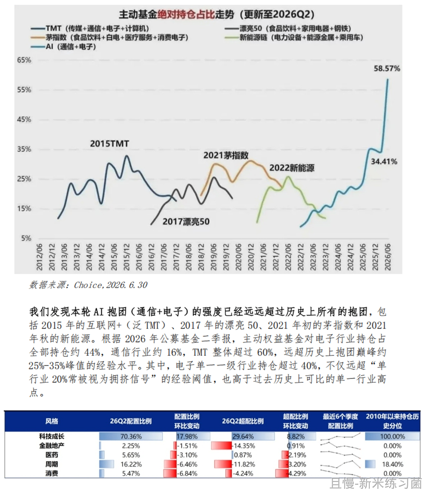
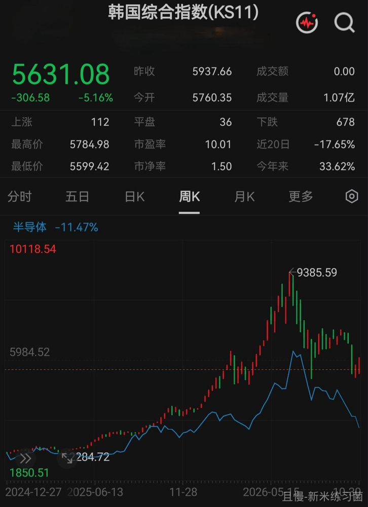
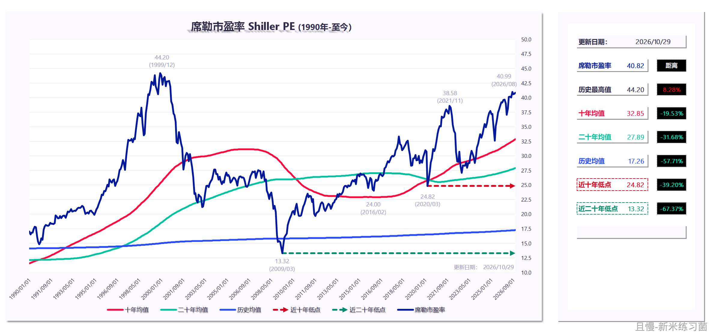
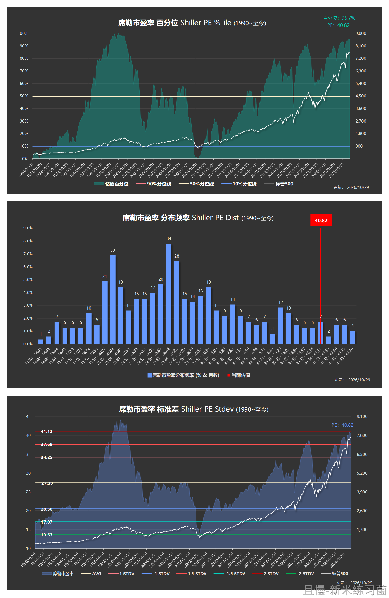
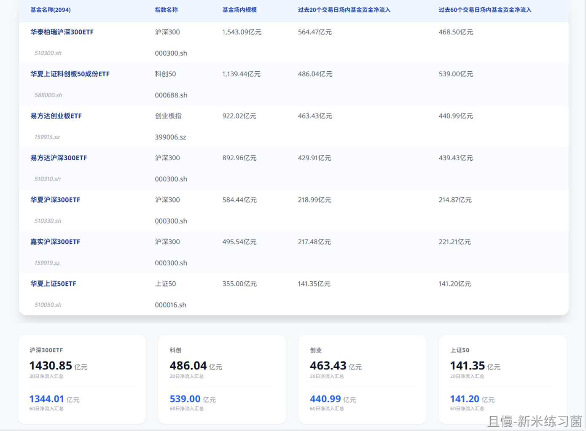
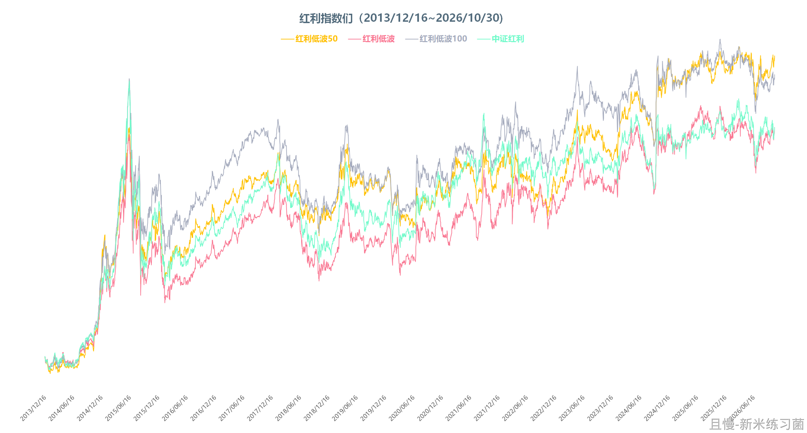
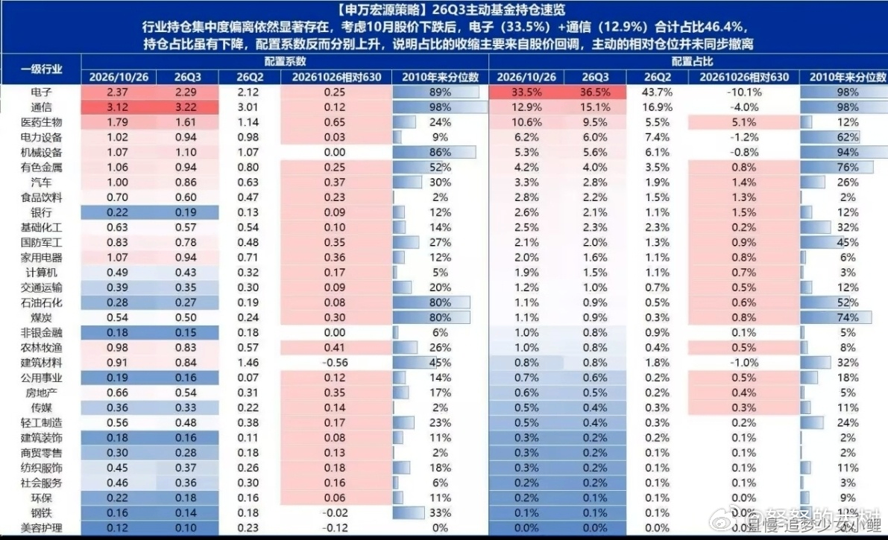
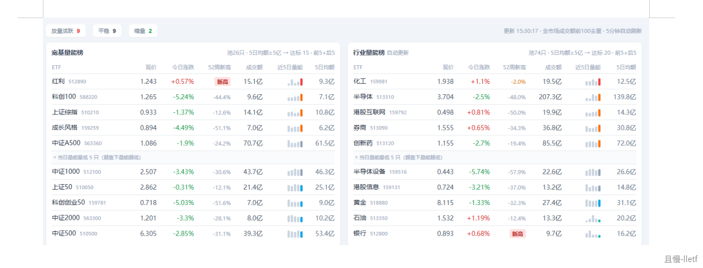

有几个问题合一块说吧。省得一条一条弄得大家通知不停跳。

第一个问题。美股。

美股的绝对估值无疑是高的。无论从哪个指标看都高。但是这几年一直走强，很大的原因是各大公司巨量的回购+分红。过去几年，美股公司回购金额合计超过几万亿美元。

没错，有些市场融资几万亿，有些市场回购分红几万亿。

但是今年情况有点变化。几个科技公司因为大力投资AI，自由现金流转负，没钱回购了。相反，要发债、发可转债、发新股募集资金。这不就是某些市场眼熟的再融资吗。

如果是这样的话，美股会怎样，咱们一起观察。

第二，环境是所有人共同打造的。

最近在各个平台上，看到各种股民各种方式的宣泄。我只是在想，其实很多问题，不是一个人，一个机构，一个组织，一群人造成的。

一个环境的形成，是在这个环境中所有人共同打造的。一个现实的出现，是所有人共同造成的。

就像足球。（为什么总说足球，因为足球是一个能讨论，有足够关注，有足够参照物能够进行比较的极其特殊的领域。）

足球的问题不是换一个足协主席，换一个国家队主教练，不是换一批球员就能变好的问题。它的问题是由所有足球工作者，所有圈子里的人，甚至整个国家的人，所有人的想法、群体的性格、社会的认知等等问题一起造就的。

市场当然也一样。市场的问题不是量化，不是基金，不是管理层，不是上市公司，也不是散户又或者什么机构单独的问题。是所有人的问题。

再推而广之。很多很多很多事情，是所有人一起造成的。一个群体的命运，是这个群体集体打造的。

不说了。

第三，抄底。

有些朋友着急抄底。看到科技股大跌，赶紧抄创业啊，科创啊，或者哪怕宽基啊。

各位，我不知道您是否想过，为什么您手里还有钱抄底。

真正的底部到来的时候，只有一种人可以抄底。那就是有知有钱又有胆。

有胆量有认知，没钱的，抄不了。

您手里之所以有钱，就是因为节奏控制住了。现在，节奏依然要控制。我会加速买，但也依然在控制节奏的基础上加速。

时间、空间。

您想一个问题。

现在的科技股谁会买。

公私募吗。记不记得之前的统计。6月底，公募基金拿科技股的仓位是历史最高。他们已经没钱买了。

神秘大资金吗。他们买300控制指数我信。让他们去买几十倍的科技股，再看看吧。

说到底，科技股你看韩国的走势就行了。韩国什么时候涨起来，咱们的科技股就什么时候涨。那韩国什么时候涨？

问题又回到了第一点。看看美国大科技公司是否还有钱持续砸吧。

总而言之，这一波科技受伤的人太多了。多少人等着解套。我不知道谁会买上去让他们解套。超跌反弹有可能。但我如果没那个本事，可能吃不到这一笔。如果机会成熟，我也会少量买点C类吃反弹。到时候看吧。

第几条了，忘了。

红利低波50又历史新高了。这个指数有点意思。难道编制红利指数也是标普这样的老外编得比较好吗。谁知道。

<!-- qieman-comments:start -->

---

# 有几个问题合一块说吧。省得一条一条弄得大家通知不停跳 · 评论区（2026-10-30）

> 评论区归档：2026-11-06 抓取于且慢社区，原帖共 448 条互动，精选 96 条（作者发言、作者回复及其他投资相关评论）。

## 改名不行是吧（澳大利亚） · 0 赞

谢谢老大！我研究研究您之前发的宽基和红利！

## 同路人_oZ7s2l（广东省） · 0 赞

银行股普遍历史最高，e大怎么看？红利是否也在高位？

## 双鱼座（湖北省） · 2 赞

美股在我心中是避风港，老大这一提示我的心呐

## LuccaRun（北京市） · 17 赞

看起来这次科技被套的是公募啊，散户还套在医药消费里

> **ETF拯救世界（作者）** · 226 赞：错。医药消费套的是老登。科技股套了几百上千万小登中登。

> **出乎意料（广东省）** · 0 赞：散户追科技的可多着呢，前面几个月涨的时候，公司各路大神都在跟我说，那些新进市场的小登们可是啥都不怕呀，我只能默默地说牛逼牛逼牛逼！这几天都不做声了

> **保卫（江苏省）** · 6 赞：美股就是被我买跌的，因为我最近加仓了

> **麦仓（广东省）**（回复 ETF拯救世界） · 15 赞：我科技没追是因为e大不断预警，万幸啊。医药医疗被套是因为刚跟车的时候不懂得控制仓位，按且慢的补仓提醒补了很多份药疗，现在逢反弹减仓，尽量和e大的持仓比例相近。

> **青青125（湖北省）**（回复 ETF拯救世界） · 3 赞：我手里消费医药中概特别多，所以这次暴涨暴跌对我影响不大😃

## 同路人_无私的白桦（河南省） · 0 赞

可以E大弄个科技的信号我等可以趁反弹卖出了，科技真的伤人心啊

## 七王五二三（天津市） · 6 赞

科技受伤长赢没挨到，上涨目测也没吃到🤐

## 纪如是（广东省） · 0 赞

E大，黄金856了，快到你上次提的买入区间了😍

## 雪铃（陕西省） · 2 赞

好的，收到，感谢老大提醒，自己一分钱都没抄底，继续蹲，不着急，昨天盘后亚马逊和英特都是大跌，下周继续看戏吧

## 湛南（北京市） · 1 赞

我其实有个小问题，个人的一点想法。好像从22年还是23年，就一直有人说美股不行，或者股值太高。但是我有同学它提前在香港开账户的那些人，它定投美股，到现在，收益跟我说起码有百分之20 30的年收益，为什么有人一直说那边不行，但是那边一直创新高呢

## 新米练习菌（上海市） · 70 赞

【留言1】放2图做补充参考
图1：当时“6月底，公募基金拿科技股的仓位是历史最高。”的统计图
图2：韩国vs我们的半导体指数，走势是挺像的

> **新米练习菌（上海市）** · 48 赞：【留言2】再放2个图 作参考
📊【图1-图2】更新下美股估值
目前40.8，离最高只有8.3%；
自1990年起，估值百分位95.7%；
统计的444个月中，估值超过当前月份的仅19个月，其中1个月是今年8月，另外18个月都是千禧年互联网泡沫时期。且接近2个标准差。
📊【图3】看了眼 A 股票型ETF近20日、近60日资金净流入情况
拉了近期净流入超百亿的7个，
虽然有“神秘资金”轮番买的可能：300，科创，创业，50都有“巨量”触碰，
但，300，分开买了4个，“总量”是最最大的。

> **新米练习菌（上海市）** · 50 赞：【留言3】红利系列
（写完上述留言，发现又多一个话题。）
四个红利，当时学习的时候，看过，老外编的这个《标普红利低波50》也不是一直都最好的，看走势（TA们对应的价格指数），就——你好我好，轮流好的，都挺好的。
查了查，放个总结：
1️⃣红利低波 50（标普）：精选大盘尖子生，弹性强，容易创新高，但波动弹性两头走
2️⃣红利低波：50 只 + 分红质量硬约束，防守最强，涨得最佛系
3️⃣红利低波 100：100 只分散版低波，均衡中庸，长期表现很稳
4️⃣中证红利：原版红利，不带低波 buff，进攻性更强，回撤也更大
【图1】从2013/12/16开始统计是因为那时《中证红利》指数编制 规则变更，从“市值加权”调整成了“股息率加权”）
——
（小声：应该是第四条吧？第三条下面的子话题较多）
🎯第一条：美股。
🎯第二条：市场环境是所有人共同造就的。
🎯第三条：抄底。
3.1 抄底
3.2 节奏
3.3 公募历史科技仓位
3.4 神秘资金 
3.5 A 股科技看韩国（又回第一条 —— 美股科技企业的回购 / 资本开支变化）
🎯第四条：红利低波 50 再创新高。

> **追梦少女小鲤（湖北省）**（回复 新米练习菌） · 16 赞：补一个图，26年Q3季度机构抱团依然严重。
公募基金三季度的持仓已经公布完毕，情况如下：

1、电子（即半导体），三季度末，机构持仓占比36.5%，10月26日33.5%，下降10.1%。

2、通信（主要是CPO），三季度末，机构持仓占比15.1%，10月26日12.9%，下降4.0%。

3、医药，三季度末，机构持仓占比9.5%，10月26日10.6%，上升5.1%。

4、食品饮料，三季度末，机构持仓占比2.2%，10月26日2.8%，上升1.3%。

5、银行，三季度末，机构持仓占比2.1%，10月26日2.6%，上升1.5%。

> **洗心革面学投资（河南省）**（回复 新米练习菌） · 2 赞：指数编的好，新高没烦恼~

## sunny888（安徽省） · 0 赞

一个策略用的人多了反而失效 其实我挺喜欢A股这样的大波动😇😇 策略有效性更强

## 暗香（安徽省） · 0 赞

现阶段人心惶惶，跌破3600再谈抄底的事

## 捡辣鸡二十三名（陕西省） · 2 赞

A股跟韩股，韩股跟美股，美股AI支出巨大回报还不明朗，且回购分红减少，感觉A社上市是这波科技股走势的拐点，搬个小板凳观察。

## 捡垃圾的跟班（陕西省） · 0 赞

美股真的是下不去手，就买了一点点，看老大说的阶梯，我建立了，前一阵锁了5个点的ytm；

## 聚沙成河（广东省） · 0 赞

昨天差点忍不住加仓，后来算了下70/80忍住了，还有很大空间

## 骨头卿（上海市） · 0 赞

红利低波50真的有点意思

## 柳树在路上（美国加利福尼亚洛杉矶） · 4 赞

心态很重要，抱着抄底心态去的话，可能动作就会变形，一下子买的太多，但是如果抱着平衡组合里的资产配置去，可能就会慢慢去加，比如像一点点买入宽基这样去配置。

## 小小鹅（北京市） · 0 赞

请E大预告一下车次，由于多开了几个150，利润回撤了多，不赔心态也好

## 洗心革面学投资（河南省） · 0 赞

美股：
一直在思考为什么美股那么贵了，还可以继续涨，可以顺着E大分红转变成发债的线索研究下去，探究一下本质。
抄底：
从估值到仓位配比均可以买入，但时间上还没有到，所以害得等。期待下周早点到来~

## 玫瑰色的米（北京市） · 0 赞

老大 我最近有很多自己的想法 您帮着看看合适不 我想的是 ai时代来临 很多想法都可以得以实现 比如我自己想建几个被动策略 1、月月分红 仿招行的月月分红产品 选三个季度分红的红利 每月定投（按市值法加仓）然后三只产品的分红月份错开 保证每个月度都有基金分红 然后红利再投资 等老了/需要时再现金分红 2、参考简慢投资 五只基金分别为 标普500 纳斯达克100 中证红利低波 A500 中债 分别20% 然后年度/半年度调仓 每月度也按市值法加仓  这两个策略保证我无论大跌还是大涨我都保证有钱加仓 目前可能每个策略几百块 您看着咋样~

## 西米666（江西省） · 19 赞

那你前几天买A500是不是抄底抄的早了点？？？

> **ETF拯救世界（作者）** · 212 赞：那不是抄底。那是高位卖出的500跌20%买回来的波段

> **FangSY（浙江省）** · 1 赞：不可能一次性买在最低 只能一点点布局增加仓位 不可能涨起来增加 只能跌的时候加

> **同路人_S843Tl（天津市）** · 2 赞：那只是一份儿，后面可以有好多份儿，时间，空间拉开距离，不超过20%有什么可怕的，这就是我和他学习到的最好的东西，慢慢来吧，财不入急门，我医疗买了好多，慢慢的就好了。虽有遗憾但是也没有办法，如果，这两年，医疗医药，如果像信息那样翻两翻，那他就是神，可惜没有十全十美的人坚持就是胜利🙂

> **真真假不了（河南省）** · 3 赞：没有人能精准的抄底，说抄底抄早了，都是后视镜视角罢了，这样的思维方式，如果涨上来又会后悔买少了

> **被陈末沉没了的沉默（黑龙江省）** · 4 赞：昨天不是说了嘛，总想买在最低是一种病，哪里有人能抄底呀，其实都是搏个概率吧

> **大晗（广东省）** · 3 赞：比如你有150块，就买了1块钱，你管这叫抄底？

> **大小孩子了（上海市）**（回复 ETF拯救世界） · 2 赞：之前要把A+H仓位降到50%的计划变了吗？现在不降反而继续加了？

> **三十岁前住瓦市殿巷（浙江省）** · 1 赞：我仓位重，一车没跟。也许再跌20%开始建仓，不跌到位置无所谓，因为对A市场体验不佳，无法把握

> **缘缤（辽宁省）** · 10 赞：人生最大的贪婪就是抄底要抄到最低，卖出要卖到最高，大家共勉。

> **北风其凉（山东省）**（回复 ETF拯救世界） · 0 赞：卖出的时候是否考虑用500代替？

> **南森（山东省）** · 2 赞：那你为啥跟呢，你可以自己操作，在你所谓抄底的空间

> **南森（山东省）**（回复 学徒） · 1 赞：她还2000多天呢，不知道抄底个鸡毛

> **YU你一起（江苏省）** · 1 赞：你管这叫抄底🙃 
500卖了那么多份，买这1-2份叫抄底🤣

> **Michael（上海市）** · 3 赞：其实可以自己操作的，不用非得看着E大的，自己操作肯定比E大要好，他总是买不到最低，加仓太早了。

## soyking（北京市） · 0 赞

证券的网格券商停了之后，自己设置了一个更保守的 15% 步长的，今天成交了，目前为止看买的位置在日内居然还可以 😃

## Jayceche（福建省） · 0 赞

在万德里面看估值，纳斯达克指数现在的pe是30左右，近十年的较低位置。不知要看哪里看pe才比较准确呢？

## Garlic（浙江省） · 0 赞

经过两轮的鞭打，现在科技这个位置，长期绝对是接飞刀，千万别急，最大风险按上次低点+200=1800 来算，幅度还有-35%😂，而且看筹码结构，根本没有涨上去的可能，必须得有输家出现，短期反弹概率大。可以有计划的小仓位试试

## 陈鑫鑫（广西壮族自治区） · 0 赞

6月的科技真的是，果然每次等我忍不住进去了就是山顶顶了

## 站在未来看当下（广东省） · 1 赞

6月底，公募基金拿科技股的仓位是历史最高。他们已经没钱买了。

## 一人一城（上海市） · 2 赞

且慢现在看到 您关注的ETF拯救世界发布了新内容就非常开心🚀🚀🚀 还有新米君发布的内容也每条必看🥳

## 不怕熊的winnie（上海市） · 0 赞

老大，我的网格条件单，已经在科创50、信息技术、游戏etf、创业etf这几个上面吃了好几个迷你波段了。我觉得非常非常好玩，资金很小（因为还是觉得贵），但是每次大跌我就买一点点，然后往往1-2天后就反弹，我就卖出。好玩惨了

> **嘿嘿嘿嘿2（山东省）** · 0 赞：可以辛苦分享一下网格吗 我的看不到了

## 不怕熊的winnie（上海市） · 0 赞

网格就是落实了”空间“这个概念的神器。然后随着下跌，金字塔型加大资金量。

## 陈逸铭（广东省） · 2 赞

能不能开放一个只跟车卖出的功能，让我们的持仓能够慢慢卖出，不然还要一直关注发车是什么

> **WAA（上海市）** · 0 赞：自动跟车 卖 然后账户里不要留钱就不会自动买入

## Yujie（四川省） · 0 赞

我管住我的小黑手，不抄底，之前一抄就抄在半山腰

## 适当得闲（山东省） · 0 赞

期待美股崩盘，咱们捡漏😃

## 阿狼（广东省） · 0 赞

好像，年轻人特别喜欢买科技股阿，说到底还是太年轻了，没有经历现实的捶打。

## 因E至此（福建省） · 4 赞

但是我在想，整个环境的影响里面是不是会有主导者，如果主导者能意识到改变，环境是否就能慢慢改善🤔

> **ETF拯救世界（作者）** · 78 赞：会。但是主导者也是群体的选择。

## 跟着E大滚雪球（湖北省） · 0 赞

现在七姐妹长期趋势走坏的有几家？

## 同路人_B4GIVS（广东省） · 0 赞

持仓中红利低波50，中证红利，红利100，红利低波，都有了，会不会根据市场变化有所侧重

## Bryan没有T（江苏省） · 0 赞

老大，请问网格中的证券ETF暂停所有新增买入，底仓也将在1.30卖出，这是什么原因？

## 可爱da文西（山东省） · 2 赞

A股和足球一样。足球是由亿万个球盲的情绪制造着舆情，影响着管理者的决策。A股是由亿万个幻想一夜暴富的韭菜共同吹起了估值的泡沫。

## 团团团子（北京市） · 1 赞

感谢e大，六月在您一再提醒下，卖了80%的科技，虽然还有20%，但心态很稳

## 肖增鑫（广东省） · 0 赞

我可能是生病了，天天盼望医疗大跌暴跌，好做波段收割。

## 学习就有收获（山东省） · 1 赞

老大，非常开心又要做波段了。资金少且不会网格的，波段是我的最爱，自己不敢做，老大带领真是开心🙏

## 大小孩子了（上海市） · 1 赞

之前要把A+H仓位降到50%的计划变了吗？现在不降反而继续加了？

> **山竹（浙江省）** · 0 赞：我也记得之前要降低A股仓位，可惜美股机会没到

## 乌拉圭（四川省） · 0 赞

没错，今天有了想抄底的想法。。。看到很多声音说这个位置，割已经没有意义。。。

## 莫名（浙江省） · 2 赞

之前是被老登套着没多少钱上科技，然后一直觉得踏空，回头看来，福兮祸兮，老登里套着还舒服点😅

> **如是我闻-（湖南省）** · 0 赞：那很舒服了，跟E大买的2万还剩2万，科技大涨那波追了进去3万还剩2万。亏贼！

## A-慢就是快（江苏省） · 0 赞

今日有车不？
（我就关心两件事，开车不？这啊那啊还会再做波段不？）

## 星梦ya（浙江省） · 1 赞

第一，底部是一个区域，不是某一个点。第二，谁也不能准确预测市场。第三，做好压力测试

## 仲华BEN（广东省） · 3 赞

问题是A500 估值不低，里面的科技制造业成份占比不少，跟沪深300一样拖垮了整个指数，如果下跌20%就买入，为啥消费和医疗不买，不明白这个逻辑

> **田老师（湖南省）** · 0 赞：一个宽基，一个行业，各有比例控制，那加仓节奏自然不同

## 诅影（山东省） · 0 赞

下坡路抄底着急，真不怕抄底变抄家啊。。。相似的事情总是重复发生。

## 春日饮花酒（四川省） · 0 赞

最近下跌老大发了好多条消息

## 兔rabbit（山西省） · 2 赞

谢谢老大，我不怕下跌，怕的是不下跌。最近科技跌的猛，心里蠢蠢欲动，谢谢你的每次警示，让我蠢蠢欲动无处安放的小心心踏踏实实的落到肚子里。不然的话，她动不动就提到嗓子眼了👍👍👍至于手嘛，吃过一次亏，我就关注了，我是不会乱开车的，只等老大的班车来接😃😃😃

## Gemmabymini（上海市） · 0 赞

我不算抄底吧，我自己做创业的波段中，今天刚刚第二网🤪

## 田老师（湖南省） · 1 赞

不停的跳信息，能感觉到近期的快速下跌让e大有点爽，马上有加仓机会了😉

## 如是我闻-（湖南省） · 3 赞

这一波科技的下跌让我明白了什么叫盈亏同源，之前6月疯狂涨的时候买科技各种在持有老登股的人面前上嘴脸。只要没有止盈，这一波亏得肯定神志不清了。果然还是要有敬畏之心

## lletf（中国） · 2 赞

今天量能最大的红利和最小的银行都新高了，是不是很神奇！

## 从微博而来（陕西省） · 0 赞

买的银行股，用来打新科技股。科技股没有中一签，但是银行股涨了，也还凑合。

## Fortune（上海市） · 0 赞

之前有没有提过买入黄金的点位，课代表踢我一下

## 云上（湖北省） · 1 赞

自己操作了之后才知道益达有多强。。。我开黑车买的科技和通信清仓之后换了黄金 光伏   旅游全部被套20%左右。   然后黑车的恒科，因为没逃顶，小亏几个点，太劳心了，以后再也不开黑车了。

## DragonL915（上海市） · 0 赞

美股要是跌下去，会跌成日本当年失去的30年那样吗？

## 飞洪Simon（秘鲁） · 0 赞

人在国外出差，时差问题不能盯盘，免去了很多痛苦。每天醒了都能看到，咔嚓一刀。虽然场内只有10％仓位，也是麻了😂

## 吴小姐（湖南省） · 0 赞

如果只买宽基，A500，创业板ETF，红利ETF，可以吗？

## 噼噼（湖北省） · 0 赞

请问E帅，国内现在的加息预期和原材料价格高位，会影响我们在红利产品上的决策吗。

## 城府（浙江省） · 0 赞

我想请教一个问题，E大你的整个持有组合，预计的最大回撤和预计年化收益率是能告诉我吗?

## 西班牙的中国韭菜（西班牙） · 0 赞

为啥科技股看韩国走势？求指点

## 淡淡的喜悦（湖南省） · 1 赞

E大，我有一点不太明白的地方，就是我看到 150 计划里面持有三份易方达安心回报债券。然后呢，最近这个债基回撤的比较厉害，我看了一下它其中权益部分持有大量前期热门的个股，为什么不在高位减持掉一部分呢？

## 同路人_A5TlIy（四川省） · 0 赞

我为什么有钱买，除了自己会攒钱，会控制欲望和消费，主要原因还是e大厉害，带我在牛市赚了钱，而且落了袋，所以功劳都是e大的

## 抽刀断水（山西省） · 0 赞

确实，科技要解套等JFJ吧🤣

## 同路人_Jane（浙江省） · 1 赞

最佩服E大的自律和控制力。节奏控制，明牌点位，不到不买。有时候自己去看盘，看到低的涨了，涨的又跌了，还没到点位就想这个低点买点，等高点抛掉做波段。然后，市场就给了一记重拳。

<!-- qieman-comments:end -->
