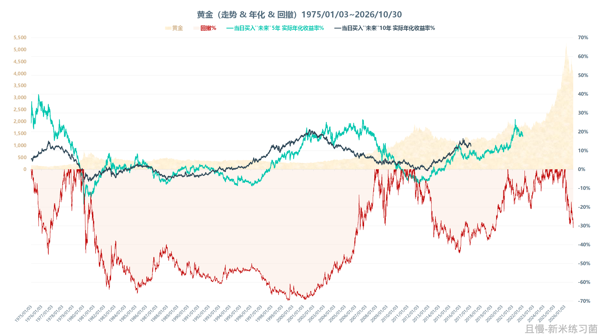
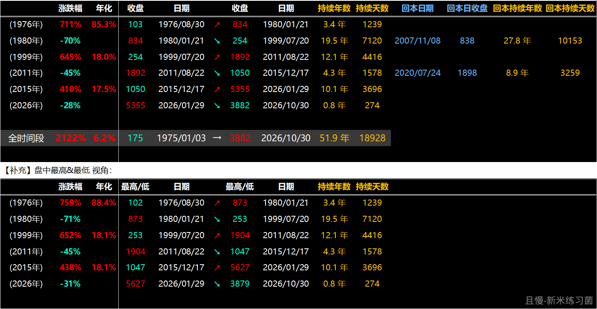
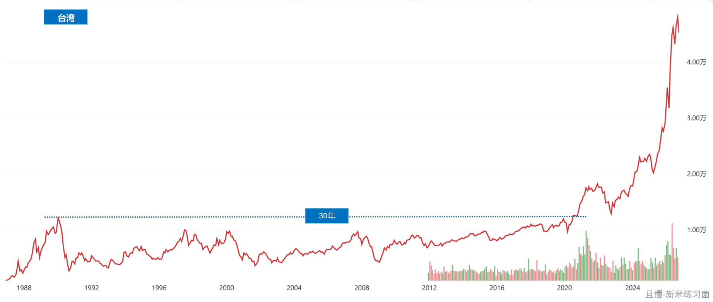
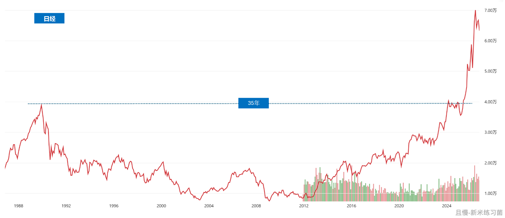
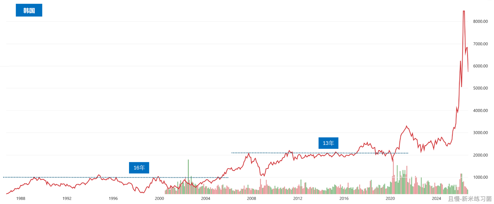
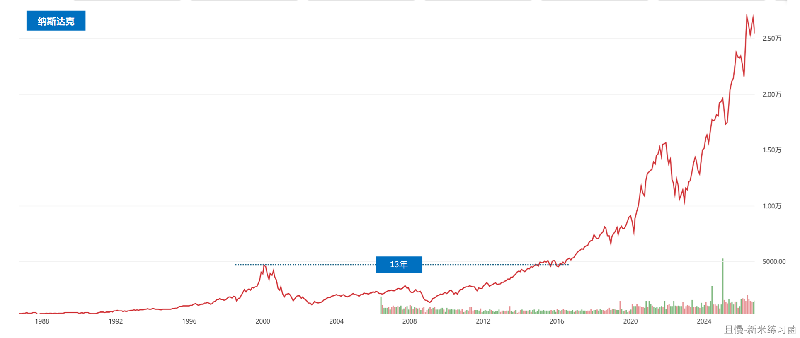
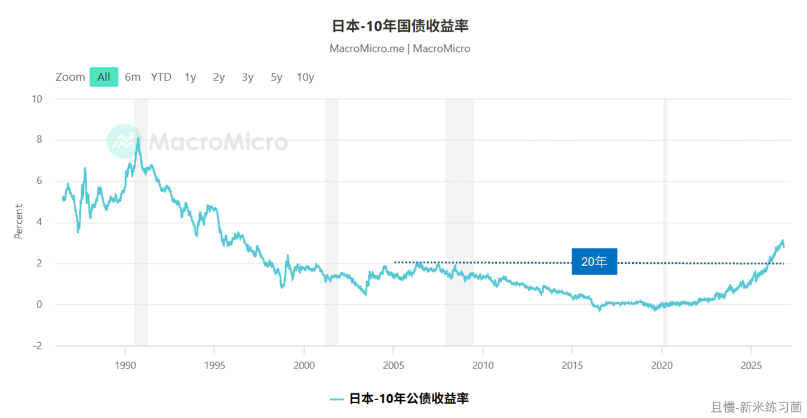
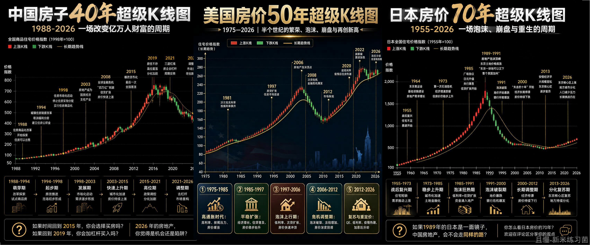

做投资也好，还是别的什么也好。很多某个时期成绩不错的人，总是误以为自己的能力强，水平高。

殊不知，无非是生对了时代而已。

我们这一代中国人，最熟悉的财富神话是房子。尤其是北上广深，2000年到2020，这二十年诞生了多少因为房子发财的神话。每个加杠杆买一套买几套的，都以为自己是天选之人。

中房、美股、日债，就是“永不破灭的神话”。

其实，无非就是生对了时代。早生二十年，晚生二十年，天选之人就是nobody。

黄金过去十年翻了5、6倍。在很多人眼中就是保本、保值增值的好东西。手里刚开始有了几个钱的年轻人，更是如此认为。因为当他们进入市场的时候，这个品种就是在一路上涨。

你进入市场的时候是什么时代，你出生在什么时代，就会极大的影响你的性格和做事方法。牛市开始的人，和熊市开始的人，就会有不同的性格。

在有些时代长大的人，乐观、充满希望、眼里全是光。有些时代长大的人，谨慎、拘谨、疑神疑鬼、沉默是金。

1980年开始买黄金的人，20年后看着价格从800跌到275，绝对不会认为黄金是保值增值的品种。1970年开始买的人，又是另一种截然不同的观点。因为那十年，黄金从30多涨到了800。

中国台湾的股市是过去十年涨幅最大的市场。年化居然达到了惊人的20多个点。在这个时代入场的人，只有all in和死死拿住是最正确的选择。

而1990年入市如果这么做，那么二十年后，他还会亏损67%。

即使不算那么极端的情况，从2015年往前推10年，2005到2015持有十年不赚钱。再退10年，1995到2015依然不赚钱。

更不要说这两年最牛的市场韩国，2025年爆发前，18年没涨了。

“永远涨”的美国，纳斯达克是怎么3年跌掉80%以上，用了4000多天才回到高位的，我就不说了。

没有任何永远都涨的品种。某个人在某个时期买了某个大涨的品种，也不意味着他真的是什么天选之人。只能说可能是他生对了时代，没经历过毒打。

那么，就真的没有办法在这样的金融市场活下去吗。

当然有。我的建议。

第一，不要在某个品种低谷的时候轻视它。横有多长，竖有多高。只要它不死，就有它的春天。

第二，上面这一条有个先决条件，是你没有把所有希望寄托在它的身上。你想象一下，无论是黄金、美股、中国台湾、韩国、日本……这些现在牛到天上的市场，如果你在那二十年满仓持有，你真的会舒服吗？二十年啊。20到40。30到50。

第三，所以，要做搭配。就像上半年科技宽基上涨，红利拉。下半年红利上涨，科技宽基拉。不是谁行还是谁不行，而是冬梅秋菊，各有开花的时间。不如都持有一些，谁好就卖出一点给那些抢的人。谁差就做做好事接一点盘。这样，不会被20年的熊市荒废了时间。

梭哈一个品种，可能拿到巨量的收益。但是，这种投资方式，绝大多数注定要失败收场。因为梭哈的人，注定是赌性极大的人。过往的成功也会让他以为自己是天选之人，所以这样的投资方式会持续。

然而，你见过长胜的赌徒吗。最终，在某一次错误中，不仅历史的收益全没了，连本金恐怕都留不住。

能够及时收手的梭哈赌徒，以及做好荤素搭配的远行者，是仅有的两种可能长赢的投资人群。不可能再有第三种了。

<!-- qieman-comments:start -->

---

# 做投资也好，还是别的什么也好。很多某个时期成绩不错的人，总是误以为自己的能力强，水平高 · 评论区（2026-10-31）

> 评论区归档：2026-11-06 抓取于且慢社区，原帖共 474 条互动，精选 80 条（作者发言、作者回复及其他投资相关评论）。

## 财富自由平凡之路（河南省） · 47 赞

老大，杯子什么时候开始抽🫶

> **ETF拯救世界（作者）** · 195 赞：抽完了。等杯子做出来公布领奖吧。

## 来去匆匆（上海市） · 1 赞

论仓位配置的重要性👍👍👍

## 爬呀爬（北京市） · 1 赞

周末愉快 e大

最近很喜欢的一句话：相信我，再没有比在崩盘期间，从不顾价格、必须卖出的人手中买进更好的事了。
股市，不是为了“抢别人的筹码”，而是从被迫卖出的人手里买便宜货。——霍华德马克斯

## Yn_小草（新疆维吾尔自治区） · 0 赞

E大，怎么跟投你的波段？

## 未名花（广东省） · 0 赞

相关性资产配置，东边不亮西边亮。

## StormZ0（湖北省） · 0 赞

150+s＋标普五百
挂机流

## 浪味仙啊（浙江省） · 0 赞

我就是自己场内梭哈了两个月的白酒，10月最后一天大涨我卖出了一半，其实回过头看看，我这么做挺傻的

## 哄哄123（重庆市） · 34 赞

老大，我胆子小，跟着您，我真的好安心，身边的朋友爸爸从30万，到3000万，再回到30万，最后50多岁就因为承受不了这些生病去世了，我现在就想照顾好身体，等到中概医药开花结果的那天到来。🙏

> **黄昏骑士（广东省）** · 11 赞：医药，医疗没什么可担心的，和科技是跷跷板。中概恒科也快到7080区间，到了这一步反而没什么可担心的了啦，不要乱加仓

> **山竹（浙江省）**（回复 黄昏骑士） · 0 赞：中概恒科我觉得还好，毕竟公司盈利的。医药由于大环境集采，国内医保拮据，这啥时候是个头

> **Light358826（云南省）** · 2 赞：他说中概、恒科和医药占比不高，你还等着他开花？再跌的话占比更低了。

> **黄昏骑士（广东省）**（回复 山竹） · 1 赞：中概恒科完全受制于外资，对美联储货币政策依赖极大，受制于离岸市场，看外部环境。医药，医疗有创新药和cxo领头，还有ai制药的故事，又是传统的防御板块，目前公募基金三季度已经开始增加医药，医疗持仓。小登不死，老登不生，就是跷跷板

## 同路人_LG4ub6（广东省） · 0 赞

纳指是不是可以考虑建仓了？老大

> **海上追风（江苏省）** · 0 赞：很难，有限制，要想配置国外市场，还是买ETF。

## 零一观照（陕西省） · 0 赞

各种不死品种，低谷期，均衡配置，保持耐心。🙏🙏🙏

## 农民工进城搞钱最光荣（江苏省） · 0 赞

永远不满仓，永远不空仓，红利宽基打底，长短结合，平常心

## 可乐的小姐姐（甘肃省） · 1 赞

老大，你上次说黄金到850以下考虑补仓，真的到830了唉

> **周周有惊喜（广东省）** · 1 赞：我午休起来就看了下黄金，850以下了，不过黄金行情没有这么快，耐心点

## 卧拾野闲云（浙江省） · 1 赞

能及时收手的梭哈赌徒，这句话里是不是已经包含了不可能三角的词语……所以其实能长赢的一定是理性人而非赌徒……

## 本金不多（重庆市） · 0 赞

工作生活亦是如此，多一份技能和兴趣，扛住周期和无聊

## 新米练习菌（上海市） · 95 赞

E大周末好~
COMEX黄金现在3884.9，距离1月最高回撤-31%左右；
（黄金TD 现在831.1，最高回撤-34%左右）
——
之前扒了黄金的数据，从1975年开始的，正好在做数据图表，我把黄金的图更新一下，同时，统计了上涨&下跌周期。
看那“大面积”的回撤，生活在那些decades（1980年高点买了黄金，到了2007年才回本）27.8年的日子，回撤又深（7080定律）还叠加跌得又久，而且80年的800多美元和07年的800多美元 根本不可同日而语，10000多天，
人生投资黄金30年全在黄金里的话，很难想象那般渡过的人，还会再爱黄金的。

> **沧海一粟2020（河北省）** · 0 赞：如果一个平衡的组合，配置5-8%的黄金行吗

> **新米练习菌（上海市）** · 27 赞：【留言2】翻看了一下台湾、日本、韩国的股市。
【图1】台湾加权
 (1990年) 最大回撤-80%
1990年02月12日 12495点 跌至 1990年10月01日 2485点
然后，30年不涨。
【图2】日经
 (1989年) 最大回撤-80%
1989年12月29日 38957点 跌至 2003年04月28日 7607点
然后，35年不涨。
【图3】韩综
 (1994年) 最大回撤-76%
1994年11月09日 1146点 跌至 1998年06月16日 277点
又 (2007年) 最大回撤-57% 
2007年11月01日2085点 跌至 2008年10月27日892点
都是十几年不涨。

> **新米练习菌（上海市）** · 38 赞：【留言3】还有：纳斯达克，日债，房价
【图1】纳斯达克
 (2000年) 最大回撤-78%
2000年03月10日 5133点 跌至 2002年10月10日 1108点
【图2】日10年国债收益率
低了20年
【图3】房价（网上找的，别人做好的图）
——
没有一直涨的，也没有一直跌的。都是周期。

> **很哇塞的鱼池（安徽省）** · 0 赞：上次老e说的黄金多少钱会买？找不到帖子了

## 同路人-鑫鑫向荣（山西省） · 0 赞

能够及时收手的梭哈赌徒，不存在。

所以远行者只有荤素搭配的长赢者。

## 知一行（上海市） · 0 赞

很多人都有时代的局限性，E大从更长的周期来看，并且制定了有效的对策，才能“长赢”。
感恩遇见e大，让我视野一下开阔，豁然开朗。🌹🌹🌹

## 洗心革面学投资（河南省） · 1 赞

井底的青蛙说，天空和井口一样大。
盲人摸象，摸到哪个部位，大象就是什么样子。
每个人都有视野局限，如何跳脱出来，站在更高的维度去思考所处的环境，所在的时代。
第一、读书，多读书。多了解历史，了解周期。
第二、透过现象看本质，去思考，去总结。

## Lingo（山东省） · 2 赞

这一篇足够指导一生的投资。我投资生涯的第一个十年，完全是荒废的，第二个十年在进行中，虽然没赚什么钱，但跟随 E 大 认知升级，做好了配置，不断的实践，优化和继续升级认知，后面的若干年，相信最终不会太差。

## 无-（北京市） · 0 赞

长赢很重要，也是最终目标。

## Guangyin（天津市） · 1 赞

第一种的这个“及时收手”，及时收手多难啊。

还是资产配置这个适合我！

## Shuaishuai（云南省） · 0 赞

一直记得横起来有多长，竖起来就有多高这句话，而且市场也在反复验证。比如我刚开始的时候遇到的油气、医药、传媒等等

## 自律自由（北京市） · 3 赞

请教E大，且慢上标普 纳指估值是低估，又有说美国不便宜，不知道如何做判断了。我们小散如何判断标普 纳指的估值？

## 桔阳子（辽宁省） · 0 赞

可惜今天周六，要不然黄金我肯定大补。

## 麦克尔王（广东省） · 1 赞

感谢E大周末的加餐。祝E大和家人周末愉快。
结合之前所学，针对三点建议的思考，做雪中送炭的人；把生活和投资的钱分开；做好各投资品种均衡配置。
今年6月逆势买红利，现在回头看，真神来之笔呀！👍

> **樱桃球（浙江省）** · 1 赞：E大最近几个月好多神来之笔，波段也是

## 从容理财（北京市） · 0 赞

看看电影《空枪》，讲的就是这样的故事，你以为老天总会眷顾你吗？时势造英雄，而不是英雄成就时代。知进退才能长久。我们这帮长赢人，不求大富大贵，也不想大涨大跌，只要慢慢变富就很好。

## ZPP（江苏省） · 0 赞

老大 长盈接下来会考虑配黄金吗

## 同路人_VXpGwx（湖南省） · 1 赞

老大，记不清你说没说过黄金的点位。能透露下，会在什么位置开始建仓黄金吗

## 兔rabbit（山西省） · 0 赞

老大今天是纯纯的理论，没有估值图图😝

## 兰花草（北京市） · 3 赞

我生的这个时代刚好遇到了E大，否则我就是今天被割的万千人之一。E大的字里行间给我的感受是这几年跟长赢下来，我自己又时不时自以为是的小动作中真实经验。长赢让我又一次躲过了灾难，在大跌的环境中看着计划还能红，这种看似熟悉的颜色变化，实则是E大的羽翼护住了我的无知无畏。
敬畏市场，踏实跟车，投资和生活资金分开，管住爱动的手，这是我跟着E.大投资的家训。
谢谢您E大，还好遇见您❤️

## 就吃香菜（香港特别行政区） · 0 赞

你说这些有啥用，现在年轻人赚钱时候骂你老老登，赔钱时候还骂你老登把红利吃尽，骂就完事儿了，管你这那的

## 跬步（广东省） · 0 赞

红利天天新高我怕了，拿不住🤣，我亏钱的居然毫无波澜怎么办🙈

## 仨石（安徽省） · 0 赞

对冲持仓其实挺快乐的，只要把握好配置的比例

## 笨鸟来了（西藏自治区） · 0 赞

期待计划里买入黄金的时刻。

## Kelen（湖南省） · 0 赞

这次回撤亏损在可控范围内吧 算是一次交学费吧 其实可以避免大部分的 慢慢学习

## 学而不倦（湖北省） · 2 赞

熟悉的文字，语言再次袭来，记得在疫情隔离期间，应该是2021年7月份，我闲着没事，从某app上将e大的微博反复听了很多遍，其中一篇就是一年四季都要换着播种不同的种子，这样才能不断的收获满满，给了我很大的鼓舞。
但是作为过来人，低位持有某品种而长期不涨真的很难熬。
其实最难熬的阶段也是今年5-6月份，卖掉的品种(别人的品种)一直涨，不断加仓的品种一直跌，或者是低位的品种一直跌，虽然知道一直涨肯定是跌下来的，但是那个阶段真的很难熬。
最难的是 不知道卖点，有人性贪婪的原因，也有在迷雾中失去方向的原因。

感谢e大，给了我很多启发，至少不买贵的(虽然有时冲动也买)，但是大体不会买太贵的品种。

## 红魔披头士（山西省） · 3 赞

虽然我们有坚定的信念，但是客观的说一句，最近几年的股市真的太TMD难了。 

长赢可能是市面上最好的投顾策略，在我心里没有之一。然而，你看长赢的收益率，就会发现，哪怕无所不知，并且知行合一，最终的收益率可能也不甚理想。

不是找借口，我觉得这不是策略的问题，就是市场的问题，这里没有好的土壤，想要大丰收就格外难。

## 凌风飞扬_爱投资（江苏省） · 2 赞

其实70、80、90的人或多或少都分享了部分中国改革开放40年的红利，只要踏踏实实过日子，已经比大多数人都好很多了（从时间线上来看，如此长的和平年代中国历史上要追溯到西汉文景之治了，连盛唐都没有这么长久安定过；从地域上看，看看现如今世界上五大洲195个国家还能不主动+被动卷入战火的还有多少个）。

## SSSS1114（浙江省） · 0 赞

今年这波科技牛让我再一次体会到“买在无人问津时，卖在人声鼎沸处”，谢谢E大不断的风险提示，至少把夏天的置装费拿回来了🤗

## 阿夏2026（上海市） · 2 赞

e大有个问题想请教，现在放在计划里的钱的确是不影响日常生活的金额，但是万一万一要急用钱只能从计划里提款的话，你建议先卖出哪个品种

> **投资不能投机（江苏省）** · 0 赞：你翻一翻小组里面的 历史文章，我记得  有一篇 劝退的文章，里面写的很清楚卖出顺序，先卖哪个，然后有几个亏钱的，等回本再卖啥的

当然我们是不会推出的。假如急用钱的时候可以参考卖出顺序

## 花香菇大人（山东省） · 0 赞

“谁好就卖出一点给那些抢的人。谁差就做做好事接一点盘”
“上帝救生艇来的时候早抓紧上”

## 紫杉小九（上海市） · 0 赞

就美股周五的样子，下周一肯定是能加仓了😂

## 种瓜点豆（福建省） · 0 赞

总是来看看，总能被安慰到，支撑着我熬过去。

## 感恩遇见美好（河南省） · 0 赞

能够及时收手的梭哈赌徒，以及做好荤素搭配的远行者，是仅有的两种可能长赢的投资人群。不可能再有第三种了。高👍

## PayneWei（浙江省） · 0 赞

老大，暴跌后的月末月初，长赢小组投资笔记是不是会更新啊？🥰

## 陈维岳（新泽西州） · 0 赞

再次认识到资产配置的重要作用

## 安文（湖南省） · 4 赞

感谢E大，救我狗命。
这几年真的，在您这里学到了很多很多。
人生只需要富一次，每一段时间里心安处也只需要一处。
最近看了很多世事无常，有很相爱的人最后分手离婚的，有很亲密的父母子女最后要断联的，赚过大钱最后负债累累的就更数不胜数了，很多人都说人生就是一场场体验，在不好的体验里能平静恬淡的人却很少。
做人要尽量激发别人的善意，做事不可太满，大概就是中庸吧。
一顿胡言乱语，E大莫怪。

## 巴韭诗（浙江省） · 0 赞

我就是看着黄金上一波跌到200的人，那时在珠宝论坛的说法是，黄金只是变现快，不保值和不增值。看着现在的黄金走势，感觉受到了自己认知的局限。不过谁知道下一次会怎样呢，谨慎一些总是好的。

## 明月繁星（广东省） · 0 赞

有没有可能收获时代的红利，而避免成为时代的代价

## 达乐安寨（河北省） · 0 赞

均衡配置，动态平衡，是技术也是学问也是哲学

## 随心随意（陕西省） · 0 赞

E大，我明年要结婚肯定就要给女朋友买三金。我看现在银行黄金只有831元每克是不是不算贵了，这个价位能否先买一部分，到明年不论涨跌，我都卖出银行黄金买三金，这样操作靠谱吗？求E大帮忙分析下

> **今晚的风是甜的（江苏省）** · 1 赞：你都说了买三金是为了送女朋友 为了结婚 为什么还要拿投资的视角来解释呢？分清楚你买这个黄金的根本原因是为了什么就不用过分在意涨跌了。

> **阿尔法猫（贵州省）** · 0 赞：我结婚前一年就买了几万块黄金。 想着：涨了我就挣钱了，亏了我就买实物更便宜了。 怎么都不亏。

> **随心随意（陕西省）**（回复 阿尔法猫） · 0 赞：结果咋样，你结婚前买的是银行黄金还是金条呢

## 不会单反（上海市） · 0 赞

早的时候跟车不紧额度小，自己在外面乱玩，现在只剩后悔，前面这波科技外面的全清了，还了点房贷，然紧跟发车，excellent choice！

## 不怕熊的winnie（上海市） · 0 赞

老大，我就好好跟着车，自己的黑账户就等待港股中概的春天

## 孤独的风（河南省） · 1 赞

中证500的卖点真绝了👍  可惜我就一份

## 昆明杰克（云南省） · 0 赞

在一个没鱼的池塘打鱼，难为e大了，从2017年跟投至今，虽然没赚着啥钱，但不怪e大，也学了不少定投知识，总比自己瞎搞强，我现在换鱼塘了，大a未来还是这样来回折腾，没意思

## Solitude123（德国） · 0 赞

跟着E大，心里稳稳哒，只盼着再跌一点好大力加仓🤗

## 蓝绿精灵（甘肃省） · 5 赞

目前为止，唯二跟着挣到稳钱的，一个是E大，一个是鹿公，都在科技风起云涌的时候拼命按着。一个说外太空，一个说看不懂。果然，活到最后的都是老鸟。

## E起富起来（四川省） · 0 赞

准备好了
谢谢E大提醒，看来明天我得把黑车网格账户充值点，储备着

## 斐波那契（浙江省） · 0 赞

这么说来大A5、6年会给一个大幅上涨不错了

## 茗有信（福建省） · 0 赞

我能在a股赚点绝对是运气。因为遇到你

## zhoujie（浙江省） · 0 赞

均衡配置，多配置宽基红利，嗯嗯

## 同路人_moU9xf（浙江省） · 0 赞

说今日不反弹就加仓，早上看了下大盘，看起来市场是要反弹一下？

## 张仲蔚（陕西省） · 0 赞

十几年前学生时代刚开始学习投资时在国外，美股论坛精华区写的是，年复利能达到7%就能超过绝大多数了。

## 喵喵棒棒糖（湖南省） · 0 赞

非常认同e大说的，生于什么时代，就有时代的烙印了。以前是知识改变命运，所以我靠读书现在能够安稳度日，但因为家底薄欠债多没有赶上买房的车，现在房价这个样子，又觉得一切都是老天爷合理的安排，总不能事事圆满

<!-- qieman-comments:end -->
