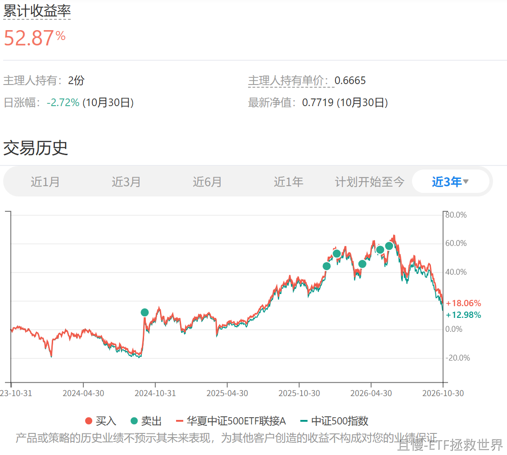

几个月后回头看，你有没有倒吸一口凉气。有没有一点后怕。

接下来，我们要做的就是一步步把它们买回来。然后在下一次别人疯狂的时候，顶住别人的嘲笑，再次卖出。

在某些市场，账面赚到钱大多数人都经历过。谁能把钱带走，才是最后的赢家。

<!-- qieman-comments:start -->

---

# 几个月后回头看，你有没有倒吸一口凉气。有没有一点后怕 · 评论区（2026-11-01）

> 评论区归档：2026-11-06 抓取于且慢社区，原帖共 1 条互动，精选 1 条（作者发言、作者回复及其他投资相关评论）。

## ETF拯救世界（作者） · 106 赞

<!-- qieman-comments:end -->
