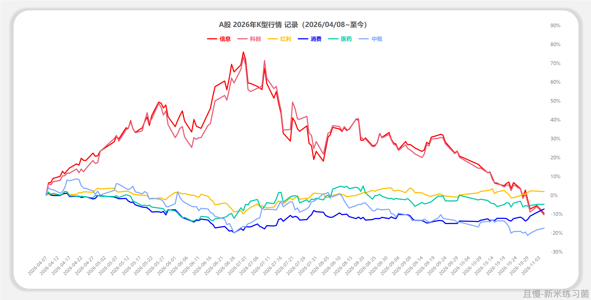
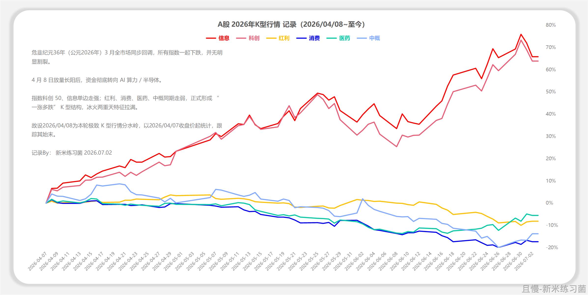

如何判断你自己是A股老登还是小登。

小登：

在上半年的行情中彻底FOMO。

别人怎么可以赚这么多！各种平台上的大神赚大钱了！同学赚大钱了！同事赚大钱了！朋友赚大钱了！网友赚大钱了！全世界只有我没赚钱！梭哈！商业航天！光模块！shut up & take my money！！！

中登：

拼命为自己不涨的品种辩解。

你怎么这样凭空污人清白……我的品种都是基本面扎实的……暴涨的都是泡沫……我没错……

老登：

笑眯眯的看着市场。

嗯嗯你真棒呢。赚好多真厉害。嗯嗯AI是未来当然没错。是被鼓励的产业呢，一定没错的。我就不买啦，年纪大了怎么也弄不懂了呢。

因为见过太多次。所以一切都不足为奇。

都是轮回。

一小部分小登也会变成中登。一小部分中登也会变成老登。绝大多数人一轮牛市后死得透透的，离开市场了。下一轮牛市再来接盘。他们变不成中登，也变不成老登。一直都是年纪越来越大的小登。

不要小看老登。能在这个市场中一直活着的，活了十几年几十年，都不是善茬。

<!-- qieman-comments:start -->

---

# 如何判断你自己是A股老登还是小登 · 评论区（2026-11-03）

> 评论区归档：2026-11-13 抓取于且慢社区，原帖共 569 条互动，精选 57 条（作者发言、作者回复及其他投资相关评论）。

## WillinMao（湖北省） · 0 赞

见了太多次就不要有偏见，虽然不合理但是一直重复发生。虽然懂但钱还是要赚，放下偏见。好在下轮配置已经准备大幅提升科创份数了。

## 纪小小（上海市） · 1 赞

E大，说说您对黄金的看法呗😃

## 丁丁90（辽宁省） · 2 赞

我属于什么登？今年都不没怎么太关注市场，有车就跟，网格也是自己运行的，一个月整理下账户。没啥波澜。

## MrBrooks（重庆市） · 9 赞

我是不辩解 逢低继续加仓 另外上个话题关闭回复了 这里趁一下 希望邮件回归

## 来去匆匆（上海市） · 32 赞

E大能聊一下黄金吗？谢谢

> **同路人_PWhYD5（浙江省）** · 8 赞：黄金给过点位的，目前还早，只有老美出现流动性危机时才有可能到位

## 同路人_doa4Eb（四川省） · 2 赞

说风凉话没意义啊，什么时候操作？赚到钱才是真的，一定要在最低点才买入嘛？

## 感恩遇见E大（安徽省） · 0 赞

被同事笑话拿长期,买的这些不是科技是赚不到大钱的😀

## lucky_ETF（北京市） · 0 赞

中登吧，肯定不是小登，也没有老登那么云淡风轻。但是也没有拼命辩解，就是默默等，然后默默加仓。因为开始就遇到了老大，所以没经历过小登阶段。

## 浮光（上海市） · 0 赞

我是迷瞪。
上半年：“发生什么？科技涨就涨为啥我的狂跌？好吧，随便吧，反正我不卖🤧”；
下半年：“就是出去玩了一个多月没看账户，又咋了？都是浮亏，不看不看。等发工资跟车，为什么工资一月一发？😫”

## 北风其凉（山东省） · 0 赞

e大可否聊聊证券指数的定位和最后一份卖出的思路

## 云枫（广东省） · 0 赞

买入后，几乎都不关注。老实跟车，其他都不管。😃

## 新米练习菌（上海市） · 81 赞

E大下午好，
更新一下K型行情，科技类，今天（调整以来）又又又新低了。
昨天神秘资金还买过科创50的还。

> **lucky_ETF（北京市）** · 0 赞：今天突然发现，券商上我的账户对比上证的图和这张图差不多呢

> **阿狼（广东省）** · 0 赞：这么贵，神秘资金也下不去手啊。这些聪明钱可不会去帮别人解套。

## 先到300万（陕西省） · 1 赞

眼看着这一波牛市过去了，没抓住这波科技的机会，踏空了一整波科技大牛市，不知道下一次是啥时候，下一波一定要勇敢加仓

## 阗昰（广东省） · 0 赞

老登都是熬出来的，科技小登崩了老登还没熬出头，这轮牛市不沾边

## 胖菜（广东省） · 0 赞

不知道自己是哪一层，有得买高兴一下，有得卖又高兴一下，其它时候没太多情绪了。
连家里那位也不像前几年好奇我的账户处境如何。偶尔聊起来，他说，反正涨了卖的钱你也会继续买进去，跌了也说浮亏不会卖无所谓。跟现实生活没什么关系的感觉。

## 小小虾米（北京市） · 0 赞

离加仓又进一步了，那时不追，现在不慌，继续等待

## WuLiSenSen（北京市） · 1 赞

E 大今天买债券的逻辑是啥？

## 老侯（北京市） · 0 赞

我想当买创业板和科创50+全指信息+半导体+云计算，网格和长线，然后买红利和长赢150的老登。

## 拓哉（澳大利亚） · 1 赞

为什么是增强债而不是普通债券

> **投资不能投机（江苏省）** · 1 赞：你不看往期文章了，那可就错过了太多宝藏了
有一篇关于上半年操作思路的，有写了
随着市场上涨，逐渐卖出权益类资产，  买纯债
随着市场下跌，开始买波动更大的二级债
等市场大幅下跌，再买回权益类

我的理解：现在市场跌幅不够，还处在买二级债的阶段

## 捡辣鸡二十三名（山西省） · 1 赞

我已经好几天没看到韩国女生黄金时代的消息了

## 净尘（河南省） · 0 赞

老登吧！10年年化5个点多，比存银行好点，很满意🙂

## 周晓耘Sandy（上海市） · 0 赞

港股最惨，我就是港股小登，不知道该不该补仓

## 棗棗（浙江省） · 4 赞

我是科创卖得差不多，信息卖得差不多，就不看了

## 坚强的韭菜（美国） · 0 赞

指数不会死但是别买贵学会看PE

## E人里的i人（广东省） · 0 赞

我没买，但当时心理还是相当痛苦的，庆幸忍住了，毕竟还是追高更痛苦一点

## 战士（湖北省） · 0 赞

我的中军永远是150+s，小仓位自己玩一下^_^，虚浮的很^_^^_^^_^

## kkkkkkkk（新疆维吾尔自治区） · 0 赞

有点理解A股永远不缺机会这句话了

## JonX（江西省） · 0 赞

周五不就出数据了么，当时不是说周一不反弹就加，今天指数就回到了周五收盘的位置

## 懂你意思（北京市） · 0 赞

科技吃了 25% 波段就跑了啊😅

## 同路人_清风乱翻（云南省） · 0 赞

我是小登的心理、中登的持仓，但并不怎么辩解。

## 同路人_iv4Jk9（浙江省） · 0 赞

这个指数极限下跌应该15%吧，现在下跌已经6%了

## 平常心很难（广东省） · 5 赞

跟投到明年，就差不多10年了。时间证明，还是长赢能做到真正长赢，最大的教训就是自己乱买股票，高位也不会跑（自己买的腾讯就是例子）🤯

## 金牛座的小王（贵州省） · 0 赞

证券的网格条件单不做了吗？

## 绝不割肉（广东省） · 0 赞

胆子太小了，看见涨的那么猛，就是下不去手，就光看着😂然后捡了些能分红的筹码

## 陈皮a（北京市） · 1 赞

自打真金白银入市，跟着老大半年就快进到老登状态维持至今。

## 先到300万（陕西省） · 0 赞

您能否讲一下今天买债的逻辑呢？

## 易游（云南省） · 5 赞

消费，医药，中概老登三件套，虽然我不会追高，但是还不能心态平静，笑眯眯的看着别人涨，这算是心态需要磨练的老登嘛😂，等着这一轮慢慢把持仓换到宽基指数，心态或许能平静很多。

> **百花争艳（广东省）** · 2 赞：应该这种行业比例要降低，至少要是宽基的一半或者1/4才好，要不体验会相当不好

## 水竹（山西省） · 1 赞

今天打车时，司机师傅还跟我聊了他的一个朋友70万进去，现在只剩4万了，而且说是要抄底，还在往里投。还给我讲了一个案例，他拉了一个顾客，20多岁小青年儿大学毕业不工作，家里放五台电脑，每天炒股，每年有三四十万收入。根本看不上一个月三四千的国企工作。

## 芳小姐（广东省） · 0 赞

我心态老登，但是买了科技，电力自己玩。主力跟老大，要养老用的

## 慢慢买便宜的指数（北京市） · 0 赞

最近体验很好，科技跌，我们红，然后还能捡筹码😘

## BOYCE_JIN（北京市） · 1 赞

对号入座了一下，妥妥老登。 今年上半年当我发现没有投资经验的同事开始跟我兴奋地讨论科技和AI的未来，展示自己股市盈利率的时候，我就知道转变就要来了！更加坚定不移的加仓老登股，自嘲自己捡垃圾。默默感叹：最疯狂的时候的股价真的是一群最不懂的人来决定的，只有情绪炒股，说着这次不一样，最后次次都一样，等着看过山车。

## 何呵呵（广东省） · 0 赞

我中登……但我也不辩解，偷偷摸摸自己持有自己看，然后对持有科技的表示惊叹。

## 霍庆丰（湖北省） · 0 赞

不知道传媒的pe是多少，以前shuo传媒是天生适合波段，科创50这波动是不是更适合？反正感觉最次的就是上证50那种不死不活拿着白交管理费

## PT-李辉（湖南省） · 0 赞

糊涂啊，老登变成小登，下回再也不追高了😇

## 做事怕认真（北京市） · 1 赞

越来越没看盘的欲望，ETF是真爱

## 白.（天津市） · 0 赞

忘记充值三点前没买到，这会把三个计划都买了，心里舒服了😃 差了一天希望估值不要差太多

## 略懂先生（中国） · 0 赞

E大，很早之前买的那些债基，没跟上车，现在可以补仓了吗？

## 一只小卡拉米.（浙江省） · 0 赞

这一轮科技牛，有羡慕过别人赚钱的心理，但是没有加仓，也没有后悔手里的老登股。这个心态应该不算小登吧，自认为达到中登的境界了😃

## HXS（河南省） · 0 赞

科创来的快，竖得高。去的更快，跌的更低！

## 同路人_yQYEfs（北京市） · 0 赞

老大，请问一下沪深300这个位置是一个比较重要的支撑嘛。为啥HJ在不停的买沪深300了

## FangSY（浙江省） · 0 赞

我感觉我已经进化成中登了 虽然也没赚到啥钱最起码没大亏在科技上要不然又是好多年的回本路

## 平常心很难（广东省） · 1 赞

看到E大前面的帖子说筛选出真正的朋友，没在且慢这里跟车怎么办。早期一直在其他地方跟车，然后又强迫症使然，不想把持仓分散在各个平台。不知不觉，差不多十年了，只想说：我唔会做二五仔噶🤣

<!-- qieman-comments:end -->
