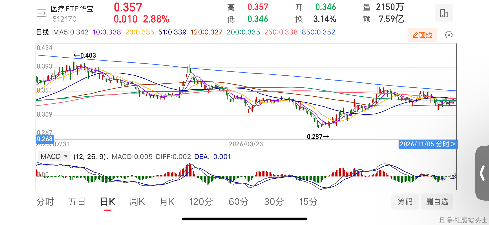
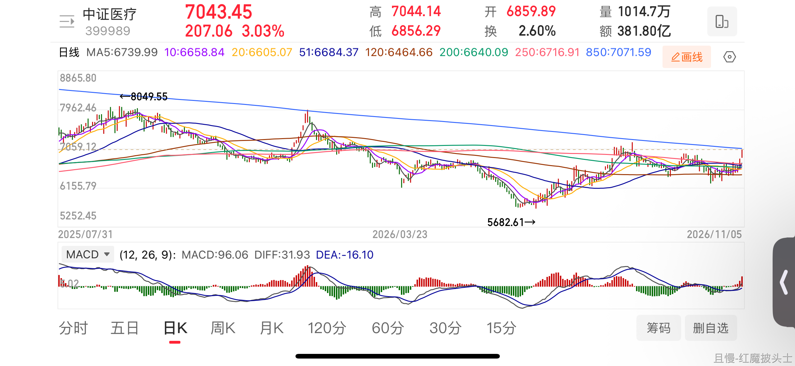
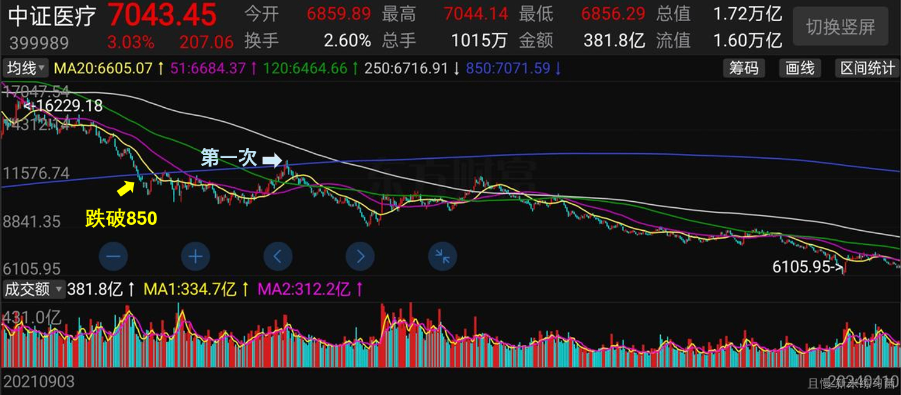
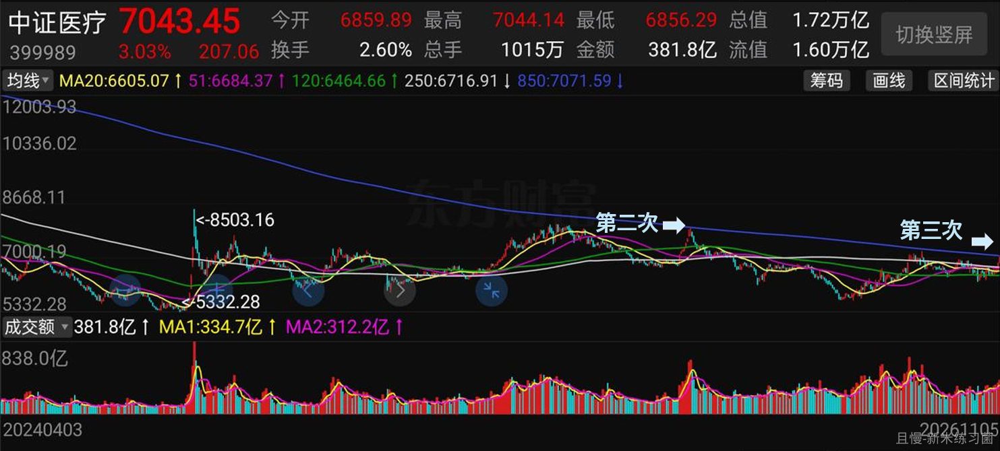
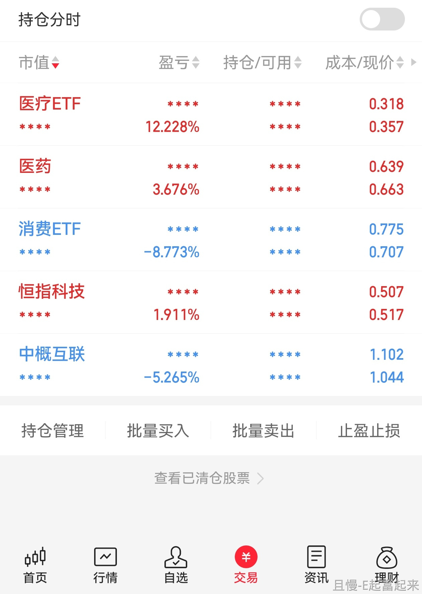

今天各位账户资产会继续增加。

当然了，在大多数股票都涨的情况下，账户资产增加也没什么了不起。不一样的是，很多朋友的账户资产在逐渐接近历史新高。在某些指数回调20%甚至接近50%的位置。

今天医药、消费的上涨，抵消了一部分红利的回调。宽基也是小幅上涨，算是不错。

有一个需要注意的，是医疗在2022年跌破850线后，正在进行第三次冲击。之前两次都是功亏一篑，看看这次的情况。

医疗全收益会好一点，过去几年曾经有一天冲过去了，结果最后还是没有站稳。

如果能冲过去并站稳，就算是不错了。当然，这也并不会太影响我们的交易节奏。只是大摩医药可能某个时间点要动一动，因为可能规模问题又要碰线了。

总而言之，我坚信各位的情绪和资产没有因为股市的巨幅波动受到太大的影响。可见做一个比较平衡的，荤素搭配的组合是很重要的。

有些路当然是最好的，但普通人走不了，走不完，再好也没用。什么样的路普通人能走完，那才是最重要的。

就这样吧。最近所有账户的状态都非常好。不仅是长线，也包括波段以及一些其它账户。

股市真好，我爱股市。没有股市可怎么活呀。太有意思了。金融投资不愧是世界上第三有意思的事情。

<!-- qieman-comments:start -->

---

# 今天各位账户资产会继续增加 · 评论区（2026-11-05）

> 评论区归档：2026-11-06 抓取于且慢社区，原帖共 469 条互动，精选 73 条（作者发言、作者回复及其他投资相关评论）。

## ashley223（辽宁省） · 0 赞

🌹抢沙发🛋️ 老大 今天科技和医药医疗涨的我心花怒放🥰

## 闲适（辽宁省） · 0 赞

最近正在想办法把中概和医疗都做到不负盈利。目前医疗自己又正起来了。就差中概了。

## chowlay（贵州省） · 0 赞

突然好奇第一第二有意思的是啥😃，不过确实账户在新高，开心

## lv（北京市） · 0 赞

还有人在跟着做波段账户吗，收益咋样

## 浩子1943（浙江省） · 0 赞

E 大，科技是否还是会挂一波人

## 一只快要牛逼哄哄的小栗子（江苏省） · 0 赞

这个账户我从来不操心，只要跟着买买买卖卖卖就好了。一直记得6月份时候，疯狂买红利的时候，咬咬牙从银行理财里赎回了一大笔，正好买完那几车，属于冬天播种春天收获了哈哈

## 开心理财（山东省） · 0 赞

医疗T出来的没来得及全补回去。

## 雨露（浙江省） · 0 赞

今天网格出了4个品种，股市真好确实涨跌都开心😁

## Helenyiyi（浙江省） · 0 赞

哈哈，资产配置的魅力，真开心

## 哄哄123（重庆市） · 1 赞

市场建设三阶段任务(政策主线)
 
市场脱离流动性风险，阻断系统性风险。
市场恢复活力，资本得以持续支持科技发展。
市场底层制度性改善，实现资本市场稳中有升。
 
这是三个阶段的任务，需要在不断解决问题，优化机制的过程中实现。
这一段从交易层面拔高到顶层目标，是递进的三步:	 	

1.第一步:守底线一隔绝流动性风险、防范系统性风险
优先目标:不发生大面积踩踏、爆仓、持续螺旋下跌，守住金融稳定底线，先稳住不崩盘。这是最优先的。
2.第二步:提功能一恢复市场活力，融资功能正常，资金愿意投科技
市场稳住之后，核心目标是发挥资本市场本源功能:让科技企业能融资、拿到钱，支撑产业升级、国产科技追赶。这是政策最重要的产业目标。
3.第三步:长期化一底层制度改革(发行、退市、分红、交易机制等)，最终实现稳中有升的长牛环境不是靠短期放水拉一波行情，而是靠制度持续优化，形成可持续的“稳中有升"。
 
不是一步到位，是动态的，边出问题、边解决、边优化。

## 默翎（江苏省） · 0 赞

后跟车的仓位配置是个大问题，有很多仓位跟不上啊

## 叶少鹏（四川省） · 2 赞

有伙伴的e大跟投账户接近历史新高啦？谁来贴图让我们羡慕下😏

## 红魔披头士（山西省） · 104 赞

医疗是第四次冲击了吧，虽然之前每次都无功而返，但胜利越来越近了。

850日线是逐渐下移的，第一次0.4左右，第二次0.39，第三次0.36，现在则是0.352，今天能站上去算是一个不错的信号。

天下苦医疗已久，是时候开张吃三年了。

> **红魔披头士（山西省）**（回复 横店查理） · 65 赞：光是医疗ETF这个细分品种，就占我当前总仓位的23%了。
过去三年我积累了足够多的筹码，我一直在等待一个机会，事实上，E大的致敬价附近就是我设的第一个网格卖出价，这个位置0.29以下的买入已经盈利接近40个点了。
最底部的买入，不盈利40%以上，我绝对不会交出筹码

> **捡破烂的启蒙者（福建省）** · 0 赞：要看指数，不能看ETF。

> **老侯（北京市）** · 0 赞：有没有可能E大说的是指数，而不是具体品种。
另外，你仓位重，你就希望上去，那我仓位轻，能冲击3次，就能4次，给我一次买到0.29的机会啊，哈哈

> **霍比特人爱串珠（广东省）**（回复 同路人_DmVkgM） · 0 赞：我看得见，因为我也重仓医药医疗📈😃

> **红魔披头士（山西省）**（回复 老侯） · 23 赞：有没有可能医疗ETF追踪的就是中证医疗指数。两者虽有偏差，但大差不差。
我仓位重不假，但每次跌破0.3，我都会加仓买入，对我来说没冲破0.4的话，涨多少都与我无关。真涨上去了我就提款，跌下去了我就买入，不涨不跌我就持有。

> **同路人_S843Tl（天津市）**（回复 红魔披头士） · 0 赞：而且，在其它的版块儿大部分都一到俩倍的涨幅情况下，医疗药，消费也有可能再没有其他版块儿拉高的时候，有机会引发一系列的行情，希望吧，把我们失去的都拿回来。

> **洗心革面学投资（河南省）** · 1 赞：2020年1月底跌破850日支撑线后，同年7月初第一次冲击，然后失败；一直到6年后的2026年1月中旬第二次冲击，然后失败。
明天是否能冲击成功，咱们拭目以待。

> **洗心革面学投资（河南省）** · 0 赞：外围大跌，今天医疗危亦～

## 虚拟身影（北京市） · 1 赞

今天医疗出了自己做的一小网

## 福缘_9（内蒙古自治区） · 0 赞

确实是这样，跟着E大好多年了，嗯，在这里呢，每天都有好多牵挂，心心念念的。但自己确实小白，好多年也没有改变，只有踏踏实实地跟着E大坚定地做好配置，希望能越配置越多，配置满了。养老就靠这个策略了！😊

## 瓶子啊（广东省） · 0 赞

今年有没有机会总资产额历史新高呢？

## 胖菜（广东省） · 0 赞

非常了不起。
最了不起的是，每次回调一点都不慌，还很兴奋。

## 希尔（山东省） · 0 赞

医疗没动 医药近几日陆续减仓

## HH默（重庆市） · 0 赞

我甚至觉得比谈恋爱都有意思，同时也在反思自己操作，如何在底部拿到带血的筹码，不会在上涨时马上交出去😂

## 金刚（广东省） · 0 赞

国内的行业基金就是体量太小，即使是国家队也得分好几个大盘 ETF 去买。

## dayday（浙江省） · 0 赞

跟着老大这么久了，自己测验的仓位还是控制不好，会继续改进。最开心的是，老大这段时间的发车俺一次没落，真的很开心(⁎⁍̴̛ᴗ⁍̴̛⁎)

## 李哈哈哈（广东省） · 0 赞

股票账户前半年落后，现在也快又要新高了。

## 横店查理（中国） · 0 赞

可以理解这次没上去会卖    在接回来做波段吗

## IIIE（广东省） · 0 赞

E大，网格策略更新了。客观条件是啥🤔

## 会微笑的糖果（河南省） · 1 赞

仓位决定心态真是一点不错

## 凉茶927（北京市） · 2 赞

哈哈！你造吗？
网格三篇真好！今天咔咔咔咔咔咔咔咔了，已经开心的玩了好几年了，可太有意思了！😘

## 韭菜st（广东省） · 2 赞

医疗还在底部，然而我已经在医疗上赚了好多😚

## 新会（山东省） · 1 赞

主理人是要逐步退出网格引领了吗？

## 以人为镜_可以知得失（广东省） · 1 赞

太棒了，我可喜欢美美的网格了，我觉得它都是提款机了，非常香

## 新米练习菌（上海市） · 59 赞

学着看了一下医疗
跌破850后，努力冲击850三次是：22年7月，26年1月，现在

> **同路人_DLereB（北京市）** · 1 赞：医疗和米米的成本一样啊，连几次降本的步伐都很一致，医药医疗我的仓位很大，波动、上去、再降都可以，还有子弹

## E路有你（北京市） · 0 赞

今天涨幅最大的两个是中概和恒科👏

## 正经人谁炒股（湖北省） · 0 赞

E大说过波段能降低成本的同时提高收益率，还有利于拿住筹码。请问有考虑专门做一个各类品种合集波段的计划嘛，不限于A市场，跟150S分开运转🙈

## 长赢一念（广东省） · 1 赞

想大富大亏，梭哈（例如科技）。想平衡体验好，荤素搭配的组合。😬

## 纳夫（四川省） · 3 赞

老大，网格以后会增加其他品种吗😭

## 周滔（上海市） · 0 赞

医疗医药是反弹还是啥呢？猜不到

## 小小菜园子（福建省） · 1 赞

E大，我在整理之前文章，遇到一个疑惑，咨询您：

您在10月8号的文章中说到配置类似【易方达安心回报】的路子配置【兴业增强】预计仓位5%-10%的仓位。

这里可以理解为：债券类偏可转债的给予5%-10%仓位，但是这里的偏可转债，又和波什可转债或者中欧可转债基金不同，而是可转债、纯债占大比重，一点股票仓位，相对波动小一下的品种？就是那种我的配置中既有可转债，但是又不是单纯配置可转债那么激进的意思吗？

## 何呵呵（广东省） · 0 赞

网格是不是最后都会停止操作了呀？虽然以后没有E大带路了，但是非常感谢教会的东西～

## 草莓兔（浙江省） · 1 赞

站上850日线是不是可以右侧加仓了？

## 幸运草1985（上海市） · 0 赞

传媒能不能在带我们做网格啊😦

## 长稳行之（上海市） · 3 赞

网格出完就不继续了吗？网格3.0还会见到吗🥺🥹

## 投资两天亏两块（四川省） · 1 赞

今年算上今天应该还是负的，继续蛰伏等待新高。

## A_5xx（江苏省） · 0 赞

等待，狩猎，收获，and下个周期

## 楚藉（广东省） · 0 赞

真好，戳戳手看看能捡点红利不😝

## 学而不倦（湖北省） · 0 赞

长线，波段我知道，其他账户是什么？

## 山竹（浙江省） · 0 赞

E大说医药、消费的上涨，抵消了一部分红利的回调。可为啥我觉得是红利回调抵消了医药，消费上涨。虽然跌的不狠，但涨起来平稳。

## 苏老师（天津市） · 0 赞

感恩老大呦，应该今天是新高了。

## Shuaishuai（云南省） · 0 赞

我在这个冲击点位附近反复吃网格 爽之

## 同路人_Jane（浙江省） · 0 赞

我是个纯普通人，E大的资产配置组合才适合我。今天卖掉了几份比E大还多的医药，回点子弹备宽基和红利。😇

## 战火小阿蛮（北京市） · 7 赞

最近太忙，有老大掌舵我的心稳稳的，谢谢您。美美接下来不能与您一起网格我内心是有点伤感的，不知道以后，老大是不是不再带我们玩网格了？或者网格从此让我们“毕业”？尽管传媒是我玩的最好最happy的品种，但是您一不在，我心里就有点小忐忑，就好像上考场的时候没在门口看到教我的老师，心里有点害怕。

不知不觉，您在我心目中已经是定海神针一样的存在，您在我就心安，不在就分外想念。回家路上，其实一直在给自己做心理建设，老大还在呢，没事的，人总要学会自己成长，一路建设下来，其实还是不舍居多。很难想象有一天你会离开我们，从此相忘于江湖。真要有那一天，我大概是走不出来的。您让我知道了投资是一件很有意思的事，但如果您不在了，有意思的程度要打个很大的折扣，大概有98个巴仙特那么大。

## 胡萝卜星（浙江省） · 0 赞

中概今天终于支棱了一天了

## 浅沫记忆（江苏省） · 1 赞

医药医疗都开着网格，现在涨跌都舒服😊

## 同路人_pJ6fHq（辽宁省） · 0 赞

要是所有的etf都分红就好了

## E起富起来（四川省） · 0 赞

用我奶给我的一点钱买了一些便宜货，看看后续这个账户会发生怎样的变化
很是期待了
消费还在等着E大波段发车的时候再加点仓😍

## 抽刀断水（山西省） · 0 赞

医药，医疗，消费我坚信怎么下来的还会怎么上去，就算回不到最高我们也已挣得盆满钵满😉

## 同路人_qHz9Jz（浙江省） · 0 赞

E大，能否说下港股红利？

## 学习ETF投资（江苏省） · 2 赞

E大，请问今天传媒网格也清仓了？后续是不展示了，还是不准备做他的网格了？

## 应无所住（四川省） · 0 赞

无所谓冲不冲得上去都可以，今天港股和恒科立大功😚

## 做事怕认真（北京市） · 6 赞

“很多朋友的账户资产在逐渐接近历史新高”；看账户感觉离此前高点还差挺多呢；好奇什么样的朋友在这个位置账户已经接近历史新高

## SkylerZhu（北京市） · 3 赞

看来跟大家节奏不太一样，离新高还差得远

## 欲将心事付瑶琴（广东省） · 0 赞

账户金额增加了是开心，在老大的带领下是是意料之内的事情，但更多地替老大开心。账户金额涨了，大家开心了，老大的压力应该会少一些吧～最希望老大开开心心的呀～

## 莫斯利安慕希（北京市） · 1 赞

医疗医药的想象力不如创新药啊，医药行业受限于政策掣肘太大了

## FangSY（浙江省） · 1 赞

距离我25年10月高点还差12% 继续加油猛干 医疗消费跟上肯定能回到高点

## 星元（贵州省） · 1 赞

请问E大全球医疗要卖一些吗

## 一路长赢（四川省） · 0 赞

为什么我的账户离历史高点还差差不多20%？？？好奇哪些朋友新高了。

<!-- qieman-comments:end -->
