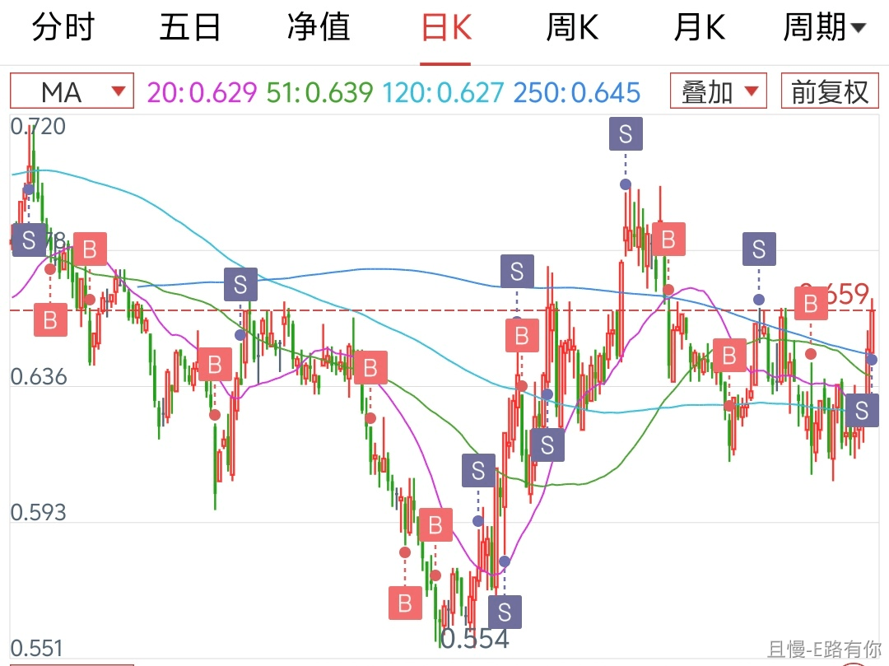

各位能想到吗。美美这样一个打开K线辣鸡无比的品种，曾经让无数朋友账户损失巨大的品种，做网格年化居然可以到17%……也已经成为不少朋友盈利金额最多的品种。

所以网格波段最重要的并不是这个品种要一路上涨，而是波动够大。

不过人总要学着自己长大。

最后一句忠告：只有波动没有涨幅的品种，每一网的间隔真的要大一些。10个点起步比较好。

<!-- qieman-comments:start -->

---

# 各位能想到吗。美美这样一个打开K线辣鸡无比的品种，曾经让无数朋友账户损失巨大的品种，做网格年化居然可以到17%……也已经成为不少朋友盈利金额最多的品种 · 评论区（2026-11-05）

> 评论区归档：2026-11-13 抓取于且慢社区，原帖共 461 条互动，精选 125 条（作者发言、作者回复及其他投资相关评论）。

## 洗心革面学投资（河南省） · 1 赞

老大，这个品种真的太适合做网格了。

## 多多多（江苏省） · 0 赞

所以怎么选出这些适合网格的品种呢？另外第一网价格在什么位置怎么设置，我不懂，纯瞎问🤣

## 闲适（辽宁省） · 1 赞

手里亏损的品种做做波段吧。真舒服

## 捡辣鸡二十三名（中国） · 0 赞

医药和医疗的网格今天收网了

> **AMGGT嘉园696（江苏省）** · 0 赞：每次卖出多少钱合适？

## 同路人_dExxJg（北京市） · 2 赞

三年来美美是我赚到的最高品种～周期短，波动大，我真的很爱美美～

## 薛凯（山西省） · 0 赞

是传媒吗，早上看了下差0.001没卖出去😅

## 以人为镜_可以知得失（广东省） · 0 赞

确实，美美这个品种我觉得非常适合做波段的提款机，不适合长线持有

## E大的粉丝（陕西省） · 0 赞

冷知识：我们对美美的称呼也是follow波段的

## 同路人_Dy7vlZ（浙江省） · 0 赞

有人能告诉我，我在且慢找不到长赢150计划的入口了，在哪里可以找到。

## 函宝（湖南省） · 0 赞

E大，请问10个点一般是指每次都距首次买入的价格要10%以上，还是距上一次买入的价格10%以上？

> **安安静静（中国）** · 0 赞：上一次，还没看懂网格什么意思，先去看看网格3篇

## 忘机不忘记（广东省） · 0 赞

恒生科技也该这样对待，不适合长期持有，只能做网格，网格间距大一些

## 雨露（浙江省） · 0 赞

美美做网格真爱 还有券商要么不动，动起来那是大波动 恒生医疗也是网格心头好🥰

## 红魔披头士（山西省） · 4 赞

我的感觉是行业指数本身波动大，适合做波段，尤其是中网和大网。

宽基波动相对小些，做波段的话小网和中网比较好。

以前我想的是长期持有+中短期波段，既赚波段的钱，又赚上涨的钱，最近几年实践下来，在这个市场可能行不通。

后续可能放弃长线持有的念想，长线也做大波段，不再留恋。

> **田老师（湖南省）** · 1 赞：长线是底仓，波段是短期大起伏，同一标的、甚至都在场外做，为啥不行？e大今年很多理论也是长短结合

今年奇葩的是恒科中概消费白酒医疗，几乎是单边下跌，只有伏伏伏，没有波段机会，e大的10%，我想也主要是针对今年的这些行业品种

像红利，就是长短结合的。我觉得150份这样分开，一份份投入，这种就是大波段吧

再比如目前的A500，如果继续跌的话，其实也可以加一份，反弹到10个点左右卖不卖？卖就是波段，不卖就是长线，卖不卖的区别取决于后续的涨幅是否巨大？

一是估值技术指标，二是大行情是否来了，值得搏一搏，三是对这个品种的熟悉程度，比如有固定的震荡区间。

可能有些品种只适合做波段，长短结合的可能也要筛选，我自己是很想把长短用在同样的标的上，这样资金不用太分散，研究的标的也少一点，仅做讨论

## 云卷CC云舒II（山东省） · 0 赞

触发了，等成交，网格中的美美最美

## 最後no騎士（浙江省） · 0 赞

医疗出了一网，医药传媒没成交😃

## E路有你（北京市） · 21 赞

美美真是网格神品！今天还差一丢丢成交。E大的网格交易也是🐮的不得了。我用在好几个品种上。有的间隔小了，有的位置高了，不断在修正。有个忠告，就是，E大的忠告不是随随便便说的。😀

> **E路有你（北京市）** · 8 赞：医药不停网格，已经到成本价。继续✊

> **同路人_无私的白桦（河南省）**（回复 E路有你） · 0 赞：请问一下道友，医药也是周期吗😂

> **E路有你（北京市）**（回复 同路人_无私的白桦） · 7 赞：不是呀，用网格方式拉低成本。医药底部磨太久，我在0.7以下设置间隔5%的小网，回点血。不过E大忠告很重要，开网位置和间隔都要把握好

> **E路有你（北京市）**（回复 AMGGT嘉园696） · 0 赞：丰俭由人。反正我每网资金不多，比如我买150计划一份的资金，网格我可以买3网～5网。

## VVY（北京市） · 50 赞

根据E大的网格三篇，实践了几年之后，更新了自己的数据库。网格起步根据不同品种设置10-15个点，随着跌幅扩大，逐步调整到5个点后再设置两到三网结束。这样设置的弊端在于前期因为网格较大会失去一些成交机会，但优势在于单边下跌的行情（这几年遇到的挺多的），总体投入和压力都会小很多，而且在底部区域也不会因为前期投入太多而早早停掉网格。目前正在实践中，希望随着经验的增加还能做出进一步优化。

> **且慢叫我输昵称（上海市）** · 3 赞：后面小步长的网格多留利润。均值回归的时候不至于过早下车。动态调整步长我不知道怎么回测，但留利润的确会提高绝对收益率（年化收益率不一定哦）

> **同路人_nQAOQ7（山东省）** · 3 赞：你好，请问网格有车可以跟吗？还是完全自己操作？感谢🙏🏻

> **耘Boicary耔（青海省）** · 2 赞：只要做好压力测试什么资金不够，提前停网什么的都是浮云。网格太大，看到反弹吃不上才是真难受。

> **学鸿（湖北省）** · 0 赞：我怎么感觉E大策略是随着跌幅扩大，网格幅度进一步扩大呢？你怎么越跌幅度越小呢？请教一下怎么考虑的？实践起来怎么效果怎么样？

## 玫瑰色的米（北京市） · 3 赞

A股：长线红利 波段：传媒  美股 ：标普 纳指100 ；黄金外汇原油债券各来一点点 这辈子稳了

## 保持饥饿（陕西省） · 2 赞

从没配置过网格的，投来了羡慕的眼神👍

## 皮皮波（上海市） · 0 赞

有很多品种可以开网格，其中科创，电子，芯片啥的容易卖飞的可以网格＋留底仓吃大肉

## 躺在沙滩睡大觉（北京市） · 0 赞

哈哈哈哈 差之毫厘，没有卖出去哈哈哈

## FangSY（浙江省） · 0 赞

昨天科创 创业网格都应该买入的但是没钱了 难受 今天网格出了一点 还是强行买入一格

## 团团团子（北京市） · 0 赞

不是中概吗？怎么都说梅梅

## Ch_Index（安徽省） · 12 赞

这两年自己交易有了一些自己的想法，我的理解，网格不一定只能做震荡行情，它也可以处理上涨走势，支撑位买入，压力位清仓卖出，它是一种交易策略，帮助自己下跌/震荡中降本，上涨中分批减仓避免追高，拿这次传媒举例：
1100点入场，1500点清仓离场，我会给1100点下方预留到900点，900点下方就是另外一种交易策略（定期定投布局一点长线仓位），所以网格区间就是900点到1500点，1100点一次性建仓，这比常规网格从第一网开始接收益更高，而且网格可以密一点，到了一定的位置，比如1400，可以执行只卖不买的策略，而回落的合适区间（比如1200下方），则又开始正常交易。
当然，以上这种方式真的需要一定技术功底，不太适合小白。还是感谢E大的三篇网格文章。

> **无内耗更健康（四川省）** · 0 赞：说起上涨中分批减仓，我之前设置了金字塔式卖出网格，就是越涨卖的越多，但我卖出的起始点选的比较高，导致只出了一网就下跌了，没能继续验证

## 启宏家居光阴似箭（山东省） · 0 赞

美美出了，还有医疗，不够都买的不多。

## 柳树在路上（广东省） · 2 赞

e大，关于网格策略这段时间我做了些探索和思考，有一些疑问在网格三部曲里找不到线索，还望指教～
1、网格是按比例还是按价格设置？（数学上讲的话，就是 等比数列vs.等差数列）
网格三部曲里给的例子是按价格，但我研究下来按价格会有几个问题：
- 如果ETF的净值计算发生变化，按价格设置就会全部乱掉，按比例设置则只会影响下一网，不会影响下下一网
- 留利润不好设置，按比例的话策略会自动留利润
当然按比例也会存在问题，就是如果一个品种网格持续反复收割，因为每次都基于上次的交易点位做动态的比例计算，整体的交易位置会不断向下，这和指数长期来看是向上的相悖了。
2、网格的间隔
帖子里你说：只有波动没有涨幅的品种，每一网的间隔真的要大一些。10个点起步比较好。
关于间隔，我想是不是应该和每网的金额有关，如果每网的金额很小，比如只占个人总资产的0.01%，那么间隔可以设置的小一些，而如果每网金额比较大，比如占到0.1%，则间隔可以大一些？
我个人的实践是大多数品种我设置大间隔，但这样有时候会一两个月都是买入，会有点按耐不住，所以在少数品种上我设置小间隔，增加下触发频率，满足下自己交易的欲望

> **华仔（山东省）** · 1 赞：等比和等差我也纠结很久，最终还是选择了等比。卖出会比买入设的大一丢丢。不过一定要做好压力测试，因为等比占用的资金会更大。

## 跟着E大捡辣鸡（贵州省） · 0 赞

感谢老大的网格三篇，是可以反反复复阅读，每次都有不一样收获的宝藏。24年底跟练，传媒28%

## 英子姐姐（陕西省） · 0 赞

这是我最开始做的波段，真的是最适合之一

## 甜心饼（河南省） · 0 赞

我给美美设置的7个点，买入没几天，今天卖出了🥰

## 小小发财了（广东省） · 1 赞

刚忙完打开一看。我的天。中概的网格出了两网，梅梅也出了😆

> **Serena1022（广东省）** · 0 赞：打开的什么软件呀？在哪里做网格呀？

> **十一Charlie（北京市）** · 0 赞：啊？中概这个位置还能出的？？

## musk（上海市） · 0 赞

一看统计传媒网格已经做了37笔了，真爽，感谢传媒，感谢E大的引路

## 水竹（山西省） · 1 赞

昨天恒医网格差一点点没出，今天一早超线近一分价钱出货，完美！
美美，在前几天跌下时又买了一网，设了5个点和10点。前天出了5个点的，今天手动改单出了差一丢丢10个点的。完美！
不知该怎样感谢E大🌹🌹🌹🌹🌹🌹

> **张小越然（重庆市）** · 2 赞：网格3号买的，今天出的，11个点😃

## 甜甜小达人（重庆市） · 1 赞

医疗9.11触发了没成交，华宝也没有自动重新设置条件单，气愤

## 袁伟-Wayne（江苏省） · 0 赞

请问美美是那一支基？这一两年事太多 网格都停下了。

## 小蜘蛛（福建省） · 0 赞

美美是我的骄傲！
是我最开始做网格交易每网资金不高时，盈利金额总额最高的品种。后来逐步提高每网资金后就被恒科追上了，现在这些品种都在做着网格。
真好啊，跟着E大有肉吃

> **田老师（湖南省）** · 0 赞：恒科除了最近有反弹，今年基本都是单边下跌，你也吃到了？我们说的是一个恒科吗

> **小蜘蛛（福建省）**（回复 田老师） · 0 赞：恒科今年没吃到，是往年的累计。不过能这么低成本的买入，我很开心，上次这么低成本好像还是22年？

> **樱桃球（浙江省）**（回复 小蜘蛛） · 0 赞：恒科成本真的算低了，天天跌不想买的时候就看往年的交易记录，给自己信心

> **小蜘蛛（福建省）**（回复 樱桃球） · 0 赞：我看自己的记录，现在的低成本是24年有过，更低一网的价格是22年的。这是恒科开始，我开始网格3.0，留利润的…

## 且慢叫我输昵称（上海市） · 9 赞

最后一段绝对是金玉良言。

我自己体会，嫌交易频率低的，多开几个不同品种网格就好了。网格的头几网真的只是打打牙祭，赚钱的都是5 6网开外，那个时候有钱补上才是赚钱。

哪怕10%步长连买6次，浮亏比例都有接近30%了。这个资金压力要在开始玩的时候考虑清楚呢。

## 兰叶葳蕤（山东省） · 0 赞

今天我的小黑车网格出了六网

## 474啊啊啊（四川省） · 1 赞

网格做大一点，这个我是经历后深刻汲取到了经验，确实如此，尤其是子弹不足的情况下。

## 万水千山走遍（北京市） · 0 赞

评论区太厉害了，今天是学习网格的1天

## 萤火虫之光（湖南省） · 0 赞

美美真的是最适合网格的品种了，太爱了

## 同路人Mjj发财（河南省） · 0 赞

看能不能再给后来的朋友不补课，仔细讲讲咋做网格🙏🙏🙏

## 南山豆瓣（重庆市） · 0 赞

网格小点，每分资金少点，总资金不变。享受买卖的感觉。虽然摩擦成本大一丢丢。

## 一毛（河南省） · 0 赞

我3号买了一网今天卖了😍，最快网格

## 枫叶子（湖南省） · 0 赞

要是能单票网格，那就无敌，可是不可能

## 樱桃球（浙江省） · 0 赞

E大别走，我想跟着你的网格一辈子，求带

## 同路人Mjj发财（河南省） · 0 赞

网格到底咋玩儿？愁死人了😭

## 小小发财了（广东省） · 0 赞

跟中概死磕到底。不向上的话，网格一点点抠💪

## 煮雨（浙江省） · 1 赞

今天卖出 8 网哈哈哈，传媒也有

## 小卡拉米橙子（湖北省） · 0 赞

报告老大，今年波段美姨长高40，

## 同路人_Jane（浙江省） · 0 赞

美美盈利+179%，虽然资金量少。确实是网格里盈利最多的品种了。波动大又没有涨幅的品种，网格10个点区间。Okk

## 小卡拉米橙子（湖北省） · 0 赞

报告老大，今年波段美姨长高40cm

## 陈姐阅读（湖北省） · 0 赞

请问怎么参与做网格呀，我早就想参与

## 伊行（广东省） · 0 赞

想知道医药什么时候可以卖🥹

## 张买买（辽宁省） · 1 赞

比如买入一个品种一份，下跌了10%，加一次仓一份，然后啥时候卖呢？上涨10%卖出吗？是不是这么理解？

## lucky_ETF（北京市） · 0 赞

设置的高，今天还没成交，但是个人小黑车响了好几个，网格真是太太好了

## 同路人_JD2ecw（上海市） · 0 赞

是不是没有e大网格参考了

## yc1818（浙江省） · 0 赞

现在用ai工具算xirr非常方便，给交易截图就可以，医疗这种一直趴在地上的品种，做了3年xirr显示9%，如果能大爆发就是12+了

## 很爱睡的绵羊（广东省） · 1 赞

老大可以提提全球医疗怎么操作吗，最近一直新高

## Darian（广东省） · 0 赞

想问下大家华宝网格的佣金是多少？毕竟网格交易会很频繁

## 胖猪的妈妈（山东省） · 0 赞

跟老大学会收益最大的网格

## 以人为镜_可以知得失（广东省） · 0 赞

上午改低了2厘，成功卖出，其实买低了，卖出价也应该跟着调低才对，不能老是局限于之前的价格，美美和药药都成功卖出，高兴

## 彩虹之约（山东省） · 0 赞

我的怎么没有网格化，在哪里跟车？

## 沈家大少爷（上海市） · 0 赞

网格可以更好适应当前的上蹿下跳，以及当前的心情

## 阗昰（广东省） · 0 赞

真的要长期持有和网格结合，不然在这特殊市场价值投资很艰难，坐过山车的体验很不好

## 公孙（山东省） · 2 赞

不知道为啥，网格的操作让我比长线还兴奋，可能就是网格是老大教会的，有一种自己操作的爽感，而长线是无脑跟车，没有这种即时的兴奋感，老大你拓宽了我的兴奋阈值😍

## 小跟班（广东省） · 1 赞

自己学会了做网格，医疗搭配小网目前已经做到盈利了。真的无比感谢E大🌹

> **同路人_nQAOQ7（山东省）** · 0 赞：怎么做网格呢？求教🙏

> **同路人_nQAOQ7（山东省）**（回复 小跟班） · 0 赞：依然感谢🙏🏻
我的理解是：在自己的券商账户场内买ETF，然后设条件单，让账户自己执行买入和卖出的操作，不知是否正确😊

## 血橙大姐（湖南省） · 3 赞

不会做网格啊，所以希望E大把网格融入计划里，我们不会的人跟车就好了

## 站在山腰看风景的饮冰侠客（瑞士巴塞尔城市） · 0 赞

体会到家庭生活突然需要一笔大钱，而此时无法加仓的双重痛苦了，不过家人都健康平安度过难关，是最大欣慰～🥰🥰

## yolanda77（上海市） · 0 赞

现在不会自动卖出了吗？要自己手动卖出还是怎样？

## 美好tl（新疆维吾尔自治区） · 0 赞

不看浮亏，用闲钱的，可以网格小点🤓

## 老M（山东省） · 0 赞

恒生科技波动大，建议E大带领我们做一次波段🥰

> **老M（山东省）** · 0 赞：您说的网格吧？我没有跟。我说的是E大高卖低买的大波段。

## 逐阳（上海市） · 1 赞

传媒网格我开的的晚，但年化收益也有21%。
传媒网格我是2年前跟的，就第一网资金，来回收割了5次。

## 二级市场捡垃圾能手（上海市） · 0 赞

E大，中证医疗马到850天线，这次会一举突破么😃

## 圆一（广东省） · 0 赞

大A更适合波段，隔壁适合长持➕高抛低吸降低成本😎

## 林锦坤（江西省） · 0 赞

华宝策略说因客观条件改变，不再有传媒网格，请问有人知道详情吗？

## 一二三1（安徽省） · 5 赞

传媒网格为啥停了，之前证券也停了，是不是以后慢慢就都停了，还是会有其他品种加入

## 岭南之鸥（广西壮族自治区） · 0 赞

利润这个卖出价，真的能到吗

## ohooblueblue（上海市） · 5 赞

梅梅客观条件改变停止网格，到底是什么客观条件阿🤣

## 是开鑫地笑啊（上海市） · 4 赞

看来以后网格都不带了，不要啊，我还没有毕业😭

## 巴韭诗（浙江省） · 3 赞

前阵子发现证券网格停了，以为只是不喜欢这个品种，以后不再交易了，没想到是从此之后会渐渐失去网格。自己也做了一阵子网格了，但是患得患失，步长设得很小，仓位也只敢放一点点，不像有e大在这么放心。原来终有一天需要自己走路，衷心感谢e大网格的陪伴。

## Shuaishuai（云南省） · 1 赞

我都在做迷你网 很适合我这样急急国王的性格，恒科、中概、医药都在做，是盈利的

## 小丑鱼MM（江西省） · 0 赞

今天美美触发了但是没成交，不急。跟车太晚，希望网格还能继续更新🙏

## 夜火1937（陕西省） · 0 赞

想跟网格的车，但是拿不到E大得专属链接😭

## Joshua（重庆市） · 1 赞

E大，怎么理解美美的网格，现在距离1.5还有将近有一倍的距离

## 被ETF拯救的may（辽宁省） · 2 赞

今天出了最后一网，就只剩利润了。以后要自己照顾网格，有点没人撑腰的危机感🤐

## 堇贤（广东省） · 2 赞

E大，为什么美美的网格表格现在显示“因客观条件变化，暂停本品种网格案例分享”，是不适合继续做网格了呢？还是不能再分享了呢？还请您明示🥺

> **luckyzz（北京市）** · 2 赞：请问关于网格今年停止更新的传媒和证券，e的意思是可以按照以往的条件单自行设置购买，还是他认为这两个品种不再适合做网格交易？我担心自己理解有偏差，所以请朋友交流一下😊我也不想长大。。。

## 勇懿毅YYY（上海市） · 0 赞

问一句，老大的美美网格还保留么？

## Freedomisland（浙江省） · 0 赞

老大，以后网格不能分享了么？😭

## 暖暖的呢（山东省） · 1 赞

还是喜欢跟着E大，网格可以开投顾吗？只想自动跟车

## 战士（湖北省） · 2 赞

E大说客观条件改变，不再分享美媒的网格，啥意思啊？不分享了还是也不建议我们自己操作？

## 同路人_blomCM（新疆维吾尔自治区） · 0 赞

谢谢E大，跟着你学着做波段受益匪浅。尤其你选出来的这几个品种实在太合适了。

## 洗心革面学投资（河南省） · 1 赞

老大，我们2025年12月4日S计划买入的沪深300，发车时：“这一笔开始，长赢计划的系统性波段网格融合仓位将正式开始部署。这部分交易，各位应该对于涨跌都有所期盼才对。”
至今没有针对其买卖操作，期间收益最高10%的情况下（2026年5/6月）也没有卖出。
我想请教一下关于宽基指数做波段，网格区间给多少合理呀？

## gdhrufbai（江苏省） · 3 赞

昨天美美差0.001没出得了。今天开盘跌本来没指望能卖出了。没想到又冲上去了，美滋滋收获十个点。下午又跌下去了。真是报恩美来的。哈哈哈。。。

## 鹅蛋鹅蛋鹅（江苏省） · 0 赞

好嘞，记下了，说起来网格，也做了好几年了

## 草头（四川省） · 1 赞

今年才学习做网格，传媒已出了两次，感谢

## 之州（河南省） · 0 赞

我真的超喜欢美美，太适合波段了，每次都是她挣钱

> **十一Charlie（中国）**（回复 之州） · 0 赞：可能是我没理解单子里面说的暂停网格分享，我以为是不适合了，我观望一下😎

> **pzy（中国）**（回复 之州） · 0 赞：所以是后续自己按照历史记录或理解来做网格，网格数据只是不分享了不是这个品种不再做的意思对吗？

> **之州（河南省）**（回复 十一Charlie） · 0 赞：暂停分享，不是暂停做网格啊，好几年了，其实自己也掌握节奏了，不看老大的分享也能继续的。

> **之州（河南省）**（回复 pzy） · 0 赞：我的理解是这样的，网格也跟了好几年了，自己也掌握了一些要领，不分享也可以继续的。

## 梅花（广东省） · 0 赞

老大，我还是有个疑问，网格还能继续做吗？我看都没有更新条件单了，都显示暂停网格数据分享，是不是往后都需要自己权衡去操作呀？🙏🙏🙏

<!-- qieman-comments:end -->
