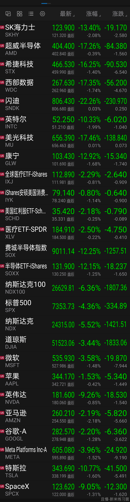
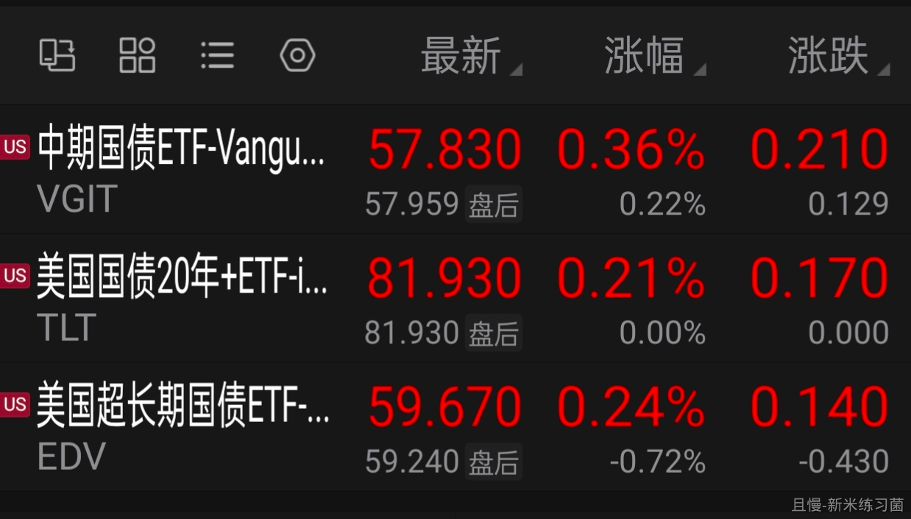
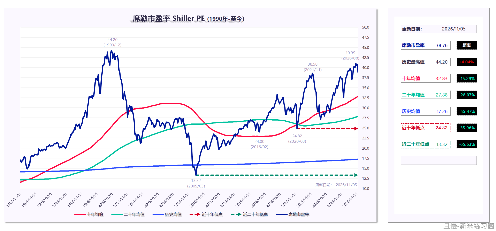
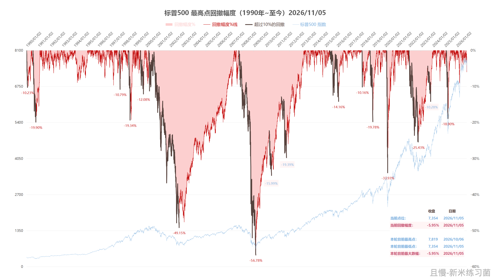
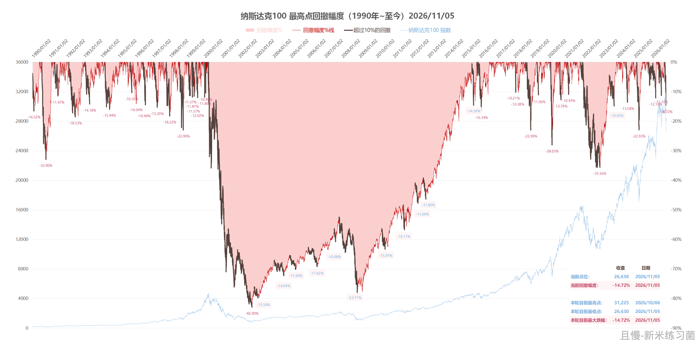
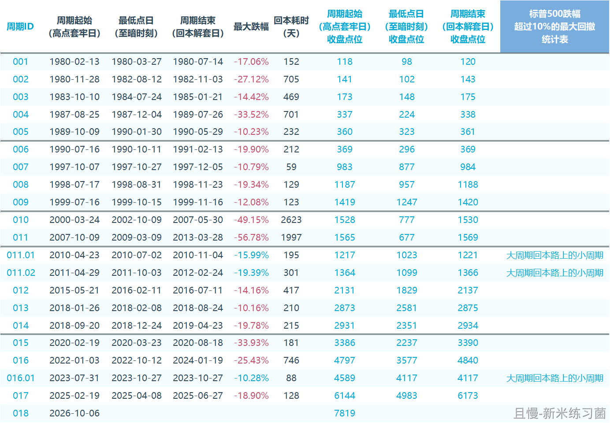
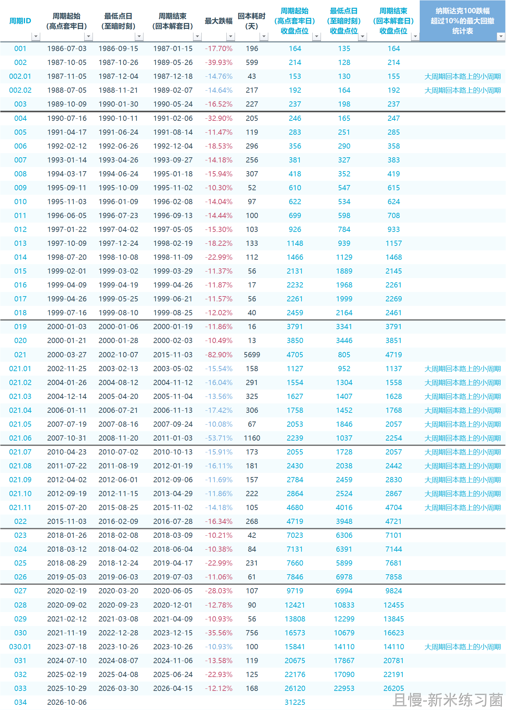

一。昨天晚上，上半场科技跌，红利和医药还在涨，还在历史新高。下半场这两位也扛不住了。事实证明，雨太大，打雨伞也会被淋湿。

二。都说美帝国债风险大。结果昨晚只有国债救命。短期历史新高，中期也不远。

三。之前在社交平台看到有人因为A股赔钱，心灰意冷卖出后买入溢价二三十个点以上的纳指ETF。在很多人心里，那边的市场已经是无风险赚钱的代名词了。

四。今天准备好迎接暴风骤雨吧。那些有神秘资金照顾的品种还好。有些品种……

<!-- qieman-comments:start -->

---

# 一。昨天晚上，上半场科技跌，红利和医药还在涨，还在历史新高。下半场这两位也扛不住了。事实证明，雨太大，打雨伞也会被淋湿 · 评论区（2026-11-06）

> 评论区归档：2026-11-07 抓取于且慢社区，原帖共 440 条互动，精选 111 条（作者发言、作者回复及其他投资相关评论）。

## 认真抄作业（华盛顿州） · 30 赞

抄底吧，老大，美股机会又来了

> **ETF拯救世界（作者）** · 213 赞：看看能不能找到额度

> **孤独的风（河南省）**（回复 ETF拯救世界） · 6 赞：老大，即便是昨天晚上的下跌，纳指到了合适买入的位置吗？

> **哄哄123（重庆市）**（回复 ETF拯救世界） · 37 赞：老大，纳斯达克100和标普500能不能给个明牌。如果没有额度的话，大家分散队形各自为战。🥰

> **来去匆匆（上海市）**（回复 孤独的风） · 0 赞：怎么可能，这才开始下跌而已

> **E..（广东省）**（回复 ETF拯救世界） · 1 赞：如果大家一起不行的话，e大可以分享一下美股的大概位置吗？

> **胡亚南（河北省）**（回复 孤独的风） · 1 赞：我看且慢的估值，纳指一直在绿色区域

> **春苗（天津市）**（回复 ETF拯救世界） · 0 赞：E大加油！我自己没忍住买了美股，已经被埋了，如果咱们的组合也觉得可以下手了，我就不怕啦

> **blue2026（广东省）**（回复 胡亚南） · 0 赞：是啊，且慢的估值是绿色的

> **认真抄作业（北京市）**（回复 孤独的风） · 0 赞：美股跌的快，起来的也快

> **DemonsL4（四川省）**（回复 blue2026） · 2 赞：E大只是在且慢开启了计划，且慢的估值系统应该和E大没太大关系吧

## 叶叶生哥（新加坡） · 3 赞

雨大，打伞也会淋湿，这个比喻很棒！配置才是王道。

> **ETF拯救我的世界（河南省）** · 0 赞：是嘞，本质上是配置风险

## 隐入尘烟（浙江省） · 1 赞

几乎所有群里，都是卖出缅A，去正规市场的声音。

## 世界被etf拯救（广东省） · 28 赞

下跌没有问题，问题在于下跌后总能快速恢复并续创新高

> **ETF拯救世界（作者）** · 250 赞：如果纳指曾经4000多天后才新高也算快速的话

> **世界被etf拯救（广东省）**（回复 ETF拯救世界） · 27 赞：二哥说的对，值得深思的是，为什么这些年美股总能给人这种近乎盲目的信心。信心某些程度上比黄金还重要

> **一条有梦想的闲鱼（上海市）**（回复 世界被etf拯救） · 4 赞：1、要深刻认识到任何经济体都有周期。
2、美的是处于通胀周期见顶阶段，经济走势你不觉得跟我国2018-2020年很像吗？
3、美的正通过向外部侵略和圈地称王的模式在走，因为它晓得石油-美元体系迟早要崩掉。当美元不再是全球唯一需要货币，可能上面的两条就是智库给出的战略。
4、美的历史上也曾出现过大萧条，参考罗斯福新政时期。

> **AHTIM（上海市）**（回复 进击的阿凯） · 1 赞：你应该在美股赚了不少钱了吧？

> **Yanhao（天津市）** · 4 赞：美股熊短牛场，但是如果真被你买在了纳指的山尖上，够你反省几年的。

> **永思（重庆市）**（回复 ETF拯救世界） · 2 赞：今天看能跌多少，我们的总体配置较好，估计不会下跌太多，我有信心

> **tqz（江苏省）**（回复 进击的阿凯） · 7 赞：2000年科网泡沫破裂，10多年后才新高，请问E大讲的是不是事实?

> **专注捡垃圾3w天（广东省）**（回复 ETF拯救世界） · 1 赞：但是有些地区大盘，现在过去4000多天了，上次的新高还在遥遥领先。

> **安然若素（江西省）** · 2 赞：你去翻翻纳指的历史数据就不会这样说了。有时想着赚最后一个铜板，套的就是你。一个多月前清空场内纳指，溢价太厉害了，场外减仓并停止定投，当然好多要么关闭了要么份额极少。

> **山竹（浙江省）** · 0 赞：我支持你。因为一直美份额少配，拉低了长期收益。以前国内一直宣扬美市风险，结果全球人都在买。就感觉错失了很多机会。优秀伟大的公司都在美国，长期定投总归是普通人的配置策略。

> **千里天山（北京市）**（回复 世界被etf拯救） · 3 赞：人的一生很短，对00后10后来说，印象中纳指就是永远涨的，就像曾经的80后，认为中房会一直涨一样，等他们活得足够老，看的足够长，就懂了~

> **luckyzz（北京市）** · 1 赞：请问关于网格今年停止更新的传媒和证券，e的意思是可以按照以往的条件单自行设置购买，还是他认为这两个品种不再适合做网格交易？我担心自己理解有偏差，所以请朋友交流一下😊

> **莫天天（上海市）**（回复 进击的阿凯） · 2 赞：希望你能用思想贯彻指导投资。比如你这么看好纳指，不如多买点？

> **虎啸山庄（江苏省）**（回复 ETF拯救世界） · 0 赞：这有什么好杠的，人家就那一次，A股多少次了？

> **虎啸山庄（江苏省）**（回复 tqz） · 2 赞：E大讲的当然是事情，没必要去买溢价20多个点的纳指。不过A股有资格说纳指4000多天才创新高吗？A股从07年创新高后到现在就没翻过去，有啥好说的

> **Guangyin（天津市）**（回复 虎啸山庄） · 0 赞：a的07年那个时候类似于荷兰17..的郁金香吧，其实个人认知是不能算进我国证券投资的发展史里面去的。
那个时候a股不要说年轻了，恐怕应该算是还没“人形”的。。。

## 山今（浙江省） · 0 赞

美股估值是否可以买入了？上次这么大单日跌幅还是疫情熔断那几次吧

## 闲云in（江苏省） · 1 赞

以前好难受10块钱限额，现在好感谢qdii限额每天只能买10块钱nasdaq

## 安文（湖南省） · 0 赞

好可怕，根本没有卖出机会😨

## mr.tang（广东省） · 0 赞

手上有一点点科技，希望不要带崩大盘就行😃

## 团团圆圆福气多多（山东省） · 0 赞

哈哈，跌的我们美滋滋，有可以买入我们想买的品种了。

## lucky_ETF（北京市） · 1 赞

暴风雨来吧，昨天小黑车网格出了不少，今天是不是就能接回来，猛跌也行，继续涨也行，不要站那不动就行，期待期待

## 新米练习菌（上海市） · 52 赞

E大早上好~
看了一眼，但凡沾点边的都📉超过-10%…
（随便看了一些，JJ上面的是硬科技，JJ下面的是七姐妹）

> **新米练习菌（上海市）** · 61 赞：【留言2】前面到工位了，更新一下美股估值和回撤图📊
【图1】目前PE：38.76
【图2 图3】目前回撤：-5.95% 和 - 14.72%（距最高日收盘价）
（启发源于老大的QQQ回撤“瀑布式”画法，可以看到深度、速度、长度、久度，运用在两大指上，然后把之前老大做的回撤超过-10%周期统计表也投映到图上了。
原贴是这两篇：
【20260328】《QQQ（纳指基金）1999年至今从最高点回撤幅度》
https://qieman.com/content/content-detail?postId=72001
【20251214】《1980年至今，标普500跌幅超过10%的最大回撤》
https://qieman.com/content/content-detail?postId=57829）

> **新米练习菌（上海市）** · 50 赞：【留言3】更新一下标普500 & 纳斯达克100的回撤超过-10%周期统计表格
这（也许的）“新一轮”先从2026/10/06（新高日）开始观察。

## 双鱼座（湖北省） · 0 赞

我手机只剩三千美股科技了还有 3万纳指，大家怎么看啊😢

## 投资-小白（贵州省） · 1 赞

泥沙俱下，兴奋！因为手里配置均衡，现金充沛！

## 余生请多指教（陕西省） · 0 赞

就不能让咱们的医药医疗也火一把😊

## 瓶子啊（广东省） · 0 赞

昨天A股牛市继续，今天估计要变成熊市无疑😂

## 盘子小号（重庆市） · 0 赞

昨天犹豫要不要出的波段，贪心了，想着今天收割，看样子会被收割

## 落儿（福建省） · 1 赞

今天银行等红利又开始工作了吧

## nonerule8（福建省） · 0 赞

等一个机会，场内溢价掉下来的时候，应该也是美股掉下来的时候吧🤣

## 红魔披头士（山西省） · 4 赞

今天的下跌看起来不可避免，比较可惜的是，医疗正处在冲击850日线的关键时刻，希望哪怕回调向上的势头也不要被打断。

> **同路人_S843Tl（天津市）** · 1 赞：一次俩次不行，那就三次四次，底部早已探明，庄家又没有别的版块儿可做，那就消费，药疗吧。

> **Raindrop（上海市）** · 0 赞：已经等到了第三次，大不了再做次波段等第四次🥹

> **不怕慢只怕站（云南省）** · 0 赞：印象中好像好几次了，医药医疗、恒生都是正要突破的时候大盘就开始拉胯，很宿命的感觉😑

## 路在脚下2025（广东省） · 0 赞

长期趋势不变的话，短期急跌是很好的上车机会。网格策略走起

## 秋雨春风（北京市） · 0 赞

纳斯达克没到买的时机，等标普跌两成再说

## AnJing（辽宁省） · 0 赞

美股溢价40%的etf也是活久见

## 养生砖家bac（山东省） · 0 赞

当市场都成为融资市之后，是不是全世界都差不多

## 小鱼（江苏省） · 1 赞

纳指目前还是不适合抄吧，再跌15%左右应该来一车，就怕没有额度🤪

## XJ（重庆市） · 1 赞

反弹把站岗的人换了，又可以继续跌了

## 春风落叶（河北省） · 0 赞

今年的股市，起伏巨大，尤其是科技股，屡创新高，跌起来，也是爹妈不认，连狗屎都比不上。

## 糖霜史莱姆（上海市） · 7 赞

老大，纳斯达克100和标普500能不能给个明牌。如果没有额度的话，大家分散队形各自为战。

## 同路人_S843Tl（天津市） · 4 赞

我们的医疗医药没有新高，还在底部，有什么可怕的，又不是没有见过，早晚上0.8

## 华雁萍（广东省） · 0 赞

哇，昨天卖出不少，今天又有机会买回来了，开心呀

## 上帝的直升机（福建省） · 0 赞

前两天，买了科创板和创业板看跌期权，亏了百分50的我，期待今天可以回本

## STA-BJ（湖南省） · 0 赞

资本市场发生任何状况，都不应该吃惊，如果做不到这一点，真的就不要做股票类资产投资了，甚至长期国债都不要碰

## 甲基绿（重庆市） · 0 赞

希望这波医疗还能多涨一点😚

## 牛气冲天牛（江苏省） · 2 赞

手里虽然没有科技，但是科技大跌，其它板块也得跟着跌，刚回两口老血啊😂

## 梓淵听风（四川省） · 0 赞

纳指还要跌多少才能回到正常呢

## 同路人_Jane（浙江省） · 0 赞

有E大带着从E大视角看问题，确实股市都有趣很多😊美帝也要沦为融资工具了，且等且看。

## 洪V_v（上海市） · 1 赞

红利，中概，消费，医药，给我涨😃 其他大跌给我捡垃圾

## 嗖嗖漫步（福建省） · 0 赞

科技大跌，其他微跌就好了

## MoreThanCoder（上海市） · 0 赞

美股仓位有点低，支持加仓

## milan-（辽宁省） · 0 赞

说了几年要等机会加仓美股，那边一直不给机会

## 捡垃圾的（广东省） · 4 赞

红利，中概，消费，医药，给我涨😃 其他大跌给我捡垃圾

## 以人为镜_可以知得失（广东省） · 0 赞

阔以，我昨天卖出的美美跌回来，又给我买入机会，那不是美滋滋

## 同路人_bZ6yxe（浙江省） · 0 赞

纳指会腰斩吗，顺便把基金溢价去掉，那就完美了

## PayneWei（浙江省） · 0 赞

创业板20cm跌停就好了，一步到位😇

> **杨小燿（上海市）** · 0 赞：创业板哪怕跌停还是高的吧🤣

## 适当得闲（山东省） · 0 赞

太好了，跌下来，有机会可以买点美股吧😃

## 星元（贵州省） · 0 赞

想卖点全球医疗的，想起E大以前说过新高不卖，老实等信号了😅

## 柳树在路上（美国加利福尼亚旧金山） · 5 赞

总说A股是政策导向，可是这政府、市场、经济，本身就是连在一起息息相关的，谁家的市场和政策没有关系，可能有的联系紧一些，有的松一些～

## 水木之宾（内蒙古自治区） · 0 赞

全球医疗想卖了，但是老大没发车还是不自己瞎操作了🤔

> **Freedomisland（浙江省）** · 0 赞：卖出点一下就行了，买回来可难了

## 何谈奇观（贵州省） · 2 赞

我不这样认为，虽然美股可能长达十年甚至未来更长的恢复周期，但是历史看任何时刻买入美股都是正确的。我计划拿七成的仓位购买mz国家包括法国德国日本市场的基金，三成的买某市场的基金，这些钱是留给孩子的，我死都不会用，遇到合适机会买入，我相信二十年可以穿越周期。但是现在近百分之二十的溢价，说明美股还没有到重仓的时候，只适合极少量操作解决手痒的问题，大部门还需忍耐

## Rich豆（四川省） · 0 赞

今天网格又要咔咔响了，昨天手动卖了好多

## 酷酷的阿金（江苏省） · 0 赞

E大早上好！全球医又历史新高了，感谢指引，之前底部坚持定投了一段时间，现在看到收益，真香👍

## 白哥（江西省） · 0 赞

扛到纳指下跌，溢价率达到3%以内

## 草原狼汛（北京市） · 0 赞

我们打算什么时候入局美股

## 曼鱼（湖北省） · 0 赞

我基金定投美股 加个 10 块钱😃

## 树上的楼主（江苏省） · 0 赞

传媒网格不做了么，大家有收到这个消息呢，这是为啥呢

## 南山豆瓣（重庆市） · 0 赞

益达给个暗示，自己每天定投，解决额度问题

## 漫天吖i（山东省） · 1 赞

以后网格会渐渐都停止公开吗

## E起富起来（四川省） · 0 赞

开盘前不到100支上涨，现在目前为止竟然爬上来了些
笑看风云的淡定呀😃

## 可苑（云南省） · 0 赞

我看有些人每天10块100块钱的每天定投10几个老美的纳指基金

## 如意如E（福建省） · 0 赞

有E读盘，心里踏实。期待美股机会

## 罗昂纳多（江西省） · 0 赞

咋说呢，全球配置都没用，全是坑😂😂

## 执着（湖南省） · 2 赞

昨天美美没走，今早的回落单干净利索溜了。
专业人士解答一下，为什么这次美美这次离开，没有设置下一个点的买入？

## E人里的i人（辽宁省） · 2 赞

很多人可能已经忘了美股也是股

## 小橘的云爹（浙江省） · 0 赞

E大，现在华宝的网格还在搞吗

## Shuaishuai（云南省） · 0 赞

我在纳指那边的自信心居然强于大A

## 零一观照（陕西省） · 0 赞

E大，请教一下如何看待房地产ETF，现在也处于低位，按说应该也是个不死的行业，就不知道出清的速度如何了，可以网格点吗

> **百花争艳（广东省）** · 0 赞：房地产整个行业亏损，无业绩，我的房地产基金都放那里不管了，也不再加钱了，建议还是不要用亏损的行业做网格了吧

> **同路人_u9kyrt（广东省）**（回复 零一观照） · 1 赞：消费和医药这种大类都沉沦四五年不见起色，行业etf少搞，再细分的行业更要谨慎。

## 战士（湖北省） · 7 赞

E大把媒媒的网格也停止分享了，是什么原因啊？

> **If-OnlyJ（福建省）** · 1 赞：华宝的网格，e大只是跟着做

## 苹雅图（山东省） · 1 赞

老大，传媒的网格是暂时结束了吗？

> **luckyzz（北京市）** · 6 赞：请问关于网格今年停止更新的传媒和证券，e的意思是可以按照以往的条件单自行设置购买，还是他认为这两个品种不再适合做网格交易？我担心自己理解有偏差，所以请朋友交流一下😊

## 哈哈哈yyy（浙江省） · 1 赞

借楼问一下，传媒的网格为啥暂停了？

## 随心随意（陕西省） · 0 赞

E大，传媒以后不做网格了吗

## 纳风儿正红（北京市） · 0 赞

昨天还和朋友聊纳指ETF，溢价率高的有40%，最低的也有10%多，都把美股当无风险市场了？

## 陈S（广东省） · 1 赞

创业板如果支撑是2100，离现在是15%，是不是可以开车了？

当然市场永远不缺机会，缺钱。

## 张玮就知道吃（福建省） · 0 赞

请问e大，不知道网格那边是不是慢慢要收缩了？感觉买入的计划单变少了很多。

## 战火小阿蛮（北京市） · 0 赞

EE 今天没跌啊。这几天账户不断新高但是木有跌。🫶

<!-- qieman-comments:end -->
