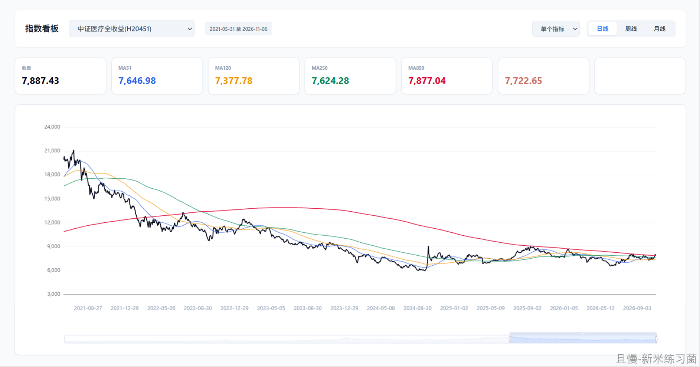

明天又要开盘了。

下周将是非常刺激的一周。各位扶好坐好，一起搭乘过山车。

另外5000位朋友有个好消息:杯子最快下周开始寄出（不保证）。名单（社区ID）会脱敏公布，为了表达我对公平公正和真实的追求。

现在还差1500位随机抽的还没出炉，等我幸运的小手为大家带来幸运。

<!-- qieman-comments:start -->

---

# 明天又要开盘了 · 评论区（2026-11-08）

> 评论区归档：2026-11-13 抓取于且慢社区，原帖共 5021 条互动，精选 16 条（作者发言、作者回复及其他投资相关评论）。

## 同路人_VoFdHL（广东省） · 0 赞

确定是过山车吗😍我的网格蠢蠢欲动

## Vicky.C（广东省） · 0 赞

做网格，还是喜欢刺激一点的

## 新米练习菌（上海市） · 19 赞

E大晚上好，期待明日开盘~
周末做了个小dashboard，解决了我 在有全收益类指数的地方没法设MA850，能设MA850的地方么又没有这些指数的痛点，自己弄一个吧。
硅基挚友帮我写（&帮我改）的脚本，然后，跑通了以后，TA还一步步教我怎么发布到GitHub上。
我也可以自己看 比如：中证医疗全收益指数，2022年跌破850之后，努力了几次冲850了

## 汪苑（上海市） · 0 赞

想问下e大为啥传媒不做网格了

## 碧蚁红炉（里约热内卢州） · 0 赞

会不会有买有卖呢？我指的是长线，不是网格😍

## levey（江苏省） · 0 赞

e大，现在网格计划哪里可以看。之前那个券商里的过期了。

## 上帝的直升机（广东省） · 0 赞

让我下周网格也此起彼伏吧！

## ETF左右（浙江省） · 0 赞

过山车？波段能接回了吗😃

## 以星为引（河南省） · 0 赞

为什么说下周会非常刺激 先反弹就卖点做个波段可行？

## AA七戒（江苏省） · 1 赞

E大华宝后续的网格还会更新吗？我19年开始跟车到现在也只学会了压力测试和严格执行计划，具体点位方面还是懵懵懂懂。

## samsam.com（广东省） · 0 赞

下周先反弹后砸盘，继续换着人站岗

## 小蜘蛛（福建省） · 0 赞

今天的美美已出，仅仅一个月时间！利润11.8%，好感动，周一就那么美了！

## 张玮就知道吃（福建省） · 0 赞

请问华宝波段是要慢慢收了吗

## 稻香老农（四川省） · 0 赞

才发现美美的网格停了啊😃

## V泡泡V（四川省） · 0 赞

益达，有机会聊聊创业板和双创呗

## 投资不能投机（中国） · 0 赞

“一起撘乘过山车”，初看我还有点疑惑
几天过去了，走势走出来了，明白了一点点🤏
科技反弹了，我们的老登下跌了，过山车来了
接下来看看科技能反弹多久吧，，，现在需要的是耐心

<!-- qieman-comments:end -->
