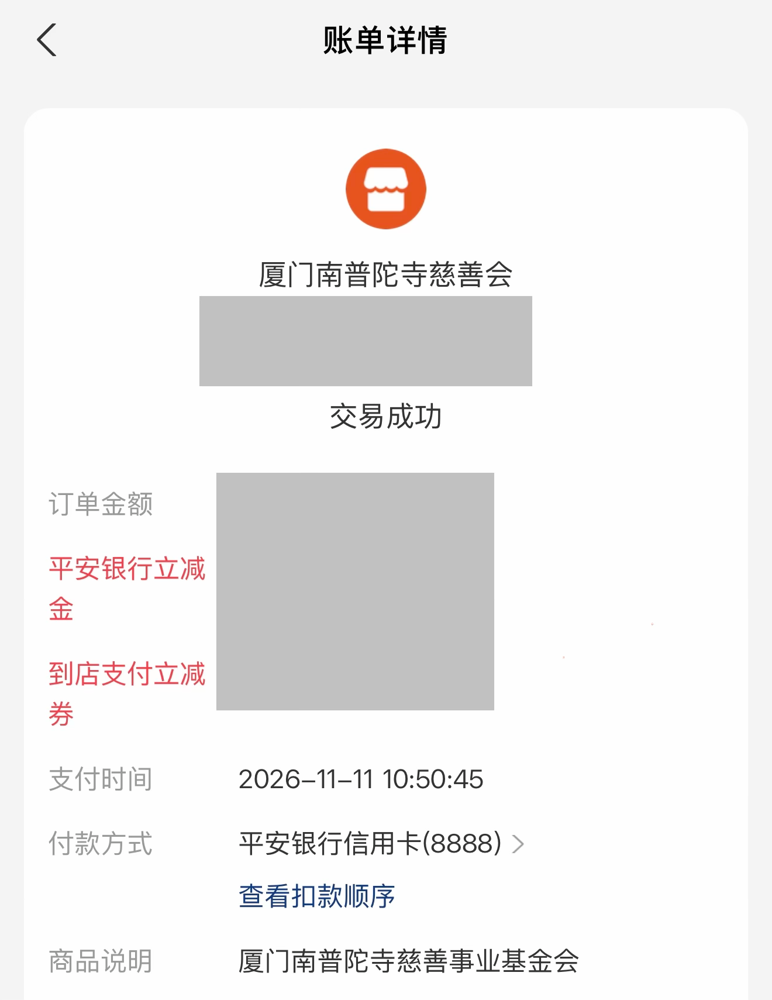
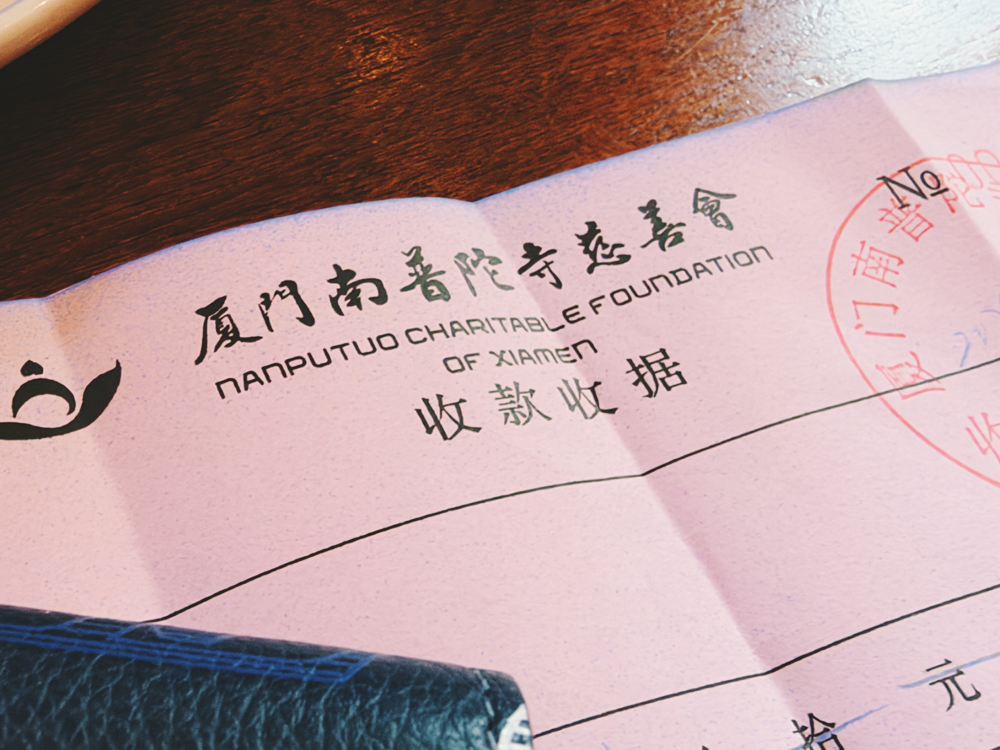

代表每位跟车的朋友积点功德。希望各位做投资都有好结果。

财聚财散，无非梦幻一场。希望流向能善待它，也最需要它的人。

<!-- qieman-comments:start -->

---

# 代表每位跟车的朋友积点功德。希望各位做投资都有好结果 · 评论区（2026-11-12）

> 评论区归档：2026-11-13 抓取于且慢社区，原帖共 968 条互动，精选 5 条（作者发言、作者回复及其他投资相关评论）。

## ocd的地盘（广东省） · 1 赞

谢谢老大，老大，全球医疗最近不错啊！

## 且慢叫我输昵称（上海市） · 1 赞

寺庙也可以支付立减。佛祖也要刺激消费😊

## 新米练习菌（中国） · 223 赞

E大中午好~
感恩慈悲心念，不忘同路之人，财本流转，善念有归，善心不虚，愿善款抵达需要的人，我们在投资里守心、守财、守分寸，平安顺遂，安心长赢。
愿菩萨保佑菩萨。

## 须亥（北京市） · 0 赞

感谢益达的代表，我自己从上个月也开始以定投的方式定期捐款一家资助流浪者的慈善机构。钱不多，但希望能一直进行下去，直到自己肉体或者精神死亡销号。

## 今天早睡了吗（中国） · 0 赞

感谢🙏祝老大和大家都长盈长赢

<!-- qieman-comments:end -->
