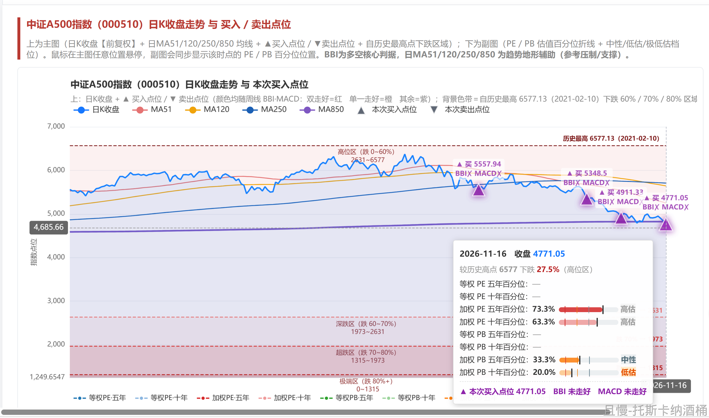
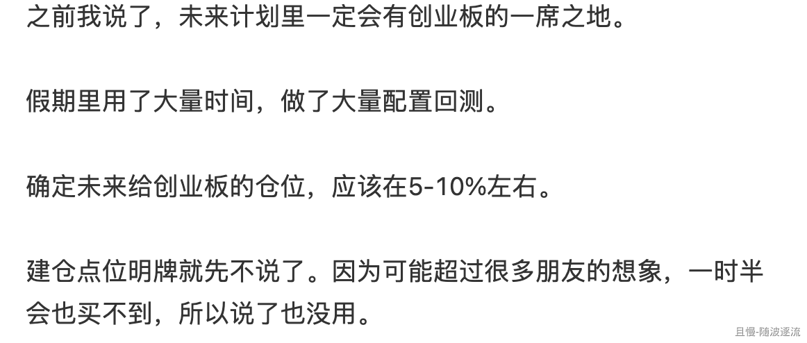

今年开始建仓的A500，不考虑高位卖出的那些宽基，只是说这一个品种，

目前浮亏6%左右，仓位大概2%。

我想问各位，这样的买入节奏，你舒服不舒服。

你要注意，不能只考虑浮亏看起来难受不难受。还要考虑如果不买，会不会总是担心市场反弹自己什么也赚不到。

是不是真的舒服，就是持仓部分下跌不难受。一旦反弹手里有货也不难受。

而建仓的节奏恰恰不会让你觉得太快拿太多担心赔太多，又不会太慢让你担心反弹一场空。

那些高位卖出大量500的朋友就不用说了。我不信这样的20多30个点的大网格没有让你爽到。

就单说这个品种目前的节奏，快慢，你舒服不舒服。不舒服的，也可以说说为什么感觉不舒服。

<!-- qieman-comments:start -->

---

# 今年开始建仓的A500，不考虑高位卖出的那些宽基，只是说这一个品种， · 评论区（2026-11-16）

> 评论区归档：2026-11-20 抓取于且慢社区，原帖共 458 条互动，精选 91 条（作者发言、作者回复及其他投资相关评论）。

## E起富起来（四川省） · 4 赞

非常棒啊
我之前的宽基仓位就不多，现在买买买，正好

## 丹剑一心（河南省） · 22 赞

不错，慢慢建仓宽基，下一个是不是创业板啦！加油！

## 酷酷的坚持（浙江省） · 0 赞

舒服！但想问E大，咱给A500多少仓位？

## 超毛战士小太阳（辽宁省） · 0 赞

舒服的，买入节奏不着急，耐心等待机会出现，出现了就小笔买入，反正比我自己买的节奏好太多啦！

## PayneWei（浙江省） · 1 赞

相当舒服！
我自己有在单独操作，给它20%的最大仓位，目前已入5%，再跌15%左右打满。这个位置可以说是相当舒服了，涨了就做波段，卖飞也不难受，最好是跌到位，想死了在4110点买满它

> **PayneWei（浙江省）** · 3 赞：今年唯一失败的操作是：上半年红利低波100买少了！

主要错在只给了它5%的最大仓位，收老大影响，我决定给他20%仓位，只是它再也跌不下来了😭
不过没关系，在A股永远不用担心买不到。每年回调10%左右买入不会犯大错

## 悦屿清风（海南省） · 0 赞

想法很简单，听你慢慢分析，慢慢买入，熊市坐等它以后变红

## 小小虾米（北京市） · 0 赞

我在计划外把今年的个人养老金账户里的钱分成4份，跟车买入A500，再也找不到比跟车买入更让人安心的方式了

## 青春的终结者（浙江省） · 0 赞

这个品种替代500建仓节奏舒服的很。现在就想看看啥时候创业板，还有黄金也能开始建仓，那就完美了。

## 牛玲和狗尿苔（浙江省） · 0 赞

没有中证 500，所以前面一直卖，一直不舒服。这次一定要买够😁

## 纳夫（四川省） · 0 赞

老大，感觉您说的很多品种不适合做网格了，可以增加一些品种进网格吗，当然如果能说说原因的话会更好😃

## 捡辣鸡二十三名（陕西省） · 0 赞

太舒服了，网格波段做起来。最近看伯克希尔的走势稳稳向上，长赢也是同样的舒心感。

## 鲲鹏视角（河南省） · 1 赞

场外今天也已开始建仓了😃

## 同路人_VXpGwx（湖南省） · 0 赞

舒服。另外能请E大讲讲对全球市场的投资想法吗？比如标普500，或者欧洲、日本，因为目前我们的海外占比还是比较低的。

## 翠峰果园（山东省） · 0 赞

很棒！
既要考虑下跌不心疼，又要考虑上涨不后悔，难度有点高啊。

## 天天天晴（浙江省） · 3 赞

舒服，上涨有货，下跌有钱☀️

## 汉水浮萍（陕西省） · 0 赞

喜欢现在这样的节奏，再也不用开黑车啦，大小波段做起来😃

## 冰璎（福建省） · 0 赞

感觉500很适合自己建网格

## 招牌菜（北京市） · 0 赞

我自己的比E大早一天，上周五买入了

## 汪汪（北京市） · 0 赞

E大，养老基金可比照的买吗？

## from0tostrong（广东省） · 0 赞

老大，现在科创50适合波段么，单纯想请教

## zyzl（广东省） · 0 赞

你好E大，能说说仓位定在2%的目的，之前好像说过5%以下对总体持仓影响不大，谢谢！

## 齐骏马（山东省） · 0 赞

非常舒服，即使浮亏再多我也不焦虑不恐惧不害怕了。

## HXS（浙江省） · 0 赞

舒服的很，高位分批卖出的中证500仓位慢慢分批买入中证A500仓位。

## 诺维里茨基（河南省） · 0 赞

益达，我有一个担心，红利和债占比提高后，难免将来涨起来时涨幅更加让人诟病（我不是怕自己涨的少，是害怕益达被黑子喷）

## 红魔披头士（山西省） · 72 赞

A500我今天没买入，我是上个月底建仓补入的，浮亏2%，仓位也只有千分之三。

不是我不想买，只是宽基卖出的仓位已经被中概医疗消费这三座大山占据了。

最近几年，以往强势的行业指数表现低迷，也许宽基为主+行业为辅是更稳妥的搭配，不过现在骑虎难下，我是不会斩仓的，只能先等待这几个行业指数波段提款，然后再去考虑腾笼换鸟的事了。

> **三十岁前住瓦市殿巷（浙江省）** · 6 赞：我想把A的占比降到尽量低，所以A500没买。中证500高位清仓了。

> **山竹（浙江省）** · 9 赞：我是医疗医药重仓，当年致敬仓位黑车多了，总觉得再补一些程本比E大低，结果埋好几年了。看新闻总说国家医保没钱，医药集采，不清楚还要熬几年😂

> **Guangyin（天津市）** · 2 赞：有一点类似的问题，但是仓位没有那么大
我的是一个自己尝试的个股，已经逐步趁着反弹减仓，转换仓位了，我记得段永平说过一个例子，就是说你去机场接人，停车场预先投币，飞机早到。你已经接到了你要接的人，请问你会因为已经投了的币，而在车里把车在停车场停到时间再开走么？
这个例子对我的触动特别大。

> **九月梅（湖北省）** · 0 赞：差不多的情况，恒科仓位太重，好不容易解套了又没减仓。现在骑虎难下，也是希望能涨起来了腾笼换鸟。

> **三十岁前住瓦市殿巷（浙江省）** · 0 赞：21年中证500高位没卖，故此次清仓，留约1元作为战绩记录和留念。个人对A500的做法是再跌15-20%开始极轻仓介入，最多不会超过1-2%，不到价格不买，一朝被蛇咬十年怕井绳，21年至今年26年五年难熬啊。

> **三十岁前住瓦市殿巷（浙江省）**（回复 九月梅） · 0 赞：这标的波动大，基本适合波段

> **Gemmabymini（上海市）** · 0 赞：中概是最头疼的，之前低位也没倒腾，放在那坐了一波过山车，现在准备自己做波段拯救一下😂

## 二级市场捡辣鸡的小卡拉米（陕西省） · 0 赞

跟车晚，沪深 300 只有两份，现在可以有节奏地慢慢买入吗

## 永远的宝贝（山东省） · 0 赞

跟着老大节奏控制的相当舒服，自己还悄悄开通了网格

## 阿澄（广东省） · 0 赞

奇怪，我其中一个计划也是今年建仓的500跟车，但显示亏损是8.9%

## alekc（浙江省） · 3 赞

我只能说没有你我不敢买，你就是我买A股的底气，大仓位

## Mmmmmmmomo（湖北省） · 0 赞

今年的个人养老金就准备买A500了。

## 无为而治（北京市） · 1 赞

满意 如果是我自己就控制不住提前加仓了

## 芒果你个pineapple（四川省） · 0 赞

必须建仓，要不涨起来没感觉

## 同路人_ADgVsM（北京市） · 0 赞

想问一下，类似于纳指这种长期看上涨的指数，怎么考虑什么时候是低价呢

## E路同行-且行且珍惜（广东省） · 0 赞

舒服。a500是不是可以配置10%左右

## 瓶子啊（广东省） · 0 赞

都是闭着眼睛买的，回头看看场内网格也可以开始了

## 福儒（河南省） · 0 赞

主要是仓位控制的好，不可能难受

## Mary（北京市） · 0 赞

这个节奏可以接受，上涨有仓位，下跌加仓。

## 韦小路（四川省） · 1 赞

怕得是像中概最早几次建仓那样，建完了一路向下，然后就5 6年趴地上不起来了😪

## 草头（四川省） · 0 赞

舒服，之前持有的宽基不够，现在慢慢补上，很安心

## 买不完根本买不完（福建省） · 0 赞

这还不舒服啊，宽基这节奏买，后面反弹也能吃到，而且估值不贵，高位卖了中证500接回来的，相当于做了个大t😊

## 托斯卡纳酒桶（陕西省） · 3 赞

挺舒服的，买点错落有致。后面再，跌了，空间时间拉开继续买；涨了（如果出现触底双创反弹一波），手里有货，还能做个波段。哈哈。

## Shuaishuai（云南省） · 0 赞

拉卡时间空间逐步建仓，体会到了策略和节奏的重要性

## 晚上吃烧烤不（重庆市） · 0 赞

我是跟车买的四份，目前浮亏8.9%，严格跟车的，为啥浮亏不一样哦

## wpm（天津市） · 1 赞

大网格特别舒服😌，发车就开心

## 自由的风（陕西省） · 0 赞

特别舒服，不但高兴的跟车，且还在某宝也开启了波段操作！谢谢您

## 全息基金（山东省） · 0 赞

老大，HB的网格是不是以后不会再公开操作了，最近看到美美没有设置网格了

> **If-OnlyJ（福建省）**（回复 esau2） · 0 赞：华宝不再更新网格了吗？

## 老郑爱养基（河南省） · 0 赞

舒服。这样的建仓节奏舒服

## 柳树在路上（广东省） · 1 赞

舒服舒服，毕竟我还是倒金字塔加仓买的a500，可以说是抄了e大的底😂

## 一席之地（江苏省） · 0 赞

创业板开黑车进沟里了，等着大家来

## Forgeter（吉林省） · 0 赞

很舒服，这种大宽基让我很踏实，行业基，没有e大替我做决定，我真的是不敢再碰了

## 零下（江苏省） · 0 赞

怕个毛，y和x逐步建仓，何况A500

## 战火小阿蛮（北京市） · 4 赞

很舒服、但大概还是会在更低一点的位置补全。原因是和大家的情况不太一样。上一轮因为没做好压力测试以及开黑车导致仓位集中在中概上，宽基基本没怎么买，当然后面中概系帮我赚了非常多（去年大概就清掉了七七八八，不多说）但这也就导致在500等宽基上完全没有利润垫，所以没利润垫的情况下就还是会本能的追求低价，这很难避免…捡垃圾&买的便宜已经形成了思想钢印(Ｔ＿Ｔ)

## 春眠不觉晓（山东省） · 1 赞

我觉得目前情况下，买A500指数基金是个不错的选择，我今天开了黑车，黑车部分如果我坚持定投，有2～3年左右的耐心，我觉得收益率大概率能跑赢银行存款利率的

## Sunny向光而生（山东省） · 0 赞

觉得目前仓位节奏还可以，大跌大买，对不？

## 花傲天yu（江西省） · 0 赞

还好吧，因为e大一直说科技高估看了A500里面很多科技和创业板所以一直没下手，主要还是医药消费中概黑车开太多还没下车，今天才开始买点。

## 溪南烟树（江苏省） · 0 赞

e大，红利涨高了也要做做网格吗？还是就拿着底仓！

## MuenPaPa（陕西省） · 1 赞

想请问E大，A500的目标仓位大致是什么范围？

## 同路人_XUE（广东省） · 0 赞

宽基我自己最近一直在买，定投➕手动。

## 王昭垚字倦收（中国） · 0 赞

舒服，只要仓位控制好，不重仓梭哈都会很舒服，还有就是心态，一部分是后天锻炼的，我先天就是心态不稳定，后天经历了十几年磨炼也就改变了 10%，大部分都是经历磨难痛苦挫折才能改变。

## 王昭垚字倦收（中国） · 0 赞

不舒服的人都是自己开私车，重仓了，跟老大你控制好了仓位，完全会很舒服的。

## 瓜瓜（陕西省） · 0 赞

有没有可能建仓科创？想要买点不知道什么时候入手合适

## 如意如E（福建省） · 1 赞

这样的配置节奏 涨跌不惊 舒适

## 北京簌簌（北京市） · 0 赞

请教E大，未来组合会给A500多大的配置比例呢？

## 愚人码头（上海市） · 0 赞

我一直心急，一想到建仓，以前恨不得立刻全部买入，哎。。。泪流不止

## 学徒（中国） · 0 赞

我要学习这种拉开空间和时间建仓

## 奕哥（重庆市） · 2 赞

老大，题外话借帖子开放评论问一下。这几天债市为什么大跌，因为我有部分国债国开政金债基金压箱底😎，请从基本面技术面详细讲解一下，谢谢🚀🚀🚀😎

## 静行致远（湖南省） · 1 赞

我的小黑车也是浮亏6.5%，看来我是学到真东西了，就是买点没有老大买的好，不过有参考答案的感觉确实不错

## 老M（山东省） · 0 赞

请问E大，中证A500您计划总仓位是多少吗？

## 归途有风（四川省） · 2 赞

从来没有过不舒服。舒服来自于对E大百分百的信任，能力和人品全方位的信任，所以我内心对于持仓根本不会有什么波澜，我相信结果并学习方法就好了，其他没有什么可操心的😎

## HJKL（广东省） · 0 赞

e大，家人有一笔钱，我想配置点红利，哪时可以再买点呢，期待

## flysunny（山东省） · 0 赞

我就是500卖舒服的，所以坚决执行策略，并且黑车分批买入

## 辣鸡没捡够（上海市） · 0 赞

虽然之前卖出手里货不足，但以后再卖出就有车跟了呀🥰🤗

## 坚强的韭菜（美国） · 2 赞

我有个疑问： 为什么创业板不按照这个节奏建仓？

## 星期天的早晨雾茫茫（上海市） · 0 赞

想问一下E大和课代表，选指数基金，比如A500，各家的产品是不是都差不多的，要怎么评估呢？我知道的主要就是比较一下买入赎回期限和费率，看一下管理费，看一下规模和流动性。指数类基金基金经理的影响是不是很小？

## 喵喵棒棒糖（湖南省） · 2 赞

最近几次我都没有跟车买入，不是没有钱，是想到了E大一直说的“要用闲钱投资”，“最近几年至少要留够2-3年的生活备用金”。我正在努力朝着“留够生活备用金的方向努力“，不想让生活中的意外打乱投资节奏，那我就继续忍忍不跟车，现金比黄金还珍贵

## 随波逐流（北京市） · 0 赞

如果按照之前的仓位计划
A股中，红利占比40%-50%，宽基占比40%-50%，行业占比10%-20%
宽基主要有A500，创业板。如果想更全面一点，应该还会加入少量中证500吧（自己猜测，希望懂的可以说说）

A股宽基中，各个板块占比是不是大概这样？
创业板预计5%-10%（E大之前回测后发的，应该是占A股的吧）
A500预计30%-40%（我猜的）
中证500预计5%-10%（我猜的）

A股红利：40%-50%之间

A股行业：10%-20%之间
医药，消费应该在5%-8%之间吧（因为5%以上才会对组合产生影响）
科技应该在2%-4%之间吧（因为和创业板重合度挺高的）

> **随波逐流（北京市）** · 1 赞：我认为A500是要买到整体仓位的15%左右（如果A股占总体仓位的50%的话）

目前只建仓2%，可以根据A500极限点位3663，分阶段配置到15%左右

## 招财金元宝（河北省） · 2 赞

年化收益和回撤对比 符号投顾的形象吗 用客观数据说话

## 鸢渊（浙江省） · 0 赞

zz500高位清仓了  但下跌了一点我就开始补了

## 阿凡提（重庆市） · 0 赞

E大，2%仓位是占A500预计的仓位？还是占整个组合的仓位？

## 手里有钱.看见世界（云南省） · 0 赞

我一直舒服的，没担心踏空，也不焦虑下跌，跟着益达就这么乘风破浪着，因为信任🤗

## 嘟嘟小迷糊（河北省） · 0 赞

舒服：持仓部分下跌不难受。一旦反弹手里有货也不难受。

<!-- qieman-comments:end -->
