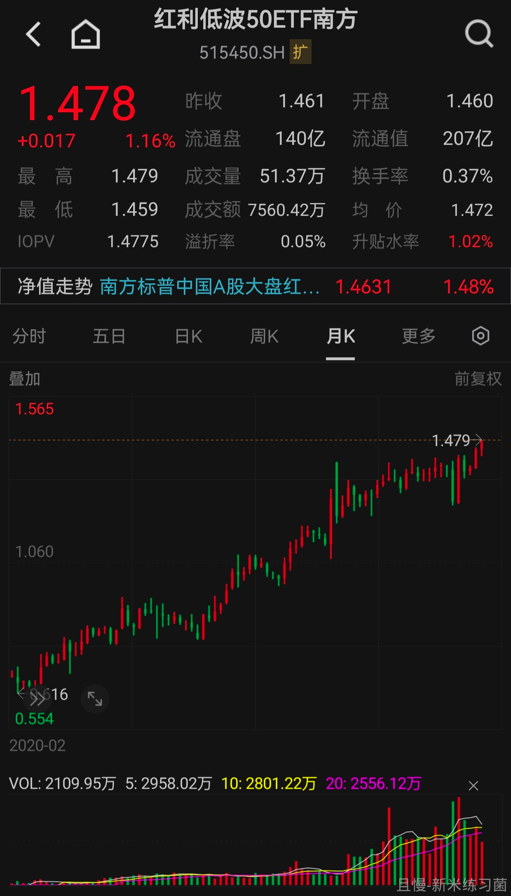
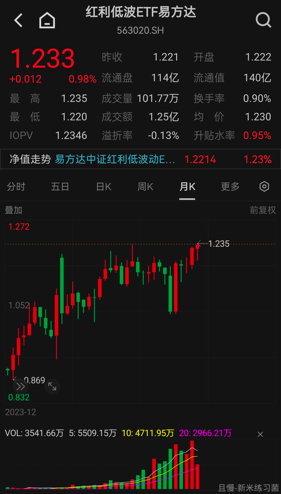
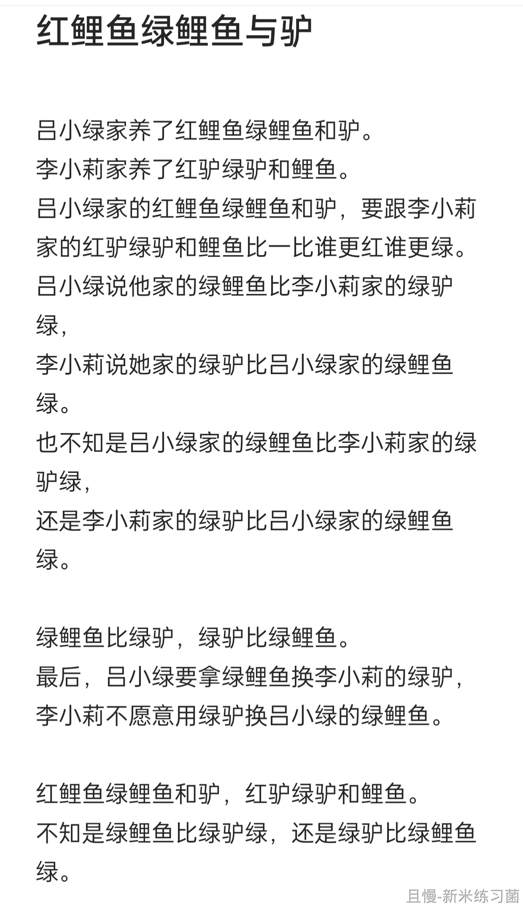
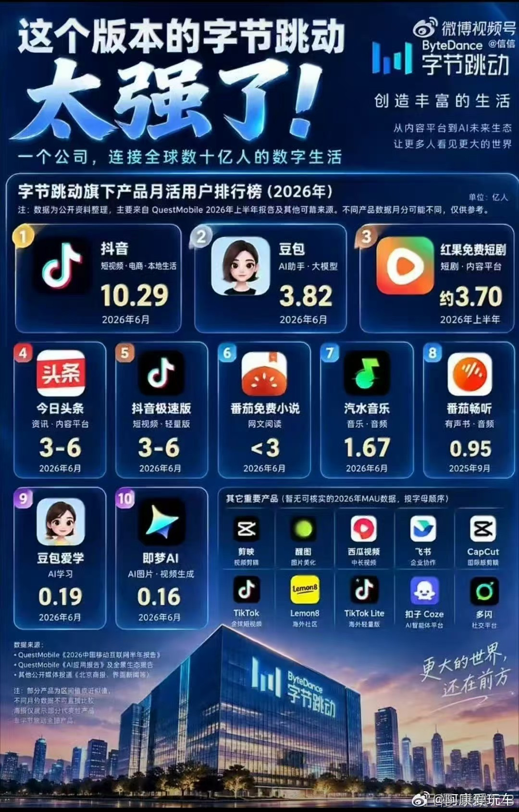

说几句话。

第一，如果收盘没有回撤，那么红利低波和红利低波50都会继续历史新高。

又想起了7月前，社交媒体上那么多人骂“绿利高波”的情景。

很多年前我就发现一件事，实际上大多数人对于比如审美，对于比如事物的本质并没有真正的认知。

大多数人会被最近发生的事情所牵引。总是认为最近发生的就会是永恒。

如果这几个月他们持有一些被他们谩骂的“绿利低波”，账户也不至于太惨。

真的不要用一时一刻的成败去评价什么。不要做短视的人。

第二，如果今天整体不反弹，我们应该会出手小买一点。

还是7月前高位卖出的宽基。现在一点点往回接。这个差价做出来20%、30%个点，我觉得很好了。我买不到最低，只能尽量让自己的成本距离底部区域不远。

未来某个时刻再次疯狂，我就再次卖出，然后一次次循环而已。

第三，不说了。

不要太乐观。

<!-- qieman-comments:start -->

---

# 说几句话 · 评论区（2026-11-16）

> 评论区归档：2026-11-26 抓取于且慢社区，原帖共 373 条互动，精选 38 条（作者发言、作者回复及其他投资相关评论）。

## E起富起来（四川省） · 4 赞

整体不反弹就出手，会不会大概率就反弹给我们看

## 不系之舟_（浙江省） · 0 赞

对于某市场只能做做小波段大波段😎

## kalin（广东省） · 1 赞

好多人那时候割红利，明明应该加啊，套了几个点也开骂，科技套50个点倒是无所谓

## 珂啊（中国） · 0 赞

能聊聊中概股吗，我是去年开始跟车的，那时候疯狂补中概股，然后现在也是亏的最多的。

## lucky_ETF（北京市） · 0 赞

不要太乐观，我上上周就是乐观了，以为自己今年能回本（黑车）😭 不过高兴一周也是好的，今天上上周出的网格已经陆陆续续接回来一些了

## 山顶资本-_-（北京市） · 0 赞

最近仔细看了您的网格文章 当年没仔细看过，开了很多普通网格。这轮到顶再下来，再看您的文章我对压力测试有了很直观的理解。上一轮没有大买实际就是没有做过压力测试。当年如果仔细看了那三篇文章，也不至于上轮跌下去的时候虽然知道应该要买，但是还是不敢买。

## 乌龟赛跑（湖北省） · 0 赞

不乐观 美股下跌风险很大 大爱又是跟跌不跟涨

## 台风来了（重庆市） · 1 赞

大概率是A500或者创业板

## Fankezhou（浙江省） · 0 赞

人就是这样！他们都会说自己是长期持有十年起步的……然后十来天的波动，他们就卖出了！别当真😄

## Bin.6（河南省） · 0 赞

长电创新高止盈了一半，吃息佬接下来怎么办呢…

## 新米练习菌（上海市） · 56 赞

E大早上好
绿利高波？发音还不太顺口的。
红利低波。想到内什么“红鲤鱼绿鲤鱼与驴”，我贴过来，念也念不清。
“绰号”也有看（阶段性）顶底的功效…

## 连睡觉都穿着铠甲（广东省） · 0 赞

彭博社说央行在调研国债政府债收25%税的消息，E大怎么看

## 乌拉圭（四川省） · 0 赞

我这个没用的东西，红利，咋都有点怕了想卖了。。。。。

## 投资两天亏两块（四川省） · 0 赞

以前不知道低波，只知道红利，现在红利全方面被低波吊打

> **百花争艳（广东省）** · 0 赞：感觉红利低波长期比红利好，只是感觉

## 柳树在路上（广东省） · 1 赞

是时候对中证500（没有A）说，众人火上浇油时，我默默离去，众人雪上加霜之时，便是我雪中送炭之日。

## 被ETF拯救的may（辽宁省） · 0 赞

你发车我就买。场内自己的网格已经买了一网。很快就成交了，是什么人在狂卖啊

## 萌新是我（北京市） · 0 赞

哈哈哈，每次都感叹国人在投资上真金白银的付出以至于真情实感吐槽方面，总是神梗频出：绿利低波、四分之一导体、新熊源......股民基民的梗商也是真的高🤪

## 稻香老农（四川省） · 0 赞

E大，传媒不适合做网格了吗？

## 大飞（福建省） · 0 赞

第三：红利今天大概率回撤，宽基反弹。

## 喜欢捡辣鸡的羊毛衫（四川省） · 1 赞

后面对面还要加息，慢慢来 不要急

## Tina过的小日子（四川省） · 0 赞

明天APEC会面，应该大概不会太拉垮。神秘资金可能在出手了？

## 张放（湖北省） · 0 赞

那是不是只买红利收益会更高一点？

> **浅若清风（宁夏回族自治区）** · 1 赞：红利也有逆风期啊，没有只涨不跌的品种，关键是老大在做资产配置，而不是赌

## 同路人_Dy7vlZ（浙江省） · 0 赞

在外面逛荡一圈，发现长赢才是避风港😭

## 俩XD（浙江省） · 1 赞

在今年这个宽基大跌了20-30%的这个时点
需要抽出些资金去支持孩子
搜罗半天找不够能卖出的
🤐

## 同路人_Jane（浙江省） · 0 赞

98%都是噪音，大多数人对于事物本质并没有真正认知。都是周期，都是循环。
嗯🤔不要太乐观。

## 捡垃圾指数星辰粉（江苏省） · 21 赞

下次抽杯子能不能把之前中过的剔除啊，我的个人想法😅

> **ETF拯救世界（作者）** · 33 赞：必须的

## 同路人_NZcQWy（陕西省） · 14 赞

老大，失联两年了，我终于找到你了，微博都快让我刷烂了

> **ETF拯救世界（作者）** · 22 赞：没有吧。去年十月开始没有再发言吧……

> **哄哄123（重庆市）**（回复 ETF拯救世界） · 1 赞：老大，中概股被全面围剿，真的起来好难哦

## 长盈久安_YYY（上海市） · 0 赞

红利不操作一下么？继续换红利品种

## 黎明前的暗黑77（浙江省） · 0 赞

按理说创业板也跌破850日K了，为何不加创业板呢

> **小鱼爱爸爸（北京市）** · 0 赞：我记得E大说好像是看到2100左右，创业板R。

> **黎明前的暗黑77（浙江省）** · 0 赞：我一直理解的是2100是最低点位，原来是开始买入的最高点呀

## 小朙（四川省） · 0 赞

黑子总是想着法子黑，黑子们现在已经不提红利了。

## 嘟嘟小迷糊（河北省） · 0 赞

尽量在底部区域，收集筹码；高位卖出。

<!-- qieman-comments:end -->
