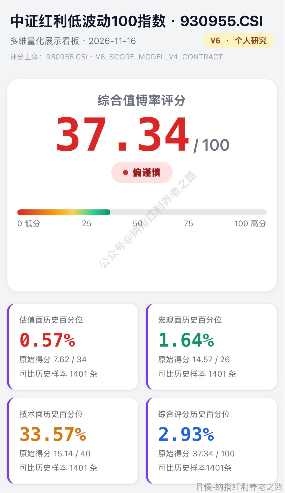

最近经常看到有评论说，看到有人在网上说红利现在很贵了。我们的持仓为什么不卖。

你怎么说。

<!-- qieman-comments:start -->

---

# 最近经常看到有评论说，看到有人在网上说红利现在很贵了。我们的持仓为什么不卖 · 评论区（2026-11-17）

> 评论区归档：2026-11-17 抓取于且慢社区，原帖共 393 条互动，精选 123 条（作者发言、作者回复及其他投资相关评论）。

## 四分图（北京市） · 0 赞

等着买下一笔红利呢，等着回撤

## 上树的猫（北京市） · 0 赞

卖了，又买什么呢？难道有比红利更好的？

## 且慢叫我输昵称（上海市） · 0 赞

他们怎么定义红利贵不贵的？我蛮好奇他们的量化标准。

## 大A布拉德（湖北省） · 0 赞

现在的港股市场E大是什么看法

## QIU（辽宁省） · 0 赞

红利是买到了就要好好拿着的品种

## Haaland（广东省） · 0 赞

等到他们要加仓，甚至喊口号红利无敌的时候，再考虑减仓

## 温暖明亮（山东省） · 0 赞

红利有好的业绩支撑，不仅不贵，估值反而很便宜。

## 理财宝宝（北京市） · 2 赞

他们说他们的，我们拿我们的，红利是我们的压舱石！

## 二级市场捡辣鸡队的跟屁虫虫儿（北京市） · 0 赞

卖了也没有合适的，还不如拿着，而且，未来越不确定，越要拿这种传家宝来控回撤

## ZYing（浙江省） · 0 赞

ai也说红利很拥挤了，让我减仓加科技😏

## 阿李财富自由奋斗中（重庆市） · 45 赞

底部抬升，其实不贵。
还有红利的价值在于长期持有分红复利。
只买不卖。
目前股息率还不错，掉到2时，卖也行。
我就知道这么多。
反正就一句话：当下不贵。只买不卖。

> **炎哈哈（福建省）** · 1 赞：现在的红利分红都是复利吗？我这是选择现金分红

> **Chris123456（北京市）**（回复 炎哈哈） · 0 赞：红利再投不就相当于复利。你要是需要现金流，选现金分红也可以

## JonX（江西省） · 0 赞

看股息率只有4点多，确实不便宜，到十年期国债1.6%了，不知道有没有公式来估值

## thmetal（上海市） · 0 赞

红利的目的不是长期持有，基本不卖。吃息

## 周周的小跟班啊（浙江省） · 0 赞

说的红利是我们持有的红利吗？

## 三四层楼那么高（湖北省） · 0 赞

情绪和趋势是有惯性的，根据自己情况可以卖一点，让自己舒服最好。

## 是为（四川省） · 1 赞

跟车的没卖，但是自己的红利股还是卖了不少😂

## 乔木泊（江苏省） · 23 赞

红利的股息率还没有降到3%，不算贵

## 跟着益达学投资的老白（北京市） · 0 赞

长期持有红利，当然不卖啦，长期看红利是上涨的。

## lzq（浙江省） · 0 赞

某队维w工具，科技不起来就可以继续持有，既可能进一步向上，就算不上也有股息。可对？

## 方乾旭（河南省） · 0 赞

到深度熊市再卖一部分，换宽基和别的极度低估的品种

## 非向之江（浙江省） · 0 赞

没有感觉更贵，这个每年有分红不着急

## 花傲天yu（江西省） · 0 赞

我们都是反指。。。认为的基本上都是错的，我三年前都以为医疗医药便宜哪知道走成这样

## 抹茶酱（江苏省） · 0 赞

红利分红在4.8%左右，还不算贵。网格上已经卖掉一格，不着急啦

## 乐天-2012（内蒙古自治区） · 0 赞

再贵一些，我有网格等着他。

然后，下来我有长线仓位等着他。

随他。

## zjq（中国） · 0 赞

目前价格与仓位匹配，波动小不适合大仓位做波段

## 艾佛（河南省） · 0 赞

我中证红利盈利接近70%了

## 同路人_kOKLft（陕西省） · 0 赞

老大可以讲讲为什么将原来的上证50+中证500作为投资标的，合并为a500了吗？上次中证500不是挣了很多吗

## 鹏牙（辽宁省） · 0 赞

长赢主要也看仓位啊，不能看啥高就卖啥啊

## 学习ETF投资（北京市） · 0 赞

特殊市场中为数不多的可以投资的标的，股息率还不错，可以长持收息的品种。

## 上帝的直升机（福建省） · 0 赞

不管噪音，相信自己手里的估值和模型。

## wpm（河北省） · 1 赞

贵不贵不知道，感觉不贵，第一感觉仓位不够，还得买，再说卖了买什么呢

## lucky_ETF（北京市） · 0 赞

不卖，好不容易买到的，怎么可能卖。如果仓位很多的话可能一小点点做波段，大部分要拿一辈子的，然而我的仓位不够多

## 上帝不掷骰（河南省） · 0 赞

我更希望他跌下来，指数的编制方式决定了他就是自带高抛低吸的优质指数，毕竟我们这里缺乏做空机制

可惜没有类似schd那样的qdii，或者类似的编制指数

## A渱-渱（湖南省） · 0 赞

有稳定分红，拿着就挺好，着急卖啥？是有更好的投资？

## 萍萍股市一路红（江苏省） · 0 赞

他说啥是啥吗，新高不卖拜拜

## 漫漫远影（辽宁省） · 0 赞

说贵的人先前照样买那么贵的科技。无论什么标的，只要大家一致看好，涨上去了，那就开始抢了，无论多贵都会买。所以还不够贵，可以等等再卖给他们。🤪

## 清风徐徐来（山东省） · 0 赞

还没买够呢，等着市场给机会，留着养老用！

## 番客儿（广东省） · 0 赞

红利能稳定增值的，大部分时间不需要卖掉，因为中间过程还有分红

## Kevin1229（江苏省） · 0 赞

低利率时代，如果其他板块没有大行情，资金还得继续往红利里面挤。拙见

## 同路人_FAkJpk（四川省） · 0 赞

唯一可惜跟车不够早，红利占比太少

## 孤帆（湖南省） · 0 赞

我自己是既收息，也做波段吃差价，幅度调小一点。

## 钟宗旺（浙江省） · 0 赞

红利是基石，少部分用于网格，等在高在卖

## 开通微博只为了E大（广东省） · 1 赞

跟车的不卖。另外有做波段的！

## 小小虾米（北京市） · 0 赞

应该跟10年期国债收益率比比

## 皮皮波（上海市） · 0 赞

存款利息这么低，红利的估值也要与时俱进

## 有风的治愈岛（安徽省） · 0 赞

大部分不卖拿着，分红再投一直攒，攒到某天足够多可以现金分红拿来花销。一部分红利用来做波段。

## 凉茶927（北京市） · 0 赞

红利打算长期持有的，不卖。
btw，那些赚波动的小黑车今天又开起来了。
😘

## 霍比特人爱串珠（广东省） · 2 赞

首先，是不是真的很贵？有没有自己的数据。第二，看仓位。第三，红利是长期震荡向上的品种，在卖之前，想好什么时候买回来。

## fenghx（江苏省） · 0 赞

红利策略自带高抛低吸功能，一般不用卖，除非涨的特别高了

## 战火小阿蛮（北京市） · 3 赞

难得老大上课提问，我想了想 大概红利它不太一样 1️⃣ 我们持有的并不够，还不到我们预计要买的比例；2️⃣ 一个能真金白银分红的品种卖完之后，买啥？不卖放那过几年也回本了，卖它作甚？没有意义。3️⃣ 由于红利拉升的比较快，咱们以前说要搞波段，还没来及买就上去了…没仓位硬卖结果也不会太好 想想还是蒜鸟蒜鸟～～

## 友尼基（上海市） · 0 赞

红利为了吃息，不为吃波动

## ETF左右（浙江省） · 0 赞

仓位太低了了我还卖？我想继续买呢

## awenyoule（北京市） · 0 赞

目前还没有更好的投资目标，留着红利还有利息，况且红利还能再涨些日子吧。我不懂啊，纯靠感觉🤪

## 进击的足球青年（湖北省） · 0 赞

前几天看到一个微信公众号说的还挺有道理，他说红利股跟内需有关，科技股这些跟美股相关度高。意思就是也比较看好红利。

## 同路人_xpW76I（美国加利福尼亚洛杉矶） · 0 赞

不卖，红利是A 股市场为数不多的值得长期持有的品种。它的收益，对于我们来说，是以拿红利为主的

## 好多年股龄（北京市） · 0 赞

红利我觉得慢慢攒股收息也好，低买高卖也不错🥰

## 慢慢买便宜的指数（北京市） · 0 赞

绝对估值不是很贵，而且股息率还行，做资产配置

## 老陈同学（广东省） · 0 赞

与10年期国债2%以上的息差，不卖

## 快乐精灵爱投资（辽宁省） · 0 赞

长期持有拿股息  卖了买不回来怎么办  成本又不高

## enjoy（辽宁省） · 0 赞

看股息和利率水平，并不贵。估值方法问题。猜的

## 同路人_15shDa（安徽省） · 1 赞

上次说买创业板，我已备好资金，就等一声令下啦😬

## 董文举（南非） · 1 赞

其实我有一个疑问，目前红利和美债哪个投资价值更高呢，随着美联储加息进入尾声，且美债利息处于高位，同时人民币汇率这一轮升值差不多10个点了，升值空间是不是也不大了。这种情况下是否可以多配置一些美债呢

> **浅若清风（宁夏回族自治区）** · 0 赞：老大上次说过了，美债这个品种的对冲已配置完毕

## 西莫（江西省） · 0 赞

请教下E大和各位家人们 网格计划现在是不新买传媒和证券了吗 为什么呀

> **向钱冲啊（江西省）** · 1 赞：同问，为什么不分享网格交易了

> **周周有惊喜（广东省）** · 0 赞：水很深，可以自己网格

## 百事（河南省） · 3 赞

二大之前说的创业板极端2100还有效吗

## 叶叶生哥（新加坡） · 0 赞

除非想买的人特别着急，把估值推到了很贵的位置，才会勉为其难的卖给他一部分。底仓永远不卖。

## 超毛战士小太阳（辽宁省） · 0 赞

咱们的红利是仓位配置，还没配到位，而且要长期拿着的

## 王泓斌（广东省） · 0 赞

红利的股息率，对于国债很有吸引力。

## 麦克尔王（广东省） · 0 赞

红利作为吃息资产，应该先把长期仓位买好，之后再做波段。

## 同路人_Jane（浙江省） · 8 赞

等会儿啊，容我看下笔记😆
因为1.红利可以吃股息，每年4-5%分红。2.红利走势特点就是长期横盘，某个时期拉升一段再横盘。不知道什么时候拉升，所以要长期持有，不错过拉升。
3.最适合普通人的品种，逢低买入，坚定持有。可以拿十几二十年，可以交给后代的可靠资产。
4.长期看，大概率一直向上的。

## 阿Lam日记（广东省） · 2 赞

红利是压舱石，目前选择了红利再投逐步扩大地基，估计有机会E大可能还要增加红利的投入。另外曾经自称暴论：普通人红利仓位可以达到50%

## Bin.6（河南省） · 1 赞

红利是压舱石，好不容易买到的便宜货，每年给你给你稳定的现金，除非它突然变很贵不然为什么要卖给他们？

## 向天一笑（河南省） · 2 赞

我只想说：老大，给我们讲讲您判断红利贵不贵的思路呗😃😃😃

## Math_Traveller（江西省） · 0 赞

熊市的话红利还是比较友好的，如果E大觉得能做差价就做，如果觉得难做就不动

## 王姑娘真靓（河南省） · 0 赞

红利当债券买的，不到超级贵坚决不卖。老大说过的。

## 王永飞（北京市） · 0 赞

其实要是有100个红利的话 每个月平均分红有3000+，跟退休职工养老金差不多了

## 天师（上海市） · 0 赞

红利份额还不够，等着机会再多买点

## 如其所是（美国加利福尼亚费利蒙） · 0 赞

从我自己的指标来看，目前不算便宜，但还没贵到卖出的位置，再涨15%左右才摸到我的红利长期仓位再平衡的区间下沿

## CENA5（广东省） · 0 赞

仓位不够啊，还想着什么时候买呢

## 如意如E（福建省） · 3 赞

我们有家训：只买不卖 长期持有 享受分红；除非有人出大价钱非要买，我们才考虑卖不卖

## 长瀛（浙江省） · 0 赞

红利仓位还没买够，现在不贵也不便宜，不至于卖出。

## 刘倩（重庆市） · 1 赞

小作文说正在考虑对债券收益征收25%的税，如果是真的，红利怕是更值得持有。

## 海上追风（江苏省） · 0 赞

卖不卖还要看仓位，根据现在红利的估值，结合我们的红利仓位，现在还不需要卖。

## 长盈久安_YYY（上海市） · 0 赞

上次倒T换红利没成功，这次还有可能么？

## 捡垃圾的跟班（陕西省） · 1 赞

只能说不便宜，但是很贵也谈不上，可以不加但是也不减；而且股息有4个点左右，哪怕不到4个点，假如卖出钱去哪里？放在现金？还不如拿着4个点的股息安省吧

## 长盈久安_YYY（上海市） · 0 赞

虽然想卖一点，但是觉得老大不会，因为好不容易拿到的仓位

## 金句小猪（江西省） · 0 赞

朋友们，美美的网格现在是变黑车了吗🥹感觉我还没考上驾照

## zhoujie（浙江省） · 0 赞

我都等着拿着退休养老呢，跌了还要补呢

## 癌股一只基（上海市） · 1 赞

科创板这么贵 不还是一个劲往上冲🤑🤑

## 柳树在路上（广东省） · 1 赞

目标仓位多少来着？反正还没到位吧，那么，目标尚未达到，怎么可以卖出，顶多做做波段，生息增值长长久久稳稳当当。

## 城北草木深（北京市） · 4 赞

1 新高不卖
2 目前股息率4，类债券属性，比债券收益高
什么时候卖：利率进入上升周期，股息率下降到3以下

## 一缕阳光小绵羊（山东省） · 4 赞

红利贵不贵，不看pe，看股息率，股息率小于3.5贵，高于5.5便宜。对否，e大。问了元宝。

## 乐迪（浙江省） · 2 赞

红利主要吃股息,按照当时买入的价格算股息的话 应该很高了,  稳稳的吃现金流,   只要股息比大额存单高1%就可以一直拿着

## yandk（北京市） · 1 赞

靠分红获得收益，还想逢低多买点

## cquzzq（四川省） · 0 赞

赚了，仓位大，其实可以卖点的，卖不卖还要结合仓位

## 同路人_人生半途（四川省） · 2 赞

不要轻易卖出 便宜的筹码。红利是最适合普通人的投资品种。可以考虑拿红利20%出来做波段或者结合MBSZ来做大波段。

## Torres的（陕西省） · 0 赞

预感最近可能要卖点儿，收回现金后再买入掉下去腰斩的那个~

## 慢慢的石头（河北省） · 1 赞

红利我准备常期持有，养老用

## 反思（山东省） · 0 赞

这才哪到哪儿  也不是做波段

## 纳指红利养老之路（重庆市） · 0 赞

从估值来讲，确实很贵了，但是技术面的情绪还没上去，可以再多观察一下，加上大盘并没有出现明显的止跌，红利是翘翘板的另一面。

## movin（北京市） · 2 赞

红利不就相当于长期定存吗？不能太关注短期涨跌吧。

## 城府（浙江省） · 0 赞

底部抬上来而已，相比利息，分红也多，手头又现金太多。多涨也会卖

## 欣想事成（辽宁省） · 0 赞

红利，我想做目标市值，一直给我留给下一代

## 超级玛丽鸡丝（四川省） · 0 赞

看一下老大持仓的富国红利，中间卖过2次，卖了之后又涨了多少。
红利这种只要持有时间够长，收益不会差。
我的红利打算持有20年，除了老大的车，我每个月还要定投1份（现在持有的4个红利指数，每个1/4份）

## E路同行静待花开（河南省） · 0 赞

长期长赢，网格开着吃点小波动😃

## E想天开06（北京市） · 1 赞

卖了红利，然后呢？留着现金等贬值吗？还是买暴跌不止的科技？

## 南山豆瓣（重庆市） · 0 赞

长期持有，不代表不可以做波段。我自己每个标的都安排2-3份资金，机动来做波段降本。我觉得我这样很舒服。

## 慢慢变富888（北京市） · 0 赞

红利贵了应该拿着收息啊，卖什么卖😏

## 张仲蔚（陕西省） · 0 赞

长持的部分不卖，自己场内黑车波段卖了一小部分。过往经验告诉我红利是容易卖飞的品种，像纳指一样🤣。

## 一路欢歌（河北省） · 0 赞

不卖不卖就不卖，拿着养老

## 奕哥（重庆市） · 0 赞

老大，题外话借帖子开放评论问一下。这几天债市为什么大跌，因为我有部分国债国开政金债基金压箱底😎，请从基本面技术面详细讲解一下，谢谢🚀🚀🚀😎

## 同路人RH（四川省） · 0 赞

第一是现金过多，一个是配置仓，一个是其他品种还需要跌一跌，就算卖了也不好上其它品种的仓位。

## 姜大伟（天津市） · 0 赞

我的个人养老金都买的红利了

## 同路人_DLereB（北京市） · 0 赞

尽量攒更多的份额，长期分红，适当做些波段，提高一下收益率

## Alance（新疆维吾尔自治区） · 0 赞

上涨的路上只有一个顶，等他趋势扭转再说吧

## 夸夸小可爱（江苏省） · 1 赞

谁说估值高了就不会再涨了？谁说估值低了一定就不跌了呢？

这是一个配置系统。我们手里已经有这么多现金了，对应整体市场中证全指的估值，我觉得可以了。那如果中证红利要卖的话，我手里这么多现金怎么办呢？

现在债券又不是一个好机会，美债配置的仓位已经合适了，A股权益类的仓位我觉得目前也还好。现在没有可买的，你能卖，但是没有买的东西。

## 泡面在喵星（江苏省） · 1 赞

高低不卖 贵贱不卖 我记得老大说这是用来养老的

## 慢条斯理的魂（北京市） · 0 赞

稳定高股息，比其他稳健理财还要稳

## 小米儿（广东省） · 0 赞

哈哈哈，分红再投，爽歪歪

<!-- qieman-comments:end -->
