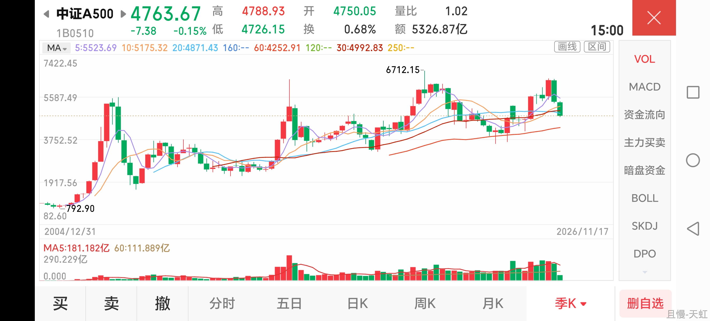
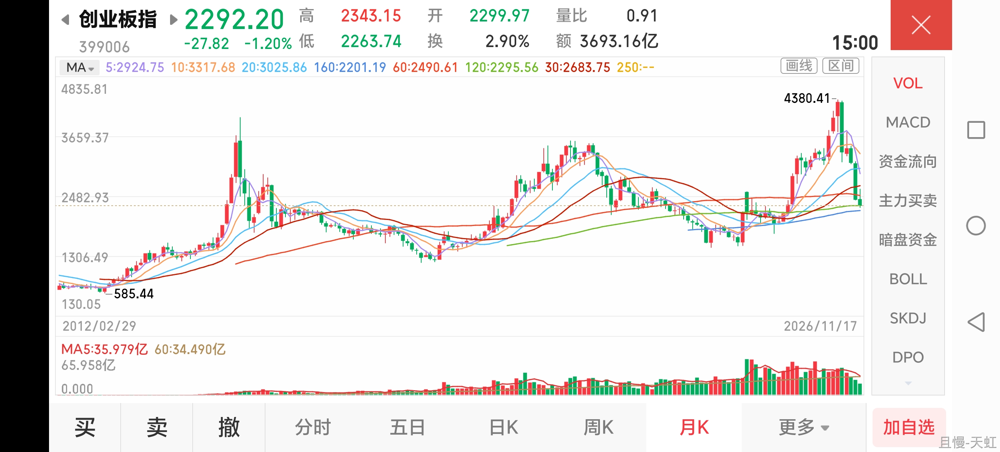
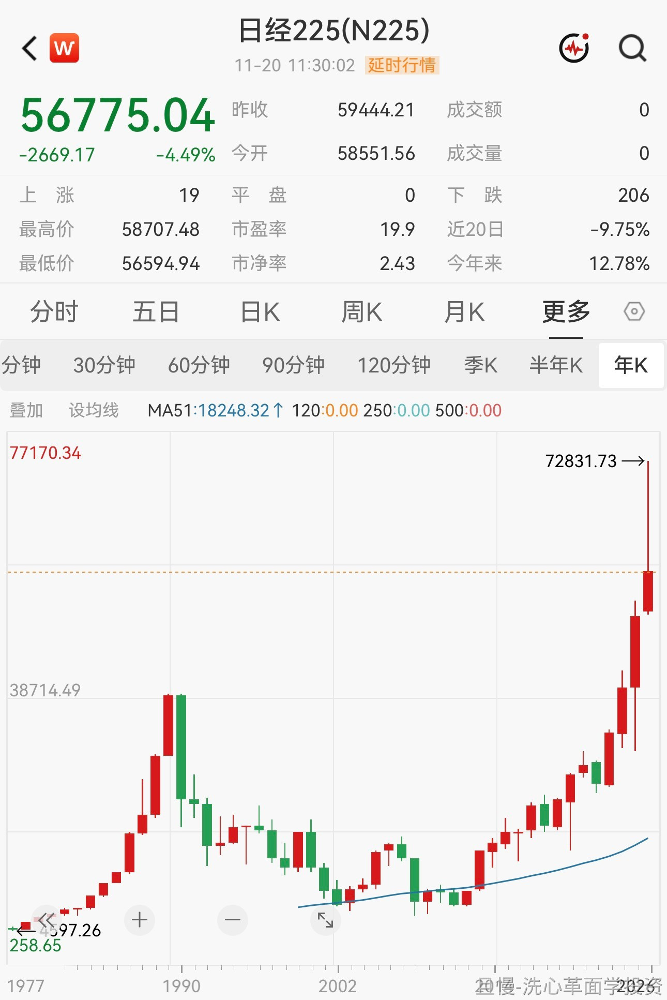
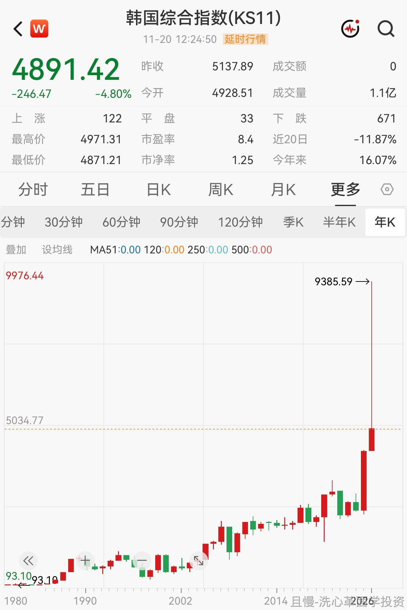
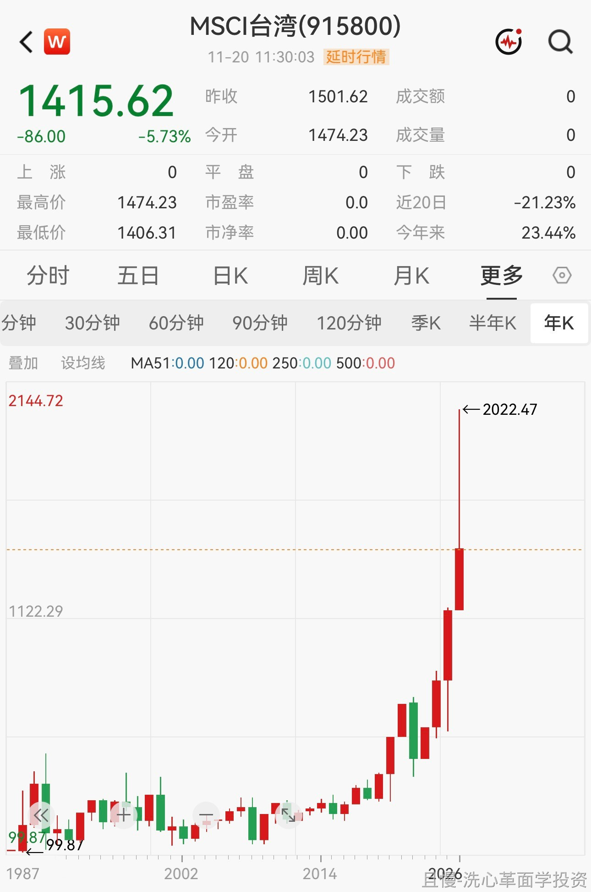
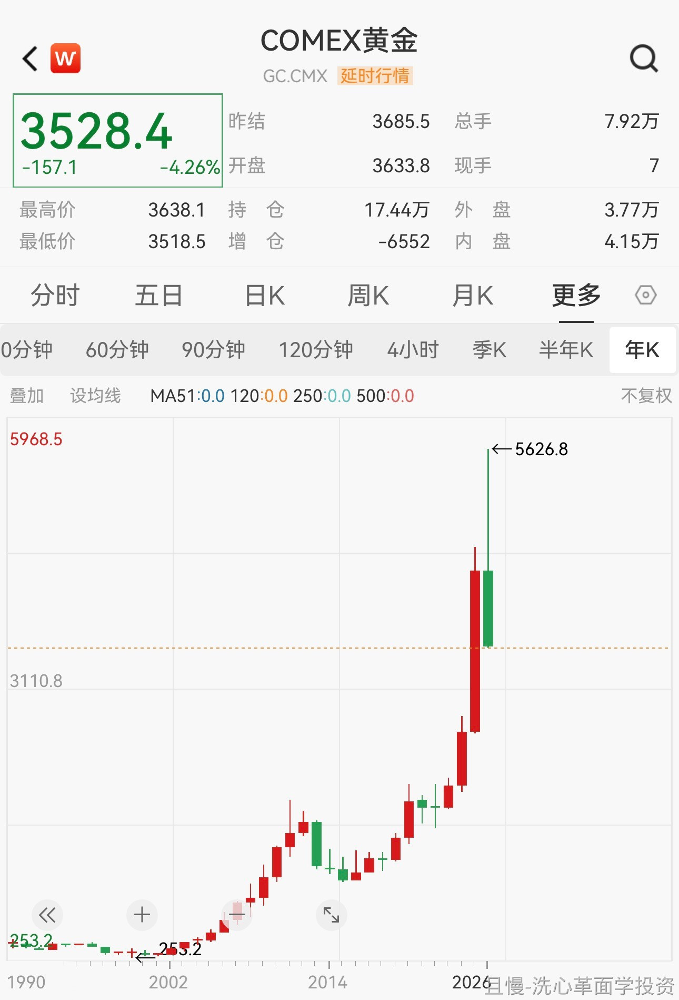
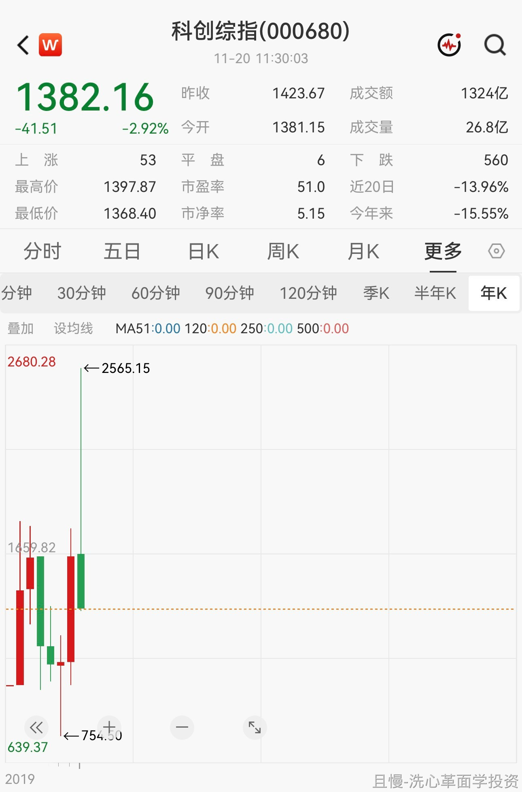
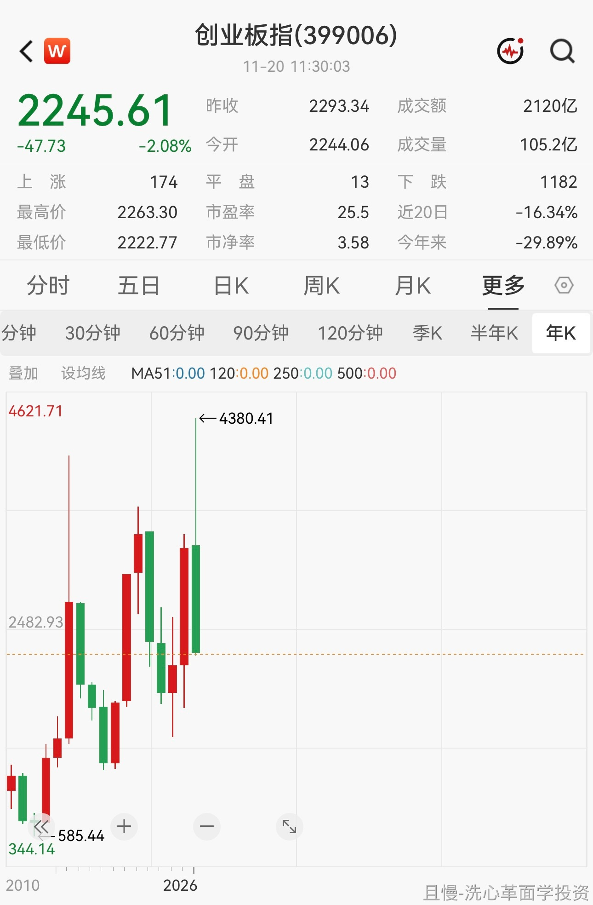
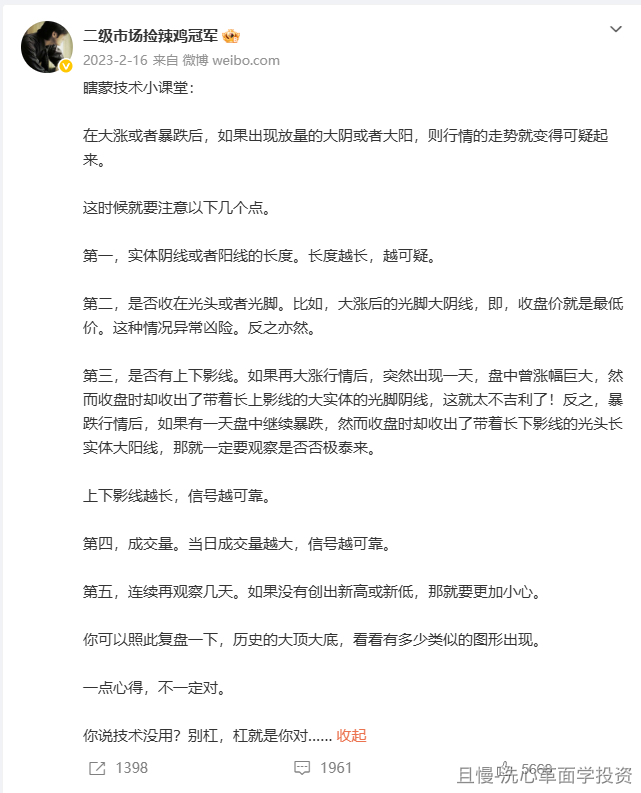

不过在这里，我想请非常乐观的朋友，一起看看技术图形。

把看盘软件调成年线，看一下热门品种的形态。

包括不限于，黄金、韩国、日本、中国台湾、科创、创业以及A股各指数。未来也可能包括美股各指数。

你会看到一根根巨长无比的上影线。叠加小实体阳线，甚至像科创创业这样的大实体阴线。

这种形态，并不吉利。

有人给这种形态起了一个名字，叫做，墓碑。

理性交易，不要过于悲观，也不要过于乐观。按照既定策略交易。

<!-- qieman-comments:start -->

---

# 不过在这里，我想请非常乐观的朋友，一起看看技术图形 · 评论区（2026-11-20）

> 评论区归档：2026-11-26 抓取于且慢社区，原帖共 419 条互动，精选 70 条（作者发言、作者回复及其他投资相关评论）。

## 长赢E家人（辽宁省） · 1 赞

且慢长赢账户还好😘😘😘😘

## danyi（广东省） · 0 赞

请教E大，之前仓位低的，建议加仓吗

> **静行致远（湖南省）** · 6 赞：有做压力测试么，对后续下跌多少百分比有准备么，对仓位管理有想法了么。如果有，那你也不会问这个问题。如果没有，那就闭着眼睛跟E大车

## 皮卡行慢半拍（上海市） · 0 赞

收到收到，握紧我的小钱包，按捺住抄底的心🤣

## 众所周知zh（广东省） · 11 赞

看看中概互联，我感觉就是沉入海底两万里

## 永思（重庆市） · 0 赞

该来的注定要来，只要筹码价格低并用闲钱在理财，下跌就是机会。🙂

## 捡垃圾的跟班（陕西省） · 0 赞

月定投加跌幅设定的策略，时间给了24-36个月是从现在开始，因为完全不同于我A，真的如履薄冰的建仓。谢谢益达🥰

## matt_xue（广东省） · 0 赞

我自己操作的账户，挺到本周，今年终于开始亏钱了，还有加速的趋势。。。

## 老何（广东省） · 0 赞

好的，就等老大的号令，现在不盲目加仓了。

## 团团圆圆福气多多（山东省） · 0 赞

我很乐观，终于可以买回创业板了😍😍😍

## 等米米自己长大（广东省） · 0 赞

可是我觉得有个反弹，下周看看

## ETF用户（天津市） · 0 赞

医疗E指数在2021年这个形态，跌了四五年，做好四五年跌幅准备了

## 菜头田（浙江省） · 0 赞

昨天买了中概做网格，不知会不会跌破0.8

## 天虹（江苏省） · 1 赞

创业板和A500的月线（季线）已进入下跌趋势，（按照之前两轮走势）两年多以后才能见底。

## 春眠不觉晓（中国） · 2 赞

我不是乐观的人，现实生活中还有点悲观主义
我经历过几个完整牛熊周期，
我有个特质就是：死猪不怕开水烫，
赔的多了，每个月定投，降成本，慢慢等，总会挣到钱😃😃

## 长盈久安_YYY（上海市） · 0 赞

遵守纪律，绝不黑车！另外，老大的网格信息现在只有看华宝的了么？华宝网格是不是跟老大的一致的？

## 悠悠淘金者6182（四川省） · 0 赞

是呀，看长周期K线，“抄底”的冲动瞬间得到抑制😝

## czq（湖南省） · 1 赞

这个阶段才开始做的医疗网格，但是还是控制了投入金额，主要资金还是跟着E大的计划进行买入。E大这条说不要太乐观，但是觉得继续下跌也并不是很可怕，毕竟是从18年经历过来的。

## Leonhardt（北京市） · 0 赞

还有点利润垫，是不是要跌完了才算🙃

## 同路人_ChbOhW（浙江省） · 0 赞

我猜要逐步卖出海外持仓了

## 长盈久安_YYY（上海市） · 0 赞

有没有一种可能，当美股出现长长上影线的时候，对我A是利好，因为或许有钱流进来了（梦里啥都有）

## 云凡（北京市） · 0 赞

会不会是创业板哈哈哈哈哈

## scillayi（广西壮族自治区） · 0 赞

上面的回复不了。盲猜一个出乎意外的买黄金？本来想猜纳指，不过考虑到qdii限量，几乎没法买。

## 追梦少女小鲤（湖北省） · 1 赞

🙉让豆包跟我分析了一下历史过往：
1. **纳指 2000 年（科网泡沫高点年 K）**
年内冲高，年终大幅回落，长上影年 K，属于经典年级别衰竭墓碑；随后 2000–2002 科网泡沫破裂，纳指最大跌幅 78%。

👀前置：互联网题材疯狂、VC 疯狂投、估值极端泡沫；后置：美联储加息、盈利证伪。

2. **道琼斯 1929 年**
年内创出历史高点，年末回落，长上影年 K；随后大萧条，持续多年下跌。

## 同路人_Jane（浙江省） · 1 赞

看了500，黄金，科创，创业板都是这种墓碑形态。不过医药，消费，中概，恒生倒不是哦。是不是又莫名乐观了😃

## 平安顺遂（河南省） · 3 赞

老大  忍不住问问，纳斯达克100ETF是否该出

## 陈与义（福建省） · 1 赞

请教一下e大，最近需要买点黄金结婚，大概什么位置可以多入手一点呢😊

## 且慢同路人9527（天津市） · 2 赞

我想知道，让人想不到的操作是买还是卖？如果是买，我估计我得筹点钱。
但我估计很可能是卖，是不是要卖海外的那个医药啊？

> **白桦林（江苏省）** · 1 赞：这个非常有可能，广发的标普医疗

## 洗心革面学投资（河南省） · 80 赞

【笔记】技术形态：墓碑线
墓碑线，又称石塔线。
形似竖立的墓碑，是股票等交易品种里典型的反转类K线形态，常被视为行情由涨转跌的预警信号。
核心的形态特征：
1、有极长的上影线，长度通常是实体的3倍以上；
2、实体极小，开盘价、收盘价和最低价几乎处于同一水平；
3、几乎没有下影线，收盘价与最低价接近；
4、常常伴随明显放大的成交量，市场分歧剧烈。
如果出现在高位上涨末期：
代表多方冲高后遭遇空方强力抛压，多方力量彻底衰竭，是强烈的见顶逃顶信号，暗示大量资金在高位出货。

> **洗心革面学投资（河南省）** · 43 赞：【复习】E大瞎蒙技术小课堂：
1、光头好，上影坏（K线，非发型）。
2、凶险组合：光脚大阴线。
3、在股票的技术形态中，底部（跌了很久，尤其是跌幅很大的横盘后）的放量大阳线，通常来说，与顶部（形态与底部相反）的放量大阴线一样，值得注意。其背后的内在逻辑，是市场多空双方博弈的展现，长度越长，越可疑。
4、技术方面讲，如果跌了很久，情绪很差的时候，出现一根：光头、放大量的长阳（至少包三阴），就是非常好的形态。
5、一个品种连续上涨后……如果高位出现放量的长阴，这时候真的要注意。但是，第一根放量长阴出现后不必太害怕……通常情况，是先来一根长阴，然后没事没事，大家不要跑，继续涨。然后是一个M形状的头部形态。再来一根长阴，然后慢慢修复回到高位，然后开始跌，跌破M的第一个下跌的低点，这时候你就真的要注意了。
6、月线大阴线是熊市见底的信号，如果能出现，三个月内90%概率见大底。
补充：
看k线一定要选前复权；
靠K线炒股，恐怕是高难度动作，浪费太多时间没有什么意义。

## SHOWZHOU（四川省） · 0 赞

这是不是说明这一波全球科技行情透支了太多，在落地并不明确的情况下，新的故事未出来前很难再持续，所以上涨小于震荡小于下跌？

## Huat（新加坡） · 0 赞

能不能让且慢的资产合并功能支持长赢计划呢？

## 子晏（上海市） · 0 赞

我确实太乐观了点，这两个月巨幅回撤。
归根结底，还是贪婪在作怪

## 半岛居士（江苏省） · 1 赞

很想问一下传媒，之前说不再买入，现在网格也停了，是不是传媒网格不能做了

## 兔rabbit（山西省） · 0 赞

医药医疗养老估计不在老大的考虑范围内，不过我想买一丢丢🙃

## holykun（北京市） · 1 赞

可转债基金开始止跌反弹了，后续有望带动股市企稳

## Sura（湖南省） · 6 赞

E大太难了。看大家慌了，说不要太慌谨慎卖出但还不是求你别卖。看大家兴奋，又拿出年线墓碑线说话敲打，谨慎乐观。

## 不怕熊的winnie（上海市） · 0 赞

！！！美国台湾韩国日本也是涨了好多了！哦，好吧，其实如果不看港股，今年A也算涨了。。。的。。。吧。。。可怜的港股哦。。。。

## 树择（山西省） · 1 赞

E大，恒生科技还能买吗？

## 迅雷不及那个掩耳（英国） · 0 赞

创业、黄金、美医 三选一🧐

## Luckygirl88（云南省） · 0 赞

吓到我了，还以为出啥大事了，早上看了就是今天又跌了，不过支付宝买的累计收益是正的，长赢这儿是负的，不怕E大顶着

## ken哥（广东省） · 0 赞

今天难道是要卖出美利坚？

## 同路人_kXAUtD（河北省） · 0 赞

网格昨天已进。今天很安静😑

## 同路人Mjj发财（河南省） · 5 赞

今天是不是要卖红利低波南方？😃

## 嗖嗖漫步（福建省） · 11 赞

卖了红利，几个月大概17%

> **ETF拯救世界（作者）** · 47 赞：是接近19%。

## 玲宝（广西壮族自治区） · 0 赞

E大，我看到您的操作了，太开心了，只是为什么这份卖掉就没有了，不是很明白，这支本来就是用来做波段的吗？为什么波段要单独做不能和长期的同一支呢🤔

## 以人为镜_可以知得失（广东省） · 0 赞

E大卖出的品种确实意想不到，不过，跟着走就没错了

## 同路人_U65LWO（广东省） · 0 赞

今天刚操作卖出纳指100，就看到E大卖出标普红利低波😳 我是不是应该步子迈得更大一些

> **陶陶哦（广东省）** · 1 赞：这两持仓完全不一样吧

> **同路人_U65LWO（广东省）**（回复 陶陶哦） · 0 赞：是 是完全不一样的东西，不过看到E大这篇评论，就在想E大是不是觉得后面各指数都不应该太乐观哈哈 E大组合里面还有一份纳指100呢 我其实也就是牵强附会

> **同路人_U65LWO（广东省）**（回复 等待等等等） · 0 赞：E大组合里面还有一份纳指100呢 我其实也只是牵强附会~就是看到E大的文章，我自己是不太乐观哈哈

## 同路人_j8YITV（山东省） · 1 赞

补11点33的评论，昨天卖出了三分之一仓位的红利低波，为啥说这是意想不到的操作，我看已经好多帖子说红利到高估了

## 金鹅管理员（内蒙古自治区） · 1 赞

我竟然学会抢答了e大，上午提交的卖出申请哈哈

## 同路人_YNXFw1（广东省） · 1 赞

还以为今天是要买入，调动资金到卡里。谁想是卖出，有钱钱入袋😃天凉了，周末涮火锅去

## E路有你（北京市） · 1 赞

今天卖出的红利是红利最低那天买入的，收益接近20%。我留了一点利润

## 陶陶哦（广东省） · 0 赞

啊？我不懂，为什么卖出红利呢？买入的成本并不高呀

## ZQqqqq（上海市） · 5 赞

通达信上可以看到s/150计划持仓呢

> **ETF拯救世界（作者）** · 10 赞：？？？？？

> **ZQqqqq（上海市）**（回复 ETF拯救世界） · 0 赞：通达信 搜索 020602 下方关联品种右侧 有S计划/150计划，点开可以看到具体的持仓汇总，但没有比例。
图片传不上，得您自己确认了哈

> **ZQqqqq（上海市）**（回复 ETF拯救世界） · 0 赞：只要是搜索持仓的基金 ，都可以看到

## 亿贯（北京市） · 1 赞

月底e大能再发下估值数据表吗😃

## 长庚（湖南省） · 0 赞

的确没想到是卖出，不过坚决跟车

## 风来（上海市） · 4 赞

在这边插个眼，一个很有意思的现象就是今年上半年，我在xhs上就会刷到很多人吐槽长赢计划多年年化收益不高，有说耽误挣钱的，有说付了投顾费不划算的。六个月的确很难熬，持仓不涨，看着别人拼命涨。到现在这阶段，突然没人说了，计划今年亏4%反而变成了一个非常亮眼的成绩了。当时6月份开始抛中证500，xhs觉得这个阶段后续中证500还能涨200%，我长期观察，一个指数，从底部到最高点，一般涨幅也就70-100%，所以那个时候我觉得坚持自己的持仓没什么问题，只是需要耐心。
今年虽然还是亏损，但作为旁观这次科技股股灾的股民，我仍然心有余悸，应了那句话:你根本不知道你面对的是什么市场。

## 小蜘蛛（福建省） · 0 赞

时隔一年多，今天入了恒生的网格，期待

## 浅若清风（宁夏回族自治区） · 3 赞

今天老大的操作真的没有想到，只想着买黄金，创业，恒科戓医疗了，根本就没想到老大的卖出操作

## 浅若清风（宁夏回族自治区） · 1 赞

看起来未来各指数的走势都很不乐观，现在首要的任务是增加冗余，慢慢买入，而不是一看大跌就激动的打子弹，毕竟关键时刻，手上的子弹相当于是氧气

## 林夜（中国） · 1 赞

即使不太懂技术指标的我，也知道千言万语一句话，如今黄金、各大市场以及 A 股各指数的技术形态很差。
那么其一。
黄金和股票在特定时期，是可能一起拉跨的。
也就是，任何分散都有失效期。
因此，自己在做压力测试的时候一定要考虑这种情况。
最差情况应该是品种表现差还失去了分散能力。
同时也启示现金的重要性。
真的是空气！
那么其二。
从技术角度上看，似乎不应该投资。
但是技术指标也只是参考指标的一种，E 大体系应该更在乎价值。
更在乎策略的坚定执行。
技术差了，价值倒有了。
一正一负，不悲不喜。
学会在困难期安慰自己。

## 一人之力干翻美股（河南省） · 2 赞

你别说，这么看沪深300还可以哈

<!-- qieman-comments:end -->
