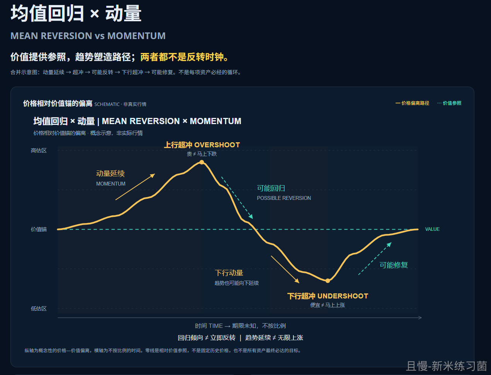
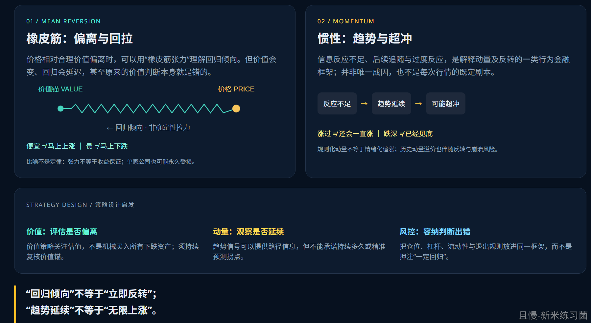

我来跟各位沟通两个你在网上经常看到的，关于投资的谬误。当有人说出这样的话，你就应该知道他在投资方面远未够班。

第一，**品种过去半年、一年、三年、五年、十年涨幅多少多少，所以要满仓持有。未来一定收益很高。同理，过去**年收益率很低，所以该品种是辣鸡，不要买。

正常情况下，我说的是正常情况。投资品种一般都会发生均值回归。不可能有任何一个正常的品种，超长期一直表现很好，几乎不可能出现某个品种超长期每年收益率在15%甚至10%以上。

不要被过去，尤其是最近发生的事情蒙蔽双眼。

第二，某个品种涨幅太大了，太贵了，马上就要暴跌，清仓或做空！某个品种短期跌幅太大了，太便宜了，满仓满融抄底！人生改变就看这一把！

如果说第一个问题是非常低级的投资谬误，那么这个问题就是更高一个层次的。很多有经验的投资者会倒在这个问题上。

长期甚至超长期来看，贵的东西或者便宜的东西，几乎一定是会均值回归。但这里说的是长期超长期。

贵的东西可能贵很久。便宜的东西也如此。这个“很久”，可能远超你的想象。虽然最终极大概率会回归，但中间的过程可能你不想经历。

除了价值，投资的世界还有动量。也就是一个上涨的品种，或者下跌的，它自带的动量会带着它冲破极端，冲到外太空或地狱，然后还继续加速冲。

这两个问题，各位是否能理解。

我的意思是，首先我们要知道，投资的世界有均值回归。太好的太差的，最后都会变成平均的。

但是，均值回归的时间，我们不可能知道。太好的可能中短期更好，太差的也许中短期更差。

明白了这两件事，那么各位设计交易策略，设计资产配置方案的时候，就应该更加游刃有余。

不相信均值回归的人，会死在不断追高。

不相信动量无法预测期限的人，会死在不断不控制仓位的抄底和做空。

明白了这两件事的人，在投资上小有成就的概率就大很多了。

<!-- qieman-comments:start -->

---

# 我来跟各位沟通两个你在网上经常看到的，关于投资的谬误。当有人说出这样的话，你就应该知道他在投资方面远未够班 · 评论区（2026-11-22）

> 评论区归档：2026-11-26 抓取于且慢社区，原帖共 361 条互动，精选 105 条（作者发言、作者回复及其他投资相关评论）。

## 草原狼汛（广东省） · 12 赞

美股会不会这一波均值回归到正常，就是我们的机会

> **亿贯（北京市）** · 0 赞：美股看qqq，spy贵吗？如果美股继续跌，A港会怎么样？

> **向天一笑（河南省）**（回复 草原狼汛） · 0 赞：港股通只能买港股吧，买不了美帝吧

> **草原狼汛（广东省）**（回复 向天一笑） · 0 赞：可以买标普，纳斯达克等ETF

> **向天一笑（河南省）**（回复 草原狼汛） · 0 赞：港股通买，没有溢价吗？

## 山今（浙江省） · 0 赞

第一个品种说的是纳指吗？我看到很多人说现在纳指估值偏低，所以是真的吗？

## forever靖（湖北省） · 1 赞

按照已经制定的资产配置计划执行，不断进行再平衡和分段投资，永远对最坏和最好就有一部分预期，通过策略来执行这些事。然后留有资金好好生活，是这样么，E大😊

## 世界和平（浙江省） · 0 赞

第二个的确左侧时候仓位没控制好，太痛了😵

## 笨鸟慢慢飞（陕西省） · 1 赞

这就是为什么要进行资产配置的原因？

## 浮生若梦zzz（上海市） · 0 赞

周期，短周期、中周期和长周期

## 向天一笑（河南省） · 8 赞

get！在价值区间，以空间和时间为原则，做好仓位控制，保持战略定力和历史耐心！

## 孤独的风（河南省） · 4 赞

😂确实，也不知道恒科 医药 医疗什么时候能均值回归

## 风吹雾起人萧萧（福建省） · 0 赞

动能，这个因素在下跌时太重要了

## 菜青虫2017（广东省） · 0 赞

医药消费在动量上都有经曲呈现。

## 宽容的红豆沙（重庆市） · 1 赞

买得便宜是王道，但是呢，也要把时间和空间拉开，一把梭哈是要不得滴。便宜的位置多做做网格吧，尽量降低长期仓位的成本，等待均值回归。还有一点啦，一定要用闲钱来买，才能等得起。

## 余良---南京律师（江苏省） · 0 赞

我就属于第2种情况，当时觉得中概互联跌下来很多价格比较便宜，就是不断地去加仓，结果就亏得更多。同时，持仓的比例也不断地增加。

## 柱子（上海市） · 0 赞

1.不用后视镜看未来。
2.仓位控制不走极端。

## 桔阳子（辽宁省） · 0 赞

我自己买的基金浮亏是18%，我看网上抽样调查，正收益是很少，10%亏损很少，大部分都是20%亏损以上的，还有不少人35%以上。

## 路在脚下666（河南省） · 1 赞

新手死在追高，老手死在抄底，高手死在杠杆。总有一款适合你😂

## 多大点儿事（河北省） · 0 赞

不懂就问，可是巴菲特说过15年以上时间的标普500会战胜基金经理的主动基金，这个跟咱们第一点矛盾吗？巴菲特的意思可以理解为标普500指数基金在15 年以上的周期中是上涨的吗？

## 无为而治（北京市） · 0 赞

便宜的一定是有原因的，贵的一直不下跌也是有道理的。

## 巨大的芒果（江苏省） · 0 赞

确实中概恒科上能看得出来😅

## 同路人_PezRCd（北京市） · 0 赞

周末美股半导体大跌，周一大A如果大跌，买啥？

## 哈哈呢（北京市） · 1 赞

眼下，不要着急抄纳指的底

## 风起时时刻刻（湖南省） · 10 赞

消费，医药，恒科，五年多了还没有均值回归，如果等10年才均值回归，那么也索然无味啊

> **zhouhaha（浙江省）** · 0 赞：还是要算年化收益率，现金是有成本的

## 雨天的感觉（江苏省） · 1 赞

主要是没法预测这个动量啥时候衰竭，右侧也不好判断是反抽还是趋势逆转，需要足够经验。所以还是跟车稳妥

## 长宁1999（上海市） · 1 赞

抄底太深刻了，会均值回归但这个时间是多久没人知道，中间的感受只能自己体会

## 捡辣鸡二十三名（陕西省） · 6 赞

估值、趋势、动量、情绪都是影响因素，不能只看单一的涨幅就推断。
在趋势中时，上涨就是上涨的理由，同理下跌就是下跌的理由，要根据趋势结合动量来判断，否则会把一个几年后正确的结论用到现在，过程和结果会很差。
低买高卖，顺势而为，好好跟车，生活长赢。

## 平常心L（广西壮族自治区） · 1 赞

还是那句话，新手死于追高，老手死于抄底，高手死于杠杆

## 莫天天（上海市） · 0 赞

问题是a股的回归周期也太长了，且，不理性地冲破外太空&地狱的幅度也太大了。在这里做投资真的很难很难。

## 文猛先生（河北省） · 0 赞

不要上杠杆，不要上杠杆，不要上杠杆！

## 小雏菊修补匠（浙江省） · 0 赞

不极端，不重仓，配置，追求平均收益，等待，虽然我的铝朋友最近很受伤，还好仓位也没到20%，还有丐丐，医疗医药，还有消费，😽

## 见习魔法师（浙江省） · 1 赞

红利低波这种这几年热度好高，有没有毁灭级的风险😳

## 魔力末（北京市） · 0 赞

能理解，动量周期太不确定了。

## 无人知晓小酒馆（湖北省） · 0 赞

网格还要搞啊，我也要跟车

## sunny888（安徽省） · 0 赞

这就是说万物皆周期 只是这个周期有长短

## 同路人_S843Tl（天津市） · 9 赞

70.80，控制仓位，单一品种不超过20%，宽基指数为主，这就是和益达学的最好的。还有吗？谁来说说。

> **投资不能投机（江苏省）** · 0 赞：时间、空间
新低不买，新高不卖
横有多长，竖有多高
救生艇来了一定要及时上去
不要妄想买在最低，卖在最高，吃宴席的时候慢慢往门口挪 不要成为买单的人

......

## 大浪淘沙206（广东省） · 0 赞

调整心态，拉长投资周期时间，持续不断做到高卖低买，熬过去

## 胖菜（广东省） · 5 赞

E大好，
经过这几年跟车，第一点应该不会再犯了。绝对不会追高接盘，机会错过就错过，宁愿拿着现金等其它机会。不可能错过春花就把夏苗拔了去补种。同样的，是不是辣鸡，要不要买，是买之前的问题，不会买了再去听别人说，更不会听别人说了几句就割。一定要赚钱才卖。
第二点，现在心里还是没什么底，看到大涨的确还是想卖，看到大跌也忍不住想再补。但是想归想，纪律是有的，跟车的部分，一分钱都不会乱动，只在小黑车上去试。这几年，很多看不懂的，自己悄悄在小黑车上跌过几个跟头，渐渐也有点明白了。时间、空间、仓位。
能有多少成就不敢说，但肯定不会死。

## Moorr（辽宁省） · 0 赞

结合"仓位"思考中，"压力测试"🤔

## 叶叶生哥（新加坡） · 0 赞

相信均值回归，只是不知道啥时候回归，回归深度如何，已经如何控制仓位，E 大可以详细说说吗？

## Amelon（福建省） · 5 赞

体会太深刻了，持有一只主动基从21年高点暴跌，最高跌幅至-30%多，熬了五年到今年乘着ai风口回本且赚了6%，太相信叙事，太贪心，只赎回了1/4仓位，没想到不到三个月时间从高点又跌回-25%。想起e大说的上帝派来的救生艇，没赶上，不知道是否又要熬下一个五年。 和人性的贪婪对抗真的很难，第一次长评论，也借此立flag，严格执行纪律性，下一次救生艇不知道什么时候来，但是一定不再错过逃生机会。

> **上帝的直升机（福建省）** · 0 赞：我觉得你当时卖出四分之一是没错的。因为你持有5年，才赚6%。这个收益还不如银行定期，但是你又觉得整体偏贵了，所以减仓了。现在回头看当然知道全仓卖出是最好的。但是在当时的环境，你适当减仓，让剩余的仓位继续奔跑的操作是对的。

## 退休后学投资（浙江省） · 0 赞

相信均值回归，但再便宜的品种也不能押注所有，因为你不知道多久能回归，所以不管什么情况控制仓位很重要，手里始终要有足够的现金，老老实实跟老大的车，不折腾！保平安！

## 飞洪Simon（云南省） · 1 赞

一，不要追高，不要割肉。二，顶部区域分批卖出，底部区域分批买入。（模糊的正确）。

## Licht（北京市） · 0 赞

相信动量无法预测，所以那怎么搞？比如医疗可能要十年才回到前高，那还买吗？a股要破上个顶峰可能不止十年？

> **Benadal（北京市）** · 1 赞：通过低估值买入+网格交易，可能不到前高就已经盈利了。

## 同路人_Jane（浙江省） · 0 赞

1.所有品种一定会价值回归，不要被最近事情蒙蔽，不追高！
2.价值回归需要长期甚至超长期。太好的可能中短期更好，太差的也许中短期更差。控制仓位的抄底和做空！
道理懂了，还是做不好。中间最重要的就是等待。等待时间，持有耐心，保持心态，还有看盘时不要胡乱操作。更体会到E大时间空间一定要拉开的重要。

## 薛定谔De猫（海南省） · 1 赞

恒科的网格，以及之前的传媒网格，改为买多少数量卖多少数量了，请问大家怎么理解？

> **来去匆匆（上海市）** · 0 赞：网格是饭后甜点，计划才是正餐。我的网格总资金不超过计划的十分之一

## 新小白（天津市） · 3 赞

赞同。能感觉的但总结不够，看完e大说的，有共鸣！且深有体会。不论是第一条还是第二条，我想补充下（也谈不上补充，就是我自己的感悟）一定不要以为“我以为”就是对的，也不要以为“别人说以为”就是对的。比如说“跌这么久要涨了”“价值已经回归了”“涨这么久要跌了”等等，要有自己的认知，没有就去学，学不会看不懂，就别动。可以错过但不能做错（但也不是“不做就是对的”）长空永远是对的，隔岸观火谁不会，既然要做投资，要炒股，要玩这个，就要明白规则。门槛最低但也最硬，1自负盈亏2跟涨不跟跌3等确定性4仓位管理。这几项不分前后，是并存的。要反思自己的操作，不要怪别人。“我对了是别人对的我跟对了”“我错了是我自己错了别人不一定错了”“别人错了我怪自己跟错不是别人的错，要共情”，愿各位财运亨通～ e大依旧伟大，由心佩服！

## swety（河南省） · 0 赞

第一个问题肯定有周期要回归，第二个问要具体看，因为很多东西在变，如果从根上出问题，风险是存在的

## 林夜（浙江省） · 0 赞

正常情况下，正常的投资品种会发生均值回归，但回归所需的时间，可能超乎我们想象的长。
其实不需要绝对意义上的长，只需要相对我们在资金或心理上的承受能力而言，足够长就够了。
资金上的，比如时间过长，导致生活中遇到了一个黑天鹅意外，钱的属性从长期被迫转为急用。
又比如 E 大说的满融或做空，加了杠杆，结果短期内的一个意外波动（比如动量的作用），直接穿仓，一切化为乌有。
心理上的，比如 E 大说的满仓（不带杠杆），结果一个小波动（还是 E 大说的动量）带来绝对金额的大量缩水。
即使绝对跌幅没有击穿心理承受底线，亏损额度也击穿了心理底线。
然后割肉，倒下了。
总得来说，均值回归、动量、仓位以及节奏等等关键词，我觉得都是 E 大说的“概率”。
均值回归、动量算规律，但即使规律，也没有 100% 的概率。
时刻想着“没有 100% 的概率”，不说完善体系，至少能避免许多冲动。
E 大最
后一句，“
明白了这两件事的人，在投资上小有成就的概率就大很多了
”，也没有说 100%，很严谨，很理性。

## 新米练习菌（上海市） · 281 赞

E大周末好，
谢谢分享，就回归一下下，上线学习一会儿。尝试给文字配个示意图
① 均值回归：长期存在向价值中枢回归的倾向，但不是万物必然回归，中枢本身也会变化。
② 动量延续：短中期趋势可能继续，高估 / 低估的持续时间可能远超想象。
只看动量、不看估值，容易追高；
只看估值、不管趋势与仓位，容易抄底过早或做空过早。
价值提供参照，动量影响路径，仓位管理决定能否承受过程。

## sharc（辽宁省） · 0 赞

一定要控制仓位，一定要止盈止损。

## 凌风飞扬_爱投资（江苏省） · 2 赞

相对来说，体量越大需要的动量也越大，所以一个体量足够大的宽基指数大概率会是第一种情况居多，而一个体量较小的行业指数如果踩在风口上就有很大可能走出第二种情况来。

## Agatha（四川省） · 0 赞

时间、空间、仓位
设计、执行、完善策略

## 忒修斯鱼子酱（广东省） · 1 赞

老大。虽然组合买不了美股 但是可以说吗，我们有途径的可以买

## zhoujie（浙江省） · 1 赞

第二条，不断抄底的仓位过重的我🤔🤔🤔

## 爱妮（新疆维吾尔自治区） · 0 赞

孙哥对中概和恒科的言论对不对啊🤣

## 知己知彼（甘肃省） · 1 赞

如果中长期在大A只挑两只，宽基我选沪深300，行业我选消费！我认为现在是建仓消费的最好时机！

> **zyy（江苏省）** · 0 赞：消费都降级了，利润也透明化了，人口也下降了~人口老龄化还是看好医疗医药和科技

> **知己知彼（甘肃省）**（回复 zyy） · 0 赞：有的人爱吃辣椒是因为它辣，有的人不吃辣椒也是因为它辣！所以正因为消费降级了我才看好消费！

> **百花争艳（北京市）** · 1 赞：老大说的A500和红利更好

## 不怕熊的winnie（上海市） · 0 赞

现在的我，依然在还曾经的我“不断不控制仓位的抄底”的债。好在现在的我跟着老大学会了控制仓位和耐心等待。

> **不怕熊的winnie（上海市）** · 1 赞：说起来，更早时候的我是绝不会想到自己有天会进行金融投资的，家里灌输的观念是“一心读好圣贤书，做好自己的事”。是当了妈妈、遭遇到一系列糟心事后才意识到必须拥有被动收入。从2020年开始进入股市到现在快7年了。一开始就经历了3月份暴跌，仓位很轻并不怕，虽然买入也紧张，但很快就收获丰厚。然后就飘了，2021年后半年就“不控制仓位的抄底”，到2022-2024真正大底部的时候虽然也大笔买入了，但假如前面没买那些都不敢想象我后面能赚多少。这绝对是我必须永远永远记住的教训！还有一个教训是2020年底嫌弃红利涨太慢卖掉了！昨天，居然又测出了2条线，和第一次一样也是没有准备过的事情。第一次的过程并不美好，我其实不想重复了。但anyway，预约了明天去检查，希望不要有坏事情发生吧。也希望后面的投资路我能越走越顺。

## DemonsL4（四川省） · 0 赞

这里面比较重要的是品种的周期如何把控、历史数据只能做参考，看不到太远的未来啊😂

## 我要多赚钱（河南省） · 81 赞

1、消费，医药，恒科不可能一直跌，总会有均值回归的时候。
2、当然不意味着他们接下来就会上涨，有可能还会再跌，啥时候均值回归，没法预测。
3、要控制仓位，单一品种不超过20%。
4、要控制加仓的节奏，下跌过程中不能一直买买买，时间和空间要拉开，当然这是在控制仓位的前提下。

## 投资不能投机（江苏省） · 38 赞

21年医疗消费新能源，我就不知道均值回归，结果交了学费，学到了教训
2025年是医疗消费加中概，我不知道动量无法预测期限，太急了，又交了学费学到了经验

下一轮我知道了，我会做的更好

> **投资不能投机（江苏省）** · 2 赞：这一波自己黑车买入，时间和空间遵守了，但是没有遵守“新底不买”😔😔😔

> **浮生若梦495（浙江省）**（回复 投资不能投机） · 4 赞：我也把中概补仓补满了，结果一路下跌到现在中间还做了一波t反弹10%都卖出了一个，成本做低了一点

## 我要多赚钱（河南省） · 4 赞

新低不买，新高不卖，是不是就是考虑了动量因素？

## 脾气时好时坏素质忽高忽低（上海市） · 0 赞

你以为是抄底，有可能是抄底也有可能是去填坑了；你害怕追高，有可能避免了追高也有可能错过了更高。前者可以做压力测试，后者该如何应对呢？

## 退休捡垃圾（山西省） · 0 赞

这几年唯一进步的就是:1下跌管住手不乱抄底了2涨跌心态放平了，做做波段。这轮有个做的不好的地方就是自己操作有点贪，浮盈60%都卖出不多，结果原款跌回来，把握不准涨多少又卖出多少迷惑啊

## Luckygirl88（云南省） · 1 赞

正好周末用均线和dS一起研究了，上证指数，中证500，沪深300……收益还挺多。之前e大介绍过过均线，说51日均线代表什么意思以后再说，我算是明白了，51日均线就是季度线。以后再多多学习交流，相信自己做任何决策都会越来越有底气

> **同路人_Sally（北京市）** · 0 赞：粗略按每周 5 个交易日算：
一个季度大约 10 周，5 × 10 ＝ 50，所以取 51 日线，是偏短一点的季度周期，属于民间自定义均线，不是交易所官方标准。

## ETF照亮了来福（江苏省） · 0 赞

今年年初账户整体市值新高，原因是年初恒科，中概跟着港股涨了一波，但由于期待过高，中概少量减仓，甚至还加了一些网格，导致坐了过山车。而恒科在自己意识到做了错误的动作后(高位网格)，居然没有及时改正，心存侥幸导致浮亏很大。医药医疗类也是由于前期仓位低，导致网格密集，又没有多少T的空间，所以仓位比较重。但是，即使现在这种情况，依然并不感到害怕，因为仓位够分散，我坚信只输时间不输钱💰。今年恒医创业化工等做得较好，边涨边卖后，下跌途中没有着急着开网格，守住了利润。经历了这一轮牛熊，在E大的指引下我觉得下次网格会做得更好，某些错误不会再犯了。

> **E路同行到地老天荒（江苏省）** · 0 赞：我恒科从正30到负的30%

## 青青125（印度尼西亚） · 0 赞

盼着你讲一下卖出红利50和当前估值情况，谢谢

## 莫一兮（江苏省） · 3 赞

恒科中概即便跌的稀巴烂了。但是你只要给他设置单只品种不超自己10%的仓位，那就也还好

## 知一行（上海市） · 0 赞

做好压力测试🌹🌹🌹🙏🙏🙏

## Ch_Index（安徽省） · 2 赞

150这个策略好像还可以进阶，对应虽然固定的一直都是150份额，每次投入都是1份，但是一旦这一份盈利卖出，比如盈利50%，那么对应的总资金应该是原来的150.5，如果依旧维持150的分配，那么后续投入的资金应该是有有所提升的，这部分原本可以滚雪球的收益实际上E大是帮大家落袋了，年化收益实际上会很高，时间越久，会越多，想想还挺恐怖

## 认真抄作业（河北省） · 0 赞

排除掉一些机会：

消费，短期内很难起来。房地产持续低迷，虽然最近有所止跌，但AI对就业的冲击更加剧烈。看看周围失业的亲朋好友，就问一下咱自己，我敢大胆消费吗？我哪儿来的这个信心

医疗，也很难起来，各种集采+反腐。已经被教育的奄奄一息了。位数不多的机会是创新药，毕竟是面向海外市场美帝的，他们是真有购买力啊。但个股风险太高，买入CXO和ETF比较合适。上周康方生物暴跌就是血淋淋的例子。

恒生科技，短期内也很难起来，都被字节给吸干，干成恒生外卖指数了。内外夹击的悲惨处境长期看很难改变。所以阿里这一类公司都远离，唯一还算有基本盘的，就鹅了。其余的都不敢随便买。

新能源，整个产业链龙头宁德都跌的半死不活，下游的新能源汽车行业更是亏钱赚吆喝，目视下一个光伏行业的节奏。为数不多有核心竞争力产业，又要废了。哪里有机会呢？见下一条

## 认真抄作业（河北省） · 0 赞

所以看来看去，为数不多的机会还是含科的板块，比如创业板，科创板。科技立国不是你想不想选，是你必须选。AI竞争加剧+英伟达事件后，算力租赁也彻底废了。玩命儿高科技吧。科创板个股风险太高了，创业板也跌的够狠了，性价比出来了。老大，买吧。
另外就是贵金属对冲美元贬值和地缘政治。央行还在不断大力买入。它不会说谎的。最近暴跌，明年可能有机会
所以合适的持仓可以是 创新药，硬核科技，尤其涉及卡脖子的领域，还有一些贵金属，以及最重要的，现金。其他的真的没什么太大机会。个人的一点看法而已，不一定对。
估计老大下周要买入创业板了。2200，太有性价比了，上涨幅度，上涨的确定性都很高了。干吧

## 张仲蔚（陕西省） · 0 赞

是不是可以解释为，一种资产的回报率在长周期尺度上（>几年）与自己负相关（均值回归），在短周期内正相关（动量）。

## 一轮风月闲（湖北省） · 0 赞

请问e大，这个时候应该暂停网格吗？

## 競超超（广东省） · 0 赞

仓位的确是个大难题，我是倒在这个上了😝

## 从容理财（北京市） · 1 赞

没有一成不变的东西，投资上要记住两个亘古不变的道理：均值回归会有，周期也会长期存在。

## 同路人_时光不语（河南省） · 2 赞

医疗和消费让我受伤很重（自已买了场内的），一定要控制仓位啊

> **大石头（浙江省）** · 0 赞：我也是，我还让我朋友买了医疗消费中概他总问我什么时候能回本我都很焦虑了

## zhouxuanli（贵州省） · 0 赞

E大，标普指数和纳指可以买了的时候说一声好不？

## E起富起来（四川省） · 2 赞

一系列政策也不知道明天到底拉不拉，就挺好奇的，毕竟涉及到发车不发车
不过涨好像也行，暂时开开心，没准有卖出的网格也说不一定
跌了有发车，也是美滋滋

> **WAA（上海市）** · 0 赞：可以先涨 网格出了 再跌 我们再买 😄

## 放飞心情Y（陕西省） · 1 赞

仓位管理太重要了，总是管不住手😭

## movin（北京市） · 0 赞

懂了，大科技已经跌的够多了，满仓做多！

## 寒情风影（四川省） · 2 赞

这次恒生网格怎么没有卖出单呢

## zxf花开花落（江西省） · 0 赞

闲钱投资很重要，不会在下跌的时候因为要用钱割肉

## ceciliaaa（上海市） · 1 赞

恒科最后一车黑车买了，躺倒不看。

## Wingzz（广东省） · 0 赞

谢谢E大分享。请问这动量是看均线么？谢谢🙏

## Alance（新疆维吾尔自治区） · 3 赞

对新手死于追高，老手死于抄底有了更深的理解。我自己在操作的时候就发现一个道理趋势一但形成不会轻易改变，上涨过程中只有小周期不断的出现负反馈才会改变趋势，下跌过程也一样，这波科技下跌基本没接飞刀就是这个逻辑救我一命

## Criscan（湖北省） · 1 赞

这波恒科黑车网格让我明白看懂动量有多重要，还有这种一路下跌的不止拉开空间也要拉开时间，还要控制仓位😭，每一条都是血淋淋的教训

## 正正正（广东省） · 0 赞

本来不明白，直到医疗医药教我投资那些事！对没错，就是趴了几年了

## 山海万里（河南省） · 0 赞

只买不会死的品种，还要分散；
控制单个品种仓位上限；
尽量买的便宜。
永远不要满仓，
永远不要加杠杆！

<!-- qieman-comments:end -->
