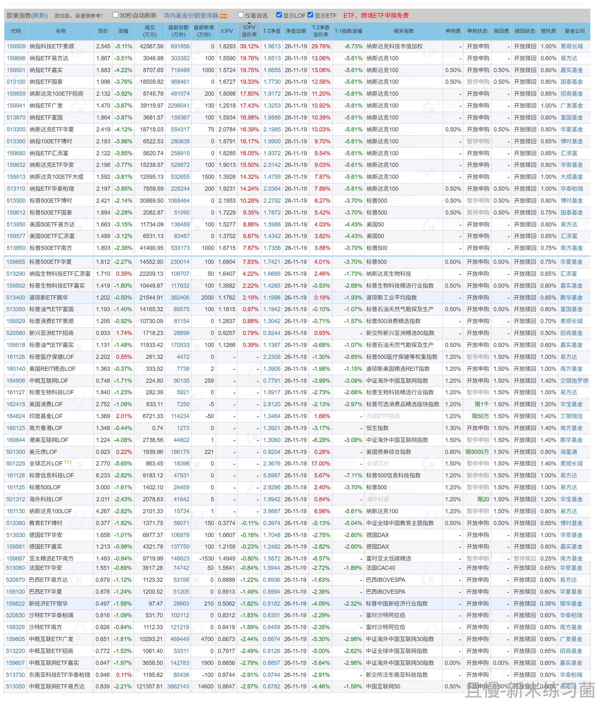
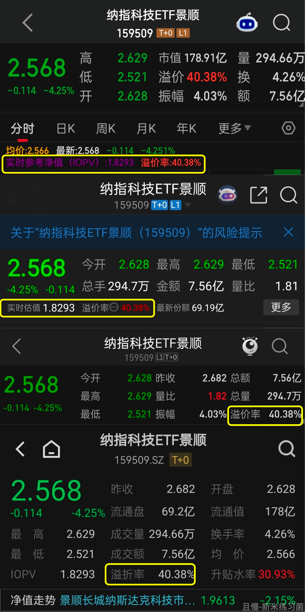
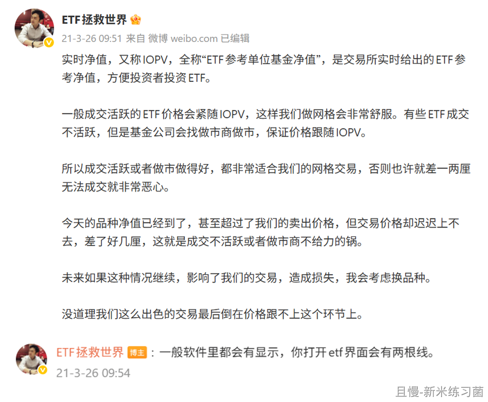
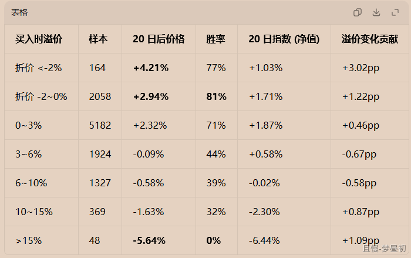

我给各位推荐一个用国内投资者情绪反推美股的小妙招。

看场内美股ETF的溢价率。

一般来说，溢价率越高，美股越危险。标普八个点以上，纳指十几个点以上，美股就比较贵。

因为我们的投资者甚至愿意用三十个点以上的溢价去买，你想想得多热了。

相反，行情最冷的时候，甚至出现过折价交易。

那时候买，不仅赚美股的钱。行情起来还能赚国内疯子愿意掏的30个点溢价。

你可以观察看看。

<!-- qieman-comments:start -->

---

# 我给各位推荐一个用国内投资者情绪反推美股的小妙招 · 评论区（2026-11-23）

> 评论区归档：2026-11-26 抓取于且慢社区，原帖共 383 条互动，精选 88 条（作者发言、作者回复及其他投资相关评论）。

## 田老师（湖南省） · 0 赞

今天看来有车了，恒科如果给点位，下一份会在多少点加呢，e大

## 小布童鞋（上海市） · 0 赞

问题是国内所有美股QDII加一起的体量也很有限，冰山一角，远没到能影响美股走势的程度吖

> **龙卷风ing（陕西省）** · 5 赞：这是个判断指标，不是说影响美股走势

## 波波子（广东省） · 1 赞

瑞思拜老大🥰不知道是否有机会重启场内网格

## 风雨夜归人（上海市） · 1 赞

有道理！看着场内纳斯达克ETF动不动就溢价十几个点，实在是下不去手

## 山今（浙江省） · 1 赞

可现在溢价十几个点的纳指也比之前几个点溢价的时候价格低呀，对于未来肯定会涨回来的品种不是应该看买入价格吗？

> **此心安处即吾乡（吉林省）** · 12 赞：溢价变折价，再叠加回撤几十个点。至少波动率30-50%，你确定你到时候能无动于衷？

> **山今（浙江省）**（回复 此心安处即吾乡） · 9 赞：中概跌了50%不也扛下来了吗😂

> **小布童鞋（上海市）**（回复 山今） · 7 赞：优秀的A股投资者最不怕的就是被套牢🤪

## 天空月亮（湖北省） · 1 赞

纳指现在还有近20个点的溢价率……

## 骨头卿（上海市） · 1 赞

我也这么想，我今天还在看场内的美股ETF溢价率

## 小灰灰伴大象（江苏省） · 9 赞

现在标普10+%，纳指17+%

## 雪铃（陕西省） · 0 赞

已经疯狂了好久的，自己在标普消费ETF上赚到过30%的溢价，那两天吓的立马跑了，没想到后面能到50%，村里疯子特别多，想想年初的白银LOF

## 羅羅（山东省） · 0 赞

E大，之前说700以上买黄金，现在还不是入场的好时机吗？

## 刘宇飞（北京市） · 0 赞

之前纳指20+，现在还有17+

## 周周有惊喜（广东省） · 0 赞

一直想场内买点纳指ETF   就是计划什么时候没有溢价了，就慢慢开始少买点！

## talk_is_cheap（上海市） · 0 赞

我最近就是用这个指标判断的！！因为溢价率一直很高所以减仓了一半美股指数etf，结果上周五跌成这个样子，溢价率还是居高不下，我就想再等等看

## 源野（广东省） · 0 赞

马上下个月美股就要接近全天候营业了，到时候也许这些溢价会因为实时套利而大幅缩小，个人见解

> **王承舜（湖南省）** · 0 赞：不要指望12月6日这个制度变化，直接把纳指接近20%的溢价打下来；它解决的是时差盲盒，解决不了额度稀缺。

## awenyoule（北京市） · 0 赞

“标普八个点以上，纳指十几个点以上，美股就比较贵。”
16个点？

## 馒头君z（北京市） · 0 赞

我记得是不是有个监管发文要取消场内qdii交易来着。。

## 周小帅（江苏省） · 0 赞

以前很准，最近半年纳指溢价普遍20%以上了

## yc1818（浙江省） · 0 赞

但是以国内对美股的信仰，真的会有原价的纳指可以买到吗？准备在19000等着呢。

## 紫薇111（福建省） · 0 赞

现在自己可以买点啥做波段么？

## 头发加速脱落的F（广东省） · 1 赞

最近场内溢价不是因为场外限购叠加港股券商不让入金还有crs交税导致的吗

## 新米练习菌（广东省） · 227 赞

E大早上好~
嗯，JSL上可以看，我帖一下目前的，按IOPV溢价率排序（大→小）
第一个居然快溢价40%了，觉得挺夸张的…
from：https://www.jisilu.cn/data/qdii/#qdiie

> **新米练习菌（广东省）** · 127 赞：单个的，各个券商APP上都有直接可以看到的
（举例几个，都在最上面，很直白的）
（IOPV：全称是 Indicative Optimized Portfolio Value。实时净值，全称“ETF参考单位基金净值”）
老大之前都讲过，JSL也是

> **tiyuanzhe（北京市）** · 0 赞：溢价率太夸张了。也是因为场外限制申购导致的吧

## 陈明灿（浙江省） · 1 赞

美股可以入的时候希望e大给个信号🫶

## 无-（北京市） · 0 赞

刚才说看看行情就看到纳指跌了百分之三以上，点进去一看溢价百分之十七点多，然后就收到了这条推送😊，今天也祝您好心情。

## 很快再相见（北京市） · 1 赞

都认为美股是正规市场，越来越认知趋同了

> **胡萝卜星（浙江省）** · 0 赞：这是个很危险的信号，越这样，我越不敢买美股。

## 长盈久安_YYY（上海市） · 1 赞

其实看老美QDII场外基金什么放开申购也能知一二

## 扶木之桑（福建省） · 0 赞

老大，美股能买入的时候咱们的计划会加吗

## 巨大的芒果（北京市） · 0 赞

想听听e大说下定投美股是不是也行

## 林夜（浙江省） · 7 赞

三点感悟：
第一，跑了一下，以博时 513500 为例。
今年 1 月的时候，溢价率约 6.6%。
2 -3 月，降到约 4.5%。
4 - 5 月，大概是 3.5%。
6 - 7 月，回升到约 5%。
随后一直在上升，现在还是超过 10%。
而 1 月到 4 月初，标普 500 基本在向下调整，之后开始往上走。
现在又是调整期。
基本上，标普 500 热的时候，溢价率就会高一些，且程度加深，反方向则同理。
这个指标还是很有参考性的。
第二，我有个场内组合月末会买一些美股 ETF，E 大提到的溢价率指标准备参考一下。
如果标普 500 溢价超过 8%，纳指溢价超过 10%，那就先拿着现金，等溢价掉下来，再统一投入。
因为溢价而没有投入的部分，还是算作相关品种的仓位，只是以现金形式暂时放着。
第三，E 大介绍可以赚溢价率变动的钱。
其实场内真的蛮搞笑的，有时候不同的标普 500 ETF ，溢价率也不一样，甚至出现 1% 以上的差额。
有时候我也套利，不赚白不赚。

## 梦昼初（河南省） · 1 赞

买入时溢价和 20 日后价格。
豆包说的，数据不保证正确哈

## SmallMuscle（北京市） · 0 赞

所以手里的美股快要出了吗？

## MrBrooks（重庆市） · 3 赞

那么其实QDII的ETF其实不太适合网格

## SS2026.1.15（陕西省） · 3 赞

中概-40%了  感觉好焦虑

## 到哪跟哪（广东省） · 0 赞

标普500波动率指数是否也是一个观察指标？

## 张仲蔚（陕西省） · 1 赞

周五纳指跌5个多点，今天场内etf跌2个多点，这是溢价还上升了呀。

## 大喵Endo（上海市） · 0 赞

场外的限购，是不是让我们的组合买入美股变得难上加难？比如有价格、空间时间的需求，到位的时候却没有额度。另一点，之前文体娱乐都能触发投顾上限，这个场外qdii是不是更容易有这个问题

## dong（北京市） · 3 赞

在美股一直涨这个信念破灭之前，溢价是下不来的，因为都不想卖。需要2000，2008那种级别的暴跌才能破除信念

> **小布童鞋（上海市）** · 0 赞：很难理解，最近美股越跌 场内溢价更高，买场内纳指和标普的难道都是长期持有打死不卖的价值投资者吗？死扛不卖？

## 瓶常心（北京市） · 1 赞

是的，纳指科技溢价率40，赌徒们太疯狂了

## 吃土萌物大猫猫（宁夏回族自治区） · 1 赞

和当年白银一样。我当年申购到了就闭着眼挂涨停卖，今天卖不出去没关系，明天继续挂涨停卖。这次运气极佳，在不能申购后的第二天下午，涨停的时候卖出了最后申购的那一份

## Shuaishuai（云南省） · 1 赞

这几天比之前美股最高点的溢价率还高

## 鲸鱼Jane（陕西省） · 1 赞

纯请教哈：
网格恒科513180，我跟车分别于2026年6月30日用0.56的价格买入一次，8月24日用0.578的价格买入一次
再次看华宝智投公众号里这支的网格的时候，找不到可参考的这两笔的发车记录了
晕了，跟不上了~为啥？我不至于看不懂网格，但现在，就是看不懂了😪
为啥E大的记录上没有这两笔

> **丞哥无处不在（上海市）** · 1 赞：我翻了下自己的记录，今年3.3，6.18，10.22买入对应档位0.67，0.61，0.52，你可以对照一下

> **牛玲和狗尿苔（浙江省）** · 0 赞：网格更新过，你是不是没改

> **兔rabbit（山西省）**（回复 丞哥无处不在） · 0 赞：难道咱们看的不是同一个网格吗？我第一网是0.636

> **丞哥无处不在（上海市）**（回复 兔rabbit） · 0 赞：我说的是档位，不是买入价

> **同路人_lncLTR（广东省）** · 0 赞：你好，想问一下E大的网格入口在哪里呀？

## 同路人_rLytFI（浙江省） · 0 赞

美股大跌猛跌插针的时候溢价也会增加的

## zhoujie（浙江省） · 1 赞

嘿嘿嘿，我很早就发现了，还有限购到100块时候，油气，白银也这样，哈哈哈哈

## 闲适（辽宁省） · 2 赞

E大！我猜到了你要买中概！😃

## 同路人_5dxpd7（新疆维吾尔自治区） · 2 赞

买中概为什么不选恒生科技呀？持仓差不多，T+0呀。

## 等待3000天的救赎（江苏省） · 2 赞

发车发车，今天刚补仓了一手中概

## 青草儿小（四川省） · 1 赞

昨天自己买了中概 今天也跟车

## 蓝绿精灵（甘肃省） · 0 赞

霹雳！各位同仁们，全球医疗保健指数也不给额度了，没法定投了…

> **蓝绿精灵（甘肃省）**（回复 浪味仙啊） · 0 赞：原来是这个原因啊，那太好了，我还以为也跟标普500一样，普遍不给额度了

## nccx001（江西省） · 5 赞

这次不跟车，补仓了中概，等一个月再补这笔中概

## 如山-（美国加利福尼亚圣何塞） · 0 赞

那就等溢价低于5%了开始网格标普纳指

> **小布童鞋（上海市）**（回复 邯菲子） · 0 赞：等到那一天说不定股价已经上涨几十个点了，低溢价买入不见得划算

## 悉茗（浙江省） · 10 赞

E大如果以后别的地方网格不更新了，可不可以在这里更新🙏

> **执着（湖南省）** · 2 赞：网格昨天有更新，今早收到的信息

> **chowm（中国）** · 5 赞：E大，如果后续不更新网格了，可以不可以讲一下网格3.0呀，想学会自己走路👀

> **仰卧起坐高段位选手（天津市）**（回复 执着） · 0 赞：😇老哥，我想请教一下这个网格，我用的是华泰的涨乐不是华宝，是需要去开通华宝才能跟车网格么

## E起富起来（四川省） · 1 赞

今天的发车竟然犹豫了，针对于在且慢外的那一份，不过最终还是买入了
犹豫的点在于上周四在场内补了一份黑车，最后想着E大买入的点都是经过深思熟虑的，老实跟车了
策略不同，计划不同，还是要有区隔
🥰

## Doris77（浙江省） · 0 赞

场内溢价走高了，美股越跌，场内越买

## 怪宴（上海市） · 2 赞

今天发了一车中概互联，想请问E大之后会发中国海外互联的车吗？S计划持有7份，150份持有4份，离上次买已经过了很久了，目前价格也下来很多了

## lizzyq（河南省） · 4 赞

但是我发现倒也不是美股行情冷溢价就少或者折价，而是a股热，纳指溢价就少，a股暴跌，纳指溢价就高

## E路有你（北京市） · 4 赞

中概又回到解放前了。希望这次做个波段

## 白虎tiger（江苏省） · 0 赞

请问小伙伴:  最近发车都是一份的，为什么我的买去卖出都是1.2份啊。确实，没有更改过每份金额。

## 浩瀚星辰（广东省） · 0 赞

我的一个买入指标就是，etf溢价消失

## 同路人_E（安徽省） · 0 赞

关于投顾跟车功能的一个建议，不知道且慢是否能更新这个功能：在自动跟车里区分买入跟车和卖出跟车，因为有时候开了更多的更高份额计划，原计划不打算更多跟车买入了，但是仍需逐步卖出，有时候没有空就没办法手动跟车导致错过合适时机🤝🤝🤝

> **同路人_E（安徽省）** · 0 赞：原来的一些小额计划不打算继续买入，所以关闭自动跟车，但是留存份额的卖出就必须得及时看到消息且有时间手动操作

## 骨头卿（上海市） · 2 赞

太棒啦，谢谢E大，希望能了解和学习红利指数估值的逻辑

## 菜头田（浙江省） · 6 赞

明天中概得涨一波吧，哈哈😃😃

## 同路人_15shDa（安徽省） · 6 赞

疯了疯了，黄教主回来了，美股拉疯了

## 纷雪飞扬（新疆维吾尔自治区） · 4 赞

这一份中概有又是经典操作👍

## 战火小阿蛮（北京市） · 3 赞

老大， 整理的时候有个捉个虫，去年724咱们没买恒生医疗啊。我一直以为我记错了，早上爬起来看了眼发车记录表，还是没买啊。所以这里有两种可能：1老大其实发了但不是长线计划？2.老大发的是我记录的全球医疗，巴特手急打错了。anyway我会继续观察恒生医疗和全球医疗，等待它可以买的那一天的出现。

## 陶陶哦（广东省） · 2 赞

只有这个贴能留言：好奇E大看到了什么发出炸裂🤯感慨！中概买的太划算了，少少钱买多多股

## 同路人_blomCM（新疆维吾尔自治区） · 1 赞

老美这是演剧本呢？！一天天的太精彩了，现在越来越觉得红利是最适合普通人盈利方式了。

## Licht（北京市） · 8 赞

我觉得中概互联网真得看看基本面的问题，真不是就一定会均值回归的，这就和航空业一样，看好腾讯可以买腾讯，但压注中概互联网均值回归是错的，互联网从业者留。

## 林小媛（广东省） · 0 赞

哎，这样搞，真是对A股失望了，不知道为什么要在这个市场炒了😭😭  真的跌的时候跟的死，涨的时候不跟。港股更惨，这个市场真的好绝望😞 🤯🤯 真是不想玩了，信心都被磨灭了

> **林小媛（广东省）** · 0 赞：主要是觉得这个市场真的涨什么都只涨一种，之前科技涨涨科技，现在到银行一直吸血，但凡没有踩到的都是亏，不是被科技吸血就是被银行吸血，其他的里外不是人….

<!-- qieman-comments:end -->
