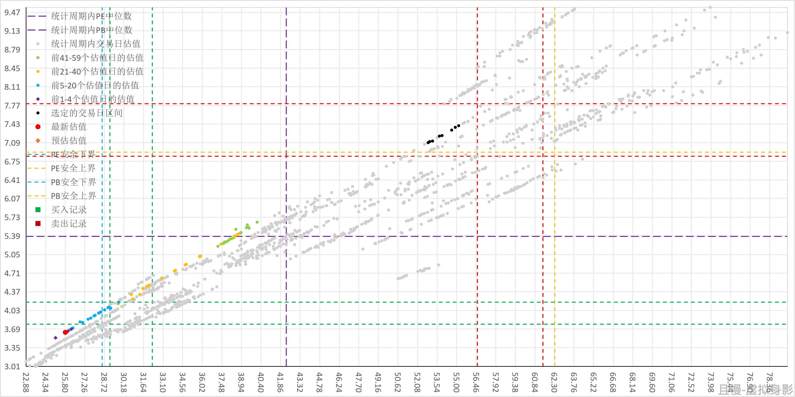
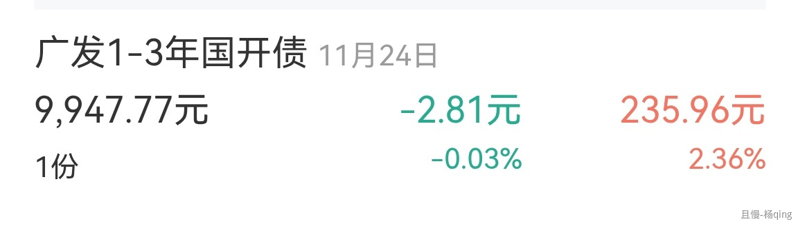

刚才有朋友说，估值真的有用吗。看估值买入的黑车赔了很多。

本来我想展开说一说，但发现要展开那可不是几百几千字能写清楚的。我就简要说几点，有缘者参考一下。

第一，估值当然有用。不然你没法解释长赢计划中那些低位买入高位卖出的赚钱逻辑。说长赢不是说它有多好，而是说这是一个你我都能真真切切看到每一笔交易的样本。

你看估值投资，就已经比不看的人强很多了。

第二，但问题在于，估值不代表一切。比如，增速。

什么是估值。市盈率、市净率、市销率、自由现金流折现……估值能反应现在和过去，但无法，永远也无法反映未来。

我给你举几个例子。

jensen的N字头公司，过去几年市盈率几十倍上百倍。但依然涨了很多。涨了几十倍。现在前瞻市盈率几乎不到10倍。暴跌。

你知道现在有些存储公司的市盈率不到5倍甚至前瞻只有2倍了吗，腰斩。

行业、企业的利润增速，发展前景……所有这些，估值无法体现。

你又知不知道目前美国科技股普遍估值在十几倍，而沃尔玛好市多这些超市估值却在40多倍？估值能反应未来吗？

第三，还有，黑天鹅。

还是那家N字头公司，你能想到它的受欢迎的领导人突然被政ke追着打吗？而且是两边的一起打。很明显未来会打得更狠。这么便宜的估值，该买还是卖？ARK的木头姐选择在暴跌前7天买入，暴跌后卖出。她卖出后第二天，反弹30%。

巴菲特上世纪50年代，买入过一家古ba的上市公司股票。那家公司非常好。有价值，价格低，现金流也棒。唯一不好的地方在于，后来它被guo有化了。巴菲特作为股东一毛钱都没拿回来。他把那家公司的股票裱起来挂在办公室墙上。

投资的世界，非常非常非常复杂。这也是为什么，你永远也看不到任何一个人或者一个机构，可以永远在投资世界不犯任何错误。

对于我们这些小卡拉米来说。唯一你能做的，只有这几点：

第一，分散全世界。

第二，做好适合自己的资产配置。制定交易策略，严格执行。

第三，不被噪音所迷惑。这个市场上，这个网络上，80%的声音都是噪音。都是什么都不懂的人在胡说八道。（可能也包括我）

第四，买指数。个股玩玩可以，不能把身家性命交给它。

<!-- qieman-comments:start -->

---

# 刚才有朋友说，估值真的有用吗。看估值买入的黑车赔了很多 · 评论区（2026-11-25）

> 评论区归档：2026-11-26 抓取于且慢社区，原帖共 284 条互动，精选 78 条（作者发言、作者回复及其他投资相关评论）。

## 自虐的骑行者（广西壮族自治区） · 1 赞

估值已经是最直接最简单的指标了

## 就说几句话（上海市） · 0 赞

估值反映的是过去，而公司市值恰恰是由未来现金流折现决定的。这是估值无法反映的。这就是相对估值法一个缺点。但不管怎么样。估值还是很重要的。毕竟像英伟达这样的企业，高速成长股在资本市场上凤毛麟角。

## 同路人_oZ7s2l（广东省） · 6 赞

所以当前美股十几倍的估值是高估是吗？

> **ETF拯救世界（作者）** · 119 赞：看你怎么看美股“十几倍”估值了。前瞻十几倍，席勒PE是40倍。2000年网络泡沫以来最高。

> **ETF拯救世界（作者）** · 100 赞：另外，voo、SPY股息率历史最低附近。历史平均2%左右，目前不到1%。

> **Sophie1111（广东省）** · 0 赞：溢价的问题，看了E大后面的一个帖子，想再问下。场内ETF虽然有溢价十几个点，但如果在香港开港美股账户，直接买美股ETF, 需要缴纳20%利得税。这样对比，是不是也就差不多了？

> **Sophie1111（广东省）**（回复 ETF拯救世界） · 0 赞：溢价的问题，看了E大后面的一个帖子，想再问下。场内ETF虽然有溢价十几个点，但如果在香港开港美股账户，直接买美股ETF, 需要缴纳20%利得税。这样对比，是不是也就差不多了？

## 同路人_VoFdHL（广东省） · 3 赞

没有正确的认知就容易这样，结果不好就认为估值没用，单一归因，所以投资操作也容易跟着别人反复横跳，没有自己的投资体系和纪律，觉得估值没用的时候就去看趋势，看趋势被套了又回来看估值，反复几次就开始怀疑人生了🤣

## 同路人_小卡拉米（广东省） · 0 赞

老大，能说说估值如何结合技术和趋势吗？

## 布布是我（广东省） · 0 赞

还有1网  中概到达我的极限测试位 10%仓位  他是真猛🙈

## 拾光YY（越南河内） · 0 赞

小白买低估值的指数相对风险已经规避了不少😃

## 且慢同路人9527（天津市） · 0 赞

我想要红利的估值工具，我不是坏人🤣🤣🤣

## 捡垃圾的跟班（陕西省） · 0 赞

大漂亮择时太难了，估值那么高又下不去手，场内溢价又高的离谱，真是怎么都难死，死难呀

## 轩子（广东省） · 1 赞

估值作为参考可能是有用的指标。
低估值买入短期不一定能赚钱，但是低估值买入亏本的可能性会更小。

## 漫漫来（上海市） · 0 赞

最近的感触是执行能力决定投资策略，而不是认知决定投资策略。

普通人能够投入投资的时间和精力注定不够多，认知可以更深，但实际方式必须脚踏实地。估值还是对普通人非常友好的理性投资参照物了。

## Alance（新疆维吾尔自治区） · 0 赞

学习了，估值只是买卖的条件之一并不是唯一条件

## 张仲蔚（陕西省） · 0 赞

开黑车后被市场教育的成果是，不仅要看估值，还要看行业周期位置，筹码结构（谁在买谁在卖），再加上大宏观周期，真的是送命的难度🤣。

## 逆行者（陕西省） · 1 赞

个股不能看估值，行业是可以看估值的。

## 农民工进城搞钱最光荣（江苏省） · 0 赞

估值当然有用，但是只看估值赚钱那投资也太简单了

## 淡淡的幸福（河南省） · 0 赞

估值和资产配置，另外加上时间，这都很重要

## 周滔（上海市） · 3 赞

我准备：50%红利+30%低估+15%宽基+5%手痒。

> **周滔（上海市）**（回复 伯言） · 1 赞：本来就是权益仓，债黄啥的另算。

> **周滔（上海市）**（回复 聚沙成河） · 2 赞：怎么算分散呢？相关性，压力测试都通过了。不要和我说非权益类啥的

## 南岳山大汉（湖南省） · 0 赞

宽基加窄基，走过全世界！

## 水云天（山东省） · 0 赞

不贵+ETF ，大概率不会输，能不能赢看命。

## Andox（浙江省） · 0 赞

红利可以参考股息率分位，当然也不绝对

## 凌风飞扬_爱投资（江苏省） · 0 赞

估值能够衡量过去和现在，但是无法预估未来，而未来无人知晓（最多因专业程度和获取的前置数据多少而具备不同的置信度），但是恰恰是这一份未知造就了投资世界无穷的魅力！

## FangSY（浙江省） · 1 赞

很想看到红利小工具 卡拉米能把红利搞明白就不错了

## 收破烂和挖地瓜（北京市） · 2 赞

指数的估值高低来自与历史数据的判断，这里有几个因素会影响判断：一个是市场环境的变化使得历史数据可参考性变弱（比如股票数增多），一个是指数内的成分发生了翻天覆地的变化，还有个就银根的周期性变化了，这些因素叠在一起导致指数失真、静态指数估值的可用性下降。

## 笨鸟来了（河南省） · 15 赞

重仓的电解铝和电池，还有化工，看估值很便宜了，亏了很久，依然不涨。

> **百花争艳（广东省）** · 15 赞：重仓行业一开始就错了，应该在便宜的时候重仓A500,标普500这种大宽基

> **海上追风（江苏省）** · 9 赞：只要基本面没坏，就稳稳地拿着，买股票最怕的就是没耐心，可惜绝大多数的散户都没耐心，很少很少很少有人能有持仓几年的耐心，其实说到底，还是没这水平，没有鹿鼎公这种技术，不会判断行业和公司的基本面，可惜没这本事还要重仓股票，绝大多数人都这样。

> **Madridista（安徽省）**（回复 百花争艳） · 16 赞：同意，我重仓医药医疗中概的惨痛教训

> **北风其凉（山东省）** · 2 赞：化工和有色这种不能只看估值，估值低的时候反而可能是周期顶部

> **Madridista（安徽省）**（回复 周周有惊喜） · 0 赞：消费我也买了😭😭只不过没那么多

> **白山黑水（北京市）** · 0 赞：电解铝是强周期，不能看估值。要看PB，破净再买比较合适

## 投资-改命（河南省） · 2 赞

估值更多的可能看的是概率

> **海上追风（江苏省）** · 0 赞：还有行业分析，比如这个行业估值比较低，你觉得可以买了，重仓了该行业，没想到第二天这个行业突然不行了（为了更好说明，举个例子），那第二天这个行业的估值马上就变非常高了，也就是说你昨天买的估值非常便宜的，今天已经成为估值非常高的了。同样道理，今天买的估值不便宜的，明天说不定就是非常便宜的。

## 同路人9号（山西省） · 4 赞

亲测有用，之前看大EE的70、80结合米米更新的大表格，在最低点买过，后来及时止盈，小赚。

认为没有用的，可以考虑：
①自己有没有用对
②估值上涨需要时间，有的时间短有的时间长

## 百花争艳（广东省） · 0 赞

A500+标普500+红利低波

## 兜瑞米饭（上海市） · 0 赞

估值表征的是当下，投资投的是未来，历史数据可以做参考，却不能直接拿来做地图，未来的变数很多，企业增长、估值变化等等。想请教下老大，对于指数投资来说，有什么用于推演未来的可参考路径吗？

## Mary（河南省） · 5 赞

还是交易策略：配置分散，7080买入，分批，波段，永远留有现金。

## 捡辣鸡二十三名（中国） · 11 赞

计划你的交易，交易你的计划，只应对不预测。
现在越来越觉得世界就是个草台班子，不能用静态的数字线性外推，最好计划然后不断改进，估值+基本面+技术面+动量。
省流：跟车最舒服

## 黑暗骑士robot（江苏省） · 0 赞

真实世界是非常复杂的，不可能单一归因，股市就是一个典型。股市中估值有用，但不能单靠它预测涨跌

## thegirlIlove（广东省） · 0 赞

我用erp的滚动分位作为仓位调节旋钮，在回测的时候可以提高收益和大幅度降低资产波动，毫无疑问是有用的

> **同路人-1刘S（江西省）** · 0 赞：是写错了吧，是＂回撤＂还是＂回测＂？要不不好理解呀

> **thegirlIlove（广东省）**（回复 同路人-1刘S） · 0 赞：是回测，回测就是拿历史数据去跑，比如估值在多少以下买，多少以上买，然后从15年前跑到现在看下结果，来判断这个策略是不是真的好用

## 阿澄（广东省） · 2 赞

影响因素太多，估值已经是比较重要的，但不是唯一重要的因素。所以才说外面狂风暴雨，e大这里已经很好了。 
只看估值？哪有那么简单的投资啊

## 聚沙成河（广东省） · 0 赞

是啊，估值很重要，谁也没办法预测未来，通过估值可以降低风险，不能消除风险。毕竟一直很好的公司，能继续好下去的机会比别的公司机会更大。

## 阿兴（广东省） · 0 赞

评论区说的70-80买入是啥东西？
另外美股有没有好的场外投资渠道啊，QDII限额太严重了

> **DemonsL4（四川省）** · 0 赞：不死品种从高点回撤70、80买入，只能说大概率保证可以赚钱、啥时候赚就不晓得了

## 汉水浮萍（陕西省） · 0 赞

敬畏市场，在里边呆久了就越来越简单，何以解犹唯有长赢!年龄大了只想好好生活。

## 小泥巴（浙江省） · 0 赞

全市场PE小于30倍的股票占比这个数值是不是比较有参考价值呢，还有PB小于2的股票占比

## 金刚（黑龙江省） · 0 赞

自己买的个股操作的稀碎，慌得很。持有的 ETF 组合目前表现最好，心很安。确实不适合自己投资股票（虽然过程中赚过很多，但是不会卖）

## Jwang（北京市） · 0 赞

估值为锚，但要出海，你还得掌握其他技能，比如看海图、看气象、掌舵、控制船速等。

## 小雏菊修补匠（江苏省） · 0 赞

不买个股了，以后就买宽基，加红利，还有可转债了

## Zzx（香港特别行政区） · 3 赞

E大核心思想始終是“不死”為先。
只看估值是很有可能會“死”的。

## 小牛牛奶当水喝（上海市） · 0 赞

神秘力量出手也要看估值，所以肯定有用👻

## 应无所住（四川省） · 0 赞

估值只是一个静态维度，看事情不能只看单一的静态的一面，要用发展的眼光看各个角度，减少判断失误的概率。

## 八一菜刀（浙江省） · 0 赞

想听老大聊聊估值与证券的相关性分析😃

## 同路人_8kwOpy（湖北省） · 0 赞

最新的那一条不能平我盲猜一下今天老大要动医疗医药了

## 抽刀断水（山西省） · 0 赞

如果投资看估值就行那还来得7赔2平1赚的说法🤣

## E门科学技术（浙江省） · 0 赞

按照黄金目前的估值，能入一点点了吗？

## 虚拟身影（北京市） · 3 赞

贴图是399006最近1700个交易日的pe-pb估值散点图。坐标原点是这1700个日估值数据的中位数。为了便于观察，按15%-25%-75%-85%分位划出了区间，又按日估值数据到估值中位数的距离的中位数乘以一个1-2之间的系数划出了保守偏离区间。左上部分的连续黑点，是26/6/22-7/1时的估值位置。从7月初到现在，估值一路向西南。按三季报后的指数EPS估算，到E大的2100底部，PE约3.33，PE约23.73。如业绩没有上升，应该更高点。我只会等待。

> **虚拟身影（北京市）** · 0 赞：估值数据用的是万德免费的

## 杨qing（北京市） · 0 赞

谁能帮忙解释下吗，明明赚了2.3多点，但净值还是比成本（1万）低，是差服务费吗，服务费也不会这么高啊

## Stephanie07（上海市） · 0 赞

想问问且慢提醒补仓的建议，中概股还适合补吗？

## 等待等等等（北京市） · 0 赞

开心，期待这一次的波段收益

## 徐志远（四川省） · 1 赞

E大后面是不是不会买中证500了，只会买A500？

## 进击的鲤鱼王（福建省） · 7 赞

我只想问问恒科看估值真的有用吗

## 早起美一天（上海市） · 0 赞

老大，可以展开讲讲适合自己的资产配置大概可以从哪些方面来考虑吗

> **tqz（江苏省）** · 0 赞：E大已经讲的够多了，我给你点一下，适合普通人的。
1、大类资产分散。A股，美股，中债，美债，现金。
2、仓位。A股不超50%，美股不超20%，美债不超10%。A股多配红利，中配宽基，小配行业。风险承担能力低，就压降股票仓位，比如A+美股最大40%。
3、设计交易策略，做到低买高卖，又不突破各品种最大仓位限制。股票看估值，债券看10年期国债收益率。建议长短策略结合，网格策略+逆向投资策略+长期持有策略。各品种特点不同，策略应用有侧重。比如红利，低买后大部分仓位长期持有，不应随便卖。宽基就多做低买高卖的逆向投资。

## 西班牙的中国韭菜（西班牙） · 0 赞

"ARK的木头姐选择在暴跌前7天买入，暴跌后卖出。她卖出后第二天，反弹30%"哈哈哈，这也太不巧了吧。不知道她的基金评论区有没有充斥着像国内基民那样各种喷的评论

## 林夜（上海市） · 1 赞

总结，要看估值，但不要迷信估值。最重要的是要知道相关估值的局限性和缺陷。
因为我们看到的估值往往是静态指标，也就是完全基于当下的数据，如过去一年的盈利得出的。
可未来会受到 E 大提到的“行业、企业的利润增速、发展前景”等等因素的影响，导致未来的利润、净资产等等，或许会脱离出目前的这些参数。
甚至变动会很大（即使没有黑天鹅，只是各因素正常引发的变动）。
于是，很多人便使用了前瞻估值（短期内对资本市场的影响应该是更大的），前瞻估值加入了对未来的预测。
可问题是，这是预测，不是精确的计算，所以预测中有多少是未来能真正发生或实现的，没人说的清楚。
也就是 E 大很早之前经常提到的“没有 100% 的概率”。
具体实践中，结合 E 大提到的例子来看。
如果用静态指标去评估一家高速发展的公司，如 E 大提到的达子。那估值可能非常高，看上去很贵，然后用前瞻估值（市场更多人用的），发现其实很便宜（毕竟未来盈利很高，把 PE 压下去了），所以涨了。
这就形成了静态估值很高，但继续涨的现象，而且完全是有价值依据的。
其他的也是差不多的道理。

## v.（四川省） · 3 赞

e 大，红利低波指数要调整了，预计银行比例还要上涨，这个我们会调吗

## 林夜（上海市） · 0 赞

又看了一遍。
第一，估值不能预示未来的走势。
第二，有些估值甚至不能展现品种的贵贱，要选择合适的估值。
第三，从简单的开始，先从估值系统相对比较简单和成熟的品种开始研究。比如宽基的估值，就比个股要简单，也更具参考性一些。

## 见空 · 0 赞

看到两个有名的组合今年回撤25%、15%，愈发感觉到老大的厉害和不易🫡

## 罗昂纳多 · 0 赞

其实，全世界都在看情绪周期炒股，啥估值都不好使

<!-- qieman-comments:end -->
