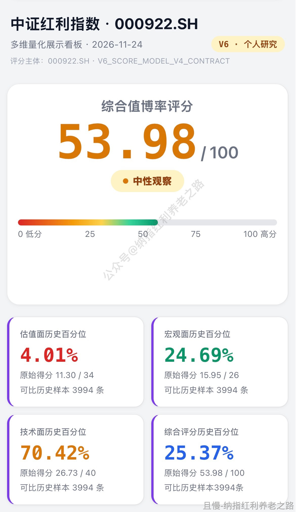
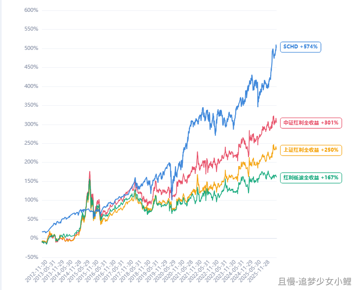
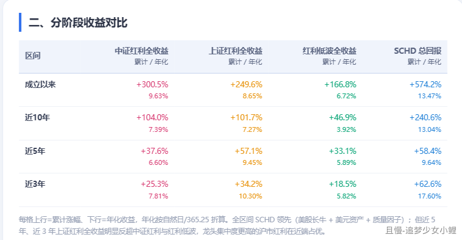
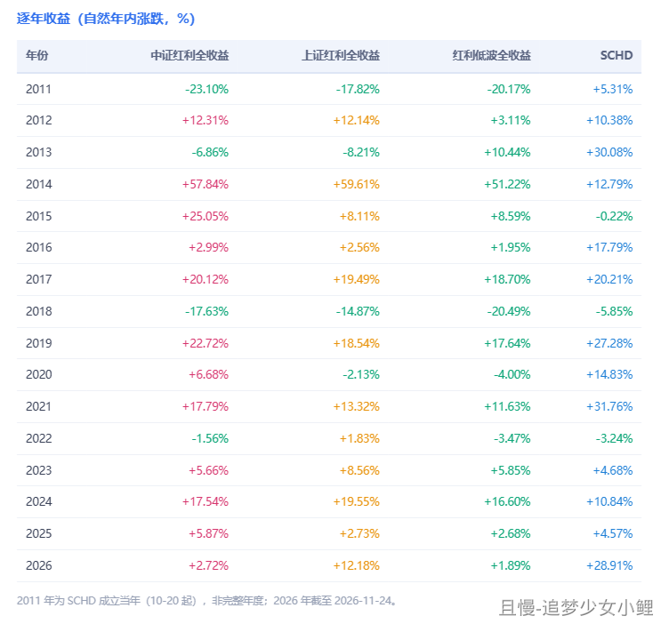
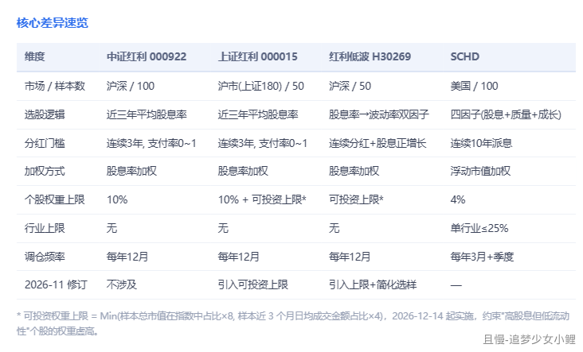
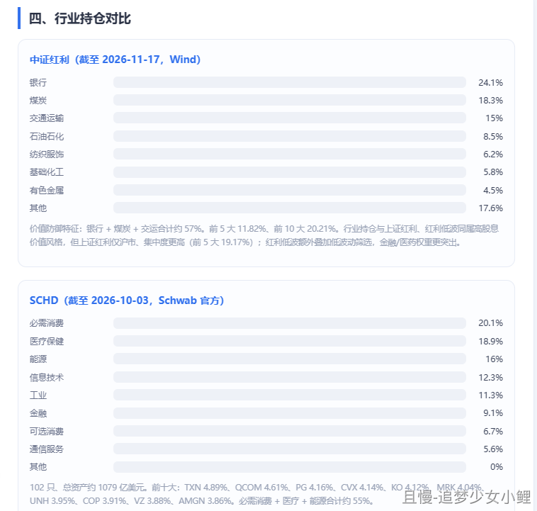

前几天说的判断红利基金是否高估的工具基本已经做好了。但是实在不好意思，没法在这里分享。因为这里还是有0.1%-0.3%的那种贱贱的人在偷窥咱们。

但是结论当然可以跟大家分享。

目前的红利基金，大部分确实不便宜甚至可以说稍微有点贵了。

未来红利的操作，会将之前的技术面为主，转化为技术面+基本面。效果未必好多少，但底气一定更足。

这个工具也揭示了一个比较悲哀的问题：

我们的红利基金，与SCHD那种真的不一样。

这边的无论是哪种，各位可以把它们看作带一部分股票性质的债券，应该比较合适。

成长性，可以说微乎其微。当然，这不代表它们不值得投资。不成长不是它们的问题，而是整个A股的问题。相反，它们可能在这里是非常值得投资的一类品种。

因为它们的持仓股好歹还不停的分红。其它大部分公司，从上市那一天开始到退市，每天都在想着怎么从你身上拿钱。

<!-- qieman-comments:start -->

---

# 前几天说的判断红利基金是否高估的工具基本已经做好了。但是实在不好意思，没法在这里分享。因为这里还是有0.1%-0.3%的那种贱贱的人在偷窥咱们 · 评论区（2026-11-25）

> 评论区归档：2026-11-26 抓取于且慢社区，原帖共 264 条互动，精选 73 条（作者发言、作者回复及其他投资相关评论）。

## 躺在沙滩睡大觉（北京市） · 0 赞

好歹他们还给我分红。。。

## cucumbermic（辽宁省） · 0 赞

红利的技术面是什么，基本面又是什么？

## 就说几句话（上海市） · 1 赞

红利指数基金有点像类债券。这个指数过去5年不断上涨，其实与过中国利率不断下行很大关系。

## 小薪亿亿_（广东省） · 4 赞

SCHD：美国股息100指数

## 大晗（广东省） · 4 赞

老大，昨天看到新版的红利低波编制方案改了，不再要求每年分红。😭😭

> **等待等等等（北京市）** · 0 赞：啊……那红利也不能保证赚钱了吧

## 克莱（上海市） · 0 赞

不能分享给个思路也行，按PE/PB现在都是低估。

## lina184（上海市） · 3 赞

我把红利和债作为现金资产看，股灾的时候拿出来买，行情鼎峰了再买进去避险

## 丁丁90（辽宁省） · 1 赞

之前新规不让用内地账户用老虎富途了，现有的持仓是放着不动还是择时卖出啊？

> **Benadal（北京市）** · 0 赞：三年之后还可以卖出吗？

## 同路人_T8LpWC（浙江省） · 0 赞

每个品种都有投资价值抑或交易价值，红利是少有的投资价值远高于交易价值的品种。

## 小灰灰伴大象（江苏省） · 0 赞

长江电力是不是应该算是股票型债券的代表

## 同路人_PWhYD5（浙江省） · 0 赞

好的，心里有数了。我减持的部分等等回调再买回去

## 蓝叶枫（浙江省） · 0 赞

超期待这个工具，每年的个人养老金就靠这个买了

## 张仲蔚（陕西省） · 1 赞

红利至少还是正和游戏🤣。作为这个市场的纳米股东，散户真的是生态链最底层。

## D.P.Yeung（广东省） · 0 赞

A股结构特殊性的优势品种

## 花傲天yu（江西省） · 15 赞

e大看估值真的有用吗？我每次黑车买估值低的都被套我都怀疑了😭

> **ETF拯救世界（作者）** · 181 赞：投资当然要看估值。但如果只看估值，恐怕有点问题。没有那么简单。

> **同路人_Bn80Yq（广东省）** · 0 赞：有用啊，你看红利低波现在成分主要是银行，银行高估了，所以红利低波也不便宜了。

> **梅西GOAT（山东省）** · 1 赞：有没有可能你看的估值和E大说的估值不一样

> **cookies_xxx（广东省）** · 7 赞：到了低估值的时候还是会继续下跌的，低估不是一个点，是一个区域，不可能每次都刚好买在一个最低点

> **花傲天yu（江西省）**（回复 梅西GOAT） · 0 赞：我不自己看啊，我都是e.大说哪个估值低我才开黑车的，可能就想e大说的需要时间吧

> **cookies_xxx（广东省）**（回复 上帝的直升机） · 1 赞：大家都不是专业人士，只看估值其实很正常啦

> **坚强的韭菜（美国）**（回复 上帝的直升机） · 1 赞：动量两个字可以理解为趋势吗？

> **上帝的直升机（福建省）**（回复 坚强的韭菜） · 3 赞：可以的。所以金融历史上，投资分为两派，一派是看估值，一派是看趋势（动量因子），E大把两派的优点融合了起来。

> **同路人_175（浙江省）**（回复 ETF拯救世界） · 0 赞：各种评论里戾气很重，不看估值也快到位置了

> **思考与成功（浙江省）** · 0 赞：加上空间时间和仓位控制，我觉得黑车没问题

## 王昭垚字倦收（北京市） · 1 赞

开黑车买的场内红利 etf 我根本拿不住，赚了两三个点就全卖飞了🤑

## 投资致富（河南省） · 1 赞

E大分析到位，A股绝大部分公司上市就是为了卖公司赚钱，根本没有想过回报股东🤔

## Jwang（北京市） · 0 赞

红利指数估值不看PE、PB，主要看股息率及其与十年期国债收益率之差。

## 康浩（北京市） · 0 赞

E大说说对于红利低波指数编制规则的看法吧。

## Fish_K（上海市） · 0 赞

红利感觉是我A最靠谱的品种了

## 向天一笑（河南省） · 13 赞

老大上次卖出标普红利低波的时候，说过会谈谈卖出的理由。还会讲吗？

## 九月在别处（北京市） · 1 赞

所以红利类基金分红方式要从红利再投改成现金吗？

## 应无所住（四川省） · 1 赞

技术面+（股息率vs债券）溢价率，如果是我做的话，可能会考虑这些问题🤔

## da（广东省） · 0 赞

E大，请问港股红利标的怎么样，值得投吗？

## cherry冰冰（广东省） · 2 赞

曾经有人告诉我定投十年赚十倍，我在A股定投9年了，根本没有赚十倍的，没影的事儿😭

> **同路人asdf（江西省）** · 1 赞：好奇你赚了多少？我在16年经历了牛市没有及时卖出的时候就幡然醒悟，原来很多所谓牛人都在教你怎么买，但从来没有人说什么时候卖出，牛市来了收益到了就赶紧跑才是正理。否则起起伏伏，咱啥也没赚到，一直在陪跑。

## 学习就有收获（山东省） · 1 赞

E大就是名副其实的股神，我顶礼膜拜！学不会的我，好好跟车！悲哀的是我连网格都不会🥵

> **同路人_dizUVe（重庆市）** · 0 赞：不会网格的+1，但是那0.1～0.3的人特别可恶

## 海中云舒卷（北京市） · 3 赞

红利看作是类债，应该看其股息率和十年期国债利率的利差、现金流情况与是否持续分红，结合利差的历史分位来判断是否有性价比，PE/PB 当作配角交叉验证，这样红利估值思路可否。

## 啊啊啊（北京市） · 5 赞

考古：红利周线布林下轨就考虑买点。爆穿周线上轨可能就卖点

## 老司（辽宁省） · 0 赞

最近中证红利和红利低波50指数修订编制规则 一是选股标准有所降低 二是对小市值成分股降权重 后期组合会优化红利标的吗

## 云溪（宁夏回族自治区） · 0 赞

红利低波我自己买了很久了，现在减了一半。后续等回调再定投

## lymax（北京市） · 3 赞

e大怎么看中证指数公司调整红利低波指数编制方案

## teethinsunshine（广东省） · 3 赞

E大，和您说个好消息，我5月份的时候根据您的发文把自己和老公的个人养老金都买了红利低波，短短几个月我自己的账户收益都7%+的收益了，以前只是抵税用的不知道买什么，这次赶上买点，收益很满意，感谢E大，比心~

> **drama（河北省）** · 0 赞：开了个人养老金账户🥰，两个人应纳税所得额都得二三十万甚至更更多，膜拜

## 木草非人（广东省） · 0 赞

连红利都开始变贵，债券收益率又低，大A又要走宽基赚波动的钱了

## 同路人_nAcRPH（广东省） · 0 赞

红利是指中证红利还是红利低波

## 信德维拉（四川省） · 0 赞

请教e大，为什么国内出不了类似JEPI或者JEPQ的策略型类固收基金呢，长期不涨的市场卖一点期权应该很有优势

## 长盈久安_YYY（上海市） · 0 赞

红利会加大操作力度和频次么？

## 纳指红利养老之路（重庆市） · 5 赞

我自己也做了一个专属红利的量化策略，只要多思考，多动手，借助AI工具，是能做出来的。

## 无尾熊grizzly（广东省） · 0 赞

a股不靠谱，持仓就不要太重a 股了，目前超过一半持仓在a股吧

## 坚强的韭菜（美国） · 0 赞

我们的红利基金，成长性，可以说微乎其微。--可不可以理解为可口可乐这类，可口可乐应该也是没什么成长性吧？不需要创新和努力了

## 陶陶哦（广东省） · 4 赞

中证红利低波指数编制调整于26年12月14日正式实行，本次调整集中于3点：
1.个股权重从15%降低至10%。(非行业权重限制）
2.踢掉股息率高但市值小、流动性低的公司。
3.踢掉三年分红连续增长规则，只要求分红支付率大于0

风险：行业更加集中，分红同比降低

## 我是芦柭澹（北京市） · 0 赞

中证红利低波指数要改规则了，E大能分析一下未来对该指数的投资影响吗？

## 周滔（上海市） · 0 赞

它有个难兄难弟：券商也是债券+指数期权

## 沧海一粟2020（河北省） · 0 赞

红利低波100我还在定投，只是占总的比例降了点

## 狭窄的宇宙（广东省） · 0 赞

技术加基本面，这个基本面指的是什么？

## 9精（东京都） · 0 赞

配置了一些schd，不过买的比较少😂

## 老强（天津市） · 1 赞

中证红利低波动指数修订内容，这个有影响么？
：（1）选样方法第1步调整为“选取过去三年平均股利支付率大于0且小于1的证券”；（2）权重上限规则调整为“单个样本权重不超过10%及其可投资权重上限，其中可投资权重上限为该样本在指数中总市值占比8倍、近3个月日均成交额占比4倍的孰低值”。指数编制方案其余部分保持不变

## 源野（广东省） · 2 赞

我一直以为红利的以往操作，E大主要是估值为主，没想到是技术面为主🤔打破认知

## 孤僻的啊（上海市） · 0 赞

其实我想听听红利估值大概的原理就好 具体的内容没有也没关系

## 同路人_LOti6D（上海市） · 0 赞

对于想建仓红利的人现在能开启定投吗

## 追梦少女小鲤（湖北省） · 3 赞

我们的红利基金，与SCHD那种真的不一样。
-
找ai帮忙看了一下，确实有非常大的不同。从收益，编制规则，持仓，都有很大的不同。
-
如果有错的地方，大家cue我改正，数据不一定准确😅

> **追梦少女小鲤（湖北省）** · 3 赞：A 股红利重仓"银行+煤炭+交运"的周期与金融高息股；SCHD 重仓"必需消费+医疗+能源"的现金流稳定型公司。前者偏深度价值与顺周期，后者偏质量与防御，这解释了两者在不同市场阶段收益与回撤的错位。

> **爱理财的xx（上海市）** · 0 赞：我去官方拉了一下数据最近5年10年都是红利低波更好呀 没有拉再早的数据了

## 杨剑锋（广东省） · 0 赞

但是红利指数不是会调仓吗？12月份一调估值就下去了

> **爱理财的xx（上海市）** · 0 赞：下不去了红利也不是按照估值调仓的 有流动性跟股息率

## 仰止（辽宁省） · 0 赞

E大：晚上好♥️
期待未来红利的操作🥰

## 俩XD（浙江省） · 0 赞

“【20260616】E 大：整个长赢计划未来的最终形态，A 股部分中，红利应该占 40%-50%。(如果 A 股 50%，那么红利可以有 20%-25% 这样)” 
 【红利的配置思路和比例，会有调整吗？😳】

## 林夜（上海市） · 1 赞

A股品种不成长或微成长，为什么还算是非常值得投资的一类品种？
我觉得关键点就是 E 大说的，它可以被视作“带一部分股票性质的债券”。
其分红虽然没有很强的确定性，但能在一个大致的区间波动（类似浮动利率债），还带有一点点的成长性（成长性能带来未来分红的成长性，股性）。
波动则也是股性。
分红是很有意义的，特别是对成长性一般的公司。
如果他们把钱投向别的行业，那很可能因为管理层不懂，造成亏损；而如果投向现在的行业，则可能引发内卷。
结果，很容易造成价值损失。
此时，慷慨、稳定的分红反而是最优解。
其实对 A 股很多公司，哪怕现在成长不错，分红也是最优解。

## KuMoo（浙江省） · 0 赞

红利估值的逻辑，五句话:
1.不看PE/PB。红利指数的PE差65%，但隐含长期回报只差0.43ppPE度量的是成分股长什么样
(ROE、派息率的结构)，不是现在贵不贵。而且红利指数每年调仓，你算的不是同一篮子东西。
2.看股息率比国债多给多少。核心指标是溢价:股息率-10年国债。当前四个红利指数都在+2.3~2.8pp。这是"比无风险资产多拿多少现金"，比PE实在。
3.但溢价要跟自己历史比。国债从3%降到1.58%，溢价被动变大，看着便宜其实是利率给的。所以算z值:当前溢价离近三年均值几个标准差。z=-0.74就是比正常水平低0.74个波动。
4.溢价要拆两条腿。中证红利现在利率腿+0.40pp(帮忙)、股息率腿-0.87pp(拖累)它的"变贵"主要是分红端在缩，不是股价涨。深证红利两条腿都正，但派息率60.8%(把利润分光了)，便宜有原因。

<!-- qieman-comments:end -->
