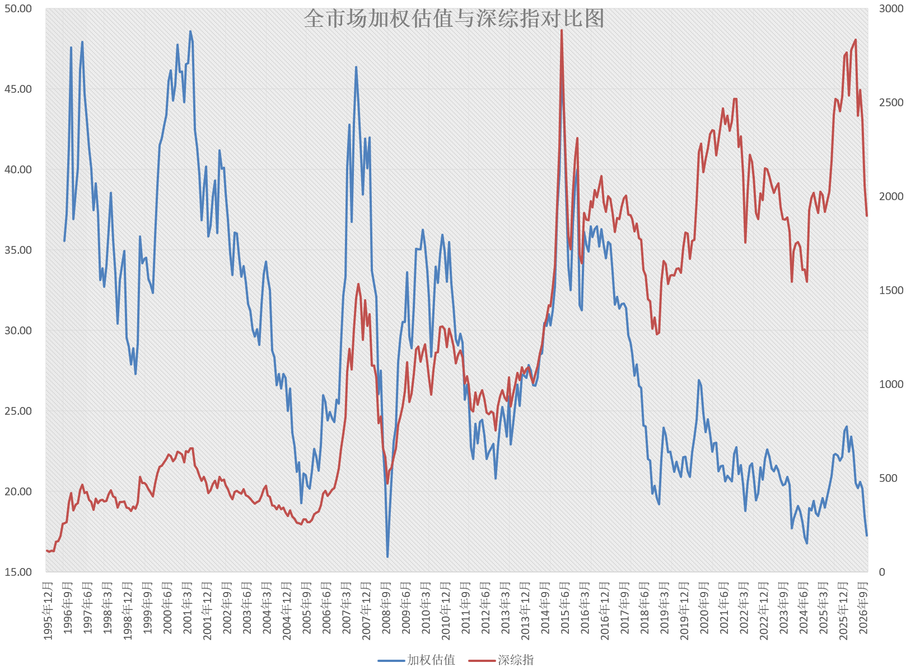
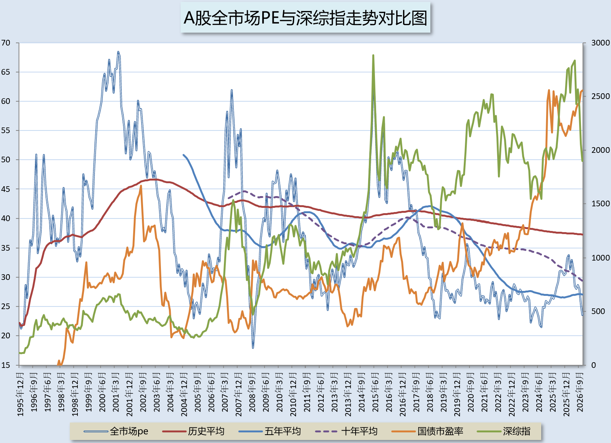
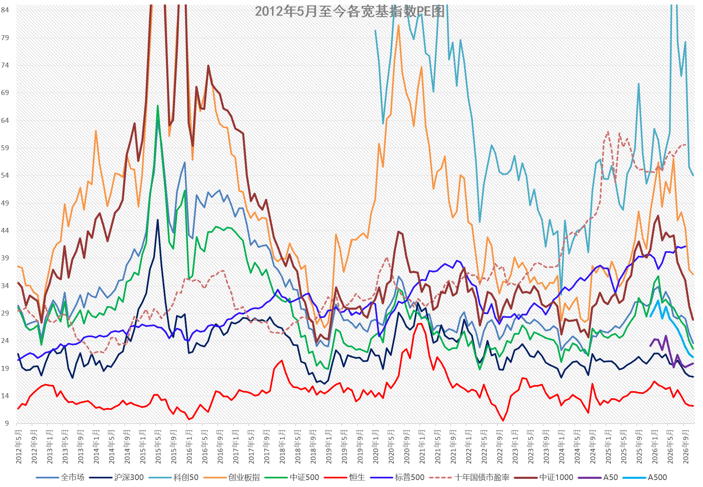

这种时候我不会再像今年之前一样，不停的给各位按摩。

道理非常简单。以前在微博或者公众号，面对的对象有很多小白。他们受不了这样的行情。

另外，上一轮，24年那时候，因为21年高位减仓不够，导致比较被动，无法大量加仓。

这一波，在座的各位，至少至少也有一年以上的跟车经验了。绝大多数都是经历过几轮的老战士，不需要我来按摩了。

更何况，因为高位大量减持，清仓了不少品种，大量减持500为代表的宽基，以及去年今年大量卖出港股，目前的仓位非常舒服。与2024截然不同。

然而，A股的估值，已经回到当时了。这一轮，各位的体感不知道比上次舒服到哪里去了。

所以，从哪方面看，都不需要我按摩了。

接下来咱们的任务，就是掌握好节奏，买好该买的东西。

我不会急，更不会怕。相信各位也是如此。

