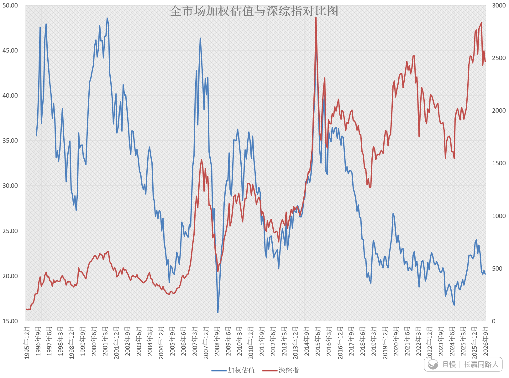
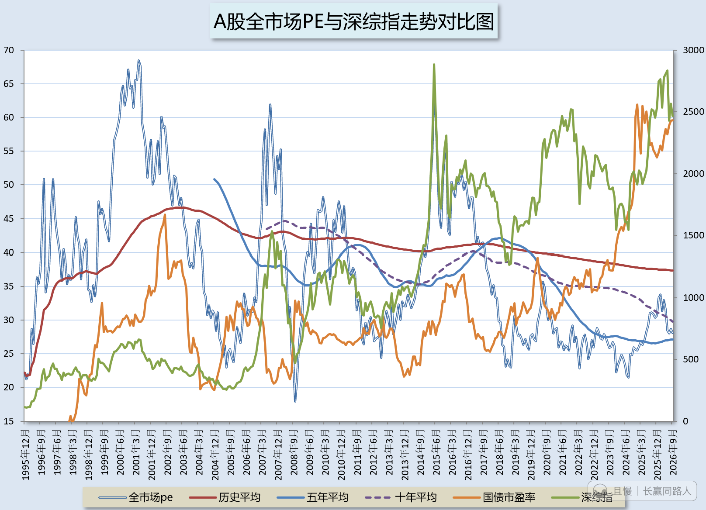
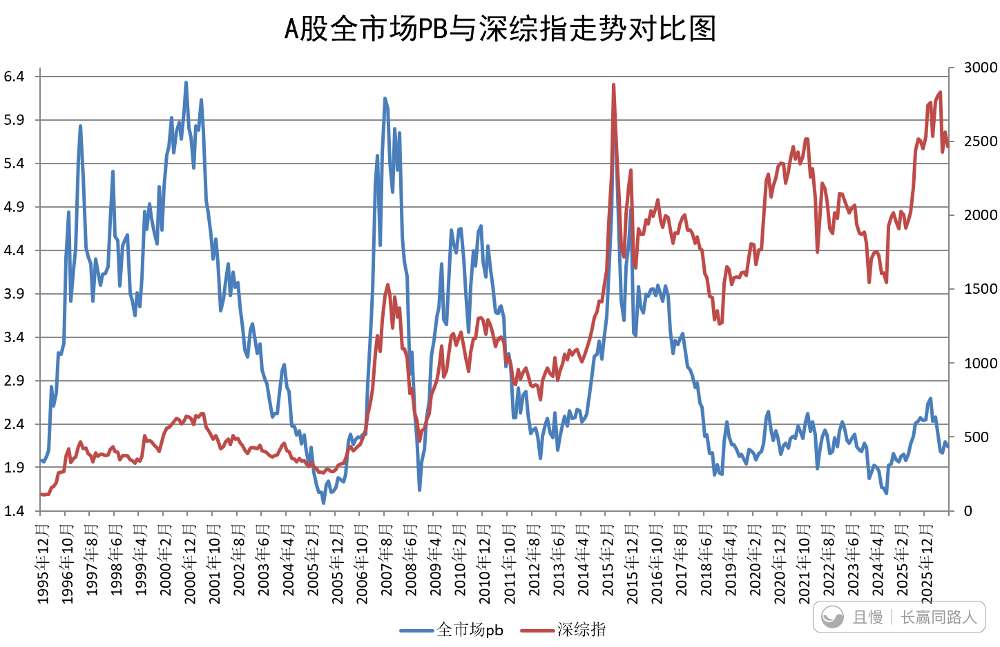
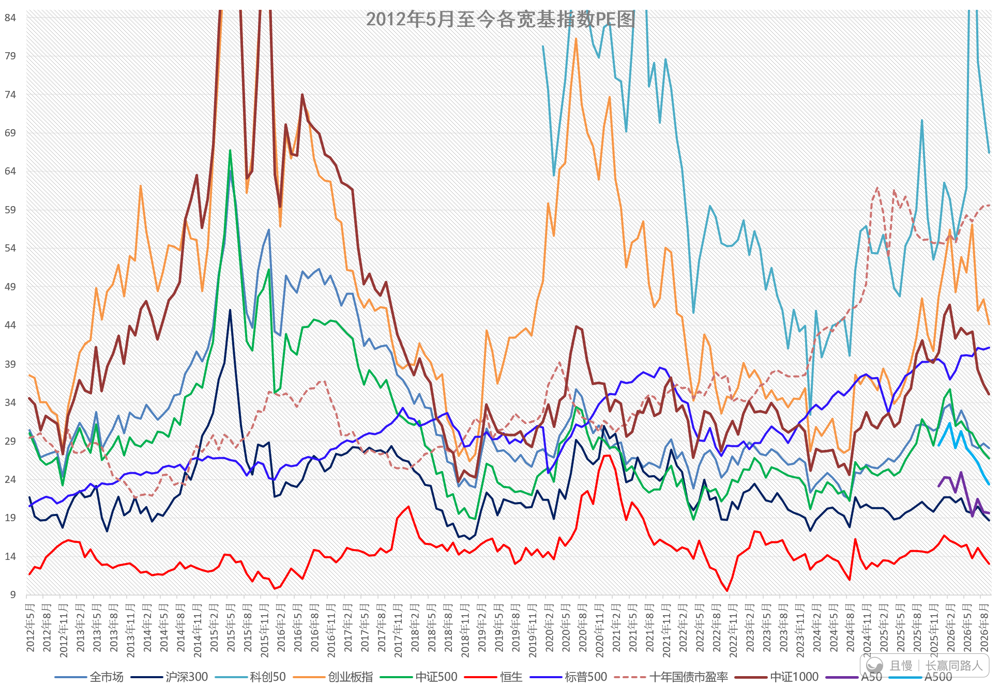
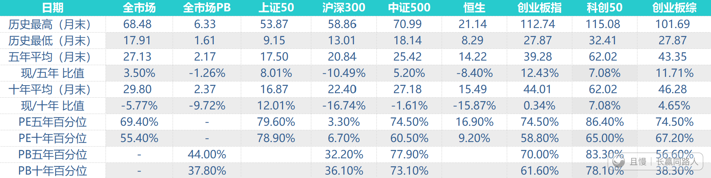
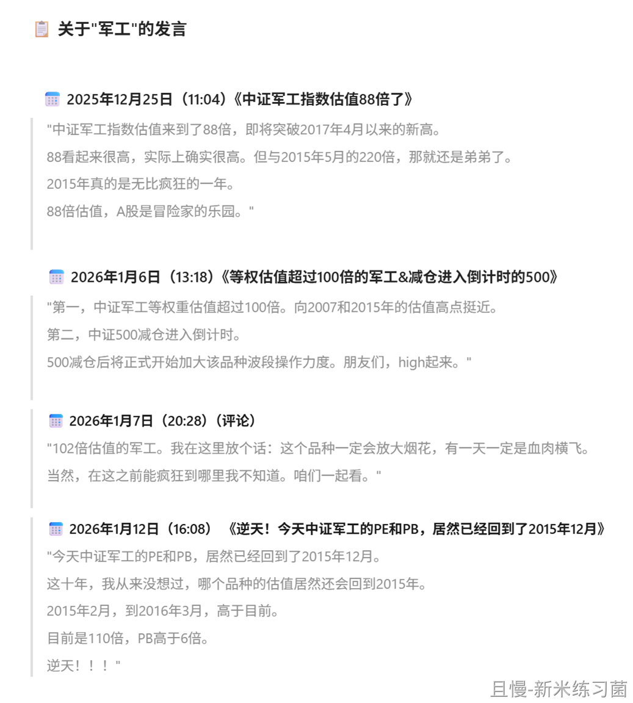
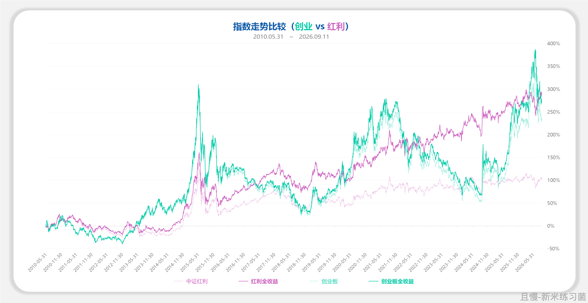
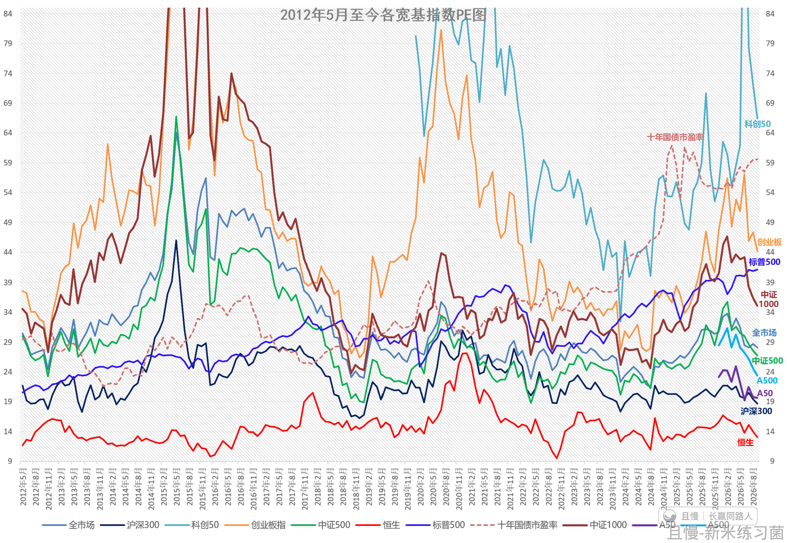

长赢小组投资笔记-0004-260912
实在对不住各位组内的朋友。因为各种原因，笔记断了几期。好在我又回来了。

最大的原因，当然是5、6月份市场的疯狂，让我的数据看起来已经没有任何意义。90倍的全指信息，115倍的科创又如何？还不是继续涨。我发了就被骂，不如不发。

现在回头看，还是有意义的。

继续截至周五的最新估值图。这个月尤其有意义的，是上个月二季报发布完毕后，可以结合各指数的利润增速，有个更加全面的观察。

首先是全市场外部数据加权估值图。

然后是全市场等权估值图：

全市场PB：

各宽基指数估值图：

然后是一些比值：

二季度利润增速方面：

A股全市场利润增速为5%。意味着小一半的公司利润下降，50%多的公司利润上升。其实这个状态已经维持好几个季度。长期看，大多数公司其实是混日子的拖油瓶。

亮点在创业板、科创以及信息产业。这三个板块的利润增速达到了38%、21%、以及31%。可见，上半年科技股的上涨，并非完全炒作。

但问题在于：

创业板6月最高估值57倍，5年新高。科创板6月估值115倍，历史新高。信息产业6月估值90倍，十年新高。

57倍的估值，对应38%增速。115倍估值，对应21%增速。90倍估值，对应31%增速。

尤其是科创和信息产业。我们假设这样的行业景气可以继续维持，假设不再上涨，那么需要多少年才可以让115和90降到正常范围？

回头看，市场没有等业绩跟上来，而是选择了杀估值。

目前，三者的估值，已经杀回了44倍、66倍和55倍。

-----------------------------------------------------------------------------

所以其实A股未必是无效的。它拉升的板块也确实被验证业绩是上升的。但最大的问题，依然是哪个板块好就全都杀进去。机构也好，散户也好。最终拉到100倍估值，然后崩盘。

与之相对应的，是被抛弃的板块，确实利润增速不行。

医药/医疗板块二季度利润增速个位数。消费更差，直接利润增速是负的。所以，6月份科技股的公募基金集中度历史最高，医药消费历史最低。

高增速=历史最高估值。低增速=历史最低估值。这就是A股投资的第一层：业绩带来了疯狂和恐惧。

第二层，搭配估值，何时可以回归？谁知道呢。

所有跟踪的板块中，有一个比较奇葩的板块，就是JUN GONG。

--------------------------------------------

年初有朋友在小组问JG，那时候它接近17000点，估值103倍。我说我绝对不会买。

现在是接近12000点，跌了29%。然后估值是：77倍。

利润增速呢？

-24%。

奇葩不奇葩？这是一个纯概念的板块。

-----------------------------------------------

宽基方面：

非常有意思。

中证1000的利润增速是3%，甚至还比不上全市场。

沪深300是11%。中证500是9.7%。A50是4%。A500是14%。

最大的A50和最小的1000，利润增速都是个位数。300比500好一些，最好的反而是A500。

也就是说，如果分层来看，二季度A股业绩增速最好的，是比较大的公司。不是最大，也不是最小的那些。

目前的一个小结论：

从历史估值与业绩增长的角度看，沪深300以及A500，已经不算贵了。

--------------------------------------------------------------------------

这里，我请各位关注A500这个指数。

当然话说在前面。A500这个指数的历史，是指数编制者模拟回测出来的。它不是真的跑出来的，所以这个点依然比较存疑。但是从回测的历史看，在数字宽基指数（300、500、50等）中，它的历史收益率，确实是最好的。比它好的，是波动非常巨大的创业板（跑出的真实数据）。

我个人认为，在未来的A股指数投资中，如果一定要投资宽基，A500应该是值得关注的。在合适的时候，多买点创业板也不会差。

从二季度看，A500的业绩增速也跑赢50、300、500。

------------------------------------------------------------

其实从历史看，A股的宽基长期看是能赚钱的，只要投资方法不要错太多。当然，赚的不会多。平均大概有6%-7%。这个业绩当然与美国QQQ16%，SPY和SCHD的滚动12%收益率没法比，但也不至于现在这样80%的股民赔钱。

因为A股波动太大了，持有体验过差，对人的心理考验过于严格。

还有就是历史数据也不好说。历史上A股表现最好的其实是医药和消费，两者平均周期年化收益率都可以到10%以上。但这几年这个样子……但总之，投资方法得当，只要不出大乱子，长期看宽基是能赚钱的。我们计划中所有持有一年以上的宽基，都是赚钱的。绝大多数收益率都超过60%、70%个点，也有100%收益率的。这一点各位还是要有点信心。

持有体验差，但有得玩。

从技术形态上看，如果宽基继续跌，可能我们的投资计划就会继续增持。

----------------------------------------------------

今天的内容基本就是这样。最后说几句。

从我接近20年每天记录估值与研究市场走势关系的经验来看，中短期指数估值并不能预判走势。很多时候低了会更低，高了会更高（比如6月科创创记录的115倍）。

但是长期看，最终会价值回归。20年A股市场的参与者可以说几乎没有任何变化。疯狂、绝望、恐惧，几乎就是大多数人的底色。

A股市场最终也会一轮轮把不理性人的钱，转入理性投资者的口袋。这一点，各位理性的朋友一定要有信心。

当然了，我目前的想法，就是没有投资体系，不能严格执行投资策略的普通人不要投A股。真不是普通人能玩的市场。一定要买，逢低买点红利可能是胜算最大的选择了。

各位下次笔记见！（会是下个月吗）

新米练习菌
1602天
E大周末好~
前三篇回顾：
《长赢小组投资笔记-0001-260322》
👉：https://qieman.com/content/content-detail?postId=71239
《长赢小组投资笔记-0002-260425》
👉：https://qieman.com/content/content-detail?postId=74233
《长赢小组投资笔记-0003-260516》
👉：https://qieman.com/content/content-detail?postId=75529

新米练习菌
笔记看完了（请允许我再写一点点留言）
看数据看图觉得好精彩，原来全市场PE超过十年均线还“挺多”，且持续了几个月，但跌下来也好快啊，又快到五年均线了。
科技大年，一边双击，涨业绩涨估值；一边双杀，杀估值杀业绩。但股市走在前面，业绩其实提前反应在了股价里。
高业绩还能撑得起高估值，但一切都是周期，没有永远高景气的行业，利润高增速不可持续，一旦增速不在，甚至还在，但不及预期，就会被抛弃；
同样，低迷的，早被嫌弃很久了，业绩增速差之后才被验证的下跌逻辑，但也不会永远消沉，这两行业可是刚需，生意还在做的。
所以，还是蛰伏的打法好，提前蹲在低估的地方，等轮到TA，修复，回归，增长，又赚业绩，又赚估值，又安全。
---
【附】关于军工 年初的发言 回顾
（PE： 88 → 100 → 102 → 110 → 77 Now）
（对应点位：13454 → 14823 → 14721 → 16868 → 11804 Now）

新米练习菌
【1】更新一下A数字宽基走势对比图
分别是：
• 点位（基日1000点 2004-12-31 起）
• 涨跌幅 （A50“诞生”以后，2014-12-31起）
==备注==
中证A500（000510）
发布日期2024-09-23
基日2004-12-31（基点1000）
从各行业选取市值较大、流动性较好的500只证券作为指数样本。
2024年才有的其实，
所以发布之后的点位是实时真实计算；
但之前的历史序列，是中证指数公司用这套固定编制规则，回溯回测算出来的，也就是假设这套选股 / 调样 / 加权规则当年就存在，倒推出来的历史走势，不是当年真实就存在的指数。
【2】创业板也挺好的
创业全收益，年化8.4%（创业板诞生以来）
红利全收益，年化8.6%（同期）
【3】
借老大的宽基PE图用用，感谢分享，因为每次都会盯着仔仔细细地看，所以顺手把名字和轴右侧数也再标注了一下。

