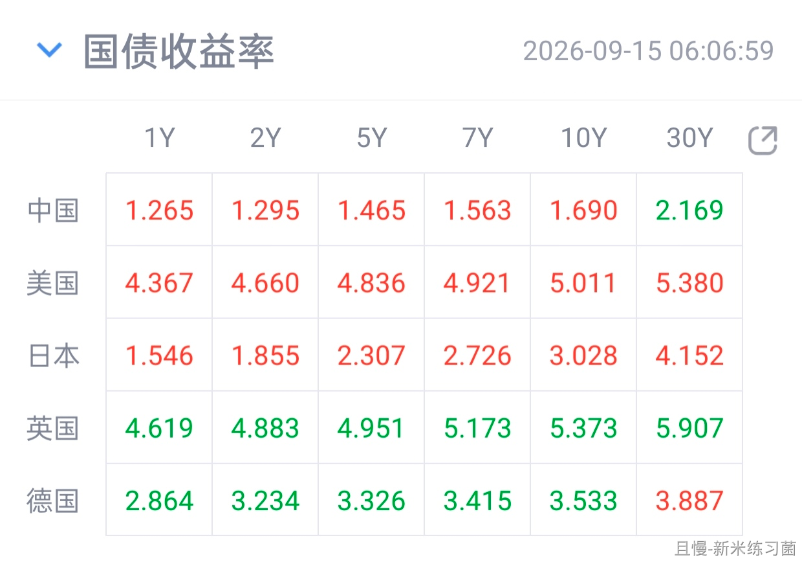
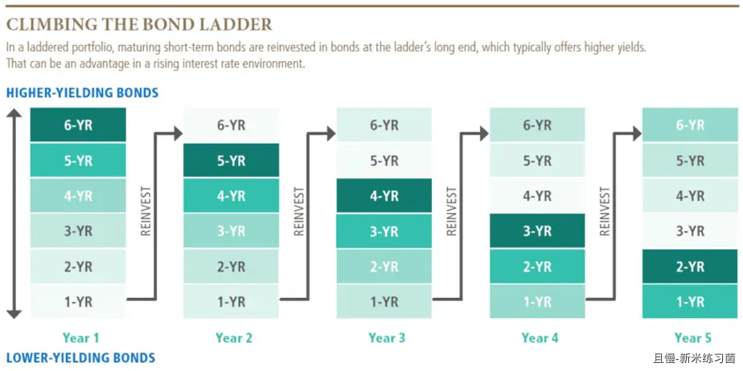

债券梯策略（Bond Ladder）

最近很多国家的债券收益率都到了一个比较诱人的状态。有人会觉得可怕，有人会觉得是机会，也有人觉得可以作为资产配置中的一环进行配置。

我不讨论具体债券，我介绍一种债券投资策略：

债券梯。

简单来说，就是把你想要买入债券的钱，分成几份，买入久期不同的债券。

比如，你有60万想买债券。那么，可以买入1、2、3、4、5、6年后到期的6支债券各买10万。

这样做有什么好处呢。

基本上有两个大方向的好处，一个是锁定收益，一个是平滑风险。

锁定收益不用说。比如说A国国债，假设目前1-6年到期的到期收益率分别是4.5%、4.6%、4.7%、4.75%、4.8%、4.9%。那么，当你目前买入它们的时候，就已经锁定了这样的收益率。

平滑风险呢。

这里有两个可能。一个是该国未来升息，一个是该国未来降息。

如果升息：

升息的话，债券价格会下跌。但是，就像之前说过的，久期越短的债券，波动越低。而且无论怎么升息，一年后，第一份到期的债券，它都必须要还本付息。

如果升息了，对你来说，一年后拿回第一份本金和利息后，可以以更高的收益率，继续买入6年后到期的债券。那么未来收益率就会更高。如果两年后还在升息，那么两年后你拿回第二份本金和利息后，以更高的价格再买入六年后到期的债券。你的收益率还会继续上升。

如果降息呢。

如果降息，债券梯里面的债券价格会上涨。这时候你卖掉也行，不卖拿利息也行。总而言之，未来六年的收益率你已经锁定，降息不会影响你拿钱。

降息环境只是有一个问题，就是每一年当年的债券到期后，你要看看到时候的利率你是否愿意继续买债券梯。

这里的1-6年，只是举例。具体要买哪一年的，可以分析一下买入时的利率，以及你自己的情况。

什么自己的情况呢。比如说，你计划3年后要给孩子拿钱去上学，那么你就可以设计1-3年的债券梯。（第一年到期后再买一份两年到期的，第二年到期后再买一份一年到期的。最终三年拿回全部本金和利息）

一般来说，我个人认为，十年的国债应该是上限。也就是不要超过10年。最好不要超过7年。中短期的债券，波动会小一点，风险也更加可控。

我不是推荐任何朋友，买入任何国家的任何国债。我只是提供一个思路。这样的债券梯策略，你动脑子可以演化成很多投资策略。比如“定存梯”等等。

再说一次，只是介绍策略，没有任何推荐。

新米练习菌
1607天
E大傍晚好~
各国：

新米练习菌
仔细阅读学习中，结合文意，对于「定存梯」的理解和复述：
假设准备拿60万做定存梯（取整数容易计算），参考老大的6档例子：
把60万拆成6份，每份10万
- 10万：1年期
​- 10万：2年期
​- 10万：3年期
​- 10万：4年期
- 10万：5年期
- 10万：6年期
一年之后：1年期存单到期，拿回本金+利息。
这时再把这笔钱，新存一份6年期。
第二年：原来2年期到期，继续新开一笔6年期。
循环往复。
最后形成一个状态：每年都有一笔存单到期，永远滚动。
（找了个图）
————
好处：
1. 平滑利率波动
- 如果之后加息：每年到期那笔钱，就可以按更高的新利率存进去，整体收益慢慢抬升。
​- 如果之后降息：之前存下的那些长期存单，高利率已经锁定，不受降息影响。只有每年到期那一笔才会按新的低利率续存，不会全部资金一下子收益缩水。
2. 流动性更好
一笔大额资金全部锁死6年，中途急用钱提前支取会损失大量利息。
定存梯每年都有一笔钱到期，相当于每年有一笔备用现金流，兼顾收益和灵活性。

