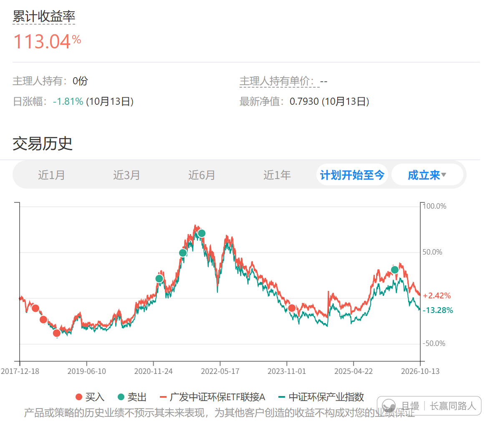
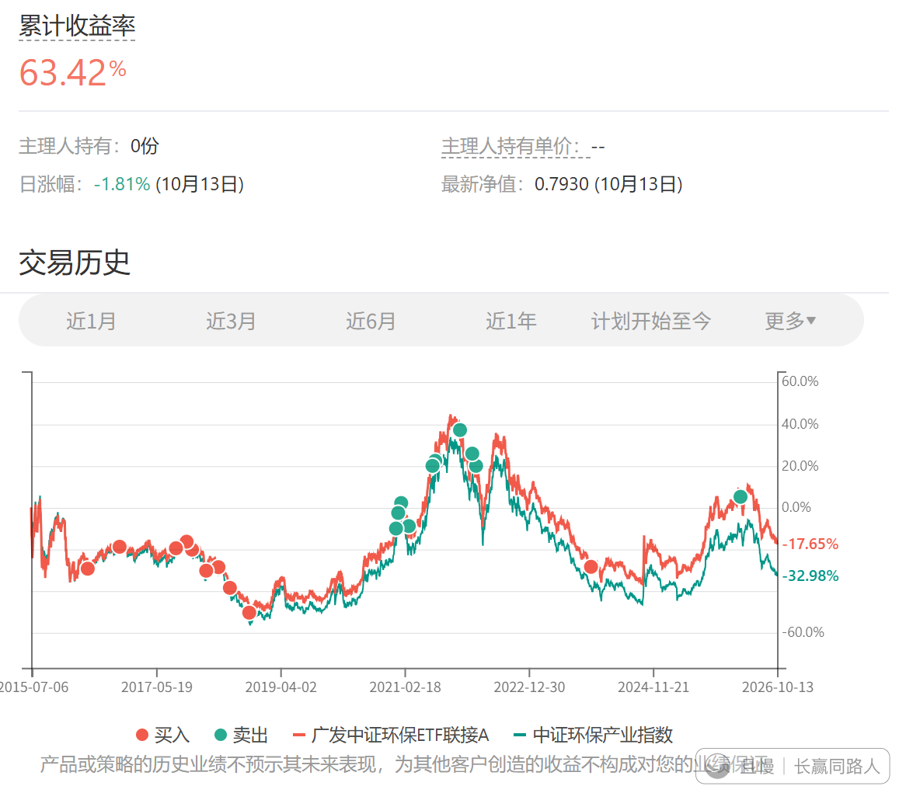

虽然这个品种我们的结果非常好。而且做了两轮全都赚钱了。

但是，我个人不建议在座的绝大多数普通投资者朋友自己去玩这个品种。

各位两轮都是高位卖出，完全无法体会到如果买错了，高位接盘的后果是怎样。

玩这种高难度品种，不可能每次都是运气好。

我自己除非它便宜到尘埃，否则也不会在计划里再买了。

不过说起来也非常无奈。为什么我们的优势产业就要互相杀，杀到所有从业者（除了高位减持的高管）都不赚钱，然后投资者也不赚钱。希望未来有一天能改变吧。

这个品种今天又创了这一轮下跌的新低。有点感慨。

