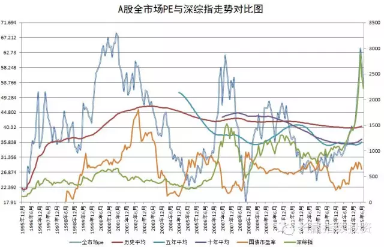
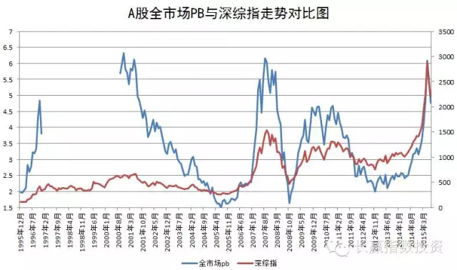
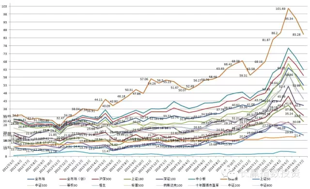
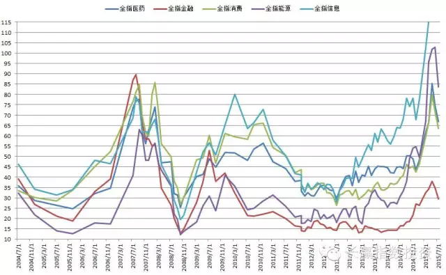

# 四张估值图告诉你明天能买了吗？

---
点击上方“长赢指数投资”，关注真正能赚钱的投资方式

___

先上图，再说话

**一：这几张图，老朋友们都很熟悉了。**

贴了快一年了。大家都说中国股市没有规律，但大家看看，没有规律吗？简直是比最规律的心电图都要规律啊。高点一样，低点也一样！怎么赚钱？找到规律，遵守纪律。简单吗？不简单！

**二：现在还贵不贵？**

分大股票小股票。以50为首的大股票，涨的话根本也没怎么涨，所以离三年平均并不是很贵，大概多了30%。而创业板从贵过平均100%以上，也跌到了60%。中小、500之流，只有40%了。（写到这里小激动）

**三：可以开始买了吗？**

我实在是不想写，仓位太空的朋友可以买点50这句话。因为我手里还有tmt和重组两只分级A还没有下折，我希望可以一鼓作气跌下去。但客观地说，除非有低估洁癖的人，现在的50或者金融，估值不是特别贵了。空仓的朋友，买几个点真的不算过分。当然，真有能遵守纪律的，等到均值以下买，我更尊重您。铁血纪律才能铸就辉煌啊。另外，注意行业。金融只高9%了！呵呵……

**四：手里有中小股票怎么办？**

呵呵。不知道，真的。

ps：虽然图贴了一年，然而并没什么卵用。在雪球，创建半个月的A类组合收益仅仅只有7.8%，居然战胜了63%的组合？这是什么意思？有50%以上的朋友已经赔钱了，在2000点上来的大牛市中！50%赔钱的朋友，您赚钱的时候会觉得，20%、30%的年化收益率太低了，看不上。但赔钱的时候，想的肯定是：我能回本就好了。这才是最痛的领悟吧。

其实没关系，闻道有先后，一切会好的。
