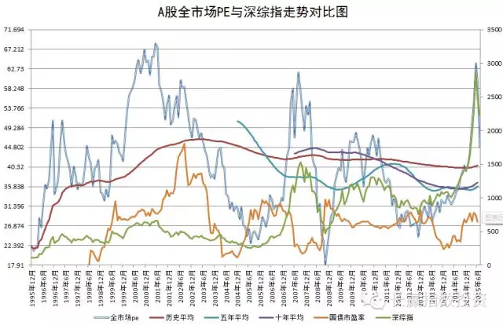

# 20年，A股估值图上从未出现如此一幕，机会还远吗

---

简单说：

中国股市自1995年以来，有过三次pe超过60的尖峰时刻。分别是2001年，2007年和2015年。

其中，尤以2015年风云变幻、诡异莫测。

6月15日，两市全市场pe超过72倍，远远将历史最高抛在身后。随后，暴雨倾盆，泥沙俱下。短短的三周时间内，pe居然已经跌到了历史均值附近！

要知道，2001年，阴跌整整2年，才在2003年跌破pe均值，进入投资区域；2007年10月创出最高后，在2008年5月才跌破pe均值，进入投资区域。

谁能想到，2015年估值创出历史纪录后，回归价值的速度也如此迅速！

朋友们，某成分指数已经仅比历史平均高20%；某行业指数只比历史平均高16%；某风格指数只比历史高不到10%（要知道，它们三周前全部高于历史100%以上）这样的话，我会乱说吗？

2015年，我们在牛市赶顶的过程中，提前下车，没有卖在5100点。但现在你回头看，有没有一丝悔恨？看看身边痛不欲生的亲友，有没有感到庆幸？

我们财富增长的下一个旅程，即将起航了。

ETF计划下个月能否开枪？会把一年多来第一颗买入子弹射向哪里？

我，真的不知道。看看剩下的十几个交易日，市场能不能给我们一个悄悄铺设陷阱的机会吧。价值有了，翻番还会远吗？

价值，才是唯一。
