# 刻舟求剑：看图猜猜哪个是A股

---
选取了历史上几个国家**估值特别高**，第一波股灾后的图形，找找哪个是A股？

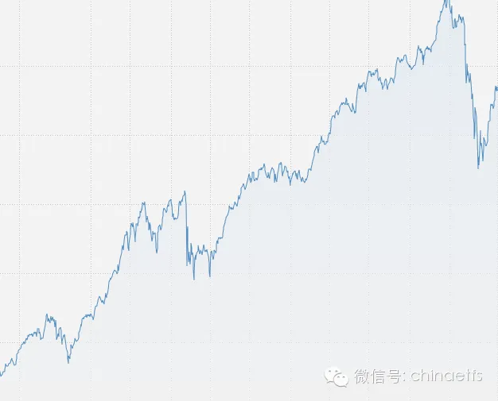

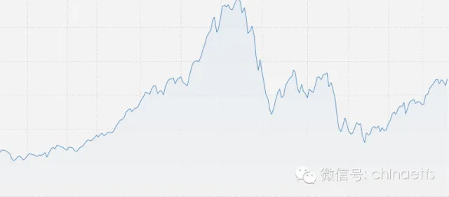

并没有那么容易看出来吧。

大家总感觉有股力量在下面托着，好像总也跌不下去。

是的，除了伟大zj的力量，更伟大的力量，是人性。一百年来，不管是任何民族的人类，都从未改变。

任何国家的股市在**高估值**的暴跌后，**都会有反弹**，反弹幅度基本上都到了跌幅的一半或以上。

答案揭晓：

历史上估值特别高的几次是：

1929年美国道琼斯及之后的走势：

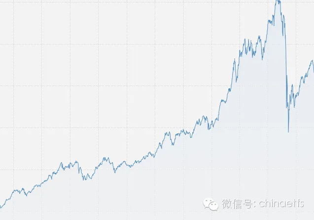

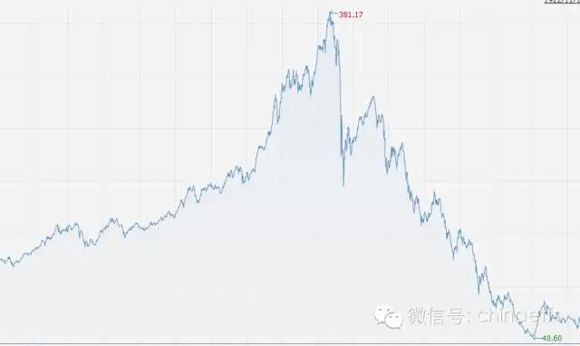

1990年日本，及之后的走势

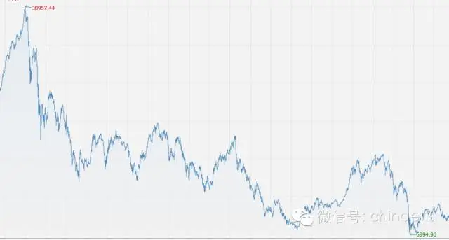

2000年纳斯达克：

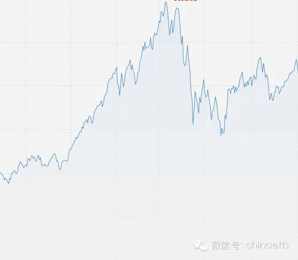

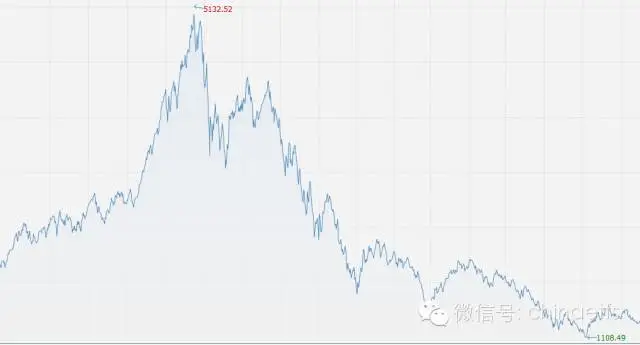

2007年上证指数：

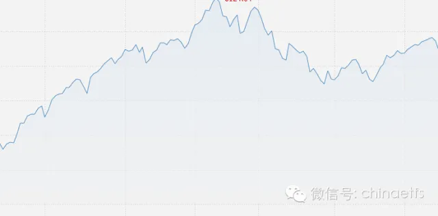

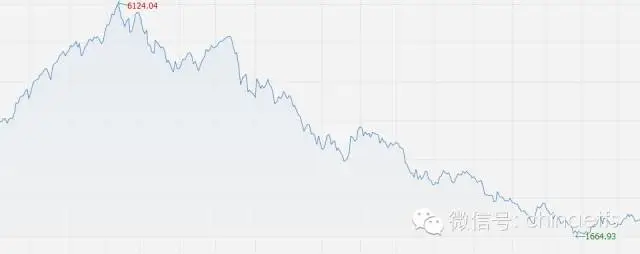

需要强调的是，历史绝对不会简单重复。我并没有说A股即将暴跌，高还会更高，低还会更低。人类没有预测时点的能力。

那么，未来会怎么走？

现在的深综指：

最后是台湾的。

台湾的情况比较有意思，也是牛市中政府出手结果暴跌，然后政府再出手继续暴涨，甚至超过之前的高点。当然，最后然并卵了。

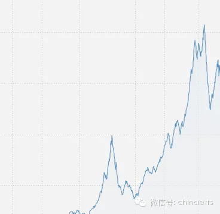

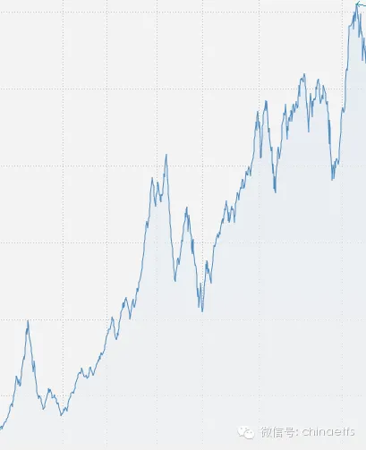

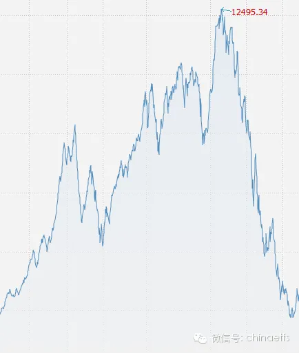

之所以选择了这几个时段，而没有选择比如1987美国暴跌后又开始上涨，正如本文一开始所强调，是在各国估值很高的时候，市场如何表现。1987年美国整体估值并不高。那么现在，A股估值高不高呢？

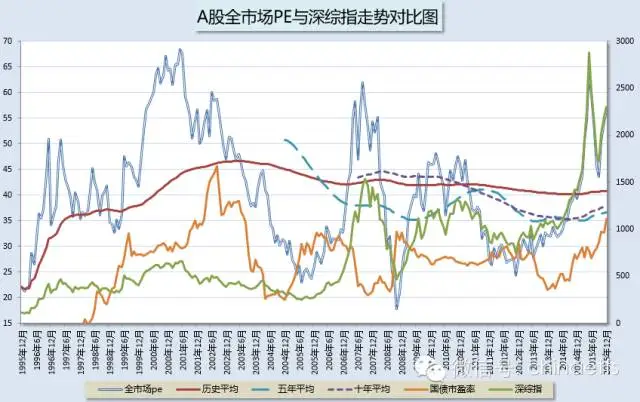

历史不会简单重复，但还有一句话叫做太阳底下没有新鲜事。愿大家2016赚大钱！
