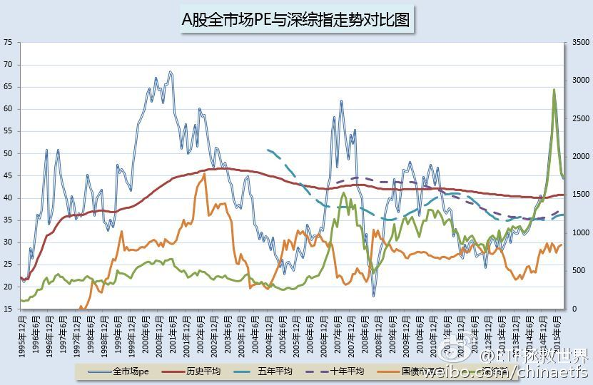
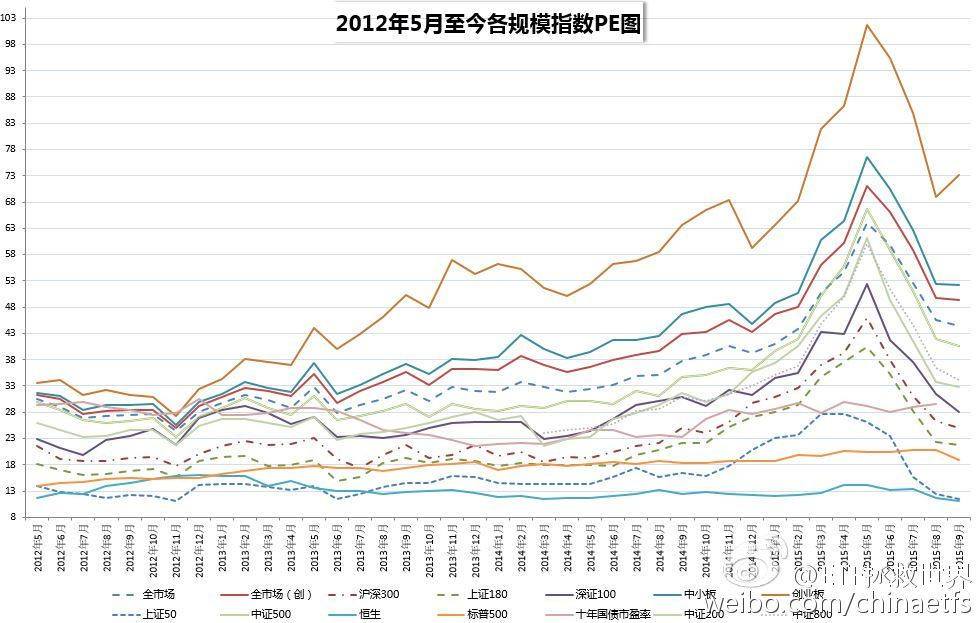
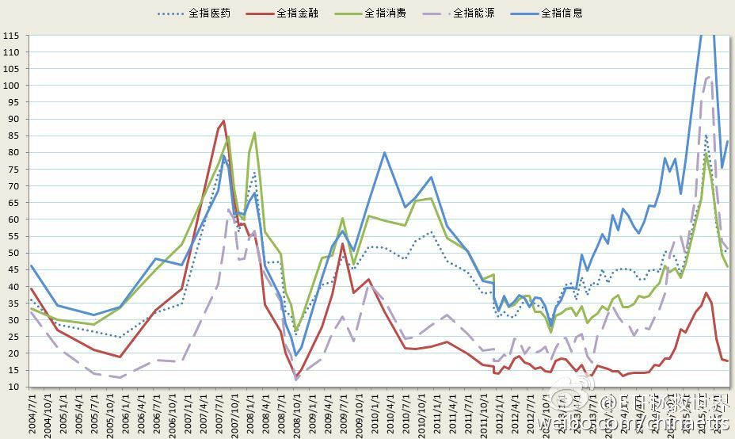
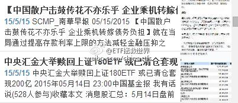
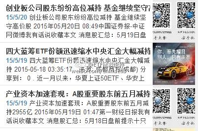
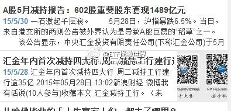
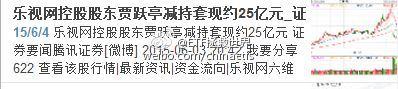
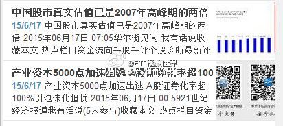

## 2015-09-28 17:21

新开微博，万象更新。也没什么送给大家的，送大家几张今天的估值图吧 ​​​
  

## 2015-09-29 10:26

持股的人不要总是嘲笑谩骂持币的投资者。

这样一个恒时高估的赌场，大部分时间持币有何过错？

在估值高企的时候，这些人卖出筹码，拿着现金，等着价值回归。他们在高位的卖出，没有伤害任何人。因为，真正的价值投资者，早在顶部出现之前已然离场了。

他们才是这个市场价值发现者和构成大底部的坚石。

总有一天，满目疮痍、人气涣散，成交量不到顶部5%——正可谓凄凄惨惨戚戚，谁还记得应是绿肥红瘦？

那时候，真正的做多大军日夜奔袭，千里勤王，救市场于崩塌，救万民于水火！

他们才是真正应该被歌颂和铭记的人。

（其实主要是试试长微博……）

## 2015-09-29 11:31

大概从10年前起，就开始有意识的收集市场极端情况下的新闻报道。

真的特别有意思。

最近几年，用的是印象笔记，也挺好用。

下面，把我收集的几条5、6月份的新闻报道给大家分享一下。

我们一起看看，当绝大多数人疯狂的时候，聪明的钱在干什么？

有意思吗？

以后有机会把历次市场底部的新闻也贴出来。更有意思！

现在的情况，我是没兴趣收集那些每天抄底的新闻的，意义不大。

## 2015-09-29 13:01

我去，居然有大户打赏了！早知道早就来微博了！这么多年少说少赚了100块……我会更加努力的。么么哒。  ​​​

## 2015-09-30 10:27

国家队连着两天猛拉券商制造人气，可惜还是不能带动整个市场的人气。“中国散户不行。” 操盘手在新盛大厦楼下的吸烟区忧郁的说。 ​​​

