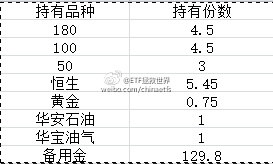
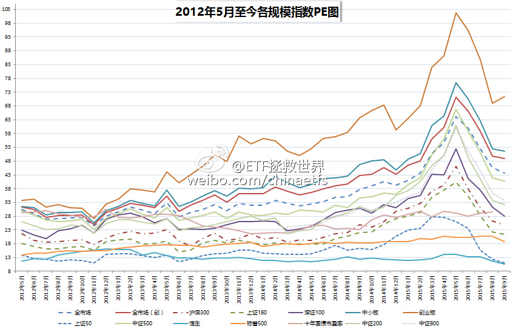
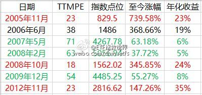

## 2015-10-01 08:55

展开这个话题前，让我们先来看看这个星球上最伟大的投资家对指数投资的看法：

被称为“股神”的巴菲特从不荐股，也从不预测市场走势，但是许多投资者都知道巴菲特唯一推荐过的投资品种就是指数基金。

在2008年5月3日伯克希尔股东大会上，名为Tim Ferriss的投资者问：“假设你只有三十来岁，没有什么经济来源，只能靠一份全日制工作谋生，但是你已经有笔储蓄，足够维持一年半的生活开支，那么你攒的第一个100万将会如何投资?”巴菲特回答：“我会把所有的钱都投资到一个低成本的跟踪标准普尔500指数的指数基金，除非我是在大牛市期间购买，否则我有信心获得强于市场的收益……然后继续努力工作。”

在2007年5月7日CNBC电视采访巴菲特时，他表示，个人投资者的最佳选择就是买入一只低成本的指数基金，并在一段时间里持续定期买入。如果你坚持长期持续定期买入指数基金，你可能不会买在最低点，但你同样也不会买在最高点。从长期来看，指数基金的收益率并不会输给主动型基金。

实际上，这可不是巴菲特推荐指数基金的全部。要知道，在巴菲特每年写的致股东的信中，从80年代起，他连续十几次推荐定投标普500指数。

好了，让我们回到国内，看看为什么说投资指数是你最佳的金融投资方式？

投资指数的优势：

**1、省心省力**
对于选股能力不强的朋友（90%的散户）来说，可以不用去学习枯燥的会计知识、跟踪瞬息万变的公司变化，只要大致看看历史估值，找个低位买入即可。

其实请朋友们认真的想一想，您炒股的比较优势是什么？您比那些深入研究、意志坚定、工具强大、信息全面的机构和个人投资者强在哪里？是信息有优势？是技术有优势？如果什么优势都没有，为什么您是10%赚钱的那个人？

**2、风险低**
投资股票的风险那可真是大了。其实A股已经是全世界最温柔的股市。退市如此艰难，再烂的公司随便卖个壳又股价一飞冲天！这也是为什么散户如此多的原因之一——只要拿着不卖，根本不会亏啊。如果每只股票都像分级B一样，分分钟一天杀掉你70%资产，你猜还有没有那么多散户？
然而，就算A股如此温柔，买公司依然风险很大。四川长虹97年响当当的大蓝筹，买入将近20年后终于在2015年这波史无前例的大牛市中解套了。管理层、行业系统、大股东、产品……任何一个方面出了问题，公司就歇菜了。

香港市场满地几毛钱仙股，美国每年退市的股票比上市的多，别以为这些情况A股以后不会出现啊，注册制啊。
指数没有这个问题。

**3、估值**
股票如何估值？PE？PB？ROIC？现金流折现？内含价值？
马化腾差点100万卖掉腾讯，结果因为没人买而作罢这种事我会乱说？小马哥都没法对自己的公司正确估值，一般人……
指数估值易如反掌，这个不多说了。看我们长赢的文章就能了解。

**4、牛市赚钱**
美国曾经做过研究，牛市里80%以上的主动基金干不过指数。这两年牛市跑赢中证500的有几位？多少散户买了股票就是不涨，终于下决心卖掉手里不涨的去追热点，结果卖掉的又变成了热点，刚买的跌成翔。买指数不会这样。大中小各规模指数一样来点，医药消费信息每种都不少。加起来一共六只。踏踏实实拿着赚钱。每个月看看估值，不贵就拿着，贵了就卖点。
简直就是躺着赚钱啊。
对，是有10倍股票，比指数涨的好。但有两点您注意，第一，那个十倍股票是您买的吗？去看看那些大牛股的股东人数，超过1万的都是多的！几千人里面有您吗？第二，您能拿10倍？50%就跑了吧……可能还说多了。

不知道大家有没有看过我之前写的“A股是个聚宝盆”。我用数据分析证明了一件事：只要你在A股连跌2年后的熊市买入一只指数基金，那么未来五年的年化收益至少有30%——是年化（每年）收益！

**5、交易成本**
指数基金投资没有印花税。

印花税您别老认为没多少。抽空把费用单子打出来看看，那可不是小数。总是传言降印花税，其实降不降关我们鸟事，我们从来不纳（印花）税……

至于手续费，现在有了某券商（拒绝做广告，瓜前李下避免误会。想知道的朋友自己百度）这样的业界良心，买ETF连5块钱门槛都没了，最低一毛钱手续费，100块买ETF随便玩，哪只股票可以？

那么，既然指数投资有这么多优点，为什么依然有那么多人在热衷炒股，然后七赔两平一赚？对于这个问题，睿智的老巴早有解释：

“因为他们觉得炒个股更有趣。总是有人让你买这买那，你希望能快速赚钱。试图赚快钱是最糟糕的错误。”

要我说，还有一个原因，就是大家讨论股票的时候，你说，我买了指数基金——这一刹那，所有人都认为你弱爆了：玩了这么多年投资，你居然还在买基金？

## 2015-10-06 20:30

2015年10月ETF计划：继续加码蓝筹与香港

写在前面，重要：

朋友们，开始浏览本月ETF计划前，请仔细阅读以下两点：

1、本计划绝非任何形式的投资建议或是投资指导。

在这里，仅仅是将本人十年前开始，一些朋友五年前开始进行的一个投资指数的计划公之于众，我们会在这里如实记录我们的投资历程。

如果这个计划能帮助您，我们会替您感到高兴，仅此而已。我们绝不会向您以各种形式收费、分成。如果您因为这个计划而亏损，我们也只能说一声很遗憾。也是仅此而已，我们不会承担任何责任。

2、请任何朋友开始参考这个计划前，要再三考虑自己是否能忍受甚至可能长达3-4年的熊市。

本计划虽然过去12年取得了超过10倍的盈利，但大家要知道，在12年中，真正让利润大幅增长的时间大概只有5-6年的三次大牛市。中国股市是个牛短熊长的市场。我们在超过7年的大熊市中慢慢买入，最终才取得了牛市利润的爆发。你一定要清楚，70%以上的人无法忍耐几年的熊市。所以，确认你自己能忍，再开始参考本计划。

大家久等了。本月ETF计划操作如下：

买入2份：

买入510050（50ETF）一份 （价格不超过2.15）

买入159920（恒生ETF）一份 （价格不超过1.04）

补入1份：

补入160416（华安石油）一份 （价格不超过0.78）

如果以上操作都能顺利完成，那么持仓状态应该是：

*上个月能收到估值邮件并已提前买入的朋友无需重复购买

由于国庆长假期间，欧美、香港股市趁我大A股休市毫无节操的涨了不少，所以开盘第一天有可能无法以上面的价格成交。但本月买入机会还是很大——就像上个月初给出的50ETF 2.1的价格当时看起来更远，结果还是有一个交易日可以买入，这里给出的买入价格是考虑各种因素而不是随便说说的。

本组合（ZH386069）2015年5月起及本月在雪球的模拟成绩为：

9月成绩略差于8月，相信10月会有更多的组合跑赢我们。毕竟A股连跌4个月，10月有个反弹的机会不小。但我们进行的是一次长跑比赛，某个100米让别人超过并不影响最后的成绩。

本月需要解释的环节比较多，一项一项看：

**1：“补入”概念**

2015年10月起，计划中除了买入、卖出两个操作，新加入一个补入概念。

补入是什么意思？

这个概念是针对2015年8月开始参考本人ETF计划的新朋友。

虽然之前的文章写得很清楚，2015年8月之前持仓的ETF完全不需要补入，但还是有很多很多朋友问能不能补。那么，从这个月开始，针对这些朋友，在合适的时候，我会给出补入建议。使新朋友最终持仓与之前的老朋友一致。

之前已经持有的朋友无需补入。

**2：查询之前的操作**

从2015年8月起，停止买入15个月的ETF计划重新起航。如果您没看过之前的操作文章，非常简单，在公众号输入如“1508”，即可查询2015年8月的操作记录文章。其它月份以此类推。

可查询月份从2015年8月开始，所有8月之后的操作，只要标的价格低于当时的买入价格，新朋友都可以补入。

总结：2015年8月之前的持仓，我会在以后给出明确的补入价格。2015年8月之后的，只要价格不高于当月价格，都可以自己补入。

最后，说说本月的买入逻辑。

先说50和恒生：

无图无真相，先上图：

这张图只画出了2012年5月至今的情况，在这里向大家报告一下过去十年上证50及恒生指数的情况：

过去十年中，恒生指数只有9个月估值低于上个月末；

过去十年中，上证50只有1个月估值低于上个月末。

也就是说，从历史估值的角度来看，这两个指数的估值，不考虑某些金融行业的周期性问题，几乎已经是历史最低。尤其是上证50指数，已经可以说是历史最低。在这种估值下，继续买入一份是比较安全的。

当然，有朋友问，这么低的估值，为什么只买一份？

原因有两个：

第一，全市场估值依然高企。大量中小股票的估值在大盘连跌4个月后依然过高，全市场估值依然高于历史平均10%，高于5年、10年平均20%，风险不小。我们的ETF计划首先看的是全市场，在全市场高企的情况下，不会大量买入ETF。

第二，这两个指数的低估，基本是因为金融行业的银行、券商、保险将估值拉低。遵循谨慎原则，对于高杠杆、周期性的金融行业始终应保持一种更加保守的投资态度。我们继续买低估值，但不在这个时候大量买。

再说华安石油：

选择石油QDII的逻辑非常简单：

首先，国际原油价格已跌至过去十年的低位水平，华安石油虽然与原油价格并不紧密相关，但具备一定的一致性；

其次，华安石油持仓的重仓股为埃克森美孚、雪佛龙、道达尔、荷兰皇家壳牌等世界上实力最雄厚的石油公司股票。即使发生最极端的情况，相信安全性也有一定的保障。同时，从美股过去几十年历史来看，石油行业股票收益率仅次于医药与消费，同时今年普遍跌幅较大，是不错的买入机会。

第三，人民币贬值预期尚在。配置QDII产品可以部分对冲人民币贬值风险。

再次强调，本操作为本人实盘记录，放在微信给大家做个参考。

投资有风险，请各位谨慎投资。

## 2015-10-20 14:25

其实死等深度价值也是不理智的。在不贵的时候，控制仓位慢慢买是个不错的选择。 //@佐罗投资札记:回复@若愚之人74:这就是多数人亏钱的根本原因，没有耐心等待，急于赚快钱！ //@若愚之人74:等到头发都快白了也没见到深度价值出现，反而越涨越高，心也越来越不淡定了。

> @厚恩投资张延昆
> 【#投资历史#】价值投资的核心就是买便宜货1.如果昂贵，即便是未来成长，当前价格也可能透支厉害。2.未来成长速度不同，当前价格是贵还是贱，就千差万别。因此，须以保守态度来定性分析企业，不给成长以过多估值加分，严守格雷厄姆安全边际教诲，这是普通投资人最好护城河：价值为本，定性成长随缘。 ​​​

## 2015-10-23 12:08

吃着火锅，谈笑风生，把钱赚了。  ​​​

道理懂了，你也能从容面对股市涨跌：谈笑风生，然后把钱赚了

昨天，在雪球发了一篇文章，简单算了一下过去十年中证500的年化收益率到了23%。

这个真是震撼。

然而，要知道2005年可是1000点，那是一个极度低估的时代。以那个时代为开始，并不全面。

好了，热爱思考的我再次发扬了勇于钻研的精神——今天，我们来看看，估值对于投资同一个指数，到底有多大的作用？

估值，到底是不是决定我们长期收益的基础？

这里，波段高手不要喷，我知道你们可以不顾估值低买高卖，这篇只是说，对于长期投资一个指数来说，起点非常重要，阅读群体不是你们，谢谢……

下面，正式开始数据分析

我们选择中证500从2005年10月开始的PE数据，从中分别选出最高、最低的各三个月末，以及一个十年平均的月末，看看从这估值不同的七个月到现在，收益率会有什么样的不同。

PS:如果最高或者最低为相近月份，则只选一个。比如2008.10与2008.11，选2008.10

中证500过去十年PE最低的三个月是：

2008.10（18）、2012.11（23）、2005.11（23）

中证500过去十年PE最高的三个月是：

2007.05（71）、2015.05（66）（该数据不选取）、2008.02（63）、2009.12（54）

中证500过去十年平均PE为38，

则我们选择过去120个月第一个PE为38的月份：2006.06

朋友们，最终结果是：

有没有感到极度震撼？？？？

同一个指数，只是因为你买的时候估值不同，就会让你的收益产生天壤之别！

只要你买的够低，不论你是持有10年还是3年，你的年化收益率至少在20%以上，甚至会达到35%，而这波牛市的最高点甚至会有60%！每年年化！

但是，悲哀的是，朋友们，如果你买的太高，那么，长期来看，你的收益率甚至比不上债券。看看上面绿色的部分，我，不忍心详细说了，自己看吧……

投资看估值有没有用？

你说有没有用？这张表不想过多分析，正常智商都能看得明明白白。

为什么我们那么有耐心的等待低估的出现？为什么我们在高估的时候闲庭信步谈笑风生不抢反弹？

因为，我们不想去澳门或者买六合彩发财。

那么，有朋友问了，现在中证500的PE是多少？

现在的中证500PE在45左右。这个估值，比十年平均高了17%。我们认为，这个点位买入，恐怕要等若干年才能赚钱。

所以我们的选择是，继续等待。

我们现在不买，不是不想赚钱——其实我们更贪，我们在等待那个真正合理的价格买入，然后，等待再次飞跃。

随手转发，造福亲友。让他们知道，在中国股市赚钱，只要有耐心，真的很简单！

## 2015-10-30 08:53

多陪陪孩子

不管生一个也好，两个也好，真心希望父母们把孩子们生下来就好好养。尽量多陪陪孩子，尽量多教孩子一些仁义理智信的做人道理，不要就是把孩子送到钢琴英语奥数各种班然后出去拼命赚钱或者花天酒地……人口素质上不去，人越多越是灾难。

从经济上来说，人越多经济越好是个奇怪的说法。关键是劳动生产率。我们的劳动生产率只有美国的1/12，日本的1/11。也就是说，从全社会的角度来讲，我们12个人做的工作相当于美国一个人。如果还用廉价的人海战术，甘做全世界的低端流水线，这也是一种悲哀。提高劳动生产率，提高我们的人均收入，人口少一点，每个人生活的会更好。

现在的中国，基本上是越有钱的地方，生孩子越少。北京上海的适龄女性生育率只有0.7多。最让人担心的，是有能力提供良好教育的家庭生的少，没有这个能力的家庭反倒越生越多。

